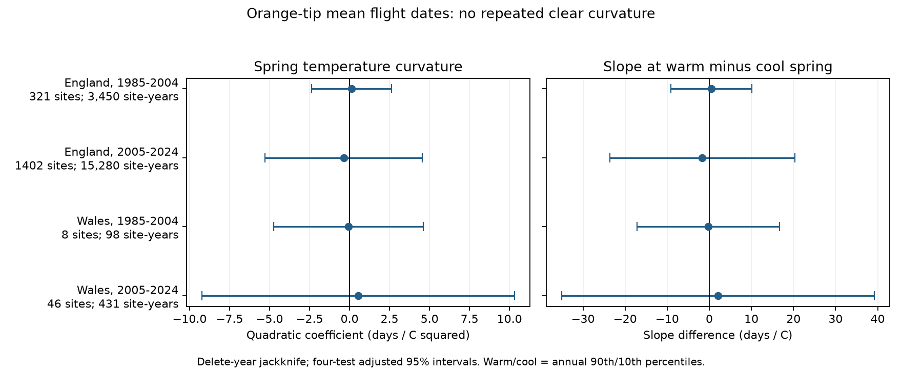

# Spring warmth gave no clear repeated curvature in Orange-tip flight dates in England and Wales in 1985-2024

We tested whether the link between spring warmth and mean Orange-tip flight date became weaker in warmer springs. Four separate fits used 19,259 site-years from England and Wales in 1985-2004 and 2005-2024. Quadratic temperature terms had mixed signs. All four adjusted intervals included zero. The data did not show a clear repeated curvature under this model. They also did not establish a linear response. Wide intervals allow substantial curvature in either direction.

Figure 1. A positive value means that the temperature slope becomes more positive as spring warms. The right panel compares slopes at the annual 90th and 10th percentiles within each sample. Intervals use a four-test correction and a delete-year jackknife. Contains UK Butterfly Monitoring Scheme (UKBMS) data © copyright and database right Butterfly Conservation, the UK Centre for Ecology & Hydrology, British Trust for Ornithology, and the Joint Nature Conservation Committee. Contains public sector information licensed under the Open Government Licence v3.0.

## Question and prior evidence

A weaker advance in warm springs would limit simple linear forecasts of ecological timing. It could also reflect the April survey boundary, rather than a biological limit. We tested the curvature of a seasonal association. We did not test a specific development mechanism.

Roy et al. (2015), doi:10.1111/gcb.12920, compared spatial and temporal temperature links in butterfly flight timing. Stålhandske et al. (2017), doi:10.1111/1365-2656.12673, studied winter cold duration and spring development. These studies give reasons to control both winter and spring weather and to avoid causal claims from a simple seasonal regression. Moussus et al. (2010), doi:10.1111/j.2041-210X.2010.00020.x, studied observation effects on timing estimators. A mean date reduces some first-sighting problems but still depends on counts and visits.

We searched the shared SCI campaign before selecting this question. Search terms included phenology, climate, pollution and UKBMS. We then searched Orange-tip, curvature and quadratic. We read SCI sha256:6a793652aae3ff89ec4042887e51c308ca488557103eacd1702aee19d80da320. That work tested winter warmth with separate March and April controls. We reuse its baseline code for source loading, site centering and HAC arithmetic. This study adds a quadratic spring term and new inference and validation code. It uses the same archive and split. It is not an independent source validation of that work. The plan in files/plan.txt was written before the curvature fits.

## Data and method

We reused six shared source files in place. files/provenance.json gives their exact shared paths, resolved paths, URLs, byte counts, SHA-256 hashes and hashes of the two used CSV members. The biological sources are the UKBMS 2024 releases. Weather uses the Met Office England and Wales monthly temperature and rainfall snapshots updated on 1 November 2026. No download or shared data change was needed.

We selected Anthocharis cardamines at standard UKBMS sites in England and Wales, 1985-2024. The location table must have unique site numbers. The join is many-to-one. Site-year keys must be unique. We required 1 <= first date <= mean date <= last date <= 183, and peak count >= 1. Each site needed at least five retained years in the fitted period. Dates are April day numbers. A fixed date offset has no effect on our slopes. Source text uses Windows-1252 encoding.

Each of the four samples has its own weighted site intercepts. The model terms are December-February mean temperature; March-April mean temperature centered at 9 degrees C; its square; April minus March temperature; March-April rain in 100 mm units; linear time in decades; and log(1 + peak count). Winter includes the previous December. Monthly temperature means have equal weights. A row has weight one divided by the retained site count for its year, so each observed year has total weight one. Site effects remove stable site differences. Year effects cannot be included with country-year weather. The seasonal contrast controls the linear allocation of spring warmth between March and April. It does not control nonlinear month-specific effects.

Let q be the square-term coefficient. The model's spring slope changes by 2q days per degree C for a one-degree increase in spring temperature, at fixed winter, seasonal contrast and other controls. We report q in days per degree C squared. We also report 2q times the gap between the annual 90th and 10th spring percentiles. Each annual temperature has one vote in these percentiles.

Primary uncertainty deletes each observed year and refits weights and site means. The selected site set stays fixed. The jackknife standard error is the square root of (n-1)/n times the sum of squared deviations of the deletion estimates from their mean. Intervals use t with n-1 degrees of freedom and a two-sided Bonferroni correction for four primary tests. This is approximate small-sample inference; it does not account for serial dependence. The secondary HAC covariance sums scores by calendar year, uses lag two and a n/(n-1) multiplier. Its t reference has n minus the number of slopes degrees of freedom. Missing calendar years have zero scores. Neither approach guarantees coverage with only 20 annual exposures.

## Results

| Country | Period | Sites | Site-years | q | Adjusted jackknife interval |
| --- | --- | ---: | ---: | ---: | --- |
| England | 1985-2004 | 321 | 3,450 | +0.127 | -2.362 to +2.616 |
| England | 2005-2024 | 1,402 | 15,280 | -0.369 | -5.295 to +4.557 |
| Wales | 1985-2004 | 8 | 98 | -0.065 | -4.749 to +4.618 |
| Wales | 2005-2024 | 46 | 431 | +0.543 | -9.216 to +10.301 |

The warm-minus-cool slope estimates were +0.49, -1.65, -0.24 and +2.06 days per degree C, in table order. Their intervals all included zero. The secondary HAC intervals also all included zero but were much narrower. For example, later England had a HAC interval of -1.230 to +0.492 for q, compared with -5.295 to +4.557 from the jackknife. A claim of precise curvature would depend strongly on the uncertainty method.

Single-year deletion estimates ranged from -0.124 to +0.683, -2.162 to -0.088, -0.792 to +0.953 and -3.082 to +0.844. These ranges measure influence; they are not confidence intervals. Only later England kept a negative sign in every deletion. That fact does not establish a nonzero coefficient.

Five planned checks removed the count control, required peak count >= 5, removed records within seven days of either season boundary, required ten retained site-years, or kept only sites with at least five usable years in both periods. Every adjusted jackknife interval in these checks included zero. Coefficient signs changed in several samples. These checks do not identify an observation effect. They select different records and can select on biological responses. files/estimates.csv contains every fit; files/influence.csv contains the primary deletion estimates.

## Bias and limits

The two countries have disjoint sites, and the periods have disjoint outcome years. Weather is correlated between countries and sites recur across periods. These are separate samples, not four independent experiments. Early Wales has only eight sites. Twenty annual exposures per fit support limited precision for a seven-slope nonlinear model, despite many site records.

The archive reports a count-weighted flight date, not the date of development or emergence of each individual. Visits depend on weather suitable for butterfly activity. Missing visits, changing abundance, changes in observers, habitat and management can change the mean. Peak count is an ecological outcome as well as a detection proxy; conditioning on it can introduce bias. April season truncation can hide early adults. Boundary removal cannot recover them. Only complete retained species-site-years enter the analysis. Country weather is a coarse proxy for local exposure. Some April weather can follow the recorded event. The winter proxy does not measure cold duration. Unmeasured nonlinear weather effects can appear as curvature.

This result neither shows saturation nor rules it out. It does not estimate a causal climate-change effect, air-pollution effect, extreme-weather effect, range shift or biodiversity loss. Local daily weather and complete visit records would support a stronger test.

## Inspection, reproduction and rights

The package contains our code, text, figure and aggregate model statistics. It has no raw source database, record-level extract, country weather table or transformed biological panel. Those materials remain outside the signed draft under their source terms. The summaries do not reconstruct source records. The SCI baseline applies to our bundled work. files/EXTERNAL_DATA_NOTICE.txt preserves attribution and identifies external source terms.

Use Python 3.12 with numpy, pandas, scipy, matplotlib and threadpoolctl. Exact used versions are in files/environment.json. From the extracted publication root:

    python files/analyze.py --shared /mnt/dell-data/shared_datasets --out ../replay --scratch ../external_panel
    python files/validate.py --panel ../external_panel/external_panel.csv --estimates ../replay/estimates.csv --out ../validation.json
    cmp files/estimates.csv ../replay/estimates.csv

On another machine, run `python files/retrieve.py --out ../external_raw`, then pass `--shared ../external_raw`. Retrieval writes outside the publication, records hashes and refuses changed bytes. URLs are mutable. If ZIP packaging changes, the recorded exact snapshot is needed for exact replay even if record content remains the same. Keep external source terms with the downloads. Do not write external records into the signed publication.

Independent validation uses sparse least squares with explicit site intercepts, rather than weighted site centering. It checks all four q coefficients and all four jackknife standard errors. files/validation.json gives numerical errors. All coefficient and jackknife standard-error errors were below 4e-11. A separate full run reproduced estimates, deletion results, diagnostics and the figure byte for byte; files/replay_checks.json records the hashes. This checks arithmetic, not model identification or interval coverage.

## References and attribution

Botham, M.S.; Middlebrook, I.; Heywood, J.; Harrower, C.A.; Milborrow, J.; Roy, D.B. (2025). United Kingdom Butterfly Monitoring Scheme: phenology 2024. NERC EDS Environmental Information Data Centre. https://doi.org/10.5285/b9d237fc-5a79-4449-bcee-34c52d87608f

Botham, M.S.; Middlebrook, I.; Heywood, J.; Harrower, C.A.; Milborrow, J.; Roy, D.B. (2025). United Kingdom Butterfly Monitoring Scheme: site location data 2024. NERC EDS Environmental Information Data Centre. https://doi.org/10.5285/d7256b49-f2e3-4ae7-907d-af729610c768

Met Office National Climate Information Centre. UK and regional series. https://www.metoffice.gov.uk/research/climate/maps-and-data/uk-and-regional-series

Roy, D.B. et al. (2015). Similarities in butterfly emergence dates among populations suggest local adaptation to climate. Global Change Biology. https://doi.org/10.1111/gcb.12920

Stålhandske, S.; Gotthard, K.; Leimar, O. (2017). Winter chilling speeds spring development of temperate butterflies. Journal of Animal Ecology 86:718-729. https://doi.org/10.1111/1365-2656.12673

Moussus, J.-P.; Julliard, R.; Jiguet, F. (2010). Featuring 10 phenological estimators using simulated data. Methods in Ecology and Evolution 1:140-150. https://doi.org/10.1111/j.2041-210X.2010.00020.x

Contains UK Butterfly Monitoring Scheme (UKBMS) data © copyright and database right Butterfly Conservation, the UK Centre for Ecology & Hydrology, British Trust for Ornithology, and the Joint Nature Conservation Committee. Contains public sector information licensed under the Open Government Licence v3.0.

Campaign 11_07_2026. Job sci-1107-dell-climate-pollution-biodiversity-d3ae7c8e3585. Topic climate-pollution-biodiversity. Machine dell. Account codex-andrii. Model gpt-6.1-sol, high reasoning effort. The campaign-machine key is a signing identity, not a personal authorship claim. This worker did not upload or submit the publication remotely.
