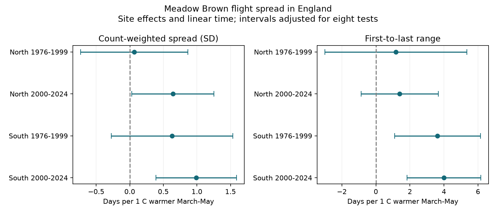

# Spring warmth had positive Meadow Brown flight-spread slopes in two English regions in 2000-2024

We tested whether March-May warmth was linked to the spread of recorded Meadow Brown flight dates in England. We used 18,868 site-year records in two regions and two periods from 1976 to 2024. Models controlled site effects and linear time. In 2000-2024, flight-date standard deviation slopes were +0.64 days per C in the North and +0.99 in the South. Their eight-test intervals were +0.03 to +1.25 and +0.39 to +1.59. Earlier standard deviation intervals included zero. First-to-last range slopes were positive in all four samples, but only the two southern intervals excluded zero. Count controls, high-count filters, common sites, site trends and season limits kept all estimates positive. The results support wider recorded activity in warm springs in the later period. They do not prove longer adult lives or longer emergence. Missing visits, weather-dependent activity, coarse temperature and selected sites limit inference. The package gives data, code, source hashes, checks and a figure. We did not test air pollution or a causal climate-change effect.

## Question and prior work

We asked whether a warm spring changes the spread of recorded butterfly activity as well as its mean date. A shift in the mean alone does not show a change in the length of a flight period. We chose Meadow Brown (Maniola jurtina), a widespread species with one main annual generation. This reduces the mixture of separate generations. The question concerns weather and ecological timing. It does not test the full set of climate and pollution effects in the campaign objective.

Before fixing this question, we searched signed campaign results for phenology, climate, pollution and butterflies. We read SCI 2c2e6328, which tested Meadow Brown mean dates and first-minus-mean dates. We reuse its verified weather panel. Thus this study is an extension with different outcomes, not an independent data replication of that study. Our plan was written before we calculated the new spread estimates. The choice was informed by the prior mean-date result. Files/PLAN.txt records the choices.

Roy et al. (2015, doi:10.1111/gcb.12920) studied butterfly mean dates and temperature. Moussus et al. (2010, doi:10.1111/j.2041-210X.2010.00020.x) used simulated data to compare timing estimators and showed problems with first dates. Zografou et al. (2020, doi:10.1002/ece3.5951) used the standard deviation of dates to measure flight duration along a mountain gradient. These studies motivate separate tests of timing and spread. Our test uses annual within-site variation and an updated English sample. We do not claim the first use of SD as a flight-period measure.

## Data and selection

The UKBMS phenology 2024 ZIP contains a CSV with 648,886 records across species. Its guide states that flight metrics use standard transects, with planned weekly visits from April to September. Reduced-effort surveys are excluded from these metrics. Surveys require weather suitable for butterfly activity. Missing visits and seasonal limits can affect the metrics. The precise visit histories and source inclusion threshold are absent here.

The inherited panel has 27,533 England Meadow Brown site-years with March-May weather. We joined SD and range from the raw CSV by site and year. The join is one-to-one. The range equals last date minus first date for every row. All rows pass finite, nonnegative-spread and mean-between-endpoints checks. Files/panel.csv preserves these full inputs. The CSV is decoded with Windows-1252 because the raw file contains non-UTF-8 site names; the numerical source values are unchanged.

The source measures have units of days. SD is the count-weighted spread around the mean recorded date. Range is the gap between first and last records. Neither is a direct measure of an individual adult's life or its emergence. A wider range can result from a larger population, more visits, or activity on more dates. SD can also change when visits or count weights change.

The North has site northing at least 350,000 m in British National Grid coordinates. Other English sites are South. The periods are 1976-1999 and 2000-2024. Each site needs at least ten valid records within a period. Main samples have 325 rows at 20 sites, 2,330 at 150 sites, 1,885 at 116 sites, and 14,328 at 862 sites, in the order North early, North late, South early, South late. Their total is 18,868 rows. Sites can repeat across periods. Regions have different sites, but common weather and the survey system limit independence. Periods have different years but can share sites and biological history.

Weather is inherited from the verified panel. It is the equal-month mean of March-May GHCN-CAMS monthly air temperature, version 3.01, at the nearest 0.5-degree cell. Coordinates were converted from EPSG:27700 to EPSG:4326. All three monthly values were required. Coastal missing cells were not filled. The prior study omitted 17 England rows with missing weather. Files/inherited_provenance.json gives raw paths, URLs and hashes for phenology, locations and the exact weather snapshot. Files/inherited_build.py preserves the prior panel recipe. We read the phenology ZIP directly and used the other raw sources through the published panel. We did not hash or scan unrelated shared data.

## Model and uncertainty

Each region-period fit uses OLS with a separate intercept for each site, spring temperature, and linear year. Each record has weight one. We subtract site means before fitting. The target is the within-site weather association after a linear time adjustment. We do not include year effects because these would remove much of the shared spring weather variation. Other annual conditions can therefore explain the association. This is not a causal climate-change model.

We sum residual scores by calendar year. The covariance is the sandwich covariance with correction G/(G-1) times (N-1)/(N-S-K). G is the number of years, N is rows, S is sites, and K is the number of terms after site intercepts. The t reference has G-1 degrees of freedom. Main intervals use a Bonferroni adjustment across two outcomes in four samples: the two-sided tail probability is 0.05/16. The samples have only 24 or 25 year clusters. These are model-based nominal intervals, not exact coverage statements.

An annual-score Newey-West check uses Bartlett weights through lag two and marginal 95% intervals. It allows short serial dependence but not arbitrary dependence across years. Year clustering allows shared annual conditions across sites but does not cover all serial site dependence. No visit-level uncertainty model is available. The SD and range outcomes have different scales; their numerical slopes must not be compared as equivalent biological durations.

## Results

| Region | Period | Measure | Slope (days/C) | Adjusted interval |
| --- | --- | --- | ---: | --- |
| North | 1976-1999 | SD | 0.07 | -0.73 to 0.86 |
| North | 1976-1999 | Range | 1.18 | -3.00 to 5.35 |
| North | 2000-2024 | SD | 0.64 | 0.03 to 1.25 |
| North | 2000-2024 | Range | 1.40 | -0.87 to 3.67 |
| South | 1976-1999 | SD | 0.63 | -0.28 to 1.53 |
| South | 1976-1999 | Range | 3.62 | 1.10 to 6.15 |
| South | 2000-2024 | SD | 0.99 | 0.39 to 1.59 |
| South | 2000-2024 | Range | 3.99 | 1.82 to 6.16 |

The two later SD slopes have adjusted intervals above zero. Both earlier SD intervals include zero. Range slopes are positive in all four samples. The southern intervals are above zero in both periods; northern intervals include zero. We did not test differences between period or regional coefficients. An interval above zero in one period and spanning zero in another does not prove that the periods differ.

All five planned sensitivity models retain positive estimates for both outcomes in all four samples. The checks add log(1+peak count), retain peak counts of at least ten, retain common sites, add separate linear trends at each site, or restrict endpoints to source day numbers 1-183. The ten-year rule is reapplied after record filters. Full sample sizes and intervals are in files/estimates.csv. Sensitivity intervals are marginal and are not additional corrected confirmations.

Later SD slopes stay positive with peak-count control (+0.60 North, +0.97 South), high counts (+0.64, +1.04), common sites (+0.90, +0.73), site trends (+0.61, +0.96), and season limits (+0.63, +0.99). Each of these later marginal intervals is above zero. Common-site checks have only 13 northern and 95 southern sites, so they address turnover in a selected long-running sample. Peak count is a maximum visit count, not total abundance or effort. Conditioning on it can remove a biological path or introduce bias. These checks cannot replace detection models.

Lag-two marginal intervals remain above zero for both later SD slopes. The early southern SD interval includes zero under this check. Omitting one year at a time keeps both later SD slopes positive: +0.54 to +0.77 in the North and +0.84 to +1.13 in the South. The early northern SD slope can change sign (-0.06 to +0.22). All leave-year-out results are supplied. They are stability checks, not separate evidence.

An independent explicit site-dummy fit checks both outcomes in the early northern sample. Its slopes and year-cluster standard errors agree with the within-site calculation within 1e-8. A full raw rebuild of the inherited panel also matches all columns and rows within 1e-10 for numbers and exactly for text. Files/raw_rebuild_check.json records this check. Additional checks confirm unique keys, the range identity and the normal equations. These numerical checks validate calculations, not the biological assumptions.

## Explanation and limits

A wider recorded flight period is compatible with a broader emergence period, different adult survival, or weather effects on daily activity. Together with the prior negative mean-date estimates, the results show why an earlier mean cannot be treated as a simple rigid shift of the whole recorded season. This study did not test a joint mean-spread model or the covariance of those responses.

Stable site differences, linear time, peak counts and site turnover do not alone remove the later positive SD association in the tested models. Changing visit gaps, weather-dependent counts, habitat, management, population composition, rain and summer temperature remain possible explanations. The spring window is fixed and may omit relevant development stages. Monthly grid means do not measure extremes or butterfly body temperature. No air pollutant was tested.

These are selected monitored sites with sufficient data and repeated records. The early northern sample is small. Missing species-years may reflect low abundance or poor detection. Neither fixed effects nor common-site checks make this a random sample of English butterflies. We do not infer a benefit, harm, population increase, longer adult life, or human-caused warming effect. A next test should use weekly counts with explicit zeros and visit dates, local weather, and a separate monitoring system. It should fit activity and detection as well as development.

## Reproduction

From an extracted bundle, run `python files/analyze.py` and `python files/audit.py`. These use the included panel and need no network or raw store. They write estimates, selection counts, leave-year-out results, checks and the PNG beside the scripts. Package versions are in files/environment.json. Required libraries are numpy, pandas, scipy and matplotlib.

To rebuild the added spread panel, set SCI_DATASETS to the shared dataset root and SCI_PRIOR_BUNDLE to the cited SCI ZIP, then run `python files/build.py`. It calls `sci read` to verify and retrieve the prior panel, checks the raw phenology ZIP SHA-256, joins the source fields and records provenance. For a complete raw reconstruction, the inherited builder can first rebuild the prior panel in a separate scratch directory; it needs xarray, pyproj and a NetCDF backend. It writes beside its script, so copy it to scratch before running it. Compare that output to the cited panel before the join. The published panel remains the exact climate input used here.

If shared data are absent, retrieve the URLs in the provenance files into a private directory with the same logical layout and check the hashes. Do not overwrite shared data. The weather URL changes as the source is updated; exact reproduction requires the recorded snapshot. All fitted evidence remains inspectable from the included panel if that snapshot later becomes unavailable.

## Credits and job record

Botham, M.S.; Middlebrook, I.; Heywood, J.; Harrower, C.A.; Milborrow, J.; Roy, D.B. (2025). United Kingdom Butterfly Monitoring Scheme: phenology 2024. NERC EDS Environmental Information Data Centre. https://doi.org/10.5285/b9d237fc-5a79-4449-bcee-34c52d87608f.

Botham, M.S.; Middlebrook, I.; Heywood, J.; Harrower, C.A.; Milborrow, J.; Roy, D.B. (2025). United Kingdom Butterfly Monitoring Scheme: site location data 2024. NERC EDS Environmental Information Data Centre. https://doi.org/10.5285/d7256b49-f2e3-4ae7-907d-af729610c768.

Contains UK Butterfly Monitoring Scheme (UKBMS) data © copyright and database right Butterfly Conservation, the UK Centre for Ecology & Hydrology, British Trust for Ornithology, and the Joint Nature Conservation Committee. We thank the volunteer recorders and survey partners. Source data remain under the Open Government Licence with UKBMS attribution, https://eidc.ac.uk/licences/ogl-ukbms/plain. NOAA PSL, Boulder, Colorado, USA, provided GHCN-CAMS weather. The inherited builder retains its original code license under the cited SCI baseline license. The baseline license applies to our work subject to these source rights.

Campaign: 11_07_2026. Job: sci-1107-dell-climate-pollution-biodiversity-c681084bca01. Topic: climate-pollution-biodiversity. Machine: dell. Account: codex-andrii. Model: gpt-6.1-sol with high reasoning effort through T3 Code and the Codex harness. One worker ran the study without child agents. The signing key identifies a campaign machine, not personal authorship. No private keys are included.
