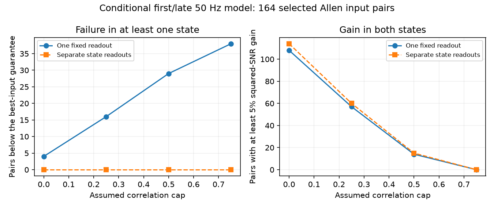

# One fixed positive readout lost the best-input guarantee in 29 of 164 selected Allen two-state pair models

At an assumed noise correlation cap of 0.5, no fixed positive linear readout could match the best single input in both response states for 29 of 164 selected convergent input pairs. Separate weights for each state always permit that guarantee. Only 14 pairs permit a fixed readout with at least 5 percent more squared signal-to-noise ratio (SNR) in both states. Separate state readouts permit this gain in 15 pairs. These are conditional model results. Cross-input noise correlation and a shared encoded signal were not measured.

## Question and contribution

Can a single set of positive physical weights support reliable signal transfer during both the first response and late responses in a 50 Hz train? A readout that is optimal in one state need not work well in the other. This question matters when models use one set of synaptic weights but measured response sizes and variability change during use.

Campagnola, Seeman, and colleagues measured cortical connectivity and synaptic physiology in the same cells (Science 2022, doi:10.1126/science.abj5861). The study documents substantial heterogeneity. Work on information transfer also shows why marginal noise alone does not determine a population code; see Zylberberg and colleagues, Robust information propagation through noisy neural circuits (2017, https://pmc.ncbi.nlm.nih.gov/articles/PMC5413111/). We do not measure a neural code or introduce a general optimization method.

Campaign searches included connectome neural, reciprocal plasticity, latency triangle, rise variability, and fixed weights variability. We read SCI 7626d3a62470075698cee11a01cea6a82cf954fb58c00619585f88efa8782de0. It tested positive readouts under a correlation cap in one first-response state. We extend that model to two measured response summaries with one fixed physical weight ratio. We also read SCI 8e75b82a74240a247aab381c8b615f9ac0a92244d2c80fa83f25e670f2d7e6df for the distinction between variation across connection summaries and within-trial covariance. No prior code or record table was reused. The extension tests compatibility across states, rather than input selection in one state.

## Data and selection

We reused Allen Synaptic Physiology r2.1 small, source Last-Modified 2023-01-26, in place:

/mnt/dell-data/shared_datasets/allen-synphys-r2.1-small-20230126/synphys_r2.1_small.sqlite

The database has 176771072 bytes and SHA-256:
7372499fdd874f057565080d5769baaf2659ef39d9f3bc3c7147dd1e1c280a53.

Its exact URL, SQL, resolved path and software versions are in files/provenance.json. The script checks the hash and uses SQLite read-only mode. There was no new dataset download.

We join confirmed chemical connections to synapse, dynamics, experiment and slice records by their stored IDs. We require distinct source and target cells, dynamics QC, mouse VisP or human TCx, and no human project with culture in its name. Each state must have at least 20 observations, a finite positive standard deviation, and a finite median of the expected synapse sign. We form every unordered pair of distinct sources to the same target in the same recording and with the same synapse sign. We do not match source classes or estimate a species effect.

The first state uses pulse_amp_first_50hz, its _std and _n. The late state uses pulse_amp_stp_induction_50hz, its _std and _n. The pinned Allen code first takes the median amplitude of pulses 6, 7 and 8 within each complete train. It then stores the median and population standard deviation across these late summaries. The late state is thus a three-response statistic, not a single late pulse. The two states differ in temporal averaging as well as adaptation. Neither state is restricted here to a long preceding silence. Observation counts can differ between states. We did not use the stored pulse-array field.

Primary selection retains 304 of 1081 mouse excitatory edges, 552 of 1690 mouse inhibitory edges, 112 of 290 human excitatory edges, and 9 of 81 human inhibitory edges. Edges without a second qualifying source do not form a pair. No human inhibitory pair qualifies. Missing values are excluded, not set to zero.

## Conditional readout model

For state k and input i, let a_ki be the absolute stored median and s_ki the stored standard deviation. We assign a_ki as the hypothetical mean response to one shared unit signal. This median-to-mean assignment is an assumption. Noise includes measurement and fit noise; we do not subtract baseline variance.

A physical readout uses weights t and 1-t, with 0 <= t <= 1. Inhibitory responses are sign-reversed together. Both inputs carry the same unit signal. Responses combine linearly without delay, dendritic filtering, saturation, or spike generation. We allow the response gains a_ki to vary by state, but hold t fixed. In particular, weights are not defined after separate state normalization.

For each state, all valid two-input correlation matrices with absolute correlation at most r are allowed, where 0 <= r < 1. For positive weights, the worst variance is attained at correlation +r. The matrix with diagonal one and off-diagonal r is positive definite in this range. Thus the worst variance is exactly

V_k(t) = t^2 s_k1^2 + (1-t)^2 s_k2^2 + 2 r t(1-t) s_k1 s_k2.

The signal is A_k(t) = t a_k1 + (1-t) a_k2. Let B_k = max_i (a_ki/s_ki)^2 be the best single-input squared SNR in that state. The fixed-readout gain is

G_fixed = max over t of min over states k of A_k(t)^2 / (V_k(t) B_k).

The adaptive reference permits a separate t in each state, then takes the smaller state gain. Each reference state can select its best single input, so G_adaptive >= 1 and G_adaptive >= G_fixed. The fixed model can fall below one because there need not be a common best input across states. A gain below one means that every fixed readout loses the best-input guarantee in at least one state. It does not mean that actual variance under an unmeasured covariance has this value.

The adaptive solution follows a standard two-variable minimum-variance calculation after unit-signal normalization. The fixed solution minimizes max_k V_k(t) B_k / A_k(t)^2 on [0,1]. Each state has interval sublevel sets: its SNR is a linear signal divided by a covariance norm. The maximum of these normalized variance functions is therefore quasiconvex. Endpoints are included explicitly.

A useful sufficient condition explains loss of the guarantee. In a single state let b_i=a_i/s_i and suppose the best input is unique. If r is strictly greater than b_worse/b_best, only the best input attains a gain of one or more under positive weights. This follows from the derivative at that endpoint in the convex, unit-signal variance problem. If the two states have different best inputs and both strict conditions hold, no fixed weights can attain one in both. A switch is necessary for fixed gain below one: without a switch, the common best input is a feasible readout. The condition is sufficient, not necessary.

## Results

All counts describe the selected sample. Pairs share cells and recordings; counts are not independent biological replicates. No population confidence intervals or species comparisons are claimed.

| Scope | Pairs | Target groups | Recordings | Pairs with a best-input switch | Below one at r=0.5 | Fixed gain >=1.05 at r=0.5 | Adaptive gain >=1.05 at r=0.5 |
|---|---:|---:|---:|---:|---:|---:|---:|
| Mouse VisP excitation | 40 | 27 | 23 | 10 | 7 | 5 | 5 |
| Mouse VisP inhibition | 104 | 70 | 51 | 21 | 15 | 7 | 7 |
| Human TCx excitation | 20 | 11 | 9 | 10 | 7 | 2 | 3 |

There are 41 best-input switches across the 164 pairs. All 29 losses at r=0.5 occur among these switched pairs. Target groups and recording counts in different sign scopes can overlap.

| Assumed cap r | Fixed gain below one | Fixed gain >=1.05 in both states | Adaptive gain >=1.05 in both states |
|---|---:|---:|---:|
| 0 | 4 | 108 | 114 |
| 0.25 | 16 | 57 | 60 |
| 0.5 | 29 | 14 | 15 |
| 0.75 | 38 | 0 | 0 |

Even with independent noise, four selected pairs have incompatible best-input guarantees under a fixed readout. However, the added 5 percent benefit from state-specific weights is small in this sample at r=0.5: only one extra pair qualifies. The result does not show a large general benefit from weight adaptation.

Requiring at least 10 observations per state gives 228 pairs. At r=0.5, 39 lose the fixed guarantee; 23 permit a fixed 5 percent gain and 26 permit an adaptive gain. Requiring 50 observations leaves only 17 pairs, with three losses and no 5 percent gains for either readout. These checks change the sample and do not establish robustness to measurement error. Full results are in files/summary.csv and files/audit.csv.

## Checks, uncertainty and limits

An independent polynomial candidate method checks all 656 primary pair-cap cases. It evaluates endpoints, stationary points of each state ratio, and intersections of the state ratios. A minimizer of the upper envelope must occur in this set, unless a constant segment gives the same value. Maximum absolute gain disagreement is 9.51e-9. Five hundred random two-state tests compare the optimizer with a grid of 20001 weights. The continuous solution is at least as good in every test; the largest improvement over the grid is 0.000176. Four proportional-state tests recover equality with the adaptive reference. These checks validate the implemented model, not Allen fits or the model's biological assumptions.

The correlation caps are illustrative assumptions, not estimates. Joint input trials are absent. Medians are assigned as signal means without a fit-error interval. The late response is a median over three pulses; this can reduce variation without any biological gain in single-event reliability. Selection of the best measured input can favor estimation noise. A hard 5 percent threshold is an analysis choice, and small gain errors can change near-threshold classifications. There is no trial holdout or assessment of uncertainty in the marginal summaries.

Connectivity and physiology are linked by cell identity in a slice, not by a cross-animal join. This is a useful link, but slices omit most inputs and can change circuit physiology. The signals carried by separate inputs need not be identical. Positive linear weights and their arbitrary adjustment are ideal readout assumptions, not measured neuronal operations. Mouse and human samples cover different regions and tissue sources. No transfer across animals, regions, intact-brain states, or behavior is established.

The supported methodological principle is narrow: separate single-state reliability guarantees need not have a common physical readout. A biological test needs simultaneous repeated input measurements, explicit signal tuning, state-specific covariance, and weights evaluated on independent trials.

## Reproduction, rights and provenance

Run files/analyze.py as described in files/REPRODUCE.md. It regenerates record-level evidence into a separate external directory and aggregate evidence into another directory. No private scratch is needed. Raw data, selected source records, pair-level model outputs and weights remain outside this publication. The bundle contains our code, narrative, proofs, aggregate model results and figure. The SCI baseline applies to this original material; it does not change external source terms. files/EXTERNAL_NOTICE.txt gives attribution, source terms and the inspected upstream code hash.

Job: sci-1107-dell-neural-structure-and-computation-420e1bd144c2.
Topic: neural-structure-and-computation. Campaign: 11_07_2026.
Machine: dell. Account: codex-myxtap.
Model: gpt-6.1-sol, high reasoning effort, in T3 Code through the Codex harness.
The campaign-machine signing key is not a personal authorship claim.
No agents were launched. The publication is signed and saved locally only.
