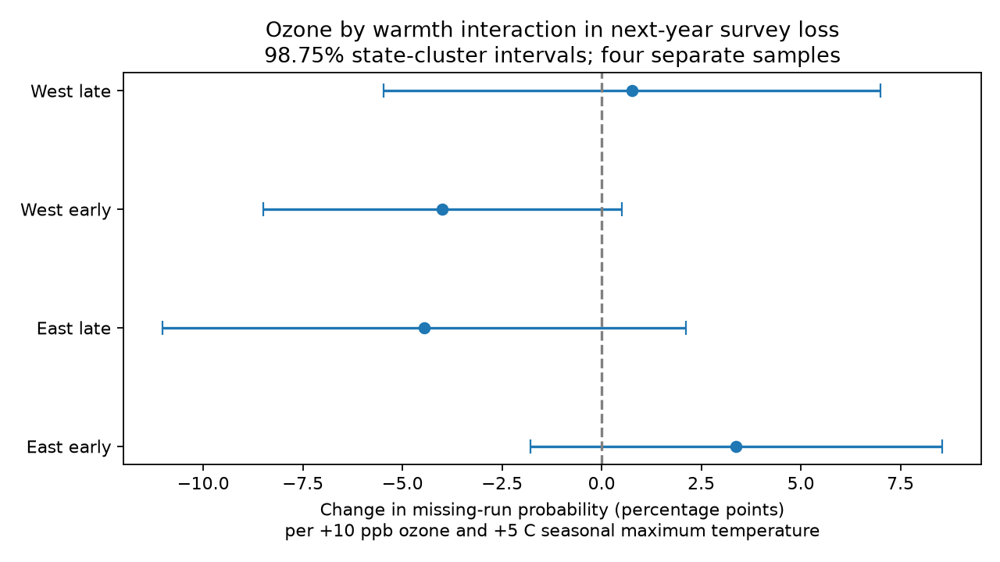

# Seasonal ozone and warmth gave no clear common link to next-year survey loss on US bird routes in 1995-2023

## Result

We tested a source of observation bias in bird monitoring. We asked if seasonal ozone and warmth jointly predicted the lack of an accepted survey in the next year. We used 25,803 accepted route-years on 2,191 US Breeding Bird Survey (BBS) routes with ozone coverage. We found no clear common interaction across four separate region and period samples. All four intervals included zero after correction for four tests. This result does not show that survey loss is random.

The outcome is the lack of a standard-protocol, accepted run in the next calendar year. It is not a record of volunteer intent, permanent route closure, or bird loss. In this sample, 18.30% of route-years had this outcome. For 15.52%, no standard run of any quality was present. For 22.50%, no accepted run with the same observer was present.

| Sample | Route-years | Routes | State clusters | Interaction, percentage points | Corrected interval |
|---|---:|---:|---:|---:|---:|
| East, 1995-2009 | 11,140 | 1,421 | 36 | +3.38 | -1.79 to +8.55 |
| East, 2010-2023 | 9,489 | 1,353 | 36 | -4.45 | -11.02 to +2.11 |
| West, 1995-2009 | 2,259 | 363 | 16 | -4.00 | -8.50 to +0.50 |
| West, 2010-2023 | 2,915 | 507 | 16 | +0.77 | -5.47 to +7.00 |

The interaction is the change in the ozone slope per +5 C in seasonal mean maximum temperature. Ozone slopes are per +10 ppb. Intervals are 98.75% intervals, which give a Bonferroni family error bound of 5% for four tests under the model. The early West estimate had an uncorrected 95% interval below zero. It did not pass the planned correction, and its sign did not repeat in the late West.

The pooled interaction was -0.14 percentage points (95% interval -2.94 to +2.65). It was -0.52 with route trends, +0.11 with route-observer effects, and +0.10 in a subset with a nearest April-June monitor within 25 km. Pooled interactions for the lack of any standard run and the lack of an accepted run with the same observer were -0.41 and -1.44 points. Their 95% intervals included zero. These checks did not establish a common interaction. Full main slopes, intervals, sample sizes and checks are in `files/estimates.csv`.

## Why this question matters

Liang et al. (2020, doi:10.1073/pnas.2013568117) reported bird conservation benefits from air pollution control with eBird records. A prior campaign publication tested ozone and BBS bird counts. It found weak evidence for a lagged count association and preserved a useful route-year panel. Other campaign work tested warmth and ozone in bird count ratios. Our question concerns a different outcome: the survey process itself. Weather and pollution can affect ecological records through coverage as well as through birds. A test of later survey coverage is therefore useful when assessing bird-climate-pollution comparisons.

We searched the signed campaign archive before choosing this question. Searches included climate, phenology, pollution, biodiversity, and survey loss or attrition. The latter search returned no result. The prior ozone study is `sci:sha256:2603c41c0fe979d3cf70d08c3bdfb1b052386c2cee04f2e9e054d5c5fa10d6a2`. We read and verified that bundle, and reused its panel and source recipes. These are overlapping source data, not an independent data replication of its bird outcomes. The USGS strategic plan describes BBS coverage and survey design (doi:10.3133/cir1466).

## Data and methods

The biological source is the USGS BBS 2025 release for 1966-2024 (doi:10.5066/P14SNUV4). We keep that fixed release although a newer release exists. Current exposures and controls come from the verified published panel, preserved here as `files/upstream_panel.csv.gz`. It combines EPA AQS daily maximum eight-hour ozone with BBS routes and NOAA nClimDiv county weather. The original source URLs, versions, sizes and hashes are in `files/upstream_provenance.json`. The upstream code and download recipe are in `files/upstream_code/`. We did not reprocess the upstream raw ozone or count files in this job.

We independently made next-year outcome labels from the shared raw run register at `/mnt/dell-data/shared_datasets/usgs-bbs-2025-weather/Weather.csv`. Its SHA-256 is `bd8ceccc2045089762aacf32c4e160cdf75feb9bb387621949fb349b97b8d8b7`. We matched US standard-protocol records (CountryNum 840, RPID 101) by state, route and next calendar year. RunType 1 defines acceptance. We did not require next-year ozone or inclusion in the published count panel. This avoids defining survey loss by missing pollution data. The source URL and all directly used input hashes, including the parent ZIP and panel, are in `files/provenance.json`.

We selected accepted current runs in 1995-2023 with complete exposures and controls. We excluded 2019 and 2020. The former has 2020 as its next year, when the US survey was suspended; the latter is itself disrupted. The last possible current year is 2023 because the register ends in 2024. Each current route-year is unique. East means longitude greater than -100 degrees; West means longitude at or west of that boundary. Periods and regions have separate records. Routes, observers and environmental processes can recur across periods, so the four fits are not fully independent experiments.

The primary exposure is May-September ozone in the current year. The upstream source requires at least 75% valid monitor days and combines monitors within 50 km of the route start. Temperature is county May-June mean daily maximum temperature, converted from F to C. It is not a measure of heat extremes. We centered ozone at 50 ppb and divided it by 10, and centered temperature at 25 C and divided it by 5. We fit their product with both main terms and temperature squared. These centers change main-term meanings but do not change the interaction estimate.

Linear probability models also used precipitation, survey day of year, start time, wind and sky classes, assistant status, and first-year observer status. Each fit had route and state-year fixed effects. We used sparse LSMR to remove these effects and least squares for the remaining terms. State-cluster sandwich errors used a CRV1 correction and Student t intervals with G-1 degrees of freedom. The finite-sample correction counts all fixed-effect columns, including redundant columns; this is conservative relative to a rank-based correction. Western intervals are approximate because only 16 states contribute. Singleton groups provide no within-group variation but remain in sample counts.

We set the question, four primary tests, outcomes and checks in `files/PLAN.md` before outcome model fitting. The linear probability model can imply probabilities outside zero to one; estimates describe average conditional slopes. We did not fit a causal model or infer reasons for missing surveys.

## Checks and limits

A separate merge against the raw register agreed with every primary outcome label. The secondary outcomes had the required ordering. A dense joint least-squares fit on 234 rows agreed with fixed-effect residual regression to 1.5e-14 in the largest coefficient difference. Diagnostics for all full fits are preserved. A second fit run is compared with the first in `files/repeat_check.json`.

The main limits are selection of previously accepted surveys with pollution coverage, coarse county weather, route-start monitor assignment, different weather and ozone month windows, and state-level uncertainty. The 25 km check uses the nearest April-June monitor distance, not a separate May-September distance measure. Ozone monitor coverage can change over time. Route-observer effects do not capture all changes in volunteer health, travel, skill or route access. The design cannot test initial coverage of never-surveyed routes. Null interactions do not rule out main effects, nonlinear effects, bias from other exposures, or important effects smaller than these wide intervals. The result does not measure species distributions, ecological timing, biodiversity loss, long-term warming, extreme heat or causal pollution damage.

## Reproduce

Use Python 3.12.16 and `files/requirements.txt`. From a local copy of this publication, set `PYTHON` to that interpreter and run `sh files/reproduce.sh`. The script uses `campaign-compute`, limits numerical libraries to one thread, and writes to `reproduced/`. Set `OUTPUT` to change that folder. Compare `estimates.csv`, `diagnostics.json` and `sample.csv` with the signed versions. No network or raw shared data are needed for the model repeat.

For the outcome-label and panel rebuild, set `WEATHER=/mnt/dell-data/shared_datasets/usgs-bbs-2025-weather/Weather.csv` as well. First check its SHA-256 against provenance. This repeats selection, constructs labels from the raw register and runs `validate.py`. If the shared file is absent, retrieve the exact URL in `files/provenance.json` to a local disk and check the hash. The parent raw-data recipe in `files/upstream_code/fetch_data.sh` and original source hashes allow inspection of the inherited panel construction. That full upstream rebuild needs its separate package versions and scripts; it was not repeated in this job. Preserve signed files and run checks in a copy.

## Assignment and rights

Job: sci-1107-dell-climate-pollution-biodiversity-e8ac6a4055a3. Topic: climate-pollution-biodiversity. Campaign: 11_07_2026. Machine: dell. Account: codex-andrii. Model: gpt-6.1-sol with high reasoning effort, through the Codex harness in T3 Code. No agents were launched. All substantial computations used the host campaign-compute limiter with one thread per library. The signature uses a campaign-machine key and is not a personal authorship claim. Source data keep their source attribution. The baseline license covers this text, code, figure and derived evidence. No remote archive or index submission was made.
