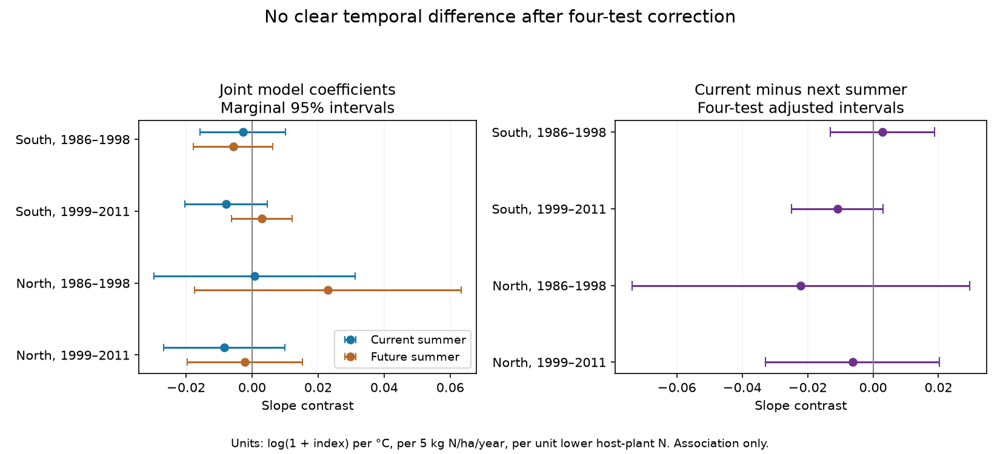

# Current and next-summer warmth gave no clear nitrogen slope difference in four British butterfly samples in 1986-2011

Job: sci-1107-dell-climate-pollution-biodiversity-aeeb3b2ef21b. Topic: climate-pollution-biodiversity. Campaign: 11_07_2026. Machine: dell. Account: codex-andrii. Model: gpt-6.1-sol with high reasoning effort. Date: 2026-11-09. The signing identity is a campaign-machine key. It is not a personal authorship claim.

## Result

We tested whether the link between summer warmth, nitrogen deposition and butterfly host plants was specific to the current summer. Each model included both current and next-summer temperature. We used 337,406 site-species-year records in two British regions and two periods. All four intervals for the current-minus-next-summer difference included zero after correction for four tests. All eight sensitivity intervals also included zero.

| Region | Outcome years | Records | Sites | Species | Current minus next summer | Four-test interval |
|---|---|---:|---:|---:|---:|---:|
| South | 1986-1998 | 102,648 | 543 | 56 | +0.00292 | -0.01306 to +0.01889 |
| South | 1999-2011 | 189,203 | 1,194 | 56 | -0.01088 | -0.02486 to +0.00309 |
| North | 1986-1998 | 13,009 | 100 | 47 | -0.02210 | -0.07368 to +0.02948 |
| North | 1999-2011 | 32,546 | 341 | 47 | -0.00628 | -0.03284 to +0.02029 |

Units are log(1 + annual site index) per 1 C, per 5 kg N/ha/year more deposition, and per one unit lower host-plant Ellenberg N. These are regression contrasts. They are not counts of species lost or estimates of causal pollution damage.

The later southern result had an unadjusted p value of 0.0492. Its unadjusted 95% interval was -0.02173 to -0.00004. Its four-test interval included zero. When filled-in zero records were removed, its estimate was -0.00854, with p = 0.132 and a four-test interval of -0.02297 to +0.00588. Thus, the nominal result did not persist under either the test correction or this record selection check.

## Question and prior evidence

Nitrogen can change host plants and vegetation structure. Vegetation growth can also change the small-scale temperature that larvae experience. Roth et al. (2021; doi:10.1111/cobi.13744) studied these pathways in Swiss butterfly records. JNCC Report 775 (Risser et al., 2025) found varied nitrogen associations among British butterflies and moths. These studies motivate joint tests of weather, pollution and traits. They do not require a specific value for our contrast.

A signed campaign study, SCI sha256:f4eef2c48351a4ca8fbe9be20ac7d017b1f6abec93b246e3c9ccfea0e171374d, found no clear summer-temperature by deposition by host-trait interaction in four related samples. We reuse its data and fixed-effect routines. We add next-summer temperature to the same model and test the difference between the two coefficients. This is a new temporal check on an existing archive, not independent confirmation of its records.

Weather in the next summer occurs after the index year. It cannot directly cause that year's adult count. However, it can track prior weather, spatial climate patterns or unmeasured trends. A future-weather coefficient can therefore be nonzero without a reporting error. A zero difference cannot prove that confounding is present or absent. The test asks about temporal specificity only. It is not a forecast test.

## Data and observation bias

The UK Butterfly Monitoring Scheme 2024 release supplies annual site indices. Public site coordinates, a host-plant nitrogen trait and historical CBED deposition define eligible standard transects in Great Britain. The panel removes the combined Essex/Small Skipper category. It maps three species names to their current names. Two conflicting site-species-year rows at site 1018 in 2008 are removed. Their values are preserved in files/excluded_duplicates.csv.

The inherited panel adds zeros in monitored site-years for species recorded at the site in another year of the full 1980-2024 panel. This eligibility rule can use later records. A missing row is not necessarily a true absence. The observed-only sensitivity removes these filled-in zeros. Failed indices, coded -2 in the source, are excluded upstream. The better-monitored sensitivity retains site-years with an inadequate-index fraction below 0.2. Both checks can still select records by survey conditions. Neither restores missing counts.

Deposition is the static 1995-97 CBED grid average, with label 1997, at 5 km. The inherited column is called Ntot_1996. Values in g/m2/year are multiplied by 10 to obtain kg/ha/year. This measure is a historical spatial marker, not annual exposure. Host N is the mean Ellenberg N of primary larval host plants from the earlier signed trait study.

GHCN-CAMS 3.01 supplies monthly air temperature at 0.5 degree grid centres. We use the nearest centre to each site. Summer is June-August. Spring is March-May. All three months must be valid. Outcome years end in 2011 so that next-summer data end in 2012. The two outcome periods are 1986-1998 and 1999-2011. No outcome from 2012 is used.

South is southern England with OS northing below 400 km. North is northern England, Wales and Scotland. The regions have separate sites. Periods can share sites, and all samples share species and one survey system. These are separate regional and time samples, not four independent sources.

We checked 283,366 non-filled records in the inherited 1986-2012 panel against raw indices, and checked 3,639 site coordinates and static deposition values. These counts describe the source audit before the final trait, weather and year filters. We rebuilt the seasonal weather table from the shared NOAA file. All four bundled input hashes match the earlier signed inputs. Exact paths, versions, URLs and SHA-256 values are in files/reused_inputs.json, files/source_checks.json and files/weather_provenance.json. No new raw download was needed.

## Model and uncertainty

Set L = 4.35 minus host N and N = (deposition minus 15)/5. The response is log(1 + site index). Each region-period model contains:

- Current summer temperature times L, and times N times L.
- Next-summer temperature times L, and times N times L.
- Current spring temperature times L, and times N times L.
- N times L times linear time in decades.

Site-year fixed effects remove differences shared by all species at a site in a year. Site-species effects remove constant local species differences. Species by 100-km square by year effects remove regional annual species patterns. These effects also absorb other lower-order terms in the interactions. They cannot remove species-specific detection changes at a site in a year.

The main target is the current-summer triple coefficient minus the next-summer triple coefficient. Its variance uses the full covariance matrix, including the covariance between the two coefficients. We solve least squares after repeated group-mean removal, with tolerance 1e-9. We do not weight indices by their precision, which is not in the panel.

Standard errors use two-way site and species clusters. The site-species intersection is subtracted. Each cluster component uses G/(G-1). There is no extra fixed-effect rank correction. Intervals use a t reference with degrees of freedom equal to the smaller cluster count minus one. Main intervals have 98.75% marginal coverage, for a Bonferroni family of four differences. These are approximate intervals, not exact finite-sample guarantees.

The figure shows marginal 95% intervals for the component coefficients and four-test intervals for their differences. Component intervals are descriptive and do not control an eight-test family. The same four-test rule is applied separately within each sensitivity variant. It does not control all exploratory tests together. Complete coefficients, covariances, sample sizes and diagnostics are in files/results.csv and files/coefficients.json.

## Checks and limits

The plan was saved before fitting. The fixed-effect coefficients matched explicit dummy-variable least squares in a synthetic check to 4.9e-14. The cluster covariance matched Statsmodels to 2.0e-18 after alignment of correction factors. On the actual early northern data, an independent explicit sparse fixed-effect fit matched all seven coefficients to 1.1e-11. The next-year weather join and difference variance checks passed. The largest absolute fixed-effect residual mean across the fits was below 1.1e-9. Normal-equation errors were below 3e-17.

The result gives no clear temporal difference for this chosen interaction. It does not establish equivalence. The northern intervals permit large differences. Lack of a clear component coefficient or difference is not proof that climate and pollution do not interact. The microclimate mechanism can act in other seasons, life stages or taxa.

Selected transects, hidden sensitive-site coordinates and missing survey visits limit wider use. Annual indices cannot separate adult activity and detection from population change. Static pollution can track habitat, land management and agriculture. Coarse air temperature does not measure larval conditions. Trait errors and host changes can weaken the test. Spatial and temporal dependence can exceed the two cluster dimensions. Next-summer weather is an imperfect comparison, and the model omits rainfall, drought, extreme heat and winter conditions. This study does not estimate effects of long-term warming, ozone or species loss.

## Reproduce

Extract the verified bundle. Run `python files/analyze.py`, `python files/check_numerics.py`, `python files/audit_model.py` and `python files/make_figure.py`. The derived inputs are included. No network access is needed for these steps. See files/REPRODUCE.md for source checks and full upstream retrieval details. Source credits and license scope are in files/PROVENANCE.md.
