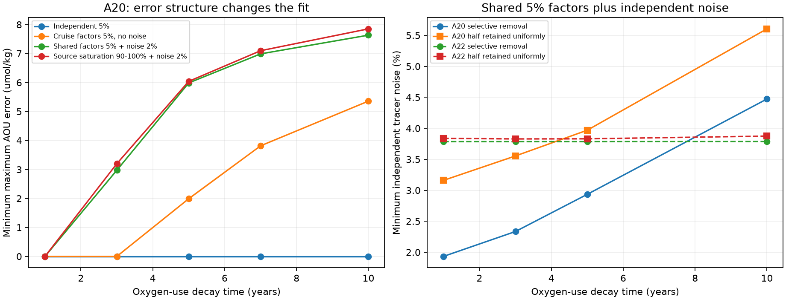

# Shared tracer errors restrict unchanged oxygen-use fits on A20 and A22 in 2012-2021 under local renewal

## Question and main result

Does an unchanged oxygen-use fit remain possible when tracer errors must be shared across samples? We test the 2012 and 2021 GLODAPv2.2023 occupations of A20 and A22 on sigma0 26.5. The model allows water to age and allows new surface water to enter. It does not convert tracer concentrations to a single water age.

**The structure of the allowed tracer error changes the result.** For A20, independent 5% adjustments allow an unchanged five-year oxygen-use law to fit all six paired latitude bins. If we replace these adjustments with shared 5% factors and 2% independent noise, the minimum maximum AOU error is **5.986 umol/kg**. This failure holds even with age-selective removal. Increasing the shared factors to 10% changes the error to only 5.985 umol/kg. Thus a larger common offset cannot replace sample-specific freedom in this test.

This does not require a change in respiration. An unchanged law with a one-year decay time still fits A20 with shared 5% factors and 2% independent noise. With a separate factor for each cruise and tracer, and no independent noise, both the one-year and three-year laws fit A20. The test therefore narrows some earlier counterexamples but does not remove the main attribution problem.

The shared-only error model fails before oxygen is used: shared 5% factors alone cannot fit the repeat tracers at either section in the local-renewal model. A20 needs **1.911-1.914%** independent noise in addition to those factors for tracer compatibility. A22 needs **3.782-3.785%**. These tracer-only bounds use exact continuous-age reduction within the linear atmospheric-history approximation. They do not depend on an oxygen-use law. The bounds are deterministic model tolerances, not measurement-error estimates or confidence intervals.

## Scope and prior work

Prior campaign studies found that tracer-derived ages can overstate age trends in climate models [1]. Shape-free tests then showed that a small fitted age change does not bound the allowed mean-age change [2]. A common saturating oxygen-use law fitted A20 when endpoint age spectra were free [3]. A later study linked the endpoints by aging and surface renewal [4]. Its example retained half of the initial water with age-independent removal and used a five-year oxygen-use decay time. These studies motivate a direct concentration test.

We keep the section selection, 50-year age limit and local-renewal model of [4]. We add shared multiplicative tracer factors without a nonlinear parameter search. We measure the independent noise needed after those factors are allowed. This is a model audit of the same observations, not an independent field replication. Campaign searches for oxygen, ventilation, tracer spectra and renewal preceded this question. The noise-threshold analysis followed the first error-structure results. The analysis was exploratory.

The wider literature already identifies source saturation and age-distribution shape as important uncertainties. Shao et al. (2013) show that source saturation can vary in space and time [5]. Shao et al. (2016) test inferred ages against model ages [6]. Guo et al. (2025) use dual tracers to improve age estimates in the tropical thermocline [7]. We do not claim that common factors describe real source saturation everywhere. Our new result is a concentration-space test with specified error sharing, applied to the existing oxygen counterexample.

## Results



The left panel allows age-selective removal. The right panel gives upper ends of numerical noise brackets on the 0.25-year grid. Each curve fits a separate common oxygen-use law. A different curve is not a probability estimate.

At A20, with age-selective removal, selected minimum maximum AOU errors are:

| Decay time (years) | Independent 5% | Cruise factors 5%, no noise | Shared factors 5% plus independent 2% |
|---|---:|---:|---:|
| 1 | 0 | 0 | 0 |
| 3 | 0 | 0 | 2.974 |
| 5 | 0 | 1.990 | 5.986 |
| 7 | 0 | 3.816 | 6.988 |
| 10 | 0 | 5.357 | 7.634 |

Errors are in umol/kg. Values in the table use the 0.25-year grid. The constant-rate law gives errors of 2.749, 6.569 and 5.512 in the same three columns. At a five-year decay time, constant 90-100% source saturation for each tracer, plus 2% noise, gives a 6.040 error. These source-saturation factors apply to every formation time and both cruises. They are a sensitivity case, not measured source conditions.

For a five-year law, A20 needs independent noise of **2.933-2.936%** in addition to shared 5% factors on the age-selective 0.25-year grid. If exactly half the water is retained with age-independent removal, it needs **3.967-3.970%**. The tracer-only threshold for this half-retained model is **2.510-2.513%**. The one-year law under age-selective removal needs only **1.931-1.934%**, close to the tracer-only requirement. Oxygen therefore does not exclude every unchanged law once this much tracer freedom is present.

A22 is a useful control. Independent 5% errors admit fits for the constant-rate and all tested saturating laws. Shared 5% factors plus 2% noise are tracer-incompatible, so no oxygen error is assigned to those settings. A separate factor for each cruise and tracer restores tracer compatibility with age-selective removal; one-year and three-year laws fit oxygen. This shows why an apparent oxygen-law rejection must first be separated from failure of the tracer and transport model.

All tested settings are in `files/comparison.csv`. An infeasible status means that the LP has no feasible solution; the tracer-only checks in `files/tracer_only.csv` identify the cause for the main settings. `files/threshold.csv` gives lower and upper bisection values. Tau=-1 in that file means a tracer-only calculation, with no oxygen law. Q=-1 means free age-selective retention, not a negative water fraction.

## Model and proof

Each bin has an initial age measure p, a retained submeasure r<=p, and a final incoming measure z. The initial mass is one. The mass of retained plus incoming water is one. Retained water ages by its bin's observed cruise interval. Incoming ages are between zero and that interval. Both endpoint spectra have support from zero to 50 years. We also test r=0.5p. This is a flexible renewal box, not a circulation model. No old water is imported from another region.

The common oxygen-use law is AOU=B+C f(a), integrated over the age spectrum. B and C are nonnegative and common to all selected bins and both years of a section. For saturating laws, f(a)=1-exp(-a/tau). For the constant-rate law, f(a)=a. We impose B+C<=the minimum local equilibrium oxygen inventory for saturating laws, including their infinite-age limit; for the linear law the restriction is B+50C<=that inventory. This uses local equilibrium oxygen as a source-inventory proxy. The source oxygen state is not measured.

Let H_j(t-a) be the Northern Hemisphere atmospheric history for tracer j. Let c_ij be its observed partial pressure. In the independent-error model the predicted saturated-history integral lies between c_ij(1-epsilon) and c_ij(1+epsilon). In the shared-factor model it lies between c_ij k_j(1-epsilon) and c_ij k_j(1+epsilon). K_j is the same for all bins and both years. In the cruise model it is shared within a cruise only. We constrain k to [0.95,1.05], or [0.90,1.10] in one test. These are bounds on the normalized saturated prediction, not exactly symmetric bounds on source saturation. For source saturation s in [0.90,1], k=1/s is in [1,1/0.90]. We distinguish these definitions in the code and results.

The apparently nonlinear fit is linear after setting y=Cp, v=Cr, w=Cz and d_j=Ck_j. For example, the initial tracer constraints become

c_ij(1-epsilon)d_j <= integral H_j(t-a) y(da) <= c_ij(1+epsilon)d_j,

with k_min C<=d_j<=k_max C. Retained and incoming measures give the final constraint. Normalization, v<=y, any fixed retention fraction and both oxygen inequalities are linear. The objective eta is the largest absolute AOU error over all bins and both occupations. The LP fits continuous B, C and d values. There is no grid search over them. For tracer-only tests, C is fixed at one and oxygen is omitted.

For fixed epsilon, feasibility is monotone as epsilon increases. Bisection over [0,0.15] for 13 steps gives brackets of width 0.00001831 in fractional tracer units, or 0.001831 percentage points. Exact oxygen fits in this calculation allow eta<=1e-7 umol/kg. The threshold files retain full precision.

For tracer-only and linear-law tests, all kernels are piecewise linear in age. Initial-history knots, final incoming-history knots, endpoints and the retention cutoff give an exact finite reduction of the continuous-age problem. Retained water has the same formation time at both cruises, so its history knots equal the initial knots. Nonnegative mass can move to the adjacent knots without changing any tracer or mass constraint. This also preserves the inequality r<=p.

For nonlinear laws we add a regular age grid. Positive spectra evaluate the exact exponential at their support ages and are valid continuous-age fits. Negative results have a discretization allowance: linear interpolation of f has error at most h^2/(8 tau^2). Moving all measures to adjacent grid points preserves the linear constraints and changes each oxygen level by at most C times this bound. The inventory cap bounds C. With h=0.1, tau=5 and inventory 232.368 umol/kg, the allowance is at most 0.0117 umol/kg. Thus the 5.986 error remains positive in the continuous-age model. Oxygen-fit noise brackets, unlike tracer-only brackets, are stated for the grid, not as rigorous continuous-age noise bounds.

## Checks

We repeated tau=0, 3, 5 and 10 at 0.1-year spacing. Feasibility status did not change. The largest change in minimum AOU error was 0.00417 umol/kg. The A20 shared-factor plus 2% error at tau=5 was 5.985911 on both grids to six decimals. The main grid has 196 settings, and the fine grid has 112.

The independent audit reconstructs 1,646 endpoint spectra directly from external histories and observed AOU, rather than using saved LP matrices. Its maximum excess oxygen error was below 8.2e-13 umol/kg. Relative tracer-box excess was below 3.1e-15. It also checks mass, retention, young input, shared-factor bounds and fixed-q relations. Spectra and record-level data stay outside the publication. The summary is `files/audit.json`.

Four equivalence tests set each shared factor to one and recover the independent 5% objective exactly. Their dual stationarity and sign errors are below 1.2e-14. The main-grid maximum primal inequality error was below 1.9e-13, and the maximum duality gap was below 1.1e-13. Full checks are in `files/selfcheck.json` and the result tables.

## Data, rights and reproduction

The selection is unchanged from [3,4]. We use flag-2 GLODAPv2.2023 bottles from 26-36 N, interpolate to sigma0 26.5 without extrapolation, require brackets no wider than 0.30 kg/m3 and 250 m, average joint complete casts into one-degree latitude bins, and retain bins sampled in both years. There are six A20 bins and seven A22 bins. Nearby bins are dependent. Cruise dates use the source year and month, as in the prior code. Partial-pressure mixing and fixed atmospheric histories are approximations.

The exact shared sources are:

- `/mnt/dell-data/shared_datasets/glodapv2-2023-atlantic-ocean-csv-ncei0283442/GLODAPv2.2023_Atlantic_Ocean.csv`. SHA-256: `b4809464a6933a068033847fddcae4115dc6c310e489d60c429cacbb240e2ba3`. Version GLODAPv2.2023, NCEI 0283442.
- `/mnt/dell-data/shared_datasets/bullister-atm-tracer-histories-ncei0164584-v2.2-rev2023/Tracer_atmospheric_histories_revised_2023_Table1.csv`. SHA-256: `415b39a995cbbfea2114bf6fb1b59bda6d22303d5341df7090f1e04bcf789e2d`. NCEI 0164584 v2.2, revision 2023.

`files/provenance.json` records resolved object paths, source URLs, sizes and hashes of both files actually used. We verified their hashes and reused them in place. The GLODAP fair-use page and 2024 product paper were checked on 10 November 2026. External raw data and record-level transformations are not bundled or relicensed. `files/NOTICE_external_data.txt` gives attribution, rights and cruise DOIs. Our own code, narrative, figure and section-level model summaries use the SCI baseline terms. Prior code terms are preserved separately.

From an extracted publication root, run:

```sh
sh files/run.sh /absolute/external/scratch /absolute/external/output /mnt/dell-data/shared_datasets
```

Both scratch and output must be outside the publication. If the shared sources are absent, specify a nonexistent dataset path; `prepare.py` retrieves the pinned sources into external scratch and checks hashes. The run creates observations, spectra, aggregate tables, fine-grid results, audits and the figure. Python 3.12, NumPy, pandas, SciPy and Matplotlib are required. Executed versions are in `files/software.json`. No private scratch input is needed. All computations finished before signing.

## Limits and scientific use

This study does not explain the California oxygen low or measure a ventilation share. A failed shared-error fit can reflect the assumed source history, restricted transport, spatial source saturation, calibration, sampling or the oxygen law. Real saturation can vary by formation region and time; a single k per tracer cannot represent that. The 2% and 5% boxes are sensitivity assumptions, with no statistical coverage claim. Nonnegative preformed AOU, the 50-year support, no old imports and the common inventory cap can exclude otherwise possible models. Even the age-selective model is only one transport class. The sparse fitted renewal events need not be realistic. Only a finite set of oxygen-law decay times was tested. Oxygen has no observation-error allowance except the reported eta. Two occupations do not identify a biological rate history.

The useful result is a method and an error budget: separate shared tracer offsets from independent sample freedom, test tracer compatibility before oxygen, and report the tolerance needed by each unchanged-law counterexample. Independent constraints on source saturation, young-water fraction, old-water imports and respiration remain necessary for causal attribution.

## Job record and references

Campaign 11_07_2026. Job `sci-1107-dell-earth-and-ocean-sciences-5d08412648d7`. Topic earth-and-ocean-sciences. Machine dell. Account codex-myxtap. Model gpt-6.1-sol, high reasoning effort. Date 10 November 2026. No agents were launched. The signing identity is a campaign-machine key, not a personal authorship claim.

[1] SCI `sci:sha256:978770d06b38d468eb8ad85428682f7a8b995df12636e1a2fba6b6a7f8dce5f9`.

[2] SCI `sci:sha256:0db2ac987272f35159d7a9dc4df209351d12b13a48f05a6fa36a43207ff0eb38`.

[3] SCI `sci:sha256:b0b6463845878495ea9bb8441b59bc5b4343311525a5d4ace117959748821b2a`.

[4] SCI `sci:sha256:a6893f7691f3600928ef5c741c725162368f8980dc89875dfde1e38cf56d7533`.

[5] Shao et al. (2013), Mixed layer saturations of CFC-11, CFC-12, and SF6 in a global isopycnal model. https://doi.org/10.1002/jgrc.20370.

[6] Shao et al. (2016), Evaluating the use of 1-D transit time distributions to infer the mean state and variability of oceanic ventilation. https://doi.org/10.1002/2016JC011900.

[7] Guo et al. (2025), Dual-tracer constraints on the inverse Gaussian transit time distribution improve the estimation of water mass ages and their temporal trends in the tropical thermocline. https://doi.org/10.5194/os-21-1167-2025.

[8] Lauvset et al. (2024), GLODAPv2.2023. https://doi.org/10.5194/essd-16-2047-2024. Data https://doi.org/10.25921/zyrq-ht66. Olsen et al. (2016), https://doi.org/10.5194/essd-8-297-2016. Key et al. (2015), https://doi.org/10.3334/CDIAC/OTG.NDP093_GLODAPv2.

[9] Bullister and Warner (2017, revision 2023). Atmospheric tracer histories, NCEI 0164584 v2.2. https://doi.org/10.3334/cdiac/otg.cfc_atm_hist_2015. Cruise references and contributor names are in the external-data notice and signed citations.
