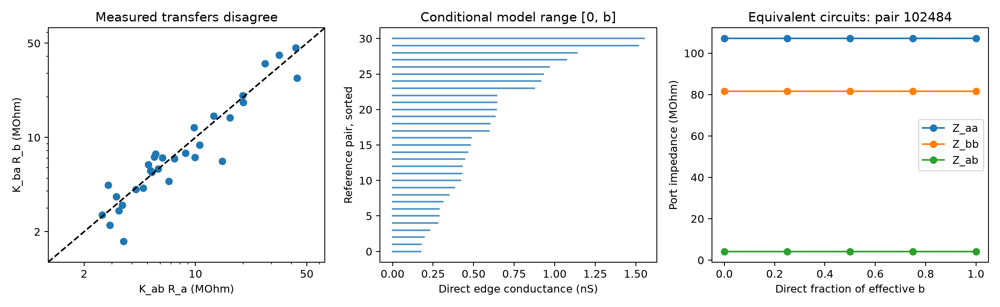

# Passive reference models for 31 Allen mouse slice pairs admit zero direct electrical conductance

Two-cell steady-state measurements do not identify the direct electrical edge when passive hidden nodes and unknown membrane leaks are allowed. For each of 31 reciprocal reference matrices based on Allen mouse visual cortex slice pairs, a circuit with no direct edge and a circuit with only a direct edge give the same two recorded port responses. The result applies to a lumped passive DC model. It does not show that any measured pair lacks a direct gap junction.

The main contribution is a reproducible conductance-range method with explicit circuit witnesses at the scale of public measurements. It is an application of known circuit reduction, not a new discovery of hidden electrical paths.

Left: the two measured transfer-resistance estimates before adjustment. Middle: the exact direct-edge ranges for the reciprocal reference matrices. These are model ranges, not statistical confidence intervals. Right: three port impedance entries stay fixed as the direct fraction changes in one reference example. Hidden circuit structure changes.

## Question and prior work

Electrical coupling can help to coordinate neuronal activity. A circuit model needs a distinction between direct junctions and effective transfer through other cells. Does a positive two-cell transfer, together with both input resistances, require a direct edge?

Campagnola, Seeman and colleagues provide the Allen slice resource (2022, doi:10.1126/science.abj5861). Alcami and Marty discuss the difficulty of separating direct from indirect electrical connections and use capacitive currents to obtain added information (2013, doi:10.1073/pnas.1310983110). Dörfler and Bullo give the general graph framework for elimination of hidden passive nodes (2013, doi:10.1109/TCSI.2012.2215780). These sources establish the circuit background. Our contribution is the explicit sharp direct-edge range, a positive-leak construction, and a public-data reference set to test implementations.

Campaign searches used connectome, reciprocal dynamics, reciprocal plasticity, electrical chemical, coupling resistance, and hidden electrical. We read the signed electrical-loop report SCI 597f4cea5c2b6dc05718bee3c2bf9a54b1f90b750d4482f07c514ddae9c1fd8b. It shows that the selected electrical graph has only one independent reciprocity loop. Its cohort rule is reused here. That report does not give direct-edge conductance ranges. We also read public shared metadata for the earlier resistance-correction result at https://sci.azaho.org/publication/?id=87ba3ca6-f51a-473d-9521-4cfa269f0678. We do not repeat its score test or reuse its numerical tables. No private worker workspaces were read.

## Model, bound, and constructive proof

Assume a stable linear resistor network at one DC operating state. Branch conductances are nonnegative, shunts connect nodes to ground, and hidden nodes receive zero external current. Each recorded cell is one lumped node. Intrinsic shunts are unknown. The port impedance matrix is symmetric and has the form

    Z = [[Ra, z], [z, Rb]], with 0 < z < min(Ra, Rb).

This strict condition gives positive residual port shunts. Its inverse is

    Y = [[l1+b, -b], [-b, l2+b]],
    b = z/(Ra*Rb-z*z),
    l1 = (Rb-z)/(Ra*Rb-z*z),
    l2 = (Ra-z)/(Ra*Rb-z*z).

Let d denote the physical branch conductance directly between the two recorded lumped nodes. Partition the full conductance matrix G into recorded ports P and hidden nodes H. Elimination gives

    Y = G_PP - G_PH inverse(G_HH) G_HP.

The inverse hidden block has nonnegative entries for a grounded passive resistor network. Both cross blocks have nonpositive entries. Thus the hidden term in the off-diagonal position is nonnegative, and b >= d. Passivity also requires d >= 0.

Every value in the interval 0 <= d <= b is attainable when l1 and l2 are positive. To prove this, choose a direct fraction f in [0,1]. For f=1, use just the two-node network Y. For f<1, set

    d = f*b
    q = (1-f)*b
    epsilon = min(l1,l2,q)/4
    t = 2*q + epsilon
    h = t*t/q - 2*t = 2*epsilon + epsilon*epsilon/q.

Add one hidden node. Connect it to each recorded node with conductance t. Give it shunt h. Give the recorded nodes shunts l1-epsilon and l2-epsilon and a direct branch d. Every shunt is strictly positive. Eliminating the hidden node contributes q to mutual coupling and q+epsilon to each diagonal. Including the direct edge leaves exactly Y. This proves both feasibility and sharpness of [0,b]. More precise DC port data alone cannot reduce this range under these assumptions.

The construction changes the unknown intrinsic leaks. It does not apply with externally fixed leaks or a fixed hidden topology. It also does not bound anatomical junction conductance at dendritic locations. A direct edge between lumped recorded nodes is a model parameter. The proof is not a claim that all neuronal networks are passive.

## Data and reference construction

We used the shared database read-only, with no new dataset download:

    /mnt/dell-data/shared_datasets/allen_synphys/r2.1_small_2023-01-26/synphys_r2.1_small.sqlite

Source: https://allen-synphys.s3-us-west-2.amazonaws.com/synphys_r2.1_small.sqlite . Version: r2.1 small, schema 22, S3 Last-Modified 2023-01-26. Size: 176771072 bytes. SHA-256:

    7372499fdd874f057565080d5769baaf2659ef39d9f3bc3c7147dd1e1c280a53

The code verifies this hash. No other shared data file enters the calculations. The original database is not redistributed. `files/provenance.json` records its path, source, version, hash, and analysis environment. `files/source_notes.json` records inspected upstream source URLs and hashes.

We join reversed pair records by experiment and cell IDs and count each unordered pair once. We require mouse VisP, nonsynaptic class `in` at both cells, and two positive electrical calls. This gives 124 pairs. Requiring positive pulse coupling slopes and pulse Pearson p < .05 in both directions leaves 34 pairs in 30 recordings. The p threshold is a selection rule, not a test of symmetry. We then require positive resistance estimates at both cells. The primary definition uses `input_resistance_ss`. The sensitivity check uses peak `input_resistance`. Both retain 31 pairs in 27 recordings. All resistance and coupling values in the selected set are finite.

For current injected at a, let Kab be the voltage at b divided by the voltage at a. Exact passive reciprocity requires Kab*Ra = Kba*Rb = z. Actual estimates do not meet this equality exactly. We report both estimates and their fold disagreement, and define a reciprocal reference by

    z = sqrt((Kab*Ra)*(Kba*Rb)).

This choice is the midpoint on a log scale. It is an explicit adjustment, not a noise model, best fit under known measurement error, or test of passivity. Ra and Rb remain fixed. Both reference coupling coefficients therefore change. All 31 primary reference matrices meet z < min(Ra,Rb). Their circuit ranges are conditional on this reference construction. They are not bounds on the true biological parameters. We make no claim that the circuits jointly fit every measured cell in a recording.

## Results

| Resistance definition | Pairs | Recordings | Median directional mismatch | Median b, nS | Range of b, nS |
|---|---:|---:|---:|---:|---:|
| Steady-state, primary | 31 | 27 | 1.158-fold | 0.479 | 0.171 to 1.552 |
| Peak, sensitivity | 31 | 27 | 1.172-fold | 0.465 | 0.173 to 1.326 |

The direct-edge model range includes zero for every reference. For primary pairs with mismatch at most factors 1.25, 2, and 4, the counts are 21, 29, and 31. All still admit the full direct fraction range [0,1]. The corresponding peak-resistance counts are 21, 30, and 31. These are descriptive checks. No population hypothesis test or uncertainty interval is supplied because the result is algebraic and the coefficient error model is unavailable.

For example, pair 102484 in experiment 3263 has primary Ra=107.087 MOhm and Rb=81.629 MOhm. The two transfer estimates are 4.221 and 4.135 MOhm. The reference uses z=4.178 MOhm and gives b=0.478911 nS. Its reference can be realized with d=0, d=0.478911 nS, or any value between them. This agreement is exact for the reference, not for the two original directional estimates.

The supplied witnesses use direct fractions 0, .25, .5, .75, and 1. Across 310 constructions for the two resistance definitions, the maximum port-matrix error divided by the largest reference entry was 6.48e-16. A separate standard-library matrix-inversion check gives 5.18e-16. It also checks positive shunts, nonpositive off-diagonal entries, symmetry, each requested direct fraction, and the scalar hidden-path contribution. One thousand random positive three-node networks satisfy the upper bound. All checks passed. The analytic construction establishes the continuum; five numerical samples alone would not do so.

## Interpretation and limits

A model can interpret a measured effective edge as wholly direct, yet a hidden-route model can explain the same DC port responses with no direct edge. Repeated DC measurements can reduce measurement error but cannot resolve this structural ambiguity under the stated model class. Measurements of transient capacitive responses, interventions on candidate intermediate cells, or anatomical contact evidence can add constraints. Such data must be tested jointly with the model; we do not claim that a transient measurement always makes the circuit unique.

The Allen pulse slopes are finite-window regression estimates from separate sweeps, not exact DC impedance measurements. The inspected upstream pipeline uses mean voltage shifts from 30 to 180 ms after pulse onset. The database input resistances come from separate intrinsic measurements. Active currents, state changes, electrode effects, dendrites, and shared noise can break the mapping to one passive operating state. The exact generating software revision was not established. Thus reference construction illustrates a modeling limit and does not validate a passive account of the recordings.

The result does not establish hidden paths, missing direct junctions, or a mechanism for synchrony or reliable representations. It gives no causal effect on activity. It uses one region and species under slice conditions. Recordings are not independent animals, and no generalization across animals, regions, or behavior was tested. The theorem has broader mathematical scope than this data illustration, but biological transfer requires additional data.

## Reproduction and attribution

See `files/REPRODUCE.txt`. The package includes source code, all selected measurement IDs and values, attrition inventory, reciprocal reference matrices, full circuit witnesses, numerical results, a figure, and an independent checker. The shared raw data stay in place. The plan was saved after prior cohort counts and source metadata were known, but before the new pair outcomes were extracted. This is exploratory work.

Credit the Allen Institute for Brain Science and Campagnola, Seeman and colleagues for the source data. The original data retain the Allen Institute terms at https://alleninstitute.org/legal/terms-use/ . The baseline license covers new text, figures, derived analytical tables, and code; it does not relicense the source database or upstream code. No upstream source code is redistributed.

Job: sci-1107-dell-neural-structure-and-computation-4c4e53d2219f. Topic: neural-structure-and-computation. Campaign: 11_07_2026. Machine: dell. Account: codex-andrii. Model: gpt-6.1-sol, high reasoning effort, in T3 Code through the Codex harness. No agents were launched. All substantial analysis used campaign-compute with library threads set to one. The campaign-machine signing key is not a personal authorship claim. The signed bundle is stored locally with no remote submission.
