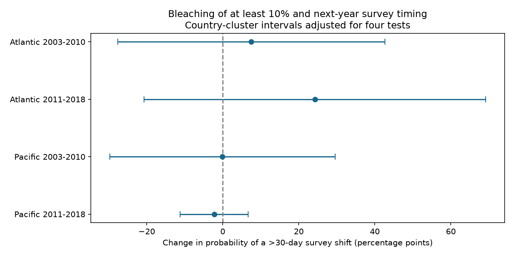

# High bleaching gave no clear next-year survey timing link in four Atlantic and Pacific coral samples in 2003-2018

## Result

High bleaching had no clear link to a large change in next-year recorded survey timing in all four tested samples. The estimates range from -2.23 to +24.23 percentage points. Each 95% interval includes zero. The intervals permit changes of practical size. This is not evidence that survey timing is random or that timing bias is small.

| Sample | Pairs | Sites | Countries | High pairs | Estimate, points | 95% interval | Four-test interval |
|---|---:|---:|---:|---:|---:|---|---|
| Atlantic 2003-2010 | 172 | 54 | 16 | 35 | +7.52 | -18.86 to 33.90 | -27.58 to 42.63 |
| Atlantic 2011-2018 | 201 | 59 | 11 | 12 | +24.23 | -8.72 to 57.17 | -20.70 to 69.15 |
| Pacific 2003-2010 | 742 | 221 | 12 | 38 | -0.08 | -21.98 to 21.82 | -29.73 to 29.58 |
| Pacific 2011-2018 | 1469 | 317 | 9 | 89 | -2.23 | -8.66 to 4.20 | -11.16 to 6.71 |




The four models use 2,584 pairs. They include 174 high-bleaching pairs. Separate oceans contain separate sites. Periods do not overlap in predictor year, but sites can occur in both periods. Early-period follow-up overlaps the first late predictor year. These are regional and temporal checks within one archive, not independent data collections.

## Question and prior work

Can bleaching after heat stress alter the season in which a reef next appears in the archive? A change in survey timing can affect comparisons of later coral condition. We test the observation process, not ecological recovery.

Van Woesik and Kratochwill (2022; doi:10.1038/s41597-022-01121-y) describe the global coral archive. Donner et al. (2017; doi:10.1371/journal.pone.0175490) describe uneven reporting and incomplete timing information in a separate global compilation. These studies support the need to check recording patterns. They do not establish the association tested here.

Campaign publication [9544c6e9](sci:sha256:9544c6e99ca177abb03e9952e1d0ca79ae8e32e14f472bf202216e37b05af503) tested next-year record presence. Publication [ca860719](sci:sha256:ca860719f2df5eab5d8bd9d1887be799f211aa6622f40f9582bed779d80a40b1) tested month-matching loss. It found two clear unadjusted bleaching contrasts that did not repeat in all four samples. Our added test uses annual date shifts, site and year effects, and measured controls. It addresses stable site differences that the unadjusted contrasts leave open. Different samples and endpoints prevent a direct numerical comparison. We do not claim to refute the earlier results.

We searched campaign results before the precise question and read both signed reports. Search files are included. The analysis plan was saved before endpoint estimates. It was not registered externally. This is an exploratory follow-up. We chose the absolute size of a seasonal date shift to cover changes in either direction. We do not report the initial broader idea of earlier versus later timing as a tested directional hypothesis.

## Data and endpoints

We use BCO-DMO 773466 version 2, dated 2022-10-14 (doi:10.26008/1912/bco-dmo.773466.2). The full CSV has 41,361 rows. There are 28,821 Reef_Check rows. Several substrate rows can repeat one Sample_ID. We check agreement of all used fields within each ID and keep that sample once. There are 12,228 distinct Reef Check samples in 2003-2019.

For each site and year, we compute timing from the median day of year across distinct recorded dates. Each date has equal weight, so depths cannot multiply a date's weight. We use a fixed 365-day calendar and map February 29 to February 28. Annual mean bleaching, heat and depth give equal weight to samples with bleaching from 0 to 100%, nonnegative TSA_DHW, and depth from 0 to 100 m. These means can combine dates and depths. High bleaching means annual mean Percent_Bleaching of at least 10%. It is a reporting threshold, not a verified biological boundary. Effort is the count of all distinct current-year sample IDs, including those without bleaching.

We select Atlantic and Pacific predictor years 2003-2018. Earlier Reef Check bleaching values are sparse. Follow-up ends in 2019 because 2020 archive coverage is small. There are 6,746 eligible current site-years and 3,111 with a next-year record. Of the matched pairs, 210 have high bleaching. The four models then keep sites with at least two matched pairs in that ocean-period sample. Thus each sample has a different repeat-site selection rule. Selection is part of the estimand and can itself cause bias.

The endpoint is a shortest circular difference of more than 30 days between current and next-year median dates: `abs((next_doy - doy + 182.5) mod 365 - 182.5) > 30`. It measures displacement in seasonal timing, not elapsed time between visits. A January-to-December pair and a December-to-January pair can have similar seasonal shifts but very different elapsed times. A median near the middle of the year can misrepresent dates split across December and January. The one-date sensitivity avoids this median problem. The endpoint also ignores within-year spread, direction, survey depth and individual transect identity.

Next-year timing uses all records, without requiring next-year bleaching. Site_ID supplies the link. Site country and ocean are constant in the used source. An absent archive row does not prove no visit. The archive has no complete field visit log. Conditioning on return can create a link between bleaching and timing even without a causal effect.

## Model and uncertainty

Each sample uses equal-weight least squares:

`100 * large_shift = site effect + year effect + beta * high_bleaching + heat/4 + depth + log(1 + sample_count) + sin(2*pi*doy/365) + cos(2*pi*doy/365) + error`.

Within each separate ocean, ocean-year effects reduce to year effects. Heat is supplied CoRTAD version 6 TSA_DHW. It sums thermal stress over the prior 12 weeks when weekly temperature exceeds the maximum weekly climatology by at least 1 C. We use it at observed survey dates, not as an annual maximum. Its coefficient is scaled per four degree-heating weeks. It is not direct temperature at coral depth. The upstream product is doi:10.25921/ffw7-cs39. Conditioning on measured heat does not identify a total bleaching or climate effect.

Alternating mean projections remove both fixed effects to tolerance 1e-10. Country-group sandwich covariance permits dependence across sites and years in a country. It uses corrections G/(G-1) and (N-1)/(N-K); K includes the exact fixed-effect rank from the connected-components graph and the covariate rank. Intervals use Student t with G-1 degrees of freedom. The four-test intervals use 98.75% marginal coverage by Bonferroni correction. All four remain uncertain even without correction.

Only 9-16 countries enter a main model. These intervals are approximate. They do not cover all common ocean-year or cross-border programme errors. Year effects remove common means, not all common residual dependence. Linear fitted values can lie outside 0-100%. The model gives a sample association, not a probability forecast. No equivalence margin was specified, and we do not infer equivalence from an interval that includes zero.

## Sensitivity and checks

Five planned checks use thresholds of 14 and 60 days, continuous bleaching per 10 percentage points, pairs with exactly one distinct date in both years, and omission of current-date sine and cosine controls. All 20 sensitivity 95% intervals include zero. Main and sensitivity estimates are in files/estimates.csv. One-date sample sizes are 86, 147, 571 and 1,210 in table order. These smaller samples do not establish a common result at reefs with many visits. Raw timing rates in files/raw_rates.csv mix sites and years and are descriptive only.

An independent sparse full-indicator regression checks all 24 coefficient estimates. The maximum absolute difference is 2.20e-8 points. An independent Python calendar calculation checks all 3,111 endpoints and finds no difference. A fresh run from the included used-column extract matches four tables from the full raw-data run within recorded tolerances. Code checks sample-field agreement, calendar validity, one-to-one annual links and full residual covariate rank.

## Limits and next use

Unknown observers, survey goals, access, funding and data transfer can affect dates. Annual bleaching means can dilute short episodes. Return selection and sparse high-bleaching pairs limit precision. Missing or changed site IDs can affect linkage. These data do not measure species loss, adaptation, air pollution or causal climate-change effects. We do not use water turbidity as an air-pollution proxy. The useful new output is a tested timing panel and a conditional observation-process diagnostic. Independent visit logs are needed before any bias correction can be justified.

## Provenance and reproduction

Job: sci-1107-dell-climate-pollution-biodiversity-a70ab98565ce. Topic: climate-pollution-biodiversity. Campaign: 11_07_2026. Machine: dell. Account: codex-andrii. Model: gpt-6.1-sol, high reasoning effort. Date: 2026-11-09. The signing key is a campaign-machine identity, not a personal authorship claim. No other agents were used.

Raw file read in place: `/mnt/dell-data/shared_datasets/bcodmo-773466-global-bleaching-environmental-v2-restored-20261108/global_bleaching_environmental.csv`. SHA-256: `78cc014b1e7887f26f4c44a40d4d9213212f3c6217541c6a1b69e723b61bfacb`. Size: 16,772,400 bytes. Exact URL, resolved shared path, version and attribution are in files/provenance.json. No shared file was changed. Attribution: Robert van Woesik and Deron Burkepile, database description by van Woesik and Chelsey Kratochwill, Reef Check survey providers, and NOAA CoRTAD providers. Raw data are CC BY 4.0. The included extract preserves all used columns and source rows; the full raw file need not be copied.

From an extracted bundle, with the recorded Python packages:

```bash
python files/reproduce.py /tmp/coral-timing-reproduction
python files/validate.py
```

The output directory must not exist. To repeat from raw data:

```bash
python files/reproduce.py /tmp/coral-timing-raw --raw /path/to/global_bleaching_environmental.csv
```

The raw hash is checked before analysis. If needed, `python files/retrieve_raw.py /tmp/global_bleaching_environmental.csv` retrieves the exact source and checks its size and hash. Use local scratch for downloads. Install dependencies only in a private environment. Tested versions are in files/requirements.txt and files/qc.json. Numerical results should match; PNG file bytes can vary with plotting libraries. Signed source and result hashes are in the SCI manifest. All computation is complete. Publication is saved locally only.
