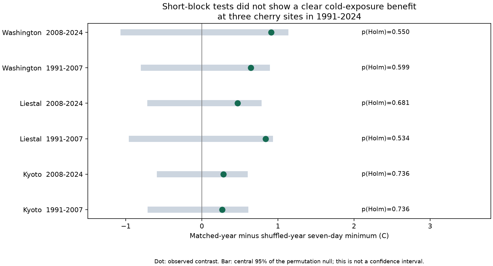

# Short-block tests did not show a clear cold-exposure benefit from cherry bloom timing at three sites in 1991-2024

We joined annual cherry bloom records at Kyoto, Liestal and Washington to daily minimum air temperature on a 0.5 degree grid. We tested 1991-2007 and 2008-2024 separately. We compared the seven-day minimum from bloom with a reference that assigns dates to weather years within four- or five-year blocks. Actual-year minima were 0.27 to 0.91 C higher than the reference in all six tests. No test had a two-sided permutation p value below 0.05, before or after six-test adjustment. Wider year shuffles gave stronger results at Washington. Some results also changed with window length, date shifts and grid cell. Thus, these tests did not establish a common cold-exposure benefit from annual bloom timing. This is a test of annual weather and timing, not a measure of damage or a causal climate effect. Fixed sites and complete years reduce changes in site coverage. Different bloom rules, unknown visit records, coarse weather and only 17 years per test limit inference. The package includes exposure matrices, source hashes, code and checks.

## Question and prior work

Does annual bloom timing place a tree in a warmer post-bloom window than dates from nearby years would? A simple relation between earlier bloom and colder exposure can mix seasonal date effects with annual weather effects. We retain the dates and the weather series, but change their annual pairing. The reference is a descriptive calculation. It is not a possible intervention on a tree.

Before choosing the precise test, we searched SCI for phenology, climate and pollution, then coral bleaching, bird surveys and cherry frost. The focused search is preserved in files/campaign_search.json. We read the published cherry forecast study SCI 12c0ec41aa55 (files/prior_read.txt). It used the same bloom archive, but tested calendar-only forecasts. Our analysis adds daily weather and a post-bloom cold-exposure measure. The biological records overlap prior campaign work. They are not independent new observations.

Chung and colleagues (2011, doi:10.1371/journal.pone.0027439) used a process model to predict Washington cherry bloom under climate change. Their study discusses cold hardening and frost injury. Our calculation tests neither physiology nor injury. It asks whether annual date-weather pairing changes a measured exposure. NOAA CPC and the fixed GMU source archive supply public data. This is an exploratory methods result within the wider climate and ecological timing objective. We do not test air pollution or species distributions.

## Data and observation bias

The fixed GMU commit is a95298263523607c8489a7be091c8c8d8ce61979. We use only data/kyoto.csv, data/liestal.csv and data/washingtondc.csv, with data/README.md for source definitions. Each site has exactly one valid bloom record in every year from 1991 through 2024. We check calendar dates against the supplied day number. We use calendar month and day when assigning dates across years, so leap years do not shift the calendar match.

Kyoto records Prunus jamasakura at Arashiyama through a local newspaper and Yasuyuki AONO. Liestal records Prunus avium when 25 percent of blossoms are in full bloom. Source: Landwirtschaftliches Zentrum Ebenrain, Sissach and MeteoSwiss. Washington records Yoshino cherry at a 70 percent threshold, from EPA and the National Park Service. All analyses stay within site. These are different species and bloom rules, so site contrasts do not identify species sensitivity.

Daily minimum temperature comes from NOAA CPC Global Unified Temperature V1.0, provided by NOAA PSL, Boulder, Colorado, USA (https://psl.noaa.gov). We use tmin.1991.nc through tmin.2024.nc. The data use a 0.5 degree grid and a 06 UTC to 06 UTC daily interval. Grid temperatures do not measure flower tissue temperature or local frost. Terrain, urban warmth, daily time boundaries and station coverage can cause error.

The nearest grid centers are 35.25 N, 135.75 E for Kyoto; 47.25 N, 7.75 E for Liestal; and 38.75 N, 77.25 W for Washington. We also test the other three centers that enclose each site. Files/provenance.json records all cells.

Fixed sites and full year coverage remove changes in sampled site count and geography from these comparisons. Short year blocks reduce the effect of slow changes in climate and record practice. They do not remove observer changes, tree replacement, threshold changes, missed visits, newspaper error or daily reporting delays. We have no visit logs. Date shifts of three days are a sensitivity check, not a bound on actual error. The three managed records do not represent global biodiversity.

## Methods

Files/plan.txt was saved after reading source definitions and example dates, before weather extraction. It was not registered. We chose the question after the campaign search. We made no outcome-based change to the primary design.

We use two separate 17-year periods, 1991-2007 and 2008-2024. For each site and period, form a 17 by 17 matrix M. Row i is the bloom month and day from year i. Column j is weather in year j. M(i,j) is the lowest daily minimum from that date through six days later in weather year j. A second matrix marks any temperature below 0 C. All used windows have complete data.

Split each period into consecutive blocks of 4, 4, 4 and 5 years. The actual value A is the mean of the 17 diagonal entries. The reference E is the sum, over blocks b, of the sum of all M(i,j) within b divided by the size of b, then divided by 17. This is the exact expected minimum under uniform independent date permutations within each block. It includes assignments that keep a date in its original year. The contrast D=A-E is positive when actual pairing gives a warmer minimum. The reference preserves the distribution of dates and the frequency of weather years within each block.

We draw 19,999 random permutations, using seed 2731107. Each permuted assignment uses every weather year once within its block. We calculate its mean minus E. The two-sided p value is (1 + number of draws at least as far from zero as D) / 20,000. We apply the Holm correction to the six primary p values. The saved central 95 percent null ranges describe shuffled assignments. They are not confidence intervals for D or for an ecological effect. The test requires exchangeability of annual date-weather pairing within each block under its null. Residual trends, serial dependence and shared drivers can violate this premise. The p values are conditional reference tests, not causal probabilities.

We specified secondary windows of 3 and 14 days, date shifts of -3 and +3 days, and each other enclosing cell. We also use unrestricted 17-year shuffles and cyclic rotations within short blocks. Rotations preserve more short-run order but wrap each block boundary. These checks do not fully solve serial dependence. Secondary p values are descriptive and are not adjusted across all variants.

## Results

| Site | Years | Actual minimum C | Shuffled minimum C | Difference C | Raw p | Holm p | Actual subzero windows |
| --- | --- | ---: | ---: | ---: | ---: | ---: | ---: |
| kyoto | 1991-2007 | 3.58 | 3.31 | +0.27 | 0.455 | 0.736 | 0/17 |
| kyoto | 2008-2024 | 3.90 | 3.62 | +0.28 | 0.368 | 0.736 | 0/17 |
| liestal | 1991-2007 | -0.81 | -1.65 | +0.84 | 0.089 | 0.534 | 11/17 |
| liestal | 2008-2024 | -0.40 | -0.87 | +0.47 | 0.227 | 0.681 | 10/17 |
| washingtondc | 1991-2007 | 1.81 | 1.17 | +0.64 | 0.150 | 0.599 | 7/17 |
| washingtondc | 2008-2024 | 1.84 | 0.93 | +0.91 | 0.110 | 0.550 | 5/17 |

Averages are over annual window minima. These are not averages of all daily temperatures.



All six primary contrasts are positive, from +0.267 to +0.912 C. All six raw p values exceed 0.05; Holm p values range from 0.534 to 0.736. We did not establish a common exposure benefit under this design. We also did not establish zero benefit. There are only 17 years in each test. All six signs cannot be treated as six independent coin flips: the sites can share annual climate influences.

The subzero indicator does not always follow the continuous measure. Kyoto has no actual subzero windows in either period at the nearest cell. Liestal has 11 and 10 of 17; Washington has 7 and 5. The reference subzero fractions are 0.015 and 0.044 at Kyoto, 0.724 and 0.662 at Liestal, and 0.394 and 0.388 at Washington. In early Washington, the actual subzero fraction is slightly higher than the reference despite a warmer mean minimum. These are descriptive grid exposures, not measured frost injury.

The design checks matter. Unrestricted year shuffles give Washington contrasts of +1.062 C and +1.505 C, with raw p values 0.032 and 0.008. Short-block cyclic shifts give raw p values 0.042 and 0.101 there. The stronger unrestricted result can reflect different reference variation, slow change or actual annual coupling; this test cannot separate them.

Three-day windows give Liestal contrasts of +1.271 and +1.032 C, with raw p values 0.015 and 0.040. The other enclosing cells give early Liestal raw p values of 0.031, 0.031 and 0.044, while its nearest-cell result is 0.089. These secondary results do not establish a repeated general benefit after selection and multiple testing. Fourteen-day and date-shift contrasts change sign in some samples. All values are in files/results.csv. We report all variants rather than select the smallest p value.

## Meaning and limits

The analysis gives a reproducible way to separate date distributions from annual date-weather pairing. It shows why a claim about frost avoidance must specify the weather window, spatial scale and reference years. The positive primary estimates are consistent with some annual timing benefit, but their reference tests are weak and some secondary results change. Neither a null test nor a positive estimate establishes biological adaptation.

We do not estimate a historical trend in injury, a causal effect of anthropogenic warming, future risk, survival, fruit production or pollination. A 0 C grid threshold is a cold marker, not a species damage threshold. Tissue state, duration of cold, flower loss before the reported peak and microclimate can change the biological response. A missing or damaged early bloom could also affect the reported peak. Source revisions and station-network changes are not in the tests. Independent station observations, visit records and damage measures are needed to test these explanations.

The periods share sites but no years. The regions are geographically separate, but the records differ in species and practice and may share climate drivers. These features support a limited check of transfer, not independent causal experiments. This finite investigation ends with the stated null and sensitivity results.

## Provenance, rights and reproduction

Job: sci-1107-dell-climate-pollution-biodiversity-273b3b044b81. Topic: climate-pollution-biodiversity. Campaign: 11_07_2026. Machine: dell. Account: codex-andrii. Model: gpt-6.1-sol with high reasoning effort. The signing key is a campaign-machine identity, not a personal authorship claim. No private key is included.

We reused all raw inputs in place and did not change shared datasets. Files/provenance.json gives each exact shared path, resolved object path, source URL, version, byte count and verified SHA-256, plus the hashes of the three used CSV members. The cherry ZIP hash is 4b66916772d2dbdb74191d4e06e7fe494544c0d2d9d60f1b81f76307279ec17a. Logical shared inputs are:

- /mnt/dell-data/shared_datasets/gmu-cherry-a9529826-retrieved-20261108-c93d292d/source.zip
- /mnt/dell-data/shared_datasets/noaa-psl-cpc-global-temp-tmin-YYYY-20261109/tmin.YYYY.nc for YYYY from 1991 to 2024.

Raw source files are not copied into this bundle. Kyoto source copyright holder: Yasuyuki AONO. Liestal raw data specify non-commercial use and source attribution. Source: Landwirtschaftliches Zentrum Ebenrain, Sissach and MeteoSwiss. Washington source: EPA and National Park Service. The SCI baseline license applies to our code, text, figures and derived evidence, and does not change source rights. No raw bloom-date table is included.

Use Python 3.12 and files/requirements.txt. From the publication root:

```sh
python files/analyze.py files /your/private/output
python files/validate.py
python files/build.py /mnt/dell-data/shared_datasets /your/private/rebuilt
python files/validate_raw.py /mnt/dell-data/shared_datasets
python files/analyze.py /your/private/rebuilt /your/private/rebuilt
```

The first command reproduces every summary, permutation draw and figure offline from saved matrices. The second independently checks the matrix statistics, cold indicators, p values and permutation means. The build command reconstructs the matrices from raw data, checks all used source-file hashes and records provenance. The raw check uses netCDF4 and direct calendar indices to check 12 diagonal and cross-year values independently of the xarray extraction. All checks passed. A second offline run gave byte-identical results and permutation CSV files.

For retrieval elsewhere, run `python files/retrieve.py /new/private/raw`. It requires a new destination, uses the preserved URLs, and checks all exact file hashes. Then use that directory as the build input. Future source revisions can cause retrieval to stop on a hash mismatch; preserve the recorded snapshots for exact reproduction. No archive or index upload was made. The signed ZIP is saved only in the local campaign.
