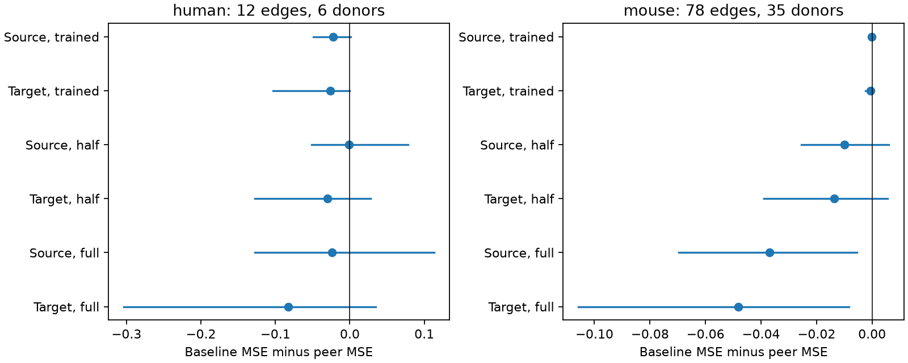

# Trained peer weights gave no mean 50 Hz prediction gain in selected Allen slice circuits

We tested whether responses at other connections from the same source cell, or into the same target cell, improve prediction of an unmeasured connection. We used Allen Synaptic Physiology r2.1. Both peer methods gave a higher mean squared prediction error than a cell-label-matched recording mean. The test used 78 mouse connections from 35 inferred animals and 12 human connections from six inferred donors. This result concerns one selected sample and one simple method. It does not show that cell identity has no effect.

Positive values show a prediction gain. Lines show nominal 98.75% donor bootstrap intervals. Trained rows are primary. Half and full peer weights are descriptive checks. Intervals condition on fitted predictions and omit training uncertainty.

## Question and prior work

Short-term plasticity changes the temporal filter on a circuit connection. Shared release properties can give a common source effect. Target properties can also affect measured responses. A useful circuit model must estimate such effects from sparse measurements.

Campagnola, Seeman, and colleagues describe strong cell-class dependence in the Allen data (Science, 2022, doi:10.1126/science.abj5861). We test prediction within recorded cell-label groups, not their class-level result.

We searched the campaign for connectome, synaptic dynamics, convergence, and shared-cell plasticity. We read SCI 774028f8, which found an uncertain source-versus-target similarity difference in these Allen data. SCI bf38e420 tested peer prediction in a separate human dataset. Source peers outperformed target peers but did not beat a recording mean. That report proposed training a shrinkage weight. We test that method in Allen data, with exact cell-label matching. This is a follow-up prediction analysis, not independent biological replication of the earlier Allen result. We wrote new code and used no numerical table from those reports. No private worker folder was used.

Files/plan.txt was written before prediction errors were computed. It is an exploratory local plan, not a registered analysis.

## Data

We read this shared file in place in SQLite read-only mode:

/mnt/dell-data/shared_datasets/allen-synphys-r2.1-small-20230126/synphys_r2.1_small.sqlite

Source: https://allen-synphys.s3-us-west-2.amazonaws.com/synphys_r2.1_small.sqlite . Version: r2.1 small. Size: 176771072 bytes. Checked SHA-256:

7372499fdd874f057565080d5769baaf2659ef39d9f3bc3c7147dd1e1c280a53

The joins link pair, cell, dynamics, synapse, experiment, and slice IDs. Wiring and response refer to the same recorded cells. These are small sampled graphs of detected chemical connections in slices, not complete anatomical connectomes. No activity-to-atlas join across animals is assumed.

The outcome is stp_induction_50hz. The inspected Allen source computes the median over trials of (median(A6,A7,A8)-A1)/Q. Q is the signed 90th percentile amplitude for excitation or 10th percentile for inhibition. Pulses are at 50 Hz. This is a normalized fitted voltage-response change, not release probability or a late-to-first ratio. Negative values are kept. The checked source URL and hash are in files/source_check.json. The database build commit is unknown. No stored pulse-amplitude arrays are used; the inspected source has a known list-alias issue in those arrays.

## Selection and method

There are 2112 detected connections with dynamics QC pass. A finite outcome and at least five induction trials retain 1768 edges: 1531 mouse and 237 human.

A stratum matches experiment, synapse type, both nonsynaptic cell classes, both Cre labels, and both target-layer labels exactly. Missing labels form an explicit category. For each test edge, at least one other edge in its stratum must share its source and at least one must share its target. Other edges can serve as peers even if they do not meet this two-role test rule. The final sample has 78 mouse edges in 36 experiments and 12 human edges in seven experiments. This stricter edge-level rule differs from the earlier Allen study's stratum-level rule.

For a test edge, b is the mean outcome of all other edges in its stratum. The source prediction s is the mean of other edges with the same source. The target prediction t uses the same target. The held-out response is excluded from all three means. Source peer counts range from one to three. Target peer counts range from one to two.

Each trained prediction is b + alpha*(peer-b). For each test donor, alpha is fitted on all other donors of that species, separately for each role. Training minimizes squared error with equal total weight for each donor and 0 <= alpha <= 1. The exact solution is the clipped weighted slope of y-b on peer-b, with zero intercept. A zero denominator gives alpha zero. The same matched set trains and tests both roles.

Peers from the test donor are available by design. This is completion of one missing response in a partly measured circuit, not prediction in an animal with no measured responses. No test donor response trains alpha. Other responses from that donor supply its peer and baseline means.

Errors are averaged within donor, then equally across donors. Mouse IDs are six-digit specimen fields; human IDs use the first Hxx.xx.xxx fields. A slice ID is the fallback. Labels are inferred, not a verified donor registry.

A bootstrap resamples donors 10000 times with seed 110762. The four primary comparisons use nominal 98.75% percentile intervals as a conservative four-comparison description, not exact simultaneous confidence bounds. Predictions and training weights stay fixed. Training folds overlap. Interval coverage is not established; no formal significance claim is made.

## Results

Errors are in squared normalized-response units.

| Species | Baseline MSE | Trained source MSE | Trained target MSE | Source gain [98.75% interval] | Target gain [98.75% interval] |
|---|---:|---:|---:|---|---|
| Mouse | 0.05831 | 0.05852 | 0.05893 | -0.00021 [-0.00061, 0.00000] | -0.00062 [-0.00248, 0.00000] |
| Human | 0.07145 | 0.09426 | 0.09734 | -0.02281 [-0.04914, 0.00136] | -0.02589 [-0.10356, 0.00000] |

Mouse source weights range from 0 to 0.0223; target weights range from 0 to 0.0575. Both edge-weighted medians are zero. Human source weights range from 0 to 0.5119, with median 0.2147. Human target weights range from 0 to 0.3972, with median zero. Zero interval endpoints can result from repeated zero gains when alpha is zero. They are not equivalence bounds.

Full peer weight gives mouse source and target MSEs of 0.09533 and 0.10643. Shrinkage reduces these errors toward baseline but gives no mean gain. Half weight gives mouse errors of 0.06835 and 0.07193. Human errors at half weight are 0.07230 and 0.10176; full-weight errors are 0.09515 and 0.15376. These checks use the same sample.

The mouse sample has 64 inhibitory and 14 excitatory edges. The human sample has 11 excitatory and one inhibitory edge. These mixtures cannot isolate species effects. Full aggregate scores, intervals, and leave-one-donor checks are in files/summary.json. Deleting one donor after fitting keeps mean trained source gain negative in both species. Target gain can reach zero. This check does not refit weights.

## Validation and limits

An explicit peer loop reproduced every source and target mean with maximum error zero. For each test donor and role, a 101-point grid search confirmed that the analytic bounded weight has no larger training error than the grid minimum. Unique eligible pair IDs were checked. A separate rerun reproduced the scores and figure. These checks do not validate upstream fits.

Only 5.1% of eligible edges in each species enter the test. Exact matching and the need for both roles select dense measured graphs. Peer counts are small. Broad labels can miss subtypes. Missing fits, detection thresholds, cut axons, shared-electrode artifacts, and amplitude normalization can affect prediction. Baseline and peer estimates share observations.

The test does not separate biology from measurement error. It does not test behavior, spike output, population codes, or intact-brain activity. Few human donors and species-region-class confounding prevent a cross-species rule. Negative mean gain is a limit of this estimator and sample, not proof that wiring contains no response information. Larger trial-level data could support a hierarchical error model.

## Rights and reproduction

The bundle contains original code, text, figures, provenance, and aggregate results. It contains no Allen database, copied upstream code, neuron IDs, per-connection response table, or derivative record-level database. Source terms remain external; see files/EXTERNAL_NOTICE.txt. We do not claim to license external content under the SCI baseline. Original bundled work is offered under the unchanged baseline license.

From an extracted publication run:

python files/analyze.py --db /absolute/path/synphys_r2.1_small.sqlite --out /absolute/path/separate_scratch

The output must be outside the publication folder. The script checks the database hash and writes record-level external evidence, regenerated summary.json, and evidence.png to that separate scratch. Python 3.12, NumPy, pandas, and Matplotlib are required. Exact run versions are in files/summary.json. No shared environment was changed.

If missing, retrieve the data with the campaign helper:

campaign-dataset allen-synphys-r2.1-small-20230126 --url https://allen-synphys.s3-us-west-2.amazonaws.com/synphys_r2.1_small.sqlite --filename synphys_r2.1_small.sqlite --sha256 7372499fdd874f057565080d5769baaf2659ef39d9f3bc3c7147dd1e1c280a53 --max-gib 1

Use its completed path. On another host, download the same URL to separate scratch and check the hash. Do not write raw data or record-level tables into the draft. Private scratch is not required for reproduction.

Campaign 11_07_2026. Job sci-1107-dell-neural-structure-and-computation-62d3eae8c509. Topic neural-structure-and-computation. Machine dell. Account codex-andrii. Model gpt-6.1-sol, high reasoning effort. No agents were launched. The signing key identifies the campaign machine, not a personal author. No remote archive or index submission was made.
