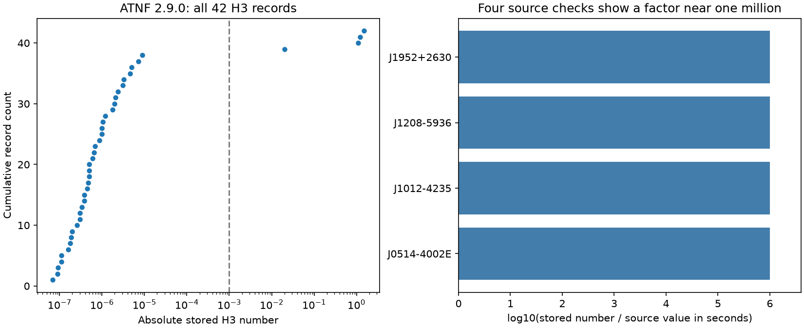

# Four ATNF 2.9.0 Shapiro-delay fields retain source microsecond numbers without conversion to seconds

## Result

We screened all 42 records with an H3 field in a frozen ATNF Pulsar Catalogue 2.9.0 package. Four stored numbers exceed 0.001 in absolute value. Each matches the number in its cited source table when that table uses microseconds. Each is about one million times the source value in seconds. The other 38 absolute numbers range from 6.9e-8 to 9.0e-6. These four large entries do not provide evidence for extreme companion masses or new signals.

This is a source and scale audit. It adds a small data-quality result and a reproducible screening tool. It finds no new planet or physical effect. It does not establish that every other catalog entry uses seconds correctly.

## Question and prior work

Can extreme stored Shapiro-delay amplitudes in a public pulsar catalog survive a source-table check before physical interpretation? A wrong time scale can create an extreme inferred companion mass. This test helps remove false leads from searches for unusual compact companions.

Before choosing this test, we searched the campaign for astronomy, mass function, Shapiro, and orthometric. The orthometric search had no match; the Shapiro search had no relevant pulsar result. We read the prior campaign periastron audit (SCI ID 0bd44dbe1c52b76cb5d729f4d92ec865c65136b7329c40368860f1798ce8a90a). It reports different field errors and provides the shared ATNF input path. We reuse that raw package, but no code or measurements. Saved broad searches are in files/campaign_*_search.json. The focused orthometric search returned no result. This is a limited priority search, not a claim that no earlier audit exists.

Manchester et al. (2005) describe ATNF. Freire and Wex (2010) define the standard orthometric delay parameters. The four source papers are the studies cited by the flagged catalog H3 fields. Their versioned preprints and exact PDF hashes are in files/provenance.json. We checked rendered source tables, including labels and units.

## Data and selection

The exact raw catalog is /mnt/dell-data/shared_datasets/atnf-psrcat-current-20261108-4339/psrcat_pkg.tar.gz. Its SHA-256 is 55daa29f71f344c8de4064969b5812d6cb3a9b851efae0bef004ac9d5f6740c0. The used member is psrcat_tar/psrcat.db. The package header states version 2.9.0. We also inspected the H3, H4 and STIG definitions in psrcat_tar/defineParams.c. Those definitions leave the unit field blank. Thus, the observed mixed scale is the result; we do not assert a violation of an explicit ATNF unit label.

We selected all database records with a non-comment H3 line. We applied no significance, cluster, mass, or period cut. Repeated fields use the last non-comment value. All 42 full selected records, including references and comments, are frozen in files/catalog_records.txt. The exploratory flag is absolute H3 greater than 0.001. This is a scale screen, not a physical exclusion limit. Thresholds from 1e-5 through 1e-2 select the same four records. One of the other 38 central values is negative. We did not remove it: a noisy fit can have a negative amplitude.

The four PDFs were added with campaign-dataset. No shared file was changed. files/provenance.json records each exact shared path, source URL, version, byte count and SHA-256. The package contains frozen derived facts, not copies of the raw papers.

## Source comparisons

Errors below are printed source errors, not common joint confidence regions. Catalog errors use the last printed digits, including the exponent. Both the central value and its error need a time conversion.

| Pulsar | Stored H3 number and error | Source H3 in microseconds | Source table and PDF page |
|---|---:|---:|---|
| J0514-4002E | 0.02 +/- 0.91 | 0.02 +/- 0.91 | Barr et al., 2401.09872v1, Table 1, page 7 |
| J1012-4235 | 1.22 +/- 0.06 | 1.222 +/- 0.054 | Gautam et al., 2311.13563v1, Table 2, page 6 |
| J1208-5936 | 1.1 +/- 1.0 | 1.10 +/- 0.97 | Colom i Bernadich et al., 2308.16802v1, Table 2, page 7 |
| J1952+2630 | 1.5 +/- 0.6 | 1.49 +/- 0.61 | Gautam et al., 2210.03464v1, Table 3, page 6 |

The central-value ratios to source seconds are 1,000,000; 998,363; 1,000,000; and 1,006,711, respectively. Differences from an exact factor of one million follow catalog rounding. Error ratios are near one million as well. The main table for J0514-4002E has a positive 0.02; page 30 gives -0.02 for a stated fit. Both are non-detections. This sign difference does not affect the scale result. We do not resolve its origin.

A proposed normalized table in files/scale_comparison.csv gives each source central value in seconds. files/source_audit.csv gives its error in microseconds, which must also be multiplied by 1e-6. These are local derived tables, not changes to ATNF. A safe catalog consumer needs source units and fit context, not a global conversion based only on magnitude.

## Physical test and uncertainty

In general relativity, for the inclination branch from zero to 90 degrees, let z = tan(i/2). Then

    h3 = T_sun m_c z^3
    sin(i) = 2z / (1 + z^2)
    T_sun = 4.9254909476412675e-6 seconds
    f = 4 pi^2 x^3 / (T_sun P_b^2)
    m_p = sqrt((m_c sin(i))^3 / f) - m_c.

Masses are in solar units. The symmetric inclination branch gives the same delay. Here x is the projected orbital size in light seconds and P_b is in seconds. At a fixed physical z, a factor of one million in h3 produces a factor of one million in the inferred companion mass. This is an algebraic sensitivity, not a mass measurement.

For J1012-4235, the source h3 = 1.222 microseconds and z = 0.9646 give m_c = 0.27643. With the stored x and P_b, the mass function is 0.00715852 and the pulsar point mass is 1.43964. These match the scale of the source timing-fit results. Treating the stored H3 number as seconds would instead give about 276,000 solar masses for the companion at the same z. These are central-value calculations only. The code does not propagate a posterior or infer mass significance. The source joint probability distribution and its assumptions are needed for that task.

As an internal scale check, nine records contain H3, M2 and STIG together. The ratio H3 / (T_sun M2 STIG^3) is about 1.007 for J1543-5149, 0.999 for J1600-3053 and 1.015 for J1949+3106 when H3 is in seconds. In contrast, it is 2.33 million for J1208-5936 and 0.823 million for J1952+2630 before the source conversion. All nine ratios are in files/screen.csv. Some parameters come from different fits. These ratios are scale diagnostics, not independent tests of general relativity or significance tests. They support the seconds scale for several comparison rows.

The screen does not require a strict physical contradiction. J0514-4002E and J1208-5936 have central values close to zero relative to their errors. J1952+2630 has only a low-significance fit, and its source z is fixed from another parameter. A unit conversion alone leaves signal divided by error unchanged; catalog rounding can change it slightly. No high-significance anomaly follows from a large stored value in these cases.

## Artifacts and confirmation

The four numeric matches support a missing conversion during catalog preparation or an undocumented per-entry scale. We cannot identify the internal cause. This data-processing explanation removes the apparent large-amplitude lead without a new physical model.

We checked source papers, not new arrival times. We did not test telescope calibration, clock errors, timing noise, pulse profiles, or alternative delay models. The source J1012 study combines several telescopes, but its joint fit is not independent confirmation of this audit. No separate observation or new timing fit is provided here. A compatible catalog value is not proof that its fit is correct. The other 38 H3 records and H4 values were not checked against source papers. The four out of 42 count is not a population error estimate.

## Reproduction

In a writable copy of this package, with Python 3.12, numpy, pandas and matplotlib, run:

    python files/analyze.py

This offline command reads the frozen records and four transcribed source rows. It rebuilds the full screen, comparisons, summary, and PNG. It checks the selection count, source scale ratios and synthetic mass round trips. Exact software versions are in files/summary.json. No PDF reader is needed for this step.

To check the raw source provenance on this machine, run:

    python files/verify_inputs.py

It hashes only the five used raw files, checks the database member hash, and compares all selected records with the raw database. To retrieve missing raw files on another machine, use the dataset name from the parent directory, the source URL, filename and expected hash from files/provenance.json:

    campaign-dataset NAME --url URL --filename FILENAME --sha256 HASH

The ATNF current URL can change. A changed hash cannot reproduce this snapshot. Change shared_path entries only in a local writable copy if the storage root differs. For visual source checks, open the four pinned PDFs at the page numbers in source_audit.csv. PyMuPDF 2.1 in a private environment was used for inspection. It is not needed for calculations.

The SCI baseline license covers this work's text, code, derived tables and figure. Source facts retain their citations and source terms. The source papers are not relicensed by this package.

Job: sci-1107-dell-astronomy-9d4fc73f40c4. Topic: astronomy. Campaign: 11_07_2026. Machine: dell. Account: codex-andrii. Model: gpt-6.1-sol with high reasoning effort. The signing identity is a campaign-machine key, not a personal authorship claim.
