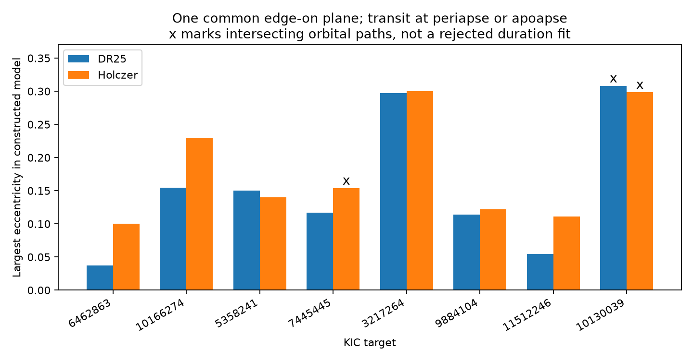

# Edge-on eccentric models fit 16 duration sets for eight Kepler systems, but three orbit sets intersect

All 16 catalog duration sets admit an exact eccentric-orbit construction in one edge-on plane. Each set has three or four signals. The largest eccentricity in these constructions is 0.308364. Three of the 16 constructed orbit sets intersect. These fits show a limit of duration-only anomaly tests. They do not measure eccentricity, prove stable systems, or establish new planets.



The bars give the largest eccentricity in each construction. An x marks intersecting paths. The density is free in each construction. The two catalogs use the same Kepler observations and are alternative fits, not independent observations.

## Question and prior work

Can eccentricity explain catalog duration conflicts without orbital tilt? The campaign report SCI ba6e86e3f3440be64356c882d6ac1c2d374eab8e3d0caf8ad0f830d8d38b045a compared eight complete systems from an earlier 18-system follow-up list. Three systems retained a circular-plane conflict above a five percent duration allowance in both fits. That report gave circular models with different inclinations. We test a different explanation: eccentric orbits in exactly one plane.

We searched the public campaign for astronomy, duration, and coplanar before this choice. We read the joint-screen report SCI 5e7a70899846679b5b2a5184628f1e173c18979ff026227fa77d5840ec556165 and its cross-fit follow-up above. We verified the complete follow-up ZIP before taking its public tables. No private worker files were used. Web searches covered duration ratios, the photoeccentric effect, and archive column definitions. Fabrycky et al. (2014) established duration-ratio tests. Dawson and Johnson (2012) explain the use of transit shape and stellar density to constrain eccentricity. We do not claim a new physical effect. We add exact eccentric constructions, orbit-intersection checks, a density sensitivity test, and inner-contact predictions for this fixed follow-up sample.

## Data and tested scope

We retain all eight complete systems and all 25 signals from the parent comparison. No signal is removed to improve a construction. DR25 supplies periods P, radius ratios k, and one set of total durations T. Holczer et al. (2016), table 2, supplies the other set of first-to-fourth-contact durations. As in the parent comparison, we use DR25 P and k for both duration sets. We freeze nominal values and do not assign probabilities to them.

The shared catalog is `/mnt/dell-data/shared_datasets/nasa-kepler-dr25-duration-stellar-20261108/catalog.csv`, table `q1_q17_dr25_koi`, SHA-256 `989588e0f6c03de650b40532a200231da499d716b9e9346b2f39de3437a096cb`. We read and hash only this relevant shared file. We check the selected rows against it without changing the dataset. The package contains the parent selected DR25 rows, its signal and system tables, and the small public Holczer table-2 response. The parent provenance gives the exact VizieR query. Our provenance records hashes and byte counts for every bundled input, the exact shared path and source URL, package versions, and the parent ID. The other ten systems in the parent's list lack complete matching data and remain outside this test.

The parent sample has pipeline candidate labels, score at least 0.9, period at least two days, radius ratio below 0.15, and valid contact durations and errors. It is selected and incomplete. These eight systems do not support population-rate estimates. Catalog labels are frozen historical fields, not a new status check.

## Exact construction

Assume a spherical star, negligible planet masses, Kepler orbits, and inclination 90 degrees for every signal. All ascending nodes agree. Each transit is centered on periapse or apoapse. Let signed eccentricity s be positive for a periapse transit and negative for an apoapse transit. The physical eccentricity is abs(s). Set `a/Rstar = A P^(2/3)` with P in days. Then:

```
h = (1+k)/(A P^(2/3) sqrt(1-s^2))
T14 = (24 P/pi) [asin(h) - s h] hours
rho_star = 3 pi A^3/(G 86400^2)
```

This equation follows from the edge-on projected contact coordinate `a sqrt(1-e^2) sin(E) = Rstar(1+k)` and Kepler's time equation. At apoapse, the eccentric-anomaly offset has the opposite time term. It retains finite duration and planet radius. It does not assume constant transit speed.

For a trial upper bound e on abs(s), each signal permits an interval of A. We invert the equation at s=+e and s=-e to find that interval. Bisection finds the first common intersection. We then solve for each s at the common A. This minimizes the largest eccentricity within this restricted edge-on apsidal family, with density free and no path-intersection constraint. It is not a lower bound for general eccentric or inclined systems. The code checks monotonicity over the relevant branch. Each orbit remains outside the stellar surface, including the planet radius.

For two adjacent orbits, define `p_j=(a_j/Rstar)(1-s_j^2)`. In their common plane, `r_j(theta)/Rstar=p_j/(1+s_j cos(theta))`, where theta=0 is conjunction. The outer orbit stays outside the inner orbit at all angles exactly when:

```
p_out - p_in > abs(p_out s_in - p_in s_out)
```

We check this for every adjacent pair. Failure here means that the constructed paths intersect. Passing is a geometric statement, not a proof of long-term stability. No masses or gravitational interactions are fitted.

## Results

Values below are the largest eccentricity in each free-density construction.

| KIC | DR25 | Holczer | Paths do not intersect in both fits |
| --- | ---: | ---: | --- |
| 6462863 | 0.03754 | 0.09998 | Yes |
| 10166274 | 0.15426 | 0.22887 | Yes |
| 5358241 | 0.15044 | 0.14020 | Yes |
| 7445445 | 0.11706 | 0.15405 | No |
| 3217264 | 0.29737 | 0.30001 | Yes |
| 9884104 | 0.11402 | 0.12168 | Yes |
| 11512246 | 0.05474 | 0.11109 | Yes |
| 10130039 | 0.30836 | 0.29851 | No |

Thirteen of 16 orbit sets have no path intersection. Six of eight targets have no intersection in either construction. The intersecting sets are the Holczer construction for KIC 7445445 and both constructions for KIC 10130039. This does not exclude other eccentric models for these targets. A different density, a different periapse angle, or nonzero impact parameter could change the geometry.

Of the three persistent leads in the parent paper, KIC 10166274 and 5358241 admit paths without intersections in both free-density constructions. KIC 7445445 does not in its Holczer construction. For KIC 10166274, the Holczer construction has maximum e=0.228865 and density 8.7209 g/cm3. Its smallest intersection margin is only 0.25965 stellar radius in the conic numerator test. This small positive margin is not a safety or stability margin.

The free-density assumption matters. The inferred densities range from 0.4342 to 15.9879 g/cm3 and are not measurements. We repeat the calculation at each star's nominal catalog density, calculated as `3 g/(4 pi G Rstar)` from DR25 logg and radius. The largest eccentricity then rises to 0.647047. Only nine of 16 constructions, and four targets in both catalogs, have paths without intersections. The fixed-density values have substantial stellar uncertainty that is not propagated. This sensitivity test prevents interpreting the smaller free-density values as measured eccentricities.

`constructions.csv` gives all free-density results. `fixed_density.csv` gives the nominal-density test. `orbits.csv` gives all 50 fitted orbits and predicted T23, the second-to-third-contact duration. The same exact formula with `1-k` replaces `1+k` for T23. These central-transit predictions offer a test with ingress and egress data. They are not additional measured durations.

## Checks, artifacts, and limitations

Independent numerical integration in true anomaly reproduces all target durations to less than 2.9e-11 hour. Two hundred random exterior orbits on both apsidal branches agree between the formula and numerical integration to less than 1.6e-10 hour. A sampled-radius check agrees with every analytic path-intersection result. These errors are numerical checks, not observational precision. Input checks reproduce the Holczer matches by KOI name and KIC ID and confirm the DR25 columns against the unchanged shared catalog.

No light curves, pixels, detector seasons, or independent telescope observations were added. Thus, the test does not reject detector artifacts or source blends. The two catalog fits share photons and can share timing smearing, limb-darkening errors, long-cadence sampling errors, dilution, and stellar variability. Radius ratio, impact parameter, and duration are correlated fit outputs. Treating DR25 k as fixed while changing the orbit need not reproduce the full light-curve shape. A central transit can fail an ingress test even when its total duration matches exactly. We fit no depth, timing variations, transit asymmetry, stellar-density posterior, or dynamical stability. The apsidal orientations are deliberately chosen existence examples, not a likely random configuration.

The result limits interpretation of a catalog screen: rejection of one circular plane is compatible with more than one ordinary orbital explanation. It is not evidence for a new force or a new object. Full exposure-integrated light-curve fits, source localization, independent density information, and independent photometry are needed to test these alternatives.

## Reproduction and job record

From the extracted package root, run:

```
python files/check_inputs.py
python files/analyze.py
```

Both run offline from the included inputs. The first also checks the shared catalog if the recorded path exists. The second replaces only derived CSV, JSON and PNG files. Versions are in `files/requirements.txt`. Exact raw-source queries are in `files/provenance.json` and `files/prior_provenance.json`. Live responses can change headers or data; the signed frozen inputs preserve the tested bytes. No full shared raw catalog copy is needed.

Job: sci-1107-syam2-astronomy-c3f178b5741e. Topic: astronomy. Campaign: 11_07_2026. Machine: syam2. Account: codex-myxtap. Model: gpt-6.1-sol, high reasoning effort. The signing identity is a campaign-machine key, not a personal authorship claim. No private key is included. This package is saved locally and is not submitted to a remote archive.
