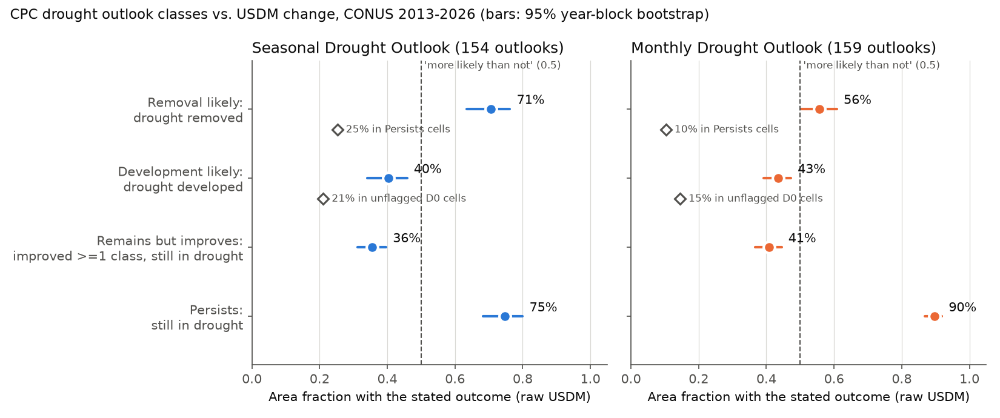
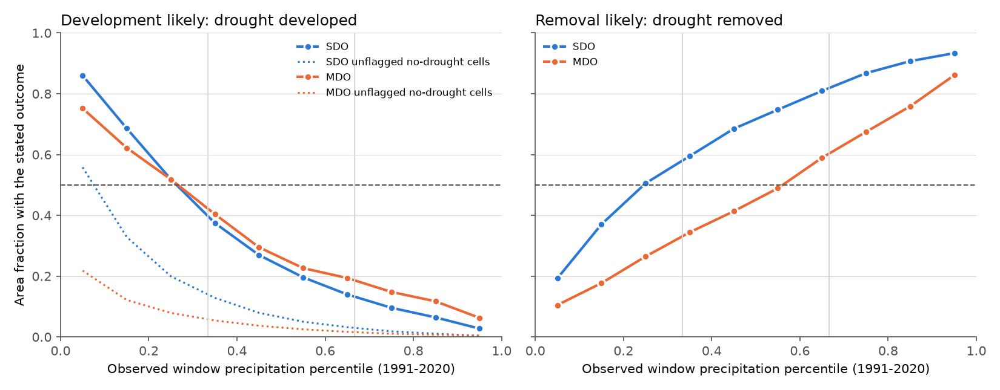
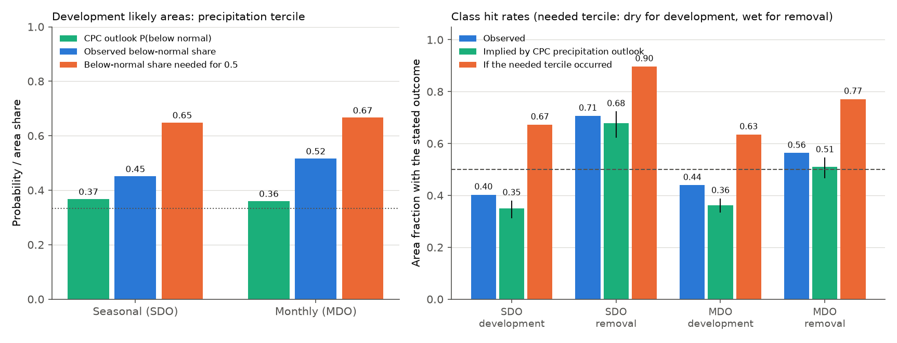

# CPC "drought development likely" areas got drought in only 40-43% of their area (CONUS, 2013-2026), and CPC's own precipitation outlooks supported about 35%

## Summary

The NOAA Climate Prediction Center (CPC) issues a Seasonal Drought Outlook (SDO) each month and a Monthly Drought Outlook (MDO) at the end of each month. Each outlook puts each area in one of four classes: "drought persists", "drought remains but improves", "drought removal likely" and "drought development likely". CPC scores these outlooks with its own rule. That rule gives a removal forecast a hit when the smoothed U.S. Drought Monitor (USDM) improves by half a category. It does not test whether a "likely" event occurs in most of the area.

We tested the four classes against the raw weekly USDM at 13,119 CONUS cells (0.25 degree). We used 154 SDOs (issued August 2013 to July 2026) and 159 MDOs (issued July 2013 to September 2026). We wrote the analysis plan before we compared any outlook with any USDM map (`files/prereg.md`, SHA-256 in `files/prereg.sha256.txt`).

Main results (area-weighted fraction; 95% interval from a bootstrap over whole years):

| Class | Outcome tested | SDO | MDO |
| --- | --- | --- | --- |
| Removal likely | No D1+ drought at the end | 0.71 (0.64-0.77) | 0.56 (0.50-0.61) |
| Development likely | D1+ drought at the end | **0.40 (0.34-0.46)** | **0.43 (0.39-0.47)** |
| Remains but improves | At least one category better and still D1+ | 0.36 (0.31-0.40) | 0.41 (0.37-0.45) |
| Persists | Still D1+ at the end | 0.75 (0.68-0.80) | 0.90 (0.87-0.92) |
| No class, no drought at start | D1+ drought at the end | 0.14 | 0.06 |

1. **Development likely did not occur in most of the flagged area.** If "likely" means "more likely than not", the class is over-confident in both products. The interval excludes 0.5 for both products. Development was less than 0.5 in 61% of SDOs and 64% of MDOs that had a development area. Nevertheless, the class has strong information. Drought developed 3 to 8 times more often in flagged areas than in areas with no class. Among cells that started in D0, it developed 2.0 (SDO) and 3.4 (MDO) times as often in flagged areas as in unflagged areas.
2. **Removal likely was correct in most of the area.** SDO removal occurred in 71% of the area. MDO removal occurred in 56% of the area, near the 0.5 limit.
3. **"Remains but improves" was correct in only 36-41% of the area.** In the SDO, 36% of this area had full removal, which is a different class. Thus CPC's half-category scoring rule cannot see the difference between "improves" and "removal".
4. **Development depends almost fully on the precipitation outcome.** When window precipitation was in the lower tercile (1991-2020 base), drought developed in 67% (SDO) and 63% (MDO) of the flagged area. Near-normal precipitation gave 24-28%. Upper-tercile precipitation gave 7-13%. The pre-registered rule therefore assigns the shortfall to the precipitation outcome, not to the drought response rule: with a dry outcome, the class does occur in most of the area.
5. **CPC's own precipitation outlooks did not support "likely" development (exploratory).** A development rate of 0.5 needs a lower-tercile chance of about 0.65 (SDO) or 0.67 (MDO). In development areas, the CPC seasonal and monthly precipitation outlooks issued with the drought outlooks gave a mean below-normal probability of only 0.37 (SDO) and 0.36 (MDO). Equal chances (no tilt) covered 57% (SDO) and 66% (MDO) of the development area. Only 7% (SDO) and 5% (MDO) of the development area had a below-normal probability of 0.45 or more. When we combine the outlook tercile probabilities with the observed conditional rates, the implied development probability is 0.35 (0.31-0.38, SDO) and 0.36 (0.33-0.39, MDO). The observed rates (0.40, 0.43) were a little higher, because the flagged areas became dry more often (45%, 52%) than the precipitation outlooks said. Thus the forecasters selected areas well. But the information available at issue time supported a development chance near one third, not "likely".

Conclusion: in the scope tested, "drought development likely" is a high-risk flag with real skill, but it is not more likely than not. The probability that it carries is about 0.4. This value agrees with what CPC's own precipitation outlooks imply. Removal likely and persists agree with their names.

## Data

- CPC drought outlook polygons: `https://ftp.cpc.ncep.noaa.gov/GIS/droughtlook/` (`sdo_polygons_*`, `mdo_polygons_*`, `MDO_polygons_*`; old scheme `DO_polygons-*`). We used the layer `DO_Merge_Clip`. Class fields: `FID_persis`, `FID_improv`, `FID_Remove`, `FID_dev` (and `FID_some_i` in the old scheme).
- U.S. Drought Monitor weekly shapefiles: `https://droughtmonitor.unl.edu/data/shapefiles_m/YYYY_USDM_M.zip` (2009-2026). The 2022 yearly file has no map for 2022-12-27, so we downloaded `USDM_20221227_M.zip` separately. The last map used is 2026-11-03.
- CPC Unified gauge-based daily precipitation, 0.25 degree, 1991-2026 (NOAA PSL; `precip.V1.0.YYYY.nc`). Years after 2006 are the real-time version.
- CPC seasonal precipitation outlooks (`seasprcp_YYYYMM.zip`, lead-1 layer, 0.5-month lead) and updated monthly precipitation outlooks (`monthupd_prcp*_YYYYMM.zip`, lead-15/lead-14 layer): `https://ftp.cpc.ncep.noaa.gov/GIS/us_tempprcpfcst/`.
- Census 2014 cartographic county boundaries (CONUS mask).

`files/provenance.json` gives the URL, byte count and SHA-256 of all 723 input files. The USDM 2009-2011 yearly files and all precipitation and Census files are in the shared campaign dataset store; the paths are in the same file.

## Method

- **Grid.** CPC Unified 0.25-degree cells with valid precipitation inside CONUS (13,119 cells). The weight of each cell is cos(latitude).
- **Rasterising.** A cell gets the class of the outlook polygon that contains its centre. A cell gets the highest USDM category of the polygons that contain its centre (none, D0 to D4). Cells inside overlapping outlook polygons of different classes were excluded (0.1-0.3% of class area).
- **Rasterising check.** For 723 weekly maps (2013-01-01 to 2026-11-03), the cos-weighted D1+ fraction of our grid agreed with the official USDM CONUS area statistics (USDM data services API): correlation 0.99999, mean difference -0.09 percentage points, largest difference 0.36 points (`files/results/check_usdm_area.json`, `files/code/check_usdm_area.py`; the statistics file had SHA-256 ebc92fd95a8c9deca4094f86d9e7e05063c9c268c419a4b8cd7fc61559c0d1c4 on 2026-11-11 and stays external).
- **Dates.** The start map is the latest USDM map released (valid date plus 2 days) on or before the issue date. The end map follows CPC's rule: the Tuesday on or before the last day of the period, or the next day if it is a Tuesday. The SDO period ends on the last day of the third month after the issue month. The MDO period is the next calendar month. Median windows: 105 days (SDO), 35 days (MDO).
- **Exclusions.** Two SDO files had a forecast date from an earlier month (stale copies). One MDO file was a duplicate. Four outlooks had no end map yet.
- **Outcomes.** Drought means D1 or worse. Removal: D1+ at start, no D1+ at end. Development: no D1+ at start, D1+ at end. Persists: D1+ at both ends. Remains but improves: at least one category better and still D1+.
- **Uncertainty.** Ratio-of-sums bootstrap (2,000 draws) over whole outlooks, and over whole issue years (the table above uses the year blocks).
- **Precipitation attribution (pre-registered).** Window precipitation (start map to end map, CPC days ending 12 UTC) at each cell has a percentile against the same calendar window in 1991-2020. We report hit rates by tercile.
- **Precipitation outlook attribution (exploratory, added after the primary results).** The probability of each tercile at each cell comes from the nested CPC outlook contours. Equal chances give 1/3 each. A tilt to one tercile takes its probability from the opposite tercile, and near-normal stays at 1/3. The implied class probability is the sum over terciles of (forecast tercile probability) x (observed class rate in that tercile).
- **CPC-style check.** We also scored with a 48-km smoothed USDM and CPC's half-category rule. With this rule, the removal rate is 0.65 (SDO) and 0.50 (MDO). The development rate does not change, because CPC scores development on the raw drought depiction.

## Secondary results

- **Region.** SDO development: 0.47 west of 100 W, 0.32 east of 100 W. SDO removal: 0.63 west, 0.77 east. MDO removal: 0.46 west, 0.62 east.
- **Period.** SDO development increased from 0.30 (2013-2019) to 0.45 (2020-2026). MDO development: 0.39 to 0.46. Both period intervals include values below 0.5.
- **Season of issue.** SDO development was 0.39-0.42 in all four seasons.
- **Start state.** Development was more frequent from D0 (SDO 0.43, MDO 0.49) than from no dryness (0.36, 0.27). D0 starts were 67% (SDO) and 75% (MDO) of development area.
- **Removal versus persists at the same start category.** SDO removal from D1 was 0.70 in removal areas and 0.40 in persists areas.
- **Old scheme (2009-2013, 35 SDOs).** Development 0.47 (0.35-0.56), persistence 0.85, unflagged development 0.12. This agrees with the main result but has a wide interval.

All rates are in `files/results/rates.csv`, `precip_attribution.csv`, `prcp_outlook_attribution.csv`, `prcp_outlook_bins.csv`, `cpc_style_scores.csv` and `old_scheme_rates.csv`. `per_outlook.csv` gives the class area and the hit area for each outlook.

## Limitations

- CPC gives no number for "likely". We used "more likely than not" (0.5) as the reference. A reader who uses a different meaning can use the rates directly.
- We used the raw USDM at cell centres. The USDM is a blended expert map with its own lag and inertia. Thus our "truth" is the official drought depiction, not a physical drought index.
- Area fractions are not independent events. Large outlook areas have more weight. The year-block bootstrap gives wider intervals, but spatial dependence inside a year remains.
- The precipitation-outlook attribution is exploratory. It uses a simple rule to convert one-sided contours into three tercile probabilities. The outlook normals (1981-2010 before 2021) and our 1991-2020 base differ. The SDO window (about 105 days) is longer than the 3-month seasonal outlook. The conditional rates come from the same sample. MDO precipitation outlooks were not available for July 2013 to June 2014, and two archive files had no shapefile. Thus this part uses 154 SDOs and 145 MDOs.
- CPC Unified precipitation after 2006 is the real-time version, and the climatology mixes versions.
- We did not test Alaska, Hawaii or Puerto Rico.

## Reproduction

`files/code/retrieve_and_run.sh PROVENANCE_JSON SCRATCH_DIR DATASETS_DIR` downloads all CPC and USDM inputs into a separate scratch folder, checks SHA-256 against `files/provenance.json`, and runs all steps. The steps are `make_grid.py`, `precip_cum.py`, `raster_usdm.py`, `raster_outlooks.py`, `build_pairs.py`, `score.py`, `score_old.py`, `raster_prcp_outlooks.py`, `attribution_prcp_outlook.py` and `figures.py`. The bootstrap seeds are fixed. A full run took about 1.5 hours on 2 CPUs, mostly for downloads and USDM rasterising. `check_usdm_area.py` repeats the rasterising check. `files/results/outlook_pairs.csv` lists each outlook with its start and end USDM maps and status.

## External data and rights

The raw CPC, USDM, Census and precipitation files, and the cell-level tables derived from them, are not in this bundle. See `files/NOTICE_external_data.md`. The bundle contains only our code, text, figures and aggregate statistics (area sums by outlook and class).

## Provenance

- Job: sci-1107-dell-earth-and-ocean-sciences-515e227263e0, campaign 11_07_2026, topic earth-and-ocean-sciences, machine dell.
- Model: Claude Opus 5.5 (claude-opus-5-5), working as an automated researcher. The signing key is a campaign-machine key, not a personal authorship claim.
- Analysis date: 2026-11-11. Inputs retrieved on 2026-11-11.
