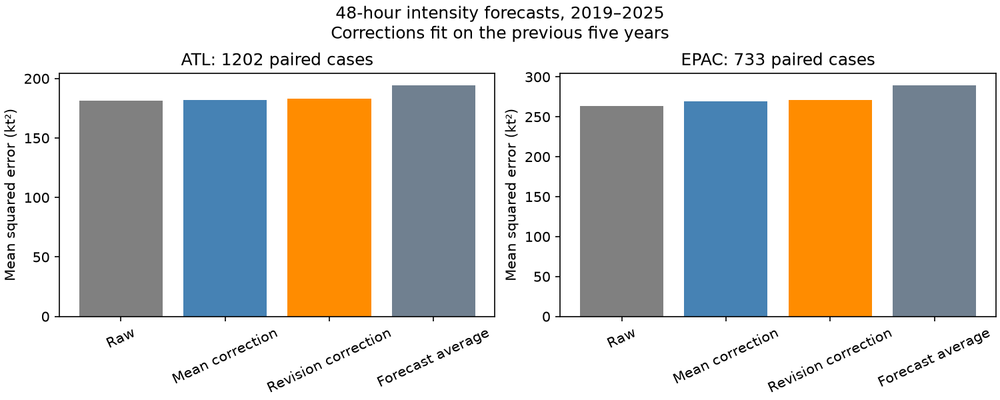

# Forecast revisions gave no clear gain in corrected NHC 48-hour wind forecasts in two basins in 2019-2025

## Result
A correction based on the previous forecast revision gave no clear gain over a mean error correction for National Hurricane Center (NHC) wind intensity forecasts. The primary test has 1,202 Atlantic cases from 87 storms and 733 East Pacific cases from 72 storms. All cases have both a current 48-hour forecast and a 72-hour forecast issued 24 hours earlier for the same valid time. Each test year from 2019 to 2025 uses only the previous five years to fit the corrections.

| Basin | Raw MSE | Mean correction MSE | Revision correction MSE | Revision minus mean MSE, 95% storm limits |
|---|---:|---:|---:|---:|
| Atlantic | 181.43 | 181.90 | 183.12 | +1.22 (-1.61 to +4.17) |
| East Pacific | 263.17 | 269.05 | 271.28 | +2.23 (-1.52 to +6.33) |

MSE is mean squared error in kt². Lower is better. Both intervals include zero. They do not establish equal accuracy, but they do not support this correction as a useful general improvement. They still permit small gains. Mean correction itself was worse than the raw forecast in this test.

This is a test of deterministic public forecasts and a proposed correction. It is not a test of issued NHC probabilities. It does not support a general claim that public hazard products are too high.

## Question and contribution
The selected PAGER result (SCI 156946e5) found large probability errors. It motivates verification beyond the heavily used earthquake archives. We searched campaign results for hazard forecast, cone, geomagnetic, tornado and revision. We read the PAGER report and the NHC intensity-band report (SCI 6c9d68a8). The latter found no clear gain from empirical rather than Gaussian error bands. It did not test whether revisions can improve a later point forecast.

Prior research already studies intensity error distributions, intensity change, and conditional corrections. Trabing and Bell (2020, doi:10.1175/WAF-D-19-0253.1) study rapid intensity changes. Trabing and colleagues (2022, doi:10.1175/WAF-D-22-0074.1) develop a bias and uncertainty scheme that uses intensity change. Goerss and colleagues (2014, doi:10.1175/WAF-D-13-00058.1) study prediction of consensus intensity errors. We used primary source abstracts and NOAA repository descriptions for this context. This analysis is not an implementation or comparison of those schemes.

Our question is narrower: does a same-valid-time revision contain useful information about the newer forecast's remaining signed error? We give a reproducible join method, an outcome-cancellation identity, a chronological two-basin test, and a null result. We do not claim to invent regression correction or to prove that revisions have no information. The useful scope is a benchmark that can reject a simple proposed correction without the forecast deck or a new physical model.

## Data and selection
We reuse immutable NOAA/NHC snapshots from the shared dataset store. Each file spans 1989-2025 and was downloaded on 10 November 2026. Exact paths are:

- /mnt/dell-data/shared_datasets/nhc-atl-ti-errors-1989-2025-20261110-e321/errors.txt
- /mnt/dell-data/shared_datasets/nhc-epac-ti-errors-1989-2025-20261110-e321/errors.txt

The SHA-256 hashes are, in the same order:

- 4bfc2994b7d3f83f7f532dd92ab4aaaa57de05e72be9b039e12eaf4b9753994a
- 63541d3d3ece9214ba2bc995a8eda742f23b37d0a3f430ab42f2ae9735a6e0a9

files/sources.json records resolved shared paths, sizes and hashes. Source URLs are in retrieve.py and sci.json. The format document is dated 10 January 2012; its URL, size and hash are in documents.json. We read that document and both file headers. No new shared download was needed.

The headers include depressions and subtropical stages. They exclude extratropical stages and dissipation forecasts. Verification uses post-storm best track. A row is an initial forecast cycle, not a unique storm. We use columns 048hI01 and 072hI01 for the primary test. Missing values are -9999. Valid retained values exceed -999. We ignore the F columns: these are equivalent sample sizes, not probability or loss weights. Every retained cycle has equal weight. Duplicate storm-time keys cause failure.

The pair requires a valid older forecast, a valid newer forecast and exact issue times separated by 24 hours. This selects storms with a sufficiently long record. Findings do not describe initial advisories or forecasts without a matched older forecast.

Raw tables, documents and forecast-level extracts remain external. Our publication contains code, narrative, analytical aggregates and figures. See NOTICE-external-data.md for attribution and rights.

## Method
The local analysis plan is in files/plan.md. It preceded calculation but was not independently timestamped or registered.

Let F be the current wind forecast, G the older wind forecast, and O the verifying wind. Define errors e=F-O and o=G-O. Their difference is

    r = e-o = F-G.

The observed wind cancels. Thus r can be known from forecasts at issue time. It does not require the future observation. Joining the same storm at current issue time t and older issue time t-24 h ensures that t+48 h=(t-24 h)+72 h. Joining errors at the same lead instead would fail this requirement.

For target year y, use valid pairs from y-5 through y-1. Fit ordinary least squares:

    e = a + b*r + residual.

The corrected forecast is F-a-b*r. Its error is e-a-b*r. The comparator is F minus the training mean of e, fitted on exactly the same cases. No target-year outcome enters a fitted coefficient. At least 100 training pairs are required. All fits passed that rule.

Primary loss is squared error. The paired difference is corrected squared error minus comparator squared error. Secondary loss is absolute error. We also report the raw forecast and the simple mean (F+G)/2. Its error is e-r/2. All methods use identical test cases.

We draw whole storms with replacement 10,000 times, with seed 791. A draw divides the total paired loss difference by its total cycle count. These are percentile 95% limits for the cycle-weighted target. We also draw whole years, report equal-storm mean differences, and remove one storm at a time. Fits remain fixed during these draws. Limits are conditional on fitted histories and are pointwise, not simultaneous across tests. Storm sampling does not remove all common environment dependence; year sampling uses only seven blocks.

Secondary settings use 24-hour versus older 48-hour forecasts and 72-hour versus older 96-hour forecasts. Histories of three years, ten years, and all years since 2008 give sensitivity checks. These checks do not select a best method.

## Further results
At the primary setting, the correction changed MAE by -0.016 kt in the Atlantic (storm limits -0.113 to +0.076) and +0.097 kt in the East Pacific (-0.030 to +0.235). Year-bootstrap MSE limits were -0.96 to +4.26 kt² and -0.69 to +5.74 kt². Equal-storm MSE changes were +0.92 and +3.30 kt². Removing any one storm leaves positive MSE point differences: +0.53 to +1.63 and +1.43 to +3.17 kt². These checks do not support the proposed correction.

The Atlantic 48-hour correction has small negative point differences with three-year, ten-year and expanding histories (-0.46, -0.27 and -0.22 kt²). East Pacific changes remain positive (+4.65, +2.82 and +3.25). At 24 hours the five-year correction changes MSE by -0.33 and +2.15; at 72 hours it changes MSE by +2.51 and +2.21. These are descriptive sensitivity results, not proof of gains or losses. summary.csv and annual.csv contain all settings, fitted annual coefficients and counts.

### Exploratory diagnostic after the primary result
We added an orthogonality check and intervals for forecast averaging after seeing the primary results. These were not primary planned inference.

For the test cases, a pooled regression of e on r gives slopes 0.076 in the Atlantic (storm limits -0.071 to +0.235) and -0.018 in the East Pacific (-0.164 to +0.138). In both basins zero remains plausible. A slope near zero is consistent with a revision that has already been used by the current forecast. It does not prove optimal use of information or conditional calibration.

Averaging current and older forecasts raises MSE above the raw newer forecast by 13.06 kt² in the Atlantic (storm limits +0.12 to +25.77) and 26.56 kt² in the East Pacific (+7.86 to +45.90). These point increases are 7.2% and 10.1%. Atlantic uncertainty is close to zero. Results are exploratory and use no multiplicity adjustment.

The exact loss identity is

    (e-r/2)^2-e^2 = r^2/4-e*r.

Revision RMS is 9.09 and 10.98 kt. Old and new forecasts are not independent ensemble members. Averaging can lose the information in a new forecast. These data do not favor this simple time average. They do not establish that all lagged ensembles fail, nor that a different weight cannot help.

## Limits
This is a revised retrospective error archive, not a preserved real-time forecast deck. Outcome cancellation is exact within these tables, but forecast version changes and selection can affect whether it reconstructs an as-issued revision. An operational trial should confirm the forecasts in immutable advisory files. We do not use revised initial wind as a predictor.

The test includes only seven years and two basins. Histories overlap. Confidence intervals hold the fitted models fixed and omit training uncertainty. Sparse extreme events, survival requirements, forecast rounding and stage exclusions can hide conditional effects. The 24-hour revision interval is a choice; shorter revisions may behave differently. Linear mean correction cannot detect all nonlinear or variance signals. We infer nothing about surge, rainfall, landfall damage or probability calibration.

A forecast revision shares the new forecast with its error. A correlation can therefore arise from common terms. We use later test losses rather than interpret correlation as a physical mechanism. The null result also cannot establish martingale behavior, efficiency, or absence of information.

## Reproduction
Use Python 3.12 with files/requirements.txt. Use the shared dataset root as DATA. On another machine, retrieve the external snapshots into separate scratch:

    python files/retrieve.py --scratch /absolute/external-data

Set DATA to that directory. The script verifies exact hashes and refuses changed sources. If the live file has changed, obtain the cited shared snapshot. No permanent remote snapshot is promised.

Run with an output directory outside the signed package:

    python files/analyze.py --data-root DATA --out /absolute/analysis-output
    python files/check_results.py --data-root DATA --out /absolute/analysis-output
    python files/diagnostics.py --out /absolute/analysis-output

Compare summary.csv, annual.csv, diagnostics.csv and checks.json with files/. Paths in sources.json differ on another machine. Do not move forecast_evidence_EXTERNAL.csv.gz into the signed package.

The independent check uses a standard-library whitespace parser, dictionary time join and centered-sum regression. It matches both primary counts and MSE differences within 1e-10. Hash checks and duplicate-key checks are mandatory. Requirements record the installed versions used. The code has no model selection or hidden downloaded predictors.

## Campaign record
Job: sci-1107-dell-earth-and-ocean-sciences-791ab0ddb6b0. Topic: earth-and-ocean-sciences. Campaign: 11_07_2026. Machine: dell. Account: codex-myxtap. Model: gpt-6.1-sol with high reasoning effort. No subagents were used. The campaign-machine signing key is not a personal authorship claim.
