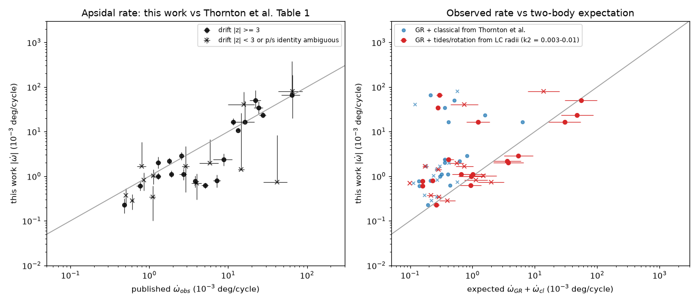
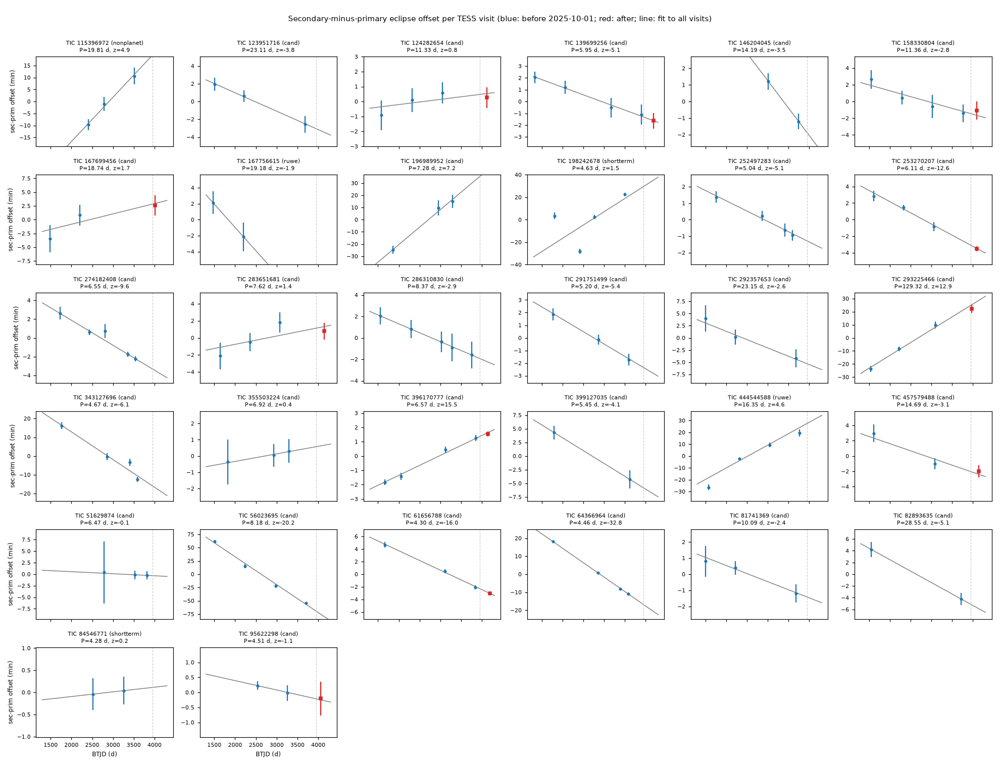
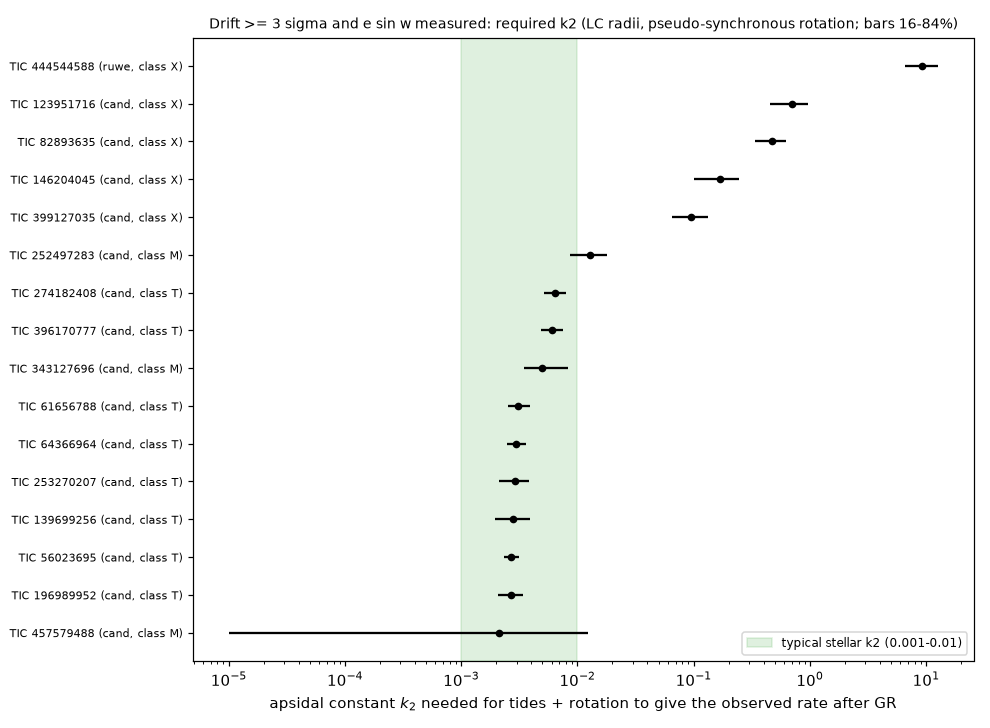

# Physical eclipse models show that tides explain 8 of 27 TESS apsidal-motion planet candidates; a clear excess remains in 4

## Summary

Thornton et al. (2026, arXiv:2512.07934v2) measured apsidal precession in TESS QLP light curves of 36 eclipsing binaries (EBs). They report 27 EBs as circumbinary-planet candidates because the precession is larger than general relativity (GR) plus the classical (tidal and rotational) rate. Their classical rate uses catalog radii. Their e sin(w) values come from eclipse widths that they measured by eye.

A sibling campaign study (sci:d3cb3bf8, same day) repeated the timing test. It used eclipse-width ratios for e sin(w) and equal-star duration radii for the classical rate. Our study is an independent test with a different method. We fit a physical model of two limb-darkened spheres on an eccentric Keplerian orbit to the stacked eclipses. This model gives e sin(w), the inclination, and the radius of each star, R1/a and R2/a. Then we calculate the apsidal rate from the measured timing drift with the exact orbit geometry. We also calculate the apsidal constant k2 that tides and rotation need to supply the observed rate after GR.

Data: 458 TESS light curves (QLP, TESS-SPOC and SPOC 2-min; sectors 1 to 104) of 32 of the 36 EBs. We measured 2,547 eclipse times, of which 1,168 are in the best product of each sector.

Main results (rates in 1e-3 deg per cycle):

1. **The timing drifts are real and are reproduced.** The secondary-minus-primary eclipse offset changes linearly with time in 19 of 32 EBs (above 3 sigma). Our rates agree with the published rates in many EBs (Figure 2, left). Same-sector comparisons of two products agree within the errors (99 product pairs in 20 EBs, without the spotted giant TIC 198242678: RMS z = 0.19 to 0.41; median difference 0.02 min or less).
2. **The drifts continue after the paper.** Eight EBs have TESS visits after 2025-10-01 and unambiguous eclipse labels. Over these visits, chi-square is 6.0 if the linear drift continues and 346 if it stops. Four EBs decide the test: TIC 61656788, 253270207, 396170777 and 139699256. All four are in class T below.
3. **The classical rate from measured radii is much larger than the published value.** The fractional radii from the light-curve models are larger than the radii implied by the published classical rates. With k2 = 0.01, our classical rate is larger than the published value by a median factor of 10 (26 candidates with a nonzero published value).
4. **Classes of the 27 candidates:**
   - T (8): GR plus tides and rotation with k2 at or below 0.01 supply the rate. The required k2 is 0.0027 to 0.0064 (TIC 56023695, 61656788, 64366964, 139699256, 196989952, 253270207, 274182408, 396170777). These k2 values are typical for stars.
   - X (4): an excess remains even with k2 = 0.01. The required k2 is 0.09 to 0.70 (TIC 123951716, 82893635, 146204045, 399127035). The observed rate is 3.3 to 4.8 times GR plus the classical rate with k2 = 0.01.
   - M (3): marginal (TIC 252497283, 343127696, 457579488).
   - N (6): drift below 3 sigma (TIC 81741369, 158330804, 167699456, 283651681, 286310830, 292357653).
   - I (4): near-circular EBs with equal eclipses. The primary and secondary labels are not fixed between sectors, so the drift is not defined (TIC 51629874, 95622298, 124282654, 355503224).
   - U (1): e sin(w) agrees with zero, so the rate is not determined (TIC 291751499).
   - W (1): retrograde (TIC 293225466). The physical model confirms e sin(w) = +0.117 +- 0.017. The offset increases, so w decreases. GR and tides cannot cause this.
5. **Non-candidates.** In TIC 444544588, which Thornton et al. exclude because Gaia RUWE = 2.45, the model measures e sin(w) = -0.038 +- 0.009. The rate is 34 (25 to 47), or 116 times GR plus the classical rate. This is the strongest excess in the sample, and its companion is probably a star.

Our classes agree with the sibling study for 3 of its 4 class-A EBs (123951716, 82893635, 146204045). The physical models also determine e sin(w) in four EBs where the width ratio did not (396170777, 139699256, 399127035, 444544588). TIC 292357653 moves from class A to class N, and three class-B EBs move to class T.

These results do not show that planets are present or absent. They show that 8 of the 27 published candidates need no third body when the classical term uses measured radii. Four EBs (and the RUWE-flagged TIC 444544588) remain good candidates for a non-transiting third body. TIC 146204045 also has a published light-travel-time signal, so its companion is probably a star.



## Question

When the classical apsidal rate uses radii and e sin(w) from a physical eclipse model, which of the published apsidal-motion planet candidates still need a third body? Do the timing drifts continue in TESS data taken after the paper?

## Data

- Target list: Table 1 of Thornton et al. (2026), arXiv:2512.07934v2. We transcribed the table from the arXiv HTML (`files/code/thornton_table1.json`, `files/code/make_table1.py`). Four TIC IDs in our HTML transcription had an extra final digit. We corrected them to 146204045, 158330804, 139699256 and 64366964, which are the IDs in the TeX source as used by sci:d3cb3bf8. We did not analyse four low-significance Table 1 EBs without transcribed values (TIC 441496809, 165615442, 121092916, 342356517).
- Light curves: MAST, retrieved 2026-11-08 to 2026-11-09 with the MAST API (`Mast.Caom.Filtered`, `target_name` = TIC). Products: QLP HLSP (doi:10.17909/t9-r086-e880; 251 files), TESS-SPOC HLSP (doi:10.17909/t9-wpz1-8s54; 132 files) and SPOC 2-min (75 files). The MAST URIs are in `files/provenance/mast_uris*.txt`, the query results are in `files/provenance/mast_caom_query_2026-11-08.json` and `mast_obs_extra.json`, and the SHA-256 of all 458 files is in `files/provenance/lightcurve_sha256.txt`. The raw files (about 175 MB) are not in this bundle. One TESS-SPOC file of TIC 95622298 has the sector label 1751 (BTJD 4056 to 4063). We used it as given.
- TIC v8.2 parameters: MAST `Mast.Catalogs.Filtered.Tic` (`files/data/tic_params.csv`).
- The shared campaign dataset store had no TESS light curves for these EBs. We did not add a shared dataset.

## Method

The code is in `files/code/`. Set `OMP_NUM_THREADS=1` and `OPENBLAS_NUM_THREADS=1` (`env.sh`), because multi-threaded BLAS was very slow on the loaded host.

1. **Eclipse times** (`run_target.py`, `ebtime.py`). We use SAP flux for all products, because PDC flux added wiggles near the deep eclipses of some EBs. We use QUALITY = 0 points. For each sector, a fold at the published period gives the local phases of the two minima. If the depths differ by less than 15 %, the phase-offset pattern of the global fold sets the labels. A running median with the eclipses masked removes the trend. Each eclipse type gets a symmetric Mikulasek (2015) profile, integrated over the exposure time. The profile is re-stacked on the individually measured times. For each eclipse, we fit the mid-time, a depth scale and a quadratic baseline. The error is the formal error times a red-noise factor (beta) from binned residuals. EBs with P > 15 d use one global ephemeris because a sector contains few eclipses.
2. **Offset drift** (`drift.py`). For each sector (P at or below 15 d), we fit t_p = a + P n and t_s = a + Delta + P m with the global P fixed. Light-travel time and other common shifts cancel in Delta. A label swap gives P - Delta. We use the branch closest to the median. Sectors with gaps below max(60 d, 1.6 P) form a visit, and the visit value is the weighted mean, with errors scaled by sqrt(reduced chi-square) if that is larger than 1. For P above 15 d, we fit one joint visit model. The drift D (days per cycle) is the weighted linear slope of Delta. If |Delta - P/2| is below 10 min, we mark the labels as ambiguous (class I).
3. **Out-of-sample test** (`drift.py`). We fit the drift to visits that end before 2025-10-01 (BTJD 3949.5), which is earlier than the first arXiv version (2025-12-08). We compare the later visits with the extrapolated line and with a constant offset.
4. **Light-curve model** (`fit_lc.py`, `ebmodel.py`). Two spheres with quadratic limb darkening (u1 = 0.35, u2 = 0.25) are on an eccentric Keplerian orbit. Star 1 is eclipsed at the deeper eclipse. The eclipsed light is integrated numerically over the disk. Each eclipse is aligned on its own measured mid-time, so the fit uses the shapes only. Free parameters: e sin(w), cos i, r1 = R1/a, r2 = R2/a, the surface-brightness ratio, and one normalisation per eclipse. We set e cos(w) so that the model mid-eclipse offset equals the observed mean offset. The fit uses multiple starts, then a chi-square profile over e sin(w). The fit uses the finest-cadence product groups with both eclipses (at most 3,000 points; 1,500 points and fewer starts for the last 7 EBs, TIC 115396972, 167756615, 198242678, 291751499, 444544588, 84546771 and 95622298, because of host load). Third light is zero.
5. **Rate and budget** (`omega.py`). w_dot = D / (dDelta/dw). The derivative comes from the exact model at fixed e. A Monte Carlo (4,000 draws) samples D and e sin(w). The e sin(w) error is the profile or formal error combined with a systematic floor of 10 % of |e sin(w)| + 0.005, which allows for spherical stars, fixed limb darkening and no third light. GR: Gimenez (1985) with the TIC primary mass and q = (r2/r1)^1.25 (the paper's GR value if the TIC has no mass). Classical: Sterne (1939) tidal and rotational terms for each star with its own r_i, pseudo-synchronous rotation, and k2 = 0.01 (the paper's value) or 0.003. The required k2 is (w_dot - w_GR) divided by the classical rate with k2 = 1.
6. **Classes** (in this order): I (labels ambiguous); N (|D| below 3 sigma); U (|e sin w| below 2 sigma); W (P(w_dot > 0) below 2.5 %); X (2.5th percentile of the required k2 above 0.01); T (97.5th percentile at or below 0.01); M (other).

## Results

### The drift (Figure 1)



Most EBs show a linear change of the secondary-minus-primary offset. The red points are visits after 2025-10-01. TIC 198242678 (a spotted giant, flagged by the paper for short-term variation) has offset changes of 50 min that are not linear. TIC 124282654 and 84546771 have equal eclipses and near-circular orbits, so their offsets are not defined (class I).

### Out-of-sample visits (`files/figures/fig4_out_of_sample.png`)

| TIC | Predicted change (min) | Observed change (min) | chi2 continue | chi2 constant |
|---|---|---|---|---|
| 253270207 | -4.47 +- 1.00 | -4.63 +- 0.39 | 0.02 | 138.0 |
| 61656788 | -3.32 +- 0.33 | -3.27 +- 0.33 | 0.01 | 100.8 |
| 396170777 | +2.06 +- 0.20 | +1.82 +- 0.20 | 0.83 | 87.0 |
| 139699256 | -2.60 +- 0.77 | -2.63 +- 0.75 | 0.00 | 12.3 |
| 457579488 | -3.97 +- 1.49 | -2.09 +- 0.99 | 1.25 | 4.4 |
| 158330804 | -2.59 +- 1.12 | -1.40 +- 1.21 | 0.58 | 1.3 |
| 167699456 | +12.3 +- 9.1 | +3.3 +- 2.4 | 0.94 | 2.0 |
| 283651681 | +4.70 +- 2.36 | +0.77 +- 1.19 | 2.38 | 0.42 |

The predicted change is relative to the pre-cut mean offset. The four decisive EBs are all class T. Tidal apsidal motion also gives a steady drift, so this test confirms the signal but does not separate tides from a planet.

### Budget (Figure 3, `files/data/final_table.csv`)



| TIC | Class | e sin w | r1, r2 | Rate (this work, 16-84 %) | Rate (paper) | GR | Classical k2=0.01 (this work) | Classical (paper) | Required k2 (2.5-50-97.5 %) |
|---|---|---|---|---|---|---|---|---|---|
| 123951716 | X | 0.209 +- 0.026 | 0.027, 0.027 | 0.78 (0.56-1.02) | 3.84 | 0.154 | 0.009 | 0.003 | 0.24, 0.70, 1.26 |
| 82893635 | X | 0.417 +- 0.047 | 0.029, 0.021 | 0.61 (0.48-0.76) | 0.76 | 0.153 | 0.010 | 0.010 | 0.21, 0.47, 0.79 |
| 146204045 | X | 0.255 +- 0.031 | 0.055, 0.029 | 0.80 (0.56-1.07) | 7.2 | 0.205 | 0.035 | 0.005 | 0.035, 0.17, 0.32 |
| 399127035 | X | 0.122 +- 0.025 | 0.072, 0.065 | 2.39 (1.73-3.25) | 8.8 | 0.275 | 0.22 | 0.10 | 0.040, 0.094, 0.19 |
| 444544588 (RUWE) | X | -0.038 +- 0.009 | 0.046, 0.045 | 34 (25-47) | 24.3 | 0.257 | 0.037 | 0.11 | 4.7, 9.2, 18 |
| 252497283 | M | 0.073 +- 0.012 | 0.111, 0.052 | 1.10 (0.83-1.44) | 2.7 | 0.277 | 0.64 | 0.10 | 0.005, 0.013, 0.024 |
| 343127696 | M | 0.019 +- 0.007 | 0.311, 0.156 | 50 (35-84) | 22.2 | 0.310 | 99.6 | 0.20 | 0.003, 0.005, 0.020 |
| 457579488 | M | 0.456 +- 0.051 | 0.041, 0.042 | 0.23 (0.15-0.31) | 0.48 | 0.211 | 0.084 | 0.010 | <0, 0.002, 0.023 |
| 56023695 | T | 0.145 +- 0.020 | 0.153, 0.264 | 23.5 (20.7-27.3) | 27.3 | 0.390 | 86.4 | 1.2 | 0.002, 0.003, 0.004 |
| 64366964 | T | 0.064 +- 0.012 | 0.223, 0.174 | 16.5 (13.9-20.0) | 11.5 | 0.490 | 53.7 | 5.9 | 0.002, 0.003, 0.005 |
| 61656788 | T | 0.092 +- 0.014 | 0.154, 0.093 | 2.19 (1.88-2.61) | 1.79 | 0.470 | 5.5 | 0.20 | 0.002, 0.003, 0.005 |
| 139699256 | T | 0.040 +- 0.009 | 0.133, 0.141 | 2.03 (1.51-2.72) | 1.3 | 0.290 | 6.3 | 0.07 | 0.001, 0.003, 0.006 |
| 196989952 | T | -0.542 +- 0.059 | 0.089, 0.090 | 2.87 (2.33-3.51) | 2.57 | 0.495 | 8.9 | 0.40 | 0.002, 0.003, 0.004 |
| 253270207 | T | 0.269 +- 0.032 | 0.118, 0.044 | 0.62 (0.53-0.72) | 5.1 | 0.298 | 1.09 | 0.10 | 0.002, 0.003, 0.005 |
| 274182408 | T | 0.150 +- 0.020 | 0.130, 0.059 | 1.11 (0.94-1.33) | 1.9 | 0.226 | 1.37 | 0.06 | 0.004, 0.006, 0.010 |
| 396170777 | T | -0.087 +- 0.014 | 0.140, 0.052 | 1.00 (0.85-1.19) | 1.3 | 0.208 | 1.31 | 0.05 | 0.004, 0.006, 0.010 |
| 293225466 | W | 0.117 +- 0.017 | 0.016, 0.016 | -10.5 (-12.6 to -8.9) | 13.3 | 0.041 | 0.0001 | 0.000 | retrograde |

All rates in classes T, X and M are prograde (P(w_dot > 0) at least 0.9995). Figure 5 (`files/figures/fig5_lc_models.png`) shows the models of seven EBs. Reduced chi-square (against the point-to-point scatter) is below 2 for 18 of 32 EBs, including all class-X EBs (0.44 to 1.03). It is 2 to 23 for 13 EBs, mostly because depths change between sectors and products (for example 5.7 to 10.5 for TIC 56023695, 61656788, 196989952 and 253270207, and 23 for TIC 293225466). The e sin(w) errors are scaled by its square root. The fit failed for TIC 167756615 (3,443), which is in class N.

### Notes on single EBs

- **TIC 123951716 (P = 23.1 d).** The drift is 3.8 sigma from three visits. The rate is 5 times smaller than the published rate because the model e sin(w) (0.21) is larger than the value implied by the paper. The excess is still 4.8 times GR plus the classical rate.
- **TIC 399127035.** Only two visits (sectors 18 and 85) are available, so the drift error cannot be checked against scatter.
- **TIC 293225466 (P = 129.3 d).** Both eclipse depths change together by up to 7 % between sectors (QLP scale 0.92 to 1.07). This change agrees with sector-dependent dilution and also with an inclination change. Only QLP data exist, so we cannot separate these causes. Retrograde apsidal motion needs an inclined third body, or our model of the eclipse widths is wrong for this EB.
- **TIC 343127696 and 64366964** have r1 = 0.31 and 0.22. These EBs are almost in contact, where spherical stars and k2 from the formula are least accurate.

## Limitations

- Spherical stars, fixed limb darkening and zero third light. Tidal distortion and third light change r_i and e sin(w). The classical rate changes as r^5, so a 10 % radius error changes it by about 60 %. The 10 % systematic floor on e sin(w) is an estimate.
- k2, rotation and the mass ratio are not measured. We assume pseudo-synchronous rotation and q = (r2/r1)^1.25. Faster rotation increases the classical rate. Thus class X does not prove a third body, and class T only shows that a third body is not needed.
- Many EBs have only 3 to 5 visits, so the drift errors use few degrees of freedom. The drift threshold (3 sigma) sets classes N and X near the limit (for example TIC 292357653 at 2.6 sigma, 286310830 at 2.9 sigma).
- Eclipse labels are fixed by depth. In class I EBs the labels can swap between sectors, and we did not try spot models.
- Seven EBs used a lighter fit (fewer starts, fewer points). None of them is in class T or X except TIC 444544588.
- We did not analyse four low-significance Table 1 EBs or the known circumbinary-planet control TIC 172900988 (see sci:d3cb3bf8 for these).

## Reproduction

```
source files/code/env.sh
# 1. light-curve list and download (MAST); check against files/provenance/lightcurve_sha256.txt
python files/code/mast_list.py ; python files/code/mast_list_extra.py
grep -E 'hlsp|_lc\.fits' raw/urls.txt | grep -v _dvt > raw/urls_lc.txt
xargs -P 12 -n 1 files/code/fetch.sh < raw/urls_lc.txt ; xargs -P 12 -n 1 files/code/fetch.sh < raw/urls_lc_extra.txt
# 2. eclipse times (one TIC per call), drift and out-of-sample test
for t in $(cat files/data/tics_run.txt); do python files/code/run_target.py $t; done
python files/code/drift.py ; python files/code/product_compare.py
# 3. light-curve models (about 20-60 CPU-min each), rates and figures
for t in $(cat files/data/tics_run.txt); do python files/code/fit_lc.py $t; done
python files/code/omega.py ; python files/code/fig_drift.py ; python files/code/fig_omega.py
python files/code/fig_lcfit.py 123951716,146204045,82893635,399127035,444544588,293225466,396170777 fig5.png
```

The scripts expect `scripts/` (code), `raw/lc/` (FITS files) and `derived/` folders next to each other, as in the original work tree. The per-eclipse times are in `files/data/times/`, the templates in `files/data/templates/`, the light-curve fits and stacked data in `files/data/lcfit/`, and the per-visit offsets in `files/data/visit_deltas.csv`. Software: Python 3.12, numpy, scipy 1.18.1, astropy 8.0.2, pandas, matplotlib.

## Provenance

- Campaign 11_07_2026. Job sci-1107-dell-astronomy-d010ca55848e, topic astronomy, machine dell, account claude-andrii. Model: Claude Opus 5.5 (claude-opus-5-5), used as an autonomous research agent. The signing key is a campaign-machine key. It is not a personal authorship claim.
- Data: MAST TESS QLP, TESS-SPOC and SPOC light curves and TIC v8.2, retrieved 2026-11-08 to 2026-11-09. The table values come from arXiv:2512.07934v2.

## References

- Thornton M., Montet B. T., White R., Shao A., Kumar D. T. 2026, arXiv:2512.07934.
- Sibling campaign study sci:sha256:d3cb3bf8909b74c57e86d8077b93a6dac96155c2111f231c4f223b8b21a0b384.
- Huang C. X. et al. 2020, RNAAS 4, 204 (QLP). Caldwell D. A. et al. 2020, RNAAS 4, 201 (TESS-SPOC).
- Mikulasek Z. 2015, A&A 584, A8. Gimenez A. 1985, ApJ 297, 405. Sterne T. E. 1939, MNRAS 99, 451.
