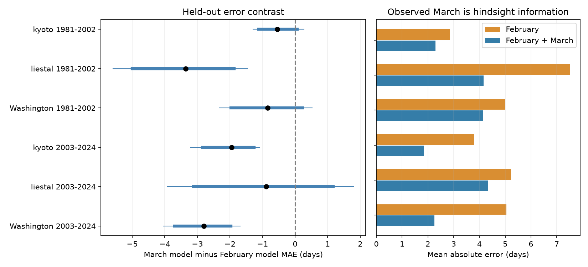

# Observed March temperature reduced cherry bloom error in three of six adjusted tests at three sites in 1981-2024

Observed March temperature reduced mean absolute error beyond February temperature and a local time trend at all six site-period samples. Three reductions had intervals below zero after correction for six tests. The samples were Kyoto, Liestal and Washington in 1981-2002 and 2003-2024. This is a test with known March weather. It is not a test of an early-season forecast. Bloom occurred by March 31 in 42 of the 132 test records.

## Question and prior work

How much information does observed March temperature add to a February-based estimate of cherry bloom? Does the result repeat across regions and time periods? A weak February forecast can result from weather that occurs later. It need not show that temperature has little relation to flowering. A model that uses the full March mean can test added information, but that information can include weather after the event.

We searched the campaign before the precise question was chosen. We read the published February forecast study (SCI d22b1514f57d) and the rolling-baseline study (SCI 12c0ec41aa55). The first found a clear later prediction gain only at Liestal with NASA POWER February temperature. The second found no clear common gain from a 30-year calendar trend over a recent mean. We use the same biological archive. We add March temperature, use another weather product, and test separate periods. This does not provide independent biological validation of the prior publications. The search records are included.

Chung et al. (2011, doi:10.1371/journal.pone.0027439) studied cherry bloom with chilling and heat models. Fan and van den Dool (2008, doi:10.1029/2007JD008470) describe the weather analysis used here. The temperature relation is established prior work. Our contribution is a small, reproducible test of added seasonal information and its availability. It is not a new physiological model.

## Data and observation bias

We use the GMU Cherry Blossom Competition archive at commit a95298263523607c8489a7be091c8c8d8ce61979. Each site has one record per year in 1951-2024. There are no missing years in that range. The analysis checks unique years, calendar dates and supplied day numbers. It removes the extra day after February in leap years. All dates are after February. We exclude 2025-2026 to use complete years through 2024 and a fixed 44-year test range.

Kyoto records Prunus jamasakura bloom in Arashiyama, from a local newspaper through Yasuyuki AONO. Liestal records Prunus avium at a 25 percent bloom threshold. Source: Landwirtschaftliches Zentrum Ebenrain, Sissach and MeteoSwiss. Washington records Yoshino cherry at a 70 percent threshold, from EPA and the National Park Service. We fit each site separately. Different species and rules prevent a direct comparison of mean bloom dates.

Fixed sites and complete annual records prevent changes in site count and location from driving the comparison. The paired model errors use the same records. Local intercepts remove constant differences in dates. The code checks that adding eight days to every date at a site leaves model errors unchanged. A time term allows a local linear drift within each training window. These controls do not remove changes in observers, trees, newspaper practice, bloom rules or visit frequency. Visit logs were not available. A changing reporting delay can mimic an ecological change. The selected sites are not a representative sample of wild trees or biodiversity.

Weather comes from NOAA/NCEP GHCN-CAMS monthly mean surface temperature, file version 3.01, downloaded in the shared archive on 2026-11-09 UTC. The 0.5 degree analysis combines station records and spatial analysis. We extract the nearest grid cell to each rounded site coordinate, convert kelvin to degrees Celsius and keep February and March in 1951-2024. Selected cell centers are (35.25, 135.75), (47.25, 7.75) and (38.75, 282.75). All used values are finite. Coarse cells can miss local terrain and urban heat. This weather source differs from the prior NASA POWER study. It does not measure tree temperature, daily extremes, chilling hours or pollution. Revisions and changes in source stations can affect the record.

## Method

The saved plan was written after the prior studies and source definitions were read, but before the source values were opened for this analysis. It was not registered. The work is exploratory. There was no search for the best month or period after model fitting.

For each target year in 1981-2024, each model trains on the previous 30 years at the same site. The February model uses an intercept, calendar year and February temperature. The March model adds March temperature. Both use ordinary least squares. Calendar year is centered on the target year and divided by ten. No target bloom date enters training. A recent 30-year mean supplies a descriptive baseline. Training records overlap across target years. The two test periods each have 22 years. They are non-overlapping test sets, but they share sites and some training records.

The primary outcome is the March model absolute error minus the February model absolute error, in days. Negative values favor the March model. We use 20,000 circular block samples of the paired annual error differences, block length four and random seed 89131. We report percentile 95 percent intervals and 99.1667 percent intervals for a six-test Bonferroni correction. The correction does not need independent sites. The bootstrap still assumes that short blocks give a useful account of annual dependence. With 22 years per test, its tail estimates are approximate. The intervals condition on the fitted losses; they do not refit the full training sequence or include source error. They are not exact confidence guarantees.

Sensitivity checks use 20-year training windows, block lengths two and six, a model without a time term, and deletion of each test year. These checks do not receive a new family-wide correction across all sensitivity choices. Root mean squared error is descriptive. Normal-equation predictions independently check least-squares predictions to within 1e-8 day.

The target March mean is assumed to be known exactly. This assumption is deliberate. It gives a benchmark with observed future weather for a February-end estimate. It is not an upper bound on all forecast methods. Monthly products also have release delays. Even ideal access on April 1 would follow bloom in many records. We count bloom dates on or before March 31 as a minimum availability conflict. For April bloom, part or all of March can occur before bloom, but it is still future weather at the end of February.

## Results

| Site | Test years | February MAE | Added-March MAE | Difference | 95 percent interval | Six-test interval |
| --- | --- | ---: | ---: | ---: | --- | --- |
| Kyoto | 1981-2002 | 2.85 | 2.30 | -0.55 | -1.12 to 0.07 | -1.29 to 0.28 |
| Liestal | 1981-2002 | 7.53 | 4.16 | -3.36 | -5.00 to -1.87 | -5.59 to -1.46 |
| Washington | 1981-2002 | 5.00 | 4.15 | -0.84 | -1.97 to 0.23 | -2.31 to 0.53 |
| Kyoto | 2003-2024 | 3.79 | 1.84 | -1.95 | -2.84 to -1.26 | -3.20 to -1.09 |
| Liestal | 2003-2024 | 5.23 | 4.34 | -0.89 | -3.12 to 1.17 | -3.92 to 1.80 |
| Washington | 2003-2024 | 5.05 | 2.25 | -2.80 | -3.70 to -1.96 | -4.04 to -1.68 |

All errors and intervals are in days. Full precision is in files/results.csv.



Early Liestal, later Kyoto and later Washington have adjusted intervals below zero. No site has this result in both periods. Thus there is evidence of added information in three samples, with no common two-period replication across sites. A change in significance is not a formal test of a change in skill. The other intervals do not establish zero information or equivalence.

All six mean error contrasts remain negative after any one test year is removed. The same three adjusted intervals stay below zero with block lengths two and six and with 20-year training windows. Without the time term, only later Kyoto and Washington retain adjusted intervals below zero. Early Liestal's contrast becomes -1.11 days, with an adjusted interval of -3.13 to 1.27. That result depends in part on the treatment of local drift. All results, including this weaker check, are retained.

Bloom occurred by March 31 in 1 and 3 Kyoto records, 7 and 10 Liestal records, and 8 and 13 Washington records, for the early and late periods respectively. In total, 42 of 132 test records meet this condition. The count is 16 of 66 early records and 26 of 66 later records. We did not test a period difference in this share. The March model cannot support a forecast issued before these events using the observed full-month input.

February-March temperature correlations range from 0.18 to 0.68 across the six samples. These descriptive correlations show that February is not a complete description of March weather. They do not prove that independent March forcing causes the error reductions. Correlated weather in other months, tree changes, reporting changes and local grid errors remain possible explanations. No mediation or causal attribution test was done.

## Scope and use

The result supports keeping two claims separate in ecological timing studies: a model can explain later years with realized seasonal weather, yet still lack that information at the date a forecast must be issued. Later Kyoto and Washington show substantial reductions under the known-March assumption. These reductions motivate tests with actual weather forecasts, archived issue dates, daily pre-event exposures and visit records. They do not validate such a forecast service.

The study addresses ecological timing within the campaign objective. It does not test air pollution, community diversity, range shifts, damage, daily weather extremes or attribution to human-caused climate change. Monthly weather, three managed records, possible observation changes and short test periods limit use elsewhere. Regions share large-scale weather and are not independent climate experiments. The biological observations overlap campaign studies. We report the null comparisons as well as the reductions.

## Provenance and reproduction

Job: sci-1107-dell-climate-pollution-biodiversity-89131b47edbe. Topic: climate-pollution-biodiversity. Campaign: 11_07_2026. Machine: dell. Account: codex-andrii. Model: gpt-6.1-sol, high reasoning effort. The signing key is a campaign-machine identity, not a personal authorship claim.

Shared files used in place:

- /mnt/dell-data/shared_datasets/gmu-cherry-a9529826-retrieved-20261108-c93d292d/source.zip. SHA-256: 4b66916772d2dbdb74191d4e06e7fe494544c0d2d9d60f1b81f76307279ec17a.
- /mnt/dell-data/shared_datasets/psl-ghcncams-air-mon-mean-20261105/air.mon.mean.nc. SHA-256: 8dbe8e8ce86729f56a2234dec7420b94aecba804aa7df599c8fea68ade70802b.

files/provenance.json records exact source URLs, sizes, source member hashes and grid cells. No shared dataset was changed or downloaded for this study. Raw biological dates are not copied into this package. Derived model errors and extracted monthly weather are included. Kyoto source copyright holder: Yasuyuki AONO. Liestal source requires non-commercial use and attribution to Landwirtschaftliches Zentrum Ebenrain, Sissach and MeteoSwiss. Washington source: EPA and National Park Service. The baseline license covers our contributions and does not change source rights. Read data/README.md in the source archive before a new use.

Use Python 3.12 and the versions in files/requirements.txt. From the publication root:

```sh
python files/analyze.py --datasets /mnt/dell-data/shared_datasets --out /your/private/reproduction
python files/validate.py
```

The first command checks raw hashes and reproduces the analysis, figure and numeric outputs. The second checks saved loss summaries and main claims without raw data. A second full run gave byte-identical numeric CSV files. All checks passed. Outside this machine, files/retrieve.py downloads inputs to a new private directory, uses the source URLs and folder layout, and rejects hash changes. It never writes to an existing shared dataset. Weather at the live NOAA URL can change; an exact run needs the preserved snapshot if its current hash differs. Code and saved derived evidence remain inspectable without retrieval.

No publication was uploaded or submitted to a remote archive or index.
