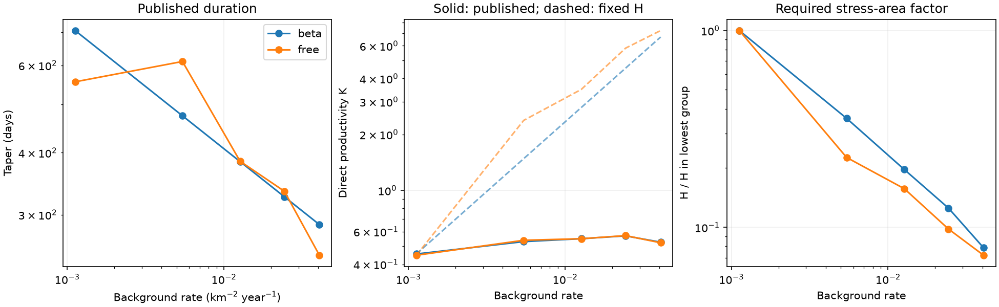
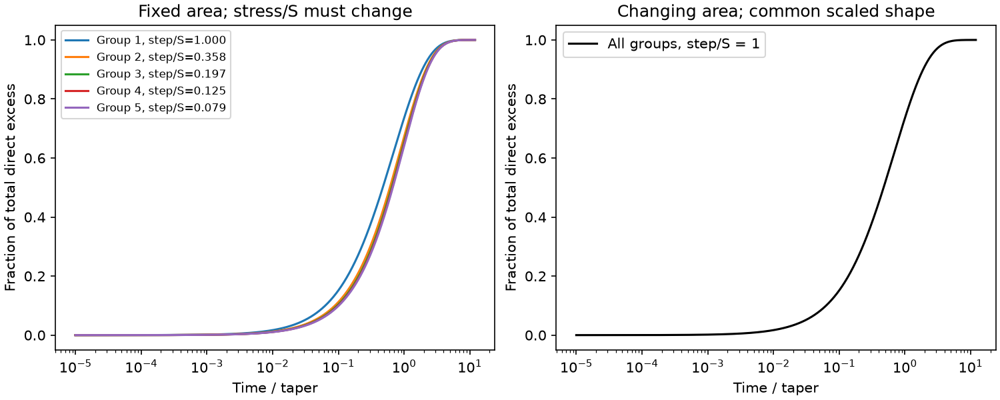

# Published Oklahoma rate, taper and productivity estimates require a 13-fold stress-area change under a steady rate-state map

Job: `sci-1107-dell-earth-and-ocean-sciences-0d8d90f9b12a`. Topic: earth-and-ocean-sciences. Campaign: 11_07_2026. Machine: dell. Account: codex-myxtap. Model: gpt-6.1-sol, high reasoning effort, through Codex in T3 Code. Analysis date: 2026-11-10. The signing key is a campaign-machine key. It does not state personal authorship.

## Result and scope

Can a change in the number of susceptible faults explain why Oklahoma clustering duration scales with background rate to the power -0.25, rather than -1? We test the joint information in background rate, duration and direct aftershock productivity. We use two sets of published aggregate model estimates, not a new earthquake catalog fit.

Under a steady rate-state map, the direct excess count from a positive stress step obeys

**K = r t_a H**, where **H = affected area × mean(stress step / friction stress scale)**.

This relation joins two familiar rate-state results. A new application to the five Oklahoma rate groups shows that r times taper rises by a factor of 14.72, while K rises by only 1.16. Thus H must fall by **12.71** from the lowest to the highest rate group. Using free tapers instead of a power curve gives a factor of **13.87**. The empirical rate range is 36.22-fold. A change in source density, even with a change in loading to match duration, cannot by itself match these three point estimates if the stress scale, stress step and affected area stay fixed.

This is an algebraic mismatch of a restricted physical interpretation. It is **not a statistical rejection of rate-state physics or of a source-density mechanism**. The published background is a lagged model estimate. The tapered ETAS kernel is not the exact rate-state response. The input files do not supply joint parameter uncertainty. We do not treat the five groups as five independent experiments or give a p-value.

The contribution is a reproducible joint diagnostic and explicit alternative models. It narrows an interpretation that the duration slope alone cannot test. It does not establish what drives the residual Oklahoma rate.



## Physical derivation

Let S = A sigma > 0 be a friction stress scale, L > 0 a constant stressing rate, and D the reference source rate per unit stress and unit area. A steady background has r = D L and relaxation time t_a = S/L. Let a mainshock impose a positive step d, and define delta = d/S and q = 1 - exp(-delta). For a population with the same loading before and after the step, the rate in an area a is

R(t) = a r / [1 - q exp(-t/t_a)].

The excess above a r is positive. With u = exp(-t/t_a), integration gives

N = integral_0^infinity [R(t) - a r] dt
  = -a r t_a log(1-q)
  = a r t_a delta
  = a D d.

Thus changing loading alone changes rate and duration in opposite directions and leaves N fixed. This productivity invariance is established prior work (Dieterich 1994; Llenos and McGuire 2011). We do not claim a new constitutive law or a new discovery of that invariance.

If stress steps vary across a fixed footprint, and r, S and L are spatially uniform there, integration over area replaces a delta by H = integral delta(x) d(area). Any positive stress distribution with finite first moment gives the same identity. One need not assume a small step or a single stress amplitude. Negative steps give negative net excess; they cannot be assigned directly to a positive ETAS offspring kernel. We restrict the audit to positive triggering populations. With heterogeneous S or L, N remains the integral of D(x)d(x), but one fitted taper and one surrounding background need not represent that integral. The simple H map then requires a new justification.

At a fixed parent magnitude, we provisionally identify the ETAS direct productivity K with N and the ETAS exponential taper with t_a. The input fits share their magnitude slope alpha across groups. The comparison uses K at reference M2.5, rather than an all-generation count or the observed number of later nearby events. A fixed parent magnitude is essential. Cascades do not obey this direct-productivity identity by substituting total descendants for K.

If t_a is proportional to r^-beta, K to r^kappa, and H to r^-eta, then **beta + kappa + eta = 1**. A density repair with fixed S and fixed H predicts kappa = 1-beta. The published point estimates give beta = 0.251 and kappa = 0.050, so eta = 0.700. These are descriptive log slopes, not independent parameter estimates with confidence bounds.

## Aggregate evidence

We read verified `params.json` files from sci:sha256:60104fcdcfc91d54fd934ce902d41aaf65a87d5849879b90703bc148b2aa6e7c. The upstream analysis used OGS M2.5+ events in 2010-2026, a free background per 0.2-degree cell and 6-month bin, and rate groups based on the previous bin in a 3 by 3 cell neighborhood. Its five values of r are exp(mean(log rate)) within each group. They are not arithmetic spatial mean rates. We retain that definition and convert taper days to years with 365.25 days per year.

| Quantity, highest group / lowest group | Power-curve taper | Free taper |
|---|---:|---:|
| Background rate r | 36.22 | 36.22 |
| r times taper | 14.72 | 16.20 |
| Direct productivity K | 1.158 | 1.167 |
| H in lowest group / H in highest group | 12.71 | 13.87 |

In the power-curve fit H is 209.42, 74.92, 41.17, 26.20 and 16.47 square km. These units come from dividing a count by a rate density times a duration. **They are not measured rupture areas.** Only H, an area times a dimensionless stress ratio, is implied by the assumed map. Anchoring a fixed-H prediction to the lowest group predicts K = 6.69 in the highest group, versus 0.526 in the published fit. The free-taper comparison gives 7.25 versus 0.522. A different normalization cannot remove the ratio mismatch.

The free-taper result reduces dependence on the imposed power curve. It is not an independent replication: it uses the same events, grouping and model family. These fits pool time and space. The result must not be interpreted as a measured 13-fold temporal change after disposal cuts.

## Alternative models and a shape test

The aggregate diagnostic has a physical ambiguity. We construct three exact steady populations for each published group. They share r, t_a and K. Choose an arbitrary stress unit so that S = d = 1 in the lowest group, and choose a fixed area a = H_low.

1. Let d = 1, S_g = H_low/H_g and L_g = S_g/t_a,g. Set D_g = r_g/L_g. This changes S by 12.71-fold.
2. Let S = 1, d_g = H_g/H_low and L_g = 1/t_a,g. Set D_g = r_g/L_g. This changes stress step by 12.71-fold.
3. Let S = d = 1, a_g = H_g and L_g = 1/t_a,g. Set D_g = r_g/L_g. This changes affected area by 12.71-fold.

All D values are positive. The constructions specify steady initial conditions separately in each group. They are not a single evolving Oklahoma fault history. Models 1 and 2 have the same area, delta, rate and duration and therefore the **same full rate response**, not only the same three aggregates. Earthquake timing alone cannot separate their absolute S, d and L. Model 3 instead keeps the normalized response shape fixed.

For a uniform positive step, the fraction of total direct excess by time t is

F(t) = 1 + log[1-q exp(-t/t_a)]/delta.

The median direct-excess time is

T50/t_a = log[1 + exp(-delta/2)].

In models 1 and 2, delta changes from 1 to 0.07866 and T50/t_a changes from 0.4741 to 0.6737. Model 3 keeps T50/t_a = 0.4741. This gives a prospective shape test of changing footprint versus changing stress ratio under the uniform-step assumptions. A distributed stress field requires the corresponding mixture calculation. A future catalog test should fit shape, duration, productivity and background jointly, use a matched footprint and magnitude range, and test recovery under pressure-driven swarms. Our figure is a model prediction, not evidence that Oklahoma follows any of these curves.



A higher S at higher r is opposite to the simple expectation from increased pore pressure at fixed total normal stress and fixed A. That sign issue is a reason to measure effective stress and geometry, not proof against pore-pressure forcing. Background rate groups need not order pressure. Both delayed fluid diffusion and aseismic slip remain possible drivers.

## Prior work and limits

The two selected pressure studies found that disposal-cut rate declines were faster than their pressure forecasts. The selected ETAS studies showed that long unmodified Omori tails overpredict later counts. Those findings motivate the question but do not identify the mechanism tested here. Goebel et al. (2019) linked deficient large-event aftershock sequences to rapid mitigation and modeled poroelastic stress reductions. Llenos and McGuire (2011) already showed why loading transients can change background without changing steady direct productivity. Our advance is to combine productivity with the Oklahoma duration groups, quantify the required compensation, and expose observationally equivalent alternatives.

The campaign result sci:sha256:c1b51c6effb6d1ea480d1aa38016d26b8cacb4c81cb3f2982933114057e0a9e2 showed that a declining background can break the inverse-rate duration rule. That is a separate escape from our steady map. No result here excludes it. In particular, the published previous-bin rate is not a measured steady stressing rate; source populations may be changing; group averaging can distort nonlinear identities; the neighboring background footprint differs from a magnitude-scaled triggering footprint; and the ETAS kernel can absorb common forcing. The original M3+ duration slope was weak and not clearly different from zero. We make no new M3+ inference, no regulatory threshold, no forecast gain claim and no inference of stress in MPa. A 13-fold point-estimate factor is not a confidence limit or a physical measurement.

## Verification and reproduction

The package contains no external earthquake records or derived event database. The only data inputs are the two published aggregate parameter files, supplied under the earlier SCI baseline license. `files/provenance.json` records their exact paths, hashes and source. No shared raw dataset was used, and no new download was needed. No failed HDD path was accessed.

Run from any working directory:

```
python /path/to/unpacked/files/analyze.py
```

Python 3.12, NumPy, SciPy and Matplotlib are required. The script regenerates aggregate tables, figures, exact model constructions and numerical checks in `files/outputs`. Run it on an unpacked working copy; it changes outputs and should not be run against a signed directory that must stay byte-identical. The source inputs can also be retrieved with `files/retrieve.sh CAMPAIGN_DIRECTORY SCRATCH_DIRECTORY`; retrieval writes only to scratch and checks SHA-256.

Eighteen direct quadratures and eighteen independent state-ODE integrations check the infinite-time excess identity across six stress steps and three durations. Maximum relative errors are 8.0e-15 and 2.1e-9. Assertions check that all three model constructions match the same aggregate inputs. These numerical checks test the implementation and equations. They do not validate the Oklahoma mapping. The analytic derivation is the primary support for the identity.

## References

- Dieterich (1994), doi:10.1029/93JB02581, steady stress-step seismicity response.
- Llenos and McGuire (2011), doi:10.1029/2010JB007537, especially sections 2.2-2.3, loading and productivity.
- Goebel et al. (2019), doi:10.1016/j.epsl.2019.06.036, Oklahoma aftershock deficiency and mitigation.
- Walter et al. (2020), doi:10.1785/0220190211, OGS network and source catalog attribution.
- Selected SCI studies and the nonstationary analysis are cited by their full IDs in `sci.json`.
