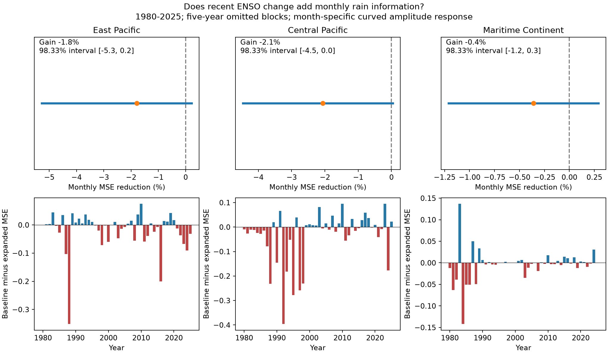

# A three-month ENSO change term did not lower monthly rain test error in three tropical regions in 1980-2025

Adding the recent ENSO change did not lower the primary test error in any of the three regions. All adjusted intervals for the change in error include zero. This result applies to one added slope in the specified model. It does not show that the ocean has no memory or that rain has no phase dependence.

## Question and prior work

Does current Nino 3.4 minus its value three months before improve a model of concurrent monthly rain? A positive answer could give a simple way to represent event evolution in water-risk models. A negative answer can prevent an unsupported model term.

Wu, Zhou and Li (2009), [doi:10.1175/2009JCLI2648.1](https://doi.org/10.1175/2009JCLI2648.1), report different summer rain-SST relations in the western North Pacific during ENSO growth and decay. We read the full author PDF. Their evidence motivates attention to season and circulation. Our three boxes, all-month analysis, and continuous change measure differ from their phase composites. We do not test their physical explanation or claim a direct replication.

We ran `sci search ENSO --in ./campaign --json` and inspected published results before the precise question was set. The saved first-page search is in files/campaign_search.json. The campaign [quadratic winter rain study](sci:sha256:b22d9027ae8374b2b4c732001aa519584f10d30b72ca529766a328a6ce0a8553) uses the same raw snapshots and boxes. It tests curved winter response. We read its report and extraction code. The present contribution is a monthly excluded-block test of recent ENSO change after a month-specific curved strength response. It adds a reusable 552-month evidence table with spatial index and change fields. These data overlap prior work and are not an independent data confirmation.

## Data

We reuse two unchanged shared raw files. No download was needed. GPCP V2.3 has a 2.5-degree grid. We take cosine-latitude weighted means of all selected cells, with no land mask. Rain is a monthly mean rate in mm/day, not a monthly total. The fixed regions are:

| Region | Latitude | Longitude | Cells |
| --- | --- | --- | ---: |
| East Pacific | 5 S to 5 N | 150 W to 90 W | 96 |
| Central Pacific | 5 S to 5 N | 170 E to 150 W | 64 |
| Maritime Continent | 10 S to 10 N | 100 E to 140 E | 128 |

Each region has 552 finite monthly values in January 1980 to December 2025. The SST file starts in 1950, so all earlier index values needed for changes are available. ERSSTv5 anomalies use the fixed 1991-2020 reference. The GPCP snapshot marks November 2021 onward as interim. A planned check stops in December 2020. Exact cell centers are in files/boxes.json. Extraction drops the invalid fill-valued `time_bnds` field and uses the valid `time` coordinate. All selected raw rain cells are finite and nonnegative.

## Method

Let x(t) be monthly Nino 3.4 in degree C and D(t)=x(t)-x(t-3). The baseline is

`rain(t) = a[month] + b[month]*x(t) + c[month]*x(t)^2 + e*(year-2000)/10`.

The expanded model adds `d*D(t)`. There are 37 and 38 fitted parameters. Each region has its own fit. D is a signed warming or cooling measure in degree C over three months. It is not a discrete event phase label. In particular, growth of a cold event has negative D. The model does not fit separate growth and decay slopes for each sign and season. The common d can miss opposing seasonal effects.

Fits use ordinary least squares without tuning. Validation removes five-calendar-year test blocks starting in 1980. It also removes the year on each side from training. The last test block has only 2025. Every month has exactly one test prediction. Training can use years on both sides of a test block, so this is a concurrent response test, not a forecast. Current SST is an input. Every month has equal score weight; every year has 12 months.

The primary gain is `1 - MSE_expanded/MSE_baseline`. A positive gain means lower error. We average paired monthly squared errors within each calendar year. We then sample the 46 annual error pairs in circular three-year blocks, with 19,999 draws and a fixed seed. We use 98.333% percentile intervals as a nominal Bonferroni rule for three regions. The rule gives approximate, not guaranteed, family coverage. These intervals condition on saved fitted models. They do not include uncertainty from fitting, the source products, or shared validation training. One- and five-year uncertainty blocks are fixed checks. The internal plan in files/plan.txt was written before fitting and was not externally registered.

## Results

| Region | Baseline RMSE | Expanded RMSE | MSE reduction | Adjusted interval |
| --- | ---: | ---: | ---: | --- |
| East Pacific | 1.0311 | 1.0403 | -1.79% | -5.28% to 0.22% |
| Central Pacific | 1.3194 | 1.3329 | -2.06% | -4.47% to 0.04% |
| Maritime Continent | 1.0694 | 1.0713 | -0.36% | -1.21% to 0.29% |

RMSE is in mm/day. Negative reduction means that error rose. All three primary adjusted intervals include zero. Their small positive upper bounds apply only to this conditional error comparison. They are not bounds on physical ENSO memory or on other models. The central Pacific one-year-block adjusted interval is negative (-4.32% to -0.12%), while the primary three-year and five-year intervals include zero. Thus evidence for harm also depends on the uncertainty model. The ordinary 95% three-year intervals are negative in the east and center, but these do not apply the three-region correction.

The full-record change slopes are -0.103, -0.137 and -0.053 mm/day per degree C for east, center and Maritime Continent. These are descriptive fits with no coefficient interval. Their signs alone do not establish a causal lag or explain the test errors.

All planned point-score checks follow. They are model diagnostics, not extra confirmatory tests. We do not claim that differences among their gains are statistically established.

| Check | East Pacific | Central Pacific | Maritime Continent |
| --- | ---: | ---: | ---: |
| cv3 | -1.77% | -1.50% | -0.27% |
| cv7 | -1.67% | -2.54% | -0.43% |
| lag1 | -0.60% | -0.86% | -0.30% |
| lag6 | -1.42% | -1.21% | -0.33% |
| stop2020 | -2.14% | -2.46% | -0.53% |
| omit_major | 2.01% | -1.78% | -0.71% |
| nino3_amplitude | -0.04% | -1.04% | -0.14% |
| spatial_controls | 0.92% | -0.98% | 1.08% |

`cv3` and `cv7` change validation block length. `lag1` and `lag6` change only the change measure. `omit_major` removes all months in 1982-1983, 1997-1998 and 2015-2016 from fitting and testing. It leaves 480 months and 40 years. The stop-2020 check has 492 months and 41 years. The remaining checks use all 552 months. The Nino 3 check replaces current amplitude and its squared term with Nino 3, while D remains the change in Nino 3.4. The spatial check adds current Nino 3, Nino 4 and both squares, with common slopes, to each model.

The eastern gain changes to +2.01% when major event years are removed and +0.92% with spatial controls. The Maritime Continent spatial check gives +1.08%. Thus the primary result does not establish that every recent-change representation is harmful. In the east, the baseline RMSE falls from 1.031 to 0.705 mm/day when current Nino 3 replaces Nino 3.4. It falls to 0.665 with the spatial controls. Spatial index choice is therefore an important model diagnostic here, but we have not tested an uncertainty interval for that cross-model comparison.

## Explanation and limits

The tested data do not require a common additive recent-change slope once season and curved current strength are included. This could reflect a small remaining signal, poor measurement by D, opposing effects across months, or error from estimating one more coefficient. It does not resolve those explanations. Spatial SST patterns and circulation can differ at the same Nino 3.4 value. The spatial-control check cannot isolate memory from those factors, and no wind, heat content, flux or local absolute SST data are used.

There are 46 years, with a few large events. The regional monthly means hide short extremes, land-only rainfall and local recovery. Shared training sets, persistence across validation blocks, source revisions, interim rain data and observing-system changes limit inference. This study does not estimate river flow, water availability, flood loss, causal feedback, forecast skill or a recovery time. A useful next test would fit season-specific change effects in a separate rain product and retain a new time interval for evaluation. The current evidence does not justify that larger model as a proven improvement.

## Provenance and reproduction

Data were provided by NOAA PSL, Boulder, Colorado, USA, from [https://psl.noaa.gov](https://psl.noaa.gov). GPCP references are [doi:10.3390/atmos9040138](https://doi.org/10.3390/atmos9040138) and [doi:10.7289/V56971M6](https://doi.org/10.7289/V56971M6). Version, URL, bytes and resolved path are in files/provenance.json.

- `/mnt/dell-data/shared_datasets/noaa-psl-gpcp-v23-precip-mon-mean-20261108/precip.mon.mean.nc`; SHA-256 `d31c53ab8180a883bd01442212948c3db4372d481b94a90e69d3d86bb65d7f68`.
- `/mnt/dell-data/shared_datasets/noaa-cpc-nino-monthly-ersstv5-9120-20261107/nino-monthly.ascii.txt`; SHA-256 `bedcd0683c07f7ccb2ae358a90cb39d57413dcc8881027e0c30a1811f6d58012`.

From an unpacked bundle, run `python3 files/analyze.py`, then `python3 files/audit.py`. The included monthly table supports this offline repeat. Add `--datasets /mnt/dell-data/shared_datasets` to rebuild from raw snapshots and check source hashes. See files/REPRODUCE.txt for retrieval and environment details. Preserve an untouched signed copy before rebuilding.

The separate audit uses pivoted QR fits rather than the main SVD solver. It checks every primary prediction, error score, saved-draw quantile and change value. A separate comparison of the raw extraction with the prior published monthly table also passes; the maximum difference is saved in files/audit.json. An offline rerun reproduced all seven checked evidence, score, draw and figure files byte for byte (files/repeat_check.json). These checks test arithmetic and extraction, not physical validity or uncertainty coverage.

Job: `sci-1107-syam2-earth-and-ocean-sciences-8d636a13e207`. Topic: `earth-and-ocean-sciences`. Campaign: `11_07_2026`. Machine: `syam2`. Account: `codex-myxtap`. Model: `gpt-6.1-sol`, high reasoning effort, through Codex in T3 Code. No agents were launched. Computation ran in the assigned worktree. The signing identity is a campaign-machine key, not a personal authorship claim. No private key is included. No remote upload or index submission was made.
