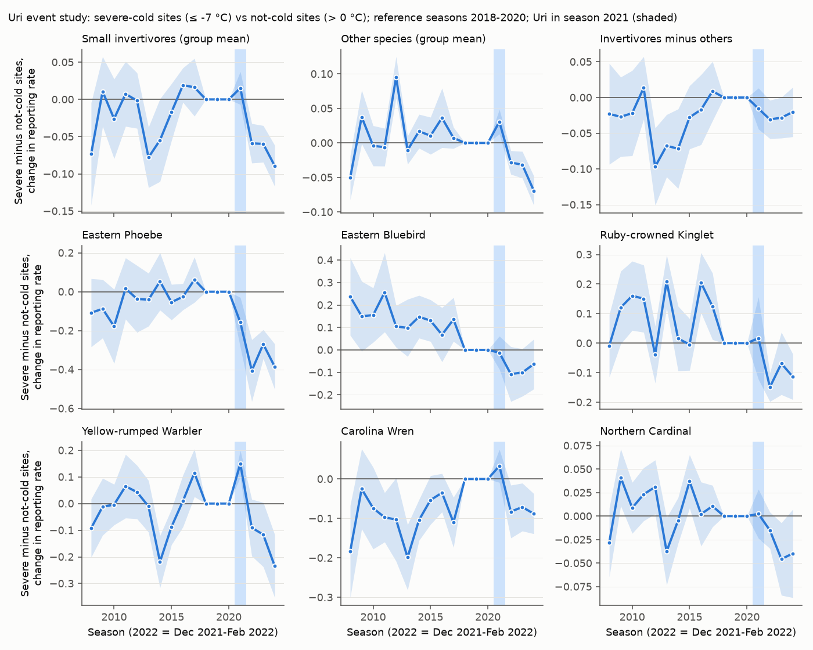
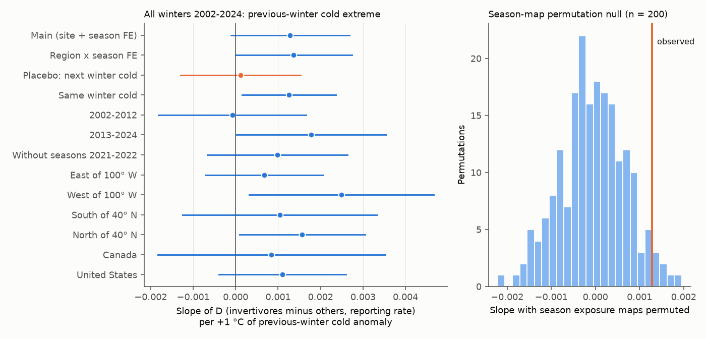
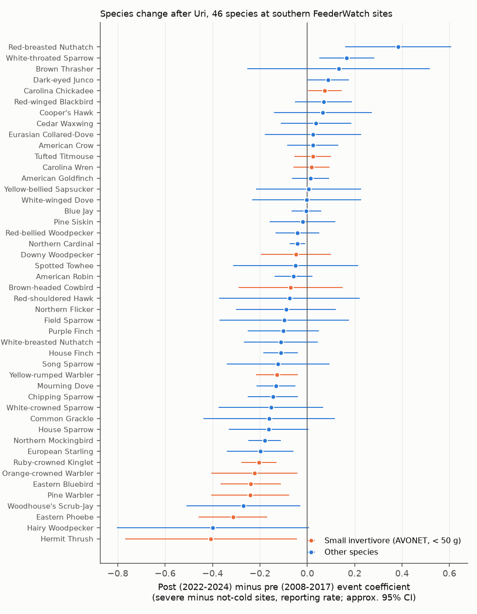

# Eastern Phoebe reports at severe-cold FeederWatch sites fell by half for three winters after Winter Storm Uri (2021); a general cold effect on small invertivores was not shown (US, Canada, 2002-2024)

**Job:** sci-1107-dell-climate-pollution-biodiversity-dd7885354b3e · **Topic:** climate-pollution-biodiversity · **Campaign:** 11_07_2026 · **Machine:** dell · **Account:** claude-andrii · **Model:** Claude Opus 5.5 (`claude-opus-5-5`), operating as an autonomous research agent. The signing key is a campaign-machine key. It is not a personal authorship claim.

## Summary

**Question.** Do short, extreme winter cold events decrease the wintering populations of small insect-eating birds? Do the decreases continue into the next winters? Earlier campaign studies used the summer Breeding Bird Survey (BBS) and monthly mean temperature. They found that colder winter months lower the next-summer counts of resident birds by about 1% per °C. A BBS test of Winter Storm Uri (February 2021) was inconclusive (sci:sha256:46ebf207…). Here we used a different data source: Project FeederWatch (PFW). PFW observers count birds at the same feeder sites each winter, so PFW measures the wintering population itself. We used daily minimum temperature (NOAA CPC, 0.5°) to measure the coldest 3-day period of each winter.

**Data.** 3.49 million PFW checklists (seasons 2001-2024, US and Canada, public release May 2024), CPC daily Tmin 1991-2024, and AVONET diet and body-mass traits. Outcome: reporting rate, the fraction of a site's December-February checklists that report a species.

**Pre-registered results** (`files/PREREGISTRATION.md`, written before any outcome model; group "small invertivores" = AVONET Trophic.Niche Invertivore and mass < 50 g):

| Test | Result | Verdict |
| --- | --- | --- |
| H1. Uri, next winter (Dec 2021-Feb 2022), 842 southern US sites. Slope of D (invertivore change minus other-species change, same site) on Uri cold | +0.0027 per °C (95% CI +0.0005 to +0.0048); colder sites had larger invertivore decreases | Sign as predicted, but 2 of 15 placebo event years gave slopes as large or larger. With latitude and longitude controls the slope was −0.0015 (−0.0045 to +0.0020). **Not established.** |
| H2. Uri, same winter (March 2021 minus Dec-Jan) | +0.0013 (−0.0018 to +0.0039) | **No clear effect.** |
| H3. All winters 2002-2024, 139,476 site-seasons at 13,977 sites. D on previous-winter cold extreme (site and season fixed effects) | +0.0013 per °C (−0.0001 to +0.0027); season-map permutation p = 0.085; next-winter placebo +0.0001 (−0.0013 to +0.0015) | **Small and not clear.** 7 of 10 subsets had CIs that included zero. 2002-2012 gave −0.0001. |
| H4. Uri species slopes (54 species) by trait | Invertivore term +0.0028 (SE 0.0017, p = 0.10); log10 mass +0.0012 (SE 0.0019) | **Weak, not clear.** |

**Exploratory result** (added after the pre-registered tests; the first species table had been seen). This result tests a field report published before this study. The report says that Eastern Phoebe and Eastern Bluebird were "especially hard hit" by the 2021 freeze in East Texas.

- **Eastern Phoebe.** At sites where the Uri 3-day low was 7 °C or more below the normal winter low ("severe", 65 sites), the mean phoebe reporting rate decreased from 0.52 (Dec-Feb of 2018-2020) to 0.26 (2022-2024). At sites where Uri was not colder than normal ("not cold", mostly in the Southeast), it increased from 0.41 to 0.50. In an event study with site and season fixed effects, the severe-minus-not-cold difference was −0.35 (95% CI −0.46 to −0.25) in 2022-2024 relative to 2018-2020. It was near zero before (2008-2017 mean −0.04, SE 0.05). The decrease continued in all three winters after the storm (Figure 1). Among 46 species, the phoebe had the largest decrease of the species with 50 or more severe sites. Its simple cross-site Uri slope was larger than in all 15 placebo event years (z = 4.3).
- **Other small insect-eaters.** Hermit Thrush, Pine Warbler, Eastern Bluebird, Orange-crowned Warbler and Ruby-crowned Kinglet were also among the 8 largest event-study decreases. As a group, small invertivores decreased more than other species (median post-minus-pre contrast −0.17 vs −0.05; one-sided Mann-Whitney p = 0.037; 12 vs 34 species). But Eastern Bluebird, kinglet and Pine Warbler had pre-existing downward relative trends, so their post-Uri change is not a clear break. Feeder-using invertivores (chickadees, titmice, Carolina Wren, Downy Woodpecker) did not decrease.
- **Replication in other winters was weak.** In 2002-2024 without Uri seasons, the species order of Uri sensitivity did not predict the species order of sensitivity to other cold winters (Spearman 0.04, permutation p = 0.80). Eastern Phoebe had the same sign in other winters (+0.0059 per °C of previous-winter cold, CI −0.0068 to +0.0187), but this is not clear. Eastern Bluebird in the south had a clear positive slope (+0.0070, CI +0.0013 to +0.0128).

**Main limitations.** The Uri exposure is mostly an east-west contrast (Texas, Oklahoma, Louisiana and Arkansas vs the Southeast; Figure in `files/figures/fig1_uri_exposure_map.png`). Thus regional changes that are not caused by the storm can look like storm effects. Placebo years, the pre-period event coefficients and the same-site other-species contrast reduce this risk but do not remove it. Formal joint tests rejected flat pre-period coefficients for most series (with only about 60 spatial clusters these tests are sensitive). Feeder counts measure use of feeders, not abundance directly. The phoebe result is exploratory.

## Background and gap

Cold winters kill small birds. Classic reports include decreases of Eastern Phoebe, Eastern Bluebird and Carolina Wren after severe winters. Winter Storm Uri (13-20 February 2021) brought the coldest temperatures in decades to Texas and the southern Plains. A study of Purple Martins found a large die-off of early-arriving birds (UMass Amherst report; PubMed 41792447). East Texas field reports named Eastern Phoebe and Eastern Bluebird as "especially hard hit" (Texas Birds Records Committee seasonal report, `texasbirds.org/media/1415/2020_winter_easttexas.pdf`). In this campaign:

- sci:sha256:46ebf207… found that colder Dec-Feb months lower next-summer BBS counts of residents (about 1.3% per °C). Its Uri hold-out test was inconclusive: most of the contrast came from migrants, and placebo year pairs gave similar contrasts. The authors noted that monthly means and summer counts cannot resolve a short event.
- sci:sha256:979b781f…, sci:sha256:e2f6bd3d… and sci:sha256:15270e89… found the same winter-month effect for residents with other designs.
- sci:sha256:e3bb114f… tested the 2021 heat dome with the BBS and found no clear decrease.

We found no campaign or published test that uses a winter bird survey with daily cold extremes for Uri and for 23 other winters.

## Data

All shared data were reused in place from the campaign store (`/mnt/dell-data/shared_datasets/`, now NFS on the HP SSD). The FeederWatch, CPC and AVONET datasets were added to the store by this job with the campaign dataset helper. `files/data/input_provenance.json` lists the 42 input files with source URL, byte size and SHA-256.

| Data | Shared dataset name | Source | SHA-256 (main file) |
| --- | --- | --- | --- |
| PFW checklists 2001-2005 … 2021-2024 (5 ZIP files) | `feederwatch-pfw-all-{2001-2005,…,2021-2024}-may2024` | `https://cdn.feederwatch.org/data/202406/PFW_all_YYYY_YYYY_May2024_Public.csv.zip` (link list from feederwatch.org/explore/raw-dataset-requests, Wayback snapshot 2026-10-09) | 2021-2024: `a4670f8f…fad5a7`; all in provenance file |
| PFW species translation table | `feederwatch-pfw-spp-translation-may2024` | same CDN | in provenance file |
| PFW site description table (downloaded, not used in models) | `feederwatch-pfw-site-data-may2024` | same CDN | in provenance file |
| NOAA CPC Global Unified daily Tmin, 0.5°, 1991-2024 (34 files) | `noaa-psl-cpc-global-temp-tmin-YYYY-20261109` | `https://downloads.psl.noaa.gov/Datasets/cpc_global_temp/tmin.YYYY.nc` | in provenance file |
| AVONET Supplementary dataset 1 (sheet AVONET2_eBird) | `avonet-tobias2022-supplementary-dataset1-v7` | `https://ndownloader.figshare.com/files/34480856` (Tobias et al. 2022, doi:10.1111/ele.13898) | `eb645e83dddb40f1654a3e8d721998dbca76eff540231b7b809267c1e96f8d3e` |

FeederWatch data: Project FeederWatch, Cornell Lab of Ornithology and Birds Canada. We thank the many participants who collected these data. The public release ends in April 2024 (season 2024). Thus we see three winters after Uri.

## Methods

**Records.** Valid PFW records (VALID = 1) from the US and Canada. A checklist is one 2-day count. A season S runs from November of year S−1 to April of year S. Periods: DJF (December-February), DJ (December-January) and March.

**Exposure** (`02_exposure.py`). For each CPC cell and winter (1 December to 10 March): the minimum of the 3-day running mean Tmin (COLD), and the mean December-February Tmin (MEAN). Anomalies are relative to the 1992-2020 seasons (median for COLD, mean for MEAN). Uri exposure: the minimum 3-day running mean Tmin from 10 to 21 February 2021, minus the 1992-2020 median of COLD. Examples: Austin −8.7 °C, Dallas −10.5 °C, Houston −6.8 °C, Atlanta +4.9 °C. Each site takes its CPC cell, or the nearest valid cell within 1° on coasts.

**Species groups** (`03_species_traits.py`). PFW codes matched to AVONET by scientific name (731 of 735 taxa that are not hybrids or "sp." groups). Small invertivores: Trophic.Niche = Invertivore and Mass < 50 g. In this AVONET classification the group includes chickadees, titmice, Downy Woodpecker and Brown-headed Cowbird.

**Uri tests** (`05_uri.py`). Sites at 25-37° N and 110-80° W in the US. For each site, species are "regular" if they are reported on ≥ 20% of the site's DJF checklists in seasons 2018-2020 (≥ 4 checklists). The change is the post-period rate minus the baseline rate (≥ 2 post checklists). D = mean change of regular invertivores minus mean change of other regular species at the same site. The slope of D on the Uri anomaly was fit by OLS, with 95% CIs from a bootstrap over 2° × 2° blocks (2,000 draws). Placebo: the same calculation with fake event seasons E = 2005-2019 (baseline E−3 to E−1, post E+1). Retention check: probability that a baseline site reported in season 2022.

**General panel** (`06_panel.py`). Sites with ≥ 5 seasons with ≥ 4 DJF checklists, seasons 2002-2024. Regular species: ≥ 20% of all the site's DJF checklists. Outcome per site-season: rI, rO (group mean reporting rates) and D = rI − rO. Model: site and season fixed effects; COLD and MEAN of the previous winter (the test) and of the current winter; log number of checklists. SEs two-way clustered by season and 2° block. Placebo: next-winter COLD. Null: 200 permutations of whole season exposure maps.

**Exploratory event study** (`09_event_study.py`, `10_all_species_event.py`). Southern panel sites, seasons 2008-2024. rate = site FE + season FE + Σ_t b_t × SEVERE × 1[season t] + log(checklists). SEVERE = Uri anomaly ≤ −7 °C; the comparison sites have anomaly > 0 °C; moderate sites are excluded. Reference seasons are 2018-2020. A continuous version uses °C of Uri cold below the normal winter low. SEs are clustered by 2° block. "Post minus pre" = mean b_t of 2022-2024 minus mean b_t of 2008-2017.

## Results

### Pre-registered Uri tests (`files/results/uri_results.json`)

| Post season | Slope of D per °C | dI (invertivores) | dO (others) | Sites |
| --- | --- | --- | --- | --- |
| 2021 (storm winter, DJF) | +0.0014 (0.0000, +0.0032) | −0.0006 (−0.0020, +0.0007) | −0.0020 (−0.0035, −0.0009) | 1,018 |
| **2022 (H1)** | **+0.0027 (+0.0005, +0.0048)** | +0.0043 (+0.0024, +0.0061) | +0.0016 (+0.0006, +0.0028) | 842 |
| 2023 | +0.0018 (−0.0003, +0.0036) | +0.0035 (+0.0020, +0.0048) | +0.0017 (+0.0003, +0.0031) | 753 |
| 2024 | +0.0011 (−0.0011, +0.0034) | +0.0050 (+0.0032, +0.0072) | +0.0040 (+0.0023, +0.0059) | 630 |

A positive slope means that colder sites had larger decreases. Both groups decreased more at colder sites. The invertivore decrease was larger, but the difference D was within the placebo distribution: placebo slopes had mean −0.0003 and SD 0.0021, and 2 of 15 were ≥ the real slope. The two largest placebo slopes were for fake events in 2011 and 2012; February 2011 also had a hard freeze in Texas. With linear latitude and longitude controls, H1 was −0.0015 (−0.0045, +0.0020). In the Uri band only (106-88° W, 343 sites), it was +0.0008 (−0.0070, +0.0120). Site retention did not depend on Uri cold (slope −0.00003 per °C; placebo 2019 −0.0002). H2 (same-season March change) was +0.0013 (−0.0018, +0.0039).

### Pre-registered general panel (`files/results/panel_results.json`)

| Model, outcome D unless stated | Previous-winter COLD slope per °C (95% CI) |
| --- | --- |
| Main: site + season FE (n = 139,476 site-seasons, 13,977 sites) | +0.0013 (−0.0001, +0.0027) |
| Site + region × season FE | +0.0014 (0.0000, +0.0027) |
| Without MEAN terms | +0.0004 (−0.0009, +0.0017) |
| rI (invertivores) only | +0.0012 (−0.0001, +0.0024) |
| rO (others) only | −0.0001 (−0.0013, +0.0011) |
| Placebo: next-winter COLD | +0.0001 (−0.0013, +0.0015) |
| Season-map permutation | p = 0.085 (200 permutations) |
| 2002-2012 / 2013-2024 | −0.0001 (−0.0018, +0.0017) / +0.0018 (0.0000, +0.0035) |
| Without seasons 2021-2022 | +0.0010 (−0.0007, +0.0026) |
| East / West of 100° W | +0.0007 (−0.0007, +0.0021) / +0.0025 (+0.0003, +0.0047) |
| South / North of 40° N | +0.0010 (−0.0012, +0.0033) / +0.0016 (+0.0001, +0.0030) |
| Canada / United States | +0.0008 (−0.0018, +0.0035) / +0.0011 (−0.0004, +0.0026) |

Binned previous-winter COLD (reference: warmer than −2 °C; 939 site-seasons at ≤ −8 °C): invertivore rate −0.019 (−0.036, −0.001) at ≤ −8 °C and −0.011 (−0.019, −0.003) at −8 to −5 °C. Other species: −0.011 (−0.027, +0.005) and −0.005 (−0.014, +0.004). D: −0.008 (−0.032, +0.016) and −0.006 (−0.018, +0.006). Thus the general signal is small. At the largest extremes, the invertivore rate was about 2 percentage points lower in the next winter, and the other species also tended to decrease.

### Exploratory: event study and species (`files/results/event_study_summary.json`, `event_all_species.csv`)

| Outcome (severe vs not-cold sites) | Pre 2008-2017 mean (SE) | Post 2022-2024 mean (95% CI) | Post minus pre | Sites (severe) |
| --- | --- | --- | --- | --- |
| Invertivores minus others (D) | −0.033 (0.020) | −0.026 (−0.050, −0.003) | +0.007 | 1,119 (372) |
| Small invertivores (rI) | −0.020 (0.017) | −0.069 (−0.091, −0.048) | −0.050 | 1,119 (372) |
| Other species (rO) | +0.013 (0.009) | −0.043 (−0.056, −0.030) | −0.056 | 1,119 (372) |
| **Eastern Phoebe** | **−0.040 (0.052)** | **−0.353 (−0.457, −0.249)** | **−0.313** | 193 (65) |
| Eastern Bluebird | +0.148 (0.043) | −0.091 (−0.186, +0.005) | −0.239 | 406 (79) |
| Ruby-crowned Kinglet | +0.093 (0.032) | −0.111 (−0.150, −0.071) | −0.204 | 303 (119) |
| Yellow-rumped Warbler | −0.019 (0.027) | −0.147 (−0.219, −0.076) | −0.128 | 485 (137) |
| Carolina Wren | −0.098 (0.027) | −0.081 (−0.135, −0.026) | +0.018 | 901 (273) |
| House Finch | +0.028 (0.030) | −0.084 (−0.128, −0.039) | −0.112 | 835 (304) |
| Northern Cardinal | +0.008 (0.009) | −0.033 (−0.061, −0.006) | −0.042 | 1,086 (371) |

At severe-Uri sites, many species decreased, including seed-eaters such as House Finch and Mourning Dove. Thus the pre-registered same-site contrast D did not change. The Eastern Phoebe decrease was much larger than the general decrease. Its continuous event-study slope was −0.038 per °C of Uri cold (−0.048, −0.028), with a pre-period mean of −0.002 (SE 0.006). With latitude and longitude controls in the simple cross-site design, the phoebe slope was +0.030 per °C (−0.022, +0.065), and 1 of 12 placebo years was as large. Thus that design has low power when geography is controlled.

Species slopes in other winters (`files/results/panel_species_slopes.csv`, seasons 2002-2024 without 2021-2022, 81 species): 2 clearly positive and 4 clearly negative slopes, which is near chance. The invertivore meta-regression term was +0.0007. In southern sites (52 species): Eastern Bluebird +0.0070 (+0.0013, +0.0128), Bewick's Wren +0.0099 (+0.0011, +0.0187), Carolina Wren +0.0043 (−0.0006, +0.0091), Eastern Phoebe +0.0059 (−0.0069, +0.0186).

## Interpretation

1. **A general, continent-wide effect of winter cold extremes on small invertivores at feeders was not shown.** The pre-registered same-site contrast had the predicted sign in most tests, but the effects were small (about 1 percentage point of reporting rate per 10 °C of extra cold). They were not clear against permutation nulls, and they did not repeat in 2002-2012.
2. **Uri left a large and lasting mark on one species with known cold sensitivity.** Eastern Phoebe reports at the most severely affected FeederWatch sites decreased by half, and they did not recover in three winters. There was no such change before the storm or at sites that the storm did not affect. This agrees with the 2021 field reports and with historical reports of phoebe decreases after hard winters. Phoebes eat mainly flying insects, rarely use feeders, and in Texas they winter near the northern part of their winter range. Thus a multi-day hard freeze can remove their food. Hermit Thrush, kinglets and warblers (also insect-eaters that rarely use seed feeders) tended to decrease. Feeder-using small invertivores (chickadees, titmice) did not decrease. The pre-registered AVONET group mixed these two kinds of species, which can explain the weak group result. This explanation is post hoc.
3. **Short extreme events and mean winter anomalies differ.** The Uri decrease of Eastern Phoebe (about −0.04 per °C) was several times larger than its slope in ordinary winters (+0.006 per °C, uncertain). Thus a rare event far outside the local experience can have effects that models of ordinary year-to-year variation do not predict.

## Limitations

- **Geography and confounding.** Uri cold was concentrated in Texas, Oklahoma, Louisiana and Arkansas. The comparison sites were mostly in Florida, Georgia and the Carolinas. Regional changes that are not caused by the storm (for example drought in Texas in 2022, habitat change or changes in observers) could contribute. The pre-period coefficients for Eastern Phoebe were flat on average, but joint Wald tests rejected flat pre-periods for most series. With about 60 spatial clusters these tests can over-reject.
- **Observation process.** Reporting rate at feeders depends on feeder use, observer effort and observer turnover. We controlled for the number of checklists and used same-site designs. Retention of sites after Uri did not depend on Uri cold. We did not model detection explicitly, and we did not use counts (HOW_MANY) as an outcome.
- **Exploratory status.** The species-level event study and the Eastern Phoebe result were added after we saw the pre-registered results and the first species table. Eastern Phoebe was named in an earlier field report, but about 46 species were examined. Its post-Uri decrease is the largest among well-sampled species, and its placebo z-score was 4.3. A chance result of this size is unlikely but not excluded.
- **Exposure.** CPC 0.5° daily Tmin smooths local cold, and it does not measure ice, snow cover or wind chill. The data end in April 2024, so recovery after three winters is not known.
- **Scope.** Only the US and Canada. Most sites are in residential areas.

## Reproduction

1. Python 3.12 with numpy, pandas, pyarrow, xarray, netCDF4, scipy, statsmodels, openpyxl and matplotlib (host research environment, 2026-11-09).
2. Get the input files from the source URLs in `files/data/input_provenance.json` (check the SHA-256 values), into folders with the listed dataset names. On the campaign host, use `/mnt/dell-data/shared_datasets`.
3. Run `bash files/code/run_all.sh DATASETS_DIR WORK_DIR`. The conversion takes about 15 minutes, the aggregation about 8 minutes, and the 200-permutation panel about 40 minutes on a loaded 24-core host. Bootstrap and permutation seeds are fixed.
4. Compare `WORK_DIR/out` with `files/results/`.

Files:
- `files/PREREGISTRATION.md`: hypotheses and design, written before outcome models.
- `files/code/`: `01_convert_pfw.py` (CSV to parquet), `02_exposure.py` (CPC cold metrics), `03_species_traits.py` (AVONET match), `04_build.py` (site-period aggregation), `05_uri.py` (H1, H2, H4, placebo events), `06_panel.py` (H3, permutations), `07`-`10` (exploratory checks), `11_figures.py`, `common.py`, `run_all.sh`.
- `files/data/exposure_grid.parquet`: COLD, MEAN and Uri metrics for every CPC cell in North America (18-72° N, 190-305° E) and season 1992-2024 (reusable).
- `files/data/panel_site_season.parquet`: site-season group rates with exposures (reusable).
- `files/data/species_traits_avonet_match.csv`: PFW species codes matched to AVONET.
- `files/results/`: all estimates (JSON and CSV), placebo and permutation results, site and species tables.
- `files/logs/`: run logs. `07b.log` is the second, complete run of `07_species_checks.py`. The first run stopped at its last step because of a degenerate species fit; we then added a filter for zero standard errors.
- `files/figures/`: Figures 1-4.
