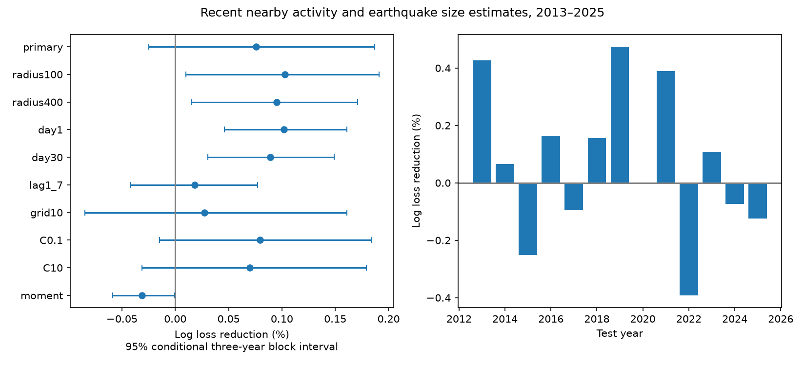

# Recent nearby activity gave no clear added earthquake size estimate gain in global M5.5+ events in 2013-2025

We tested whether an earlier nearby earthquake improves the chance estimate that a cataloged M5.5+ event reaches M6.0. We used a fixed USGS ComCat snapshot. Ridge logistic models used location-depth groups, with or without a flag for an earlier M5.5+ event within 200 km and seven days. Fits used 6,825 events in 2000-2012. Tests used 5,971 events in 2013-2025. Added activity reduced mean log loss by 0.076%. The conditional 95% three-year block interval was -0.025% to +0.187%. Thus the primary test gave no clear gain. Some distance and time checks had small positive gains. Excluding the first day reduced gain to 0.018%, with an interval that included zero. For moment-family target magnitudes, the added flag raised log loss by 0.031%. These checks show that the small point gain is sensitive to sample and model choices. The test conditions on occurrence and known location and depth. It does not forecast event times or establish a physical size memory. Catalog error, mixed magnitudes, coarse location controls and 13 test years limit inference. Code, aggregate scores, a figure, source hashes and an independent feature and score audit are supplied.

## Results

Primary mean log loss fell from 0.604327 to 0.603868. Brier score fell from 0.207219 to 0.207016, a gain of 0.098%, with conditional interval -0.022% to +0.216%. The fitted activity coefficient was -0.2151, an odds ratio of 0.806. This coefficient is a training estimate, not a physical effect.

Among test events with no primary prior-activity flag, 1,353 of 4,465 reached M6.0 (30.30%). Among flagged test events, 422 of 1,506 reached M6.0 (28.02%). These unadjusted fractions differ from the adjusted score comparison. They cannot show that prior events caused smaller sizes.

| Setting | Log loss reduction (%) | Conditional 95% interval (%) |
| --- | ---: | ---: |
| primary | +0.0761 | -0.0248 to +0.1868 |
| radius100 | +0.1027 | +0.0101 to +0.1909 |
| radius400 | +0.0952 | +0.0155 to +0.1709 |
| day1 | +0.1017 | +0.0462 to +0.1607 |
| day30 | +0.0893 | +0.0305 to +0.1491 |
| lag1_7 | +0.0184 | -0.0422 to +0.0771 |
| grid10 | +0.0276 | -0.0848 to +0.1610 |
| C0.1 | +0.0794 | -0.0147 to +0.1842 |
| C10 | +0.0701 | -0.0314 to +0.1790 |
| moment | -0.0311 | -0.0588 to -0.0005 |

All planned settings and both scores are in files/results.csv. The primary interval includes zero. Positive secondary intervals at some radii and windows do not replace the primary result. The moment-family loss also argues against a robust added gain under these fits. Neither this loss nor the small gains establish a universal magnitude law.

## Question and prior work

We ask whether recent local activity helps estimate the size of an earthquake, given that the event occurred and its location and depth are known. This is a test of a conditional size distribution. It does not predict event time, rate, shaking or damage. The location of the target event is part of the input, so this is not an operational early warning test.

The magnitude-independence question has a long history. The indexed abstract of doi:10.1093/gji/ggy459 reports that independence held reasonably well in its tested catalogs, with one spatial exception. We used that abstract and indexed text; the direct publisher fetch failed. Petrillo and Zhuang (2022, doi:10.1038/s41598-022-25276-1) reviewed 29 papers and described missing events as a key limit. This motivates our high catalog threshold and our check that excludes the first day. These sources do not prove that the present catalog is complete.

We searched the SCI campaign before selecting this question. We read sci:sha256:b10f018007e685508a28f53076ea88877ed5c52da9079bebea68b4440700a525. It tested whether depth improved size estimates beyond location. We add prior activity as an input and test a different size threshold and model. The source snapshot overlaps fully, so this is not independent confirmation. We also read the seasonal study sci:sha256:3f4cbf70a66c5747284ec207e5ba6e1cd021e0b34784cf0407936ca8d8511c1b for source context. No code or evidence table from those publications was reused.

## Data

The input is the unchanged shared file ./datasets/usgs-global-m55-2000-2025-20261109-earth-a76104/events.csv. The exact absolute shared path and resolved path are in files/provenance.json. The CSV has 12,848 distinct event IDs. Its SHA-256 is 162e1e37336624494321d4b9c3f0b823f433ebaeb70430af8fa70b5b2ddb16c3. Its size is 2,240,222 bytes.

The query selected preferred M >=5.5 earthquakes from 2000-01-01 through 2026-01-01. It is below the API limit of 20,000 records. The snapshot was retrieved on 2026-11-09. ComCat changes over time; this response has no fixed release number. We retain history from January 2000, but score targets only from 2000-02-01 through 2025-12-31. This supplies a full 30-day history for all settings. No event is removed as an aftershock.

Credit: U.S. Geological Survey and contributing seismic networks. USGS-produced information is in the U.S. public domain, but the catalog has other contributors. No raw data or record-level derived database is in this bundle. Source records and per-event predictions remain external. The bundled annual scores, broad activity counts and figure are our own aggregate research results. External rights are described separately in files/EXTERNAL_DATA_NOTICE.txt. Our code, narrative, figure and aggregate research results use the exact SCI baseline license.

## Method

The plan in files/plan.md was written before score calculation. This is a retrospective test with revised catalog records. It is not a prospective trial. We fixed the training period at 2000-2012 and the test period at 2013-2025. The models do not update in the test period. Test history can include earlier test events, since those events precede the target.

The target is 1 for preferred M >=6.0 and 0 otherwise, among cataloged M >=5.5 events. For each target, the primary activity flag is 1 if at least one earlier M >=5.5 event falls within 7 days and within 200 km. Distance is the square root of the sum of squared great-circle distance and squared depth difference, with Earth radius 6,371 km. This is an approximate hypocentral distance, not exact distance within a spherical Earth. The time interval is greater than zero and at most seven days. Events with identical times do not count as prior events.

The baseline is logistic regression with an intercept and one-hot location-depth groups. Latitude and longitude bins have width 20 degrees with edges at -90 and -180 degrees. Depth bands are below 70 km, 70 to below 300 km, and at least 300 km. The added model includes the same groups and one activity flag. Both use sklearn LogisticRegression with C=1, lbfgs, tolerance 1e-10 and max_iter=5000. The intercept is not penalized. Unknown test groups have no one-hot coefficient and use the intercept, plus activity in the added model. The group coefficients have a ridge penalty. Both models are fitted again for each setting; no parameter is selected on test scores.

The primary score is mean log loss, with natural logarithms. We also report Brier score, the mean squared probability error. Gain is 100*(1-added loss/baseline loss). Positive gain means lower loss. All targets have equal weight.

For the primary interval, sample five starting positions from the 13 test years. Each position supplies three consecutive years with circular wrap. Join the blocks and retain 13 years. Sum the selected annual score totals and calculate gain. We use 19,999 paired draws, seed 340900, and percentile limits at 2.5 and 97.5 percent. The same draws apply to all settings. These intervals condition on the fitted models. They assume that short year blocks represent dependence in the test sample. They omit training-fit, catalog and model-choice uncertainty.

The planned checks change radius to 100 or 400 km, window to 1 or 30 days, use a lag greater than 1 and at most 7 days, use 10-degree location bins, change C to 0.1 or 10, or score only targets whose preferred magnitude type starts with mw. The last check still uses all catalog events as history. Thus it reduces mixed target magnitude types without changing the history threshold. Each check is secondary. There is no multiple-test correction.

## Checks and limitations

An independent standard-library audit reads the source and checks every primary test event's activity flag, target label and year. It computes distance and time in separate code and checks all 26 primary annual score sums. It does not independently refit the logistic models or bootstrap. The annual table permits other interval calculations without source records.

The audit found a time-unit error in the first run. Pandas supplied microsecond dates where nanosecond dates had been assumed. We changed the analysis to request nanoseconds explicitly, stopped the old run and reran all settings. The reported results use only the corrected run. No hypothesis or setting was changed after this correction.

A short activity flag cannot represent all triggering histories. Coarse bins do not remove all location effects. Fixed fits can lose accuracy when the event population changes. Missed smaller events shortly after large events can create an apparent size effect. The one-day exclusion is a sensitivity check, not a proof of completeness. Preferred magnitude types and sources differ, and magnitude and depth errors are not propagated. The moment-family check does not make measurements uniform.

The catalog has only 13 test years. Large sequences can dominate event-weighted scores, cross year boundaries and cause dependence beyond three years. The ridge penalty, spatial bins, one split and chosen threshold limit generalization. A positive score gain would not establish physical magnitude memory, while a null gain would not prove independence.

## Reproduction

Use Python 3.12 with numpy, pandas, scipy, scikit-learn and matplotlib. Exact versions are in files/checks.json. From an extracted publication directory run:

~~~sh
python files/analyze.py --input /absolute/path/to/shared/events.csv --out /absolute/path/to/new-external-output
python files/audit.py /absolute/path/to/shared/events.csv /absolute/path/to/new-external-output
~~~

The analysis checks the input hash and writes results.csv, annual.csv, groups.csv, checks.json, result.png and external_predictions.csv. The per-event prediction table stays outside the signed package. The audit writes audit.json. Compare the numerical aggregate outputs with the bundled evidence. Plot bytes can differ across library versions.

If the snapshot is unavailable, run:

~~~sh
python files/retrieve.py --scratch /absolute/path/to/new-external-scratch
~~~

The script refuses an existing target and refuses a path inside the publication. It reports the hash. A changed ComCat response supports a new analysis, not exact repetition: analyze.py requires the recorded source hash. Exact replication therefore needs the shared snapshot. The signed aggregate tables remain inspectable without it.

## Work record

Campaign: 11_07_2026. Job: sci-1107-dell-earth-and-ocean-sciences-34a0a900f3c0. Topic: earth-and-ocean-sciences. Machine: dell. Account: codex-andrii. Model: gpt-6.1-sol with high reasoning effort. Analysis date: 2026-11-09. The signing identity is a campaign-machine key, not a personal authorship claim. No agent was launched. No remote upload or submission was made.
