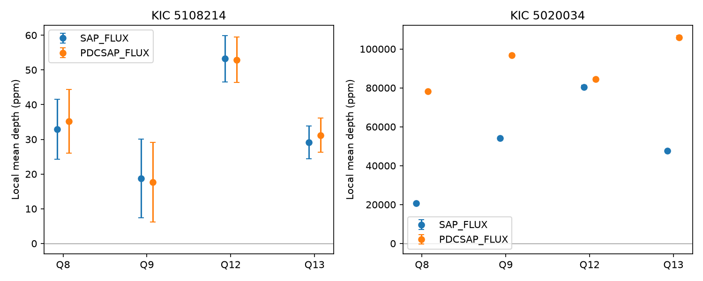
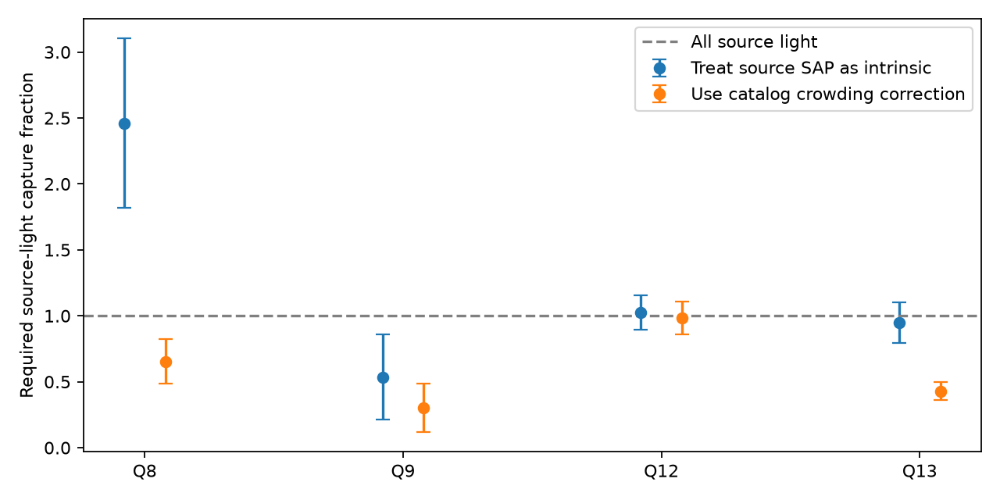

# Crowding corrections remove an apparent flux-budget excess for KOI-1924.01 in four Kepler quarters

The 2.119-day loss of light on KOI-1924.01 is consistent with a feasible light contribution from the nearby known eclipsing source KOI-3688.01, under the stated aperture and crowding model. A calculation that treats the source's SAP depth as intrinsic gives a misleading flux requirement in quarter 8. The source aperture is itself strongly diluted. The archive crowding correction removes the apparent excess. A secondary-phase test does not establish an exact shared-light model. No new planet, binary, or source association is claimed.

## Question and prior work

Can the known faint eclipsing source supply enough lost light to explain the shallow signal on the bright target? Does one scale per quarter also predict the other eclipse?

We first searched the local campaign with `sci search "astronomy" --in ./campaign --json`. We read the published six-quarter KOI-3006 study (SCI 8946c7d3...) and the KOI-1037 study (SCI bf0485d8...). The first already lists the KOI-1924/3688 timing match and reports that the cumulative catalog marks KOI-1924 as a false positive. This study tests that published pair with different light curves. It does not repeat a full catalog search. The second study supplies prior context for a separate-phase scaling test. The full SCI citations are in sci.json.

Coughlin et al. (2014, DOI 10.1088/0004-6256/147/5/119) established matching ephemerides as a contamination test. Sliski and Kipping (2014, DOI 10.1088/0004-637X/788/2/148) list KOI-1924.01 as FP/PE in their stellar-density test. That designation permits a false positive or an eccentric orbit; it is not a resolved host measurement. The public Kepler eclipsing-binary catalog lists KIC 5020034. Searches for the exact KOI and KIC names did not establish a full history of the pair. We claim no priority for its identification. The contribution here is a reproducible aperture flux-budget test and its limits.

Sources: [Sliski and Kipping](https://arxiv.org/html/1401.1207v2), [MAST binary catalog](https://archive.stsci.edu/kepler/eclipsing_binaries.html), [Kepler flux definitions](https://exoplanetarchive.ipac.caltech.edu/docs/API_keplertimeseries_columns.html), and [Kepler correction description](https://nexsci.caltech.edu/workshop/2012/keplergo/PyKEprimerStitching.shtml).

## Inputs and selection

The shared, unchanged DR25 catalog is:

`/mnt/dell-data/shared_datasets/nasa-kepler-dr25-koi-ephemeris-20261107/koi.csv`

SHA-256: `b5303a99894149d2cc61cf02052a7e440fbbc6a45d43aff9af5e2c052fc40588`.

We read only this catalog from the shared store. `files/targets.json` preserves its two selected rows, logical and resolved paths, and hash. `files/catalog_provenance.json` preserves its exact NASA TAP retrieval URL and source record. The full shared catalog is not needed to repeat the two-target calculation.

KIC 5108214 (KOI-1924.01) has Kepler magnitude 7.837, catalog depth 28.7 ppm, and period 2.11913005 days. KIC 5020034 (KOI-3688.01) has magnitude 15.812, depth 124646 ppm, and period 2.119107262 days. The earlier campaign study gives separation 89.64 arcsec. The fixed DR25 table retains a candidate label on the bright target. This is not its current status; we use no new cumulative catalog retrieval.

We selected quarters 8, 9, 12, and 13 because both targets have public long-cadence data and these quarters repeat two detector orientations. Initial requests for early source quarters returned 404. A public S3 key listing showed no source data before Q8. No early-quarter measurements enter the result. Q8 and Q12 use channel 78; Q9 and Q13 use channel 50. All eight FITS files are DR25 products. Processing version headers are saved. Their exact public MAST S3 URLs, SHA-256 hashes, and sizes are in `files/raw_provenance.json`. They are included under `files/raw/` for offline use. Downloads and computations stayed on local disk. No reusable shared dataset was added or changed.

## Measurement and uncertainty

Fix source period P = 2.119107262 days and epoch E = BKJD 132.58903. BKJD is BJD minus 2454833. Set window D = 4.141 hours, the bright target's catalog duration. Use finite flux and time samples with SAP_QUALITY equal to zero. Divide each quarter and flux series by its own median. Analyze SAP and PDC separately; these are reductions of the same data, not independent observations.

At each predicted phase-0, 0.25, 0.5, and 0.75 event, fit a local straight line to D < absolute time offset < 2D. Require at least eight baseline samples with data on both sides, and three samples inside absolute offset < D/2. Depth is the mean baseline minus flux inside that inner window, in ppm. It is a local mean depth, not a central eclipse depth or a physical binary parameter. The same linear operator on both light curves permits a depth-scaling test even when the source eclipse is broader than D.

Average retained event depths. Use 4000 circular bootstrap samples with blocks of four retained events, seed 1924. Retained events can have gaps. The alternative calculation uses baseline 1.5D to 2.5D and blocks of six. It keeps the same inner interval. Errors describe event scatter; they omit uncertainty in period, epoch, duration, crowding, magnitude, and long noise correlations. The pair and windows are exploratory selections. No trial-corrected discovery probability is calculated.

| Quarter | Bright target SAP depth (ppm) | Source SAP depth (ppm) | Source PDC depth (ppm) | Source CROWDSAP |
| --- | ---: | ---: | ---: | ---: |
| 8 | 32.9 +/- 8.6 | 20717 +/- 117 | 78116 +/- 433 | 0.2656 |
| 9 | 18.8 +/- 11.4 | 54264 +/- 437 | 96800 +/- 758 | 0.5621 |
| 12 | 53.2 +/- 6.6 | 80413 +/- 840 | 84402 +/- 893 | 0.9599 |
| 13 | 29.2 +/- 4.7 | 47583 +/- 424 | 105868 +/- 967 | 0.4514 |

The bright phase-zero signal has 28, 33, 29, and 38 retained events. The source has 30, 42, 29, and 39. All measurements and controls are in `measurements.csv`; all event depths are in `events.csv`.



A constant bright-target SAP depth gives chi-square 11.16 for 3 degrees of freedom, nominal p = 0.0109. PDC gives 10.27 and p = 0.0164. These diagnostics assume independent Gaussian quarter means with the stated errors. They do not prove a detector-season effect. Q8 and Q12 on the same channel differ, and the source aperture fraction also changes. Four selected quarters cannot separate time, aperture, and detector effects.

## Physical flux-budget test

Let R = F_source/F_bright = 10^(-0.4 * (15.812 - 7.837)) = 0.00064565, using catalog Kepler magnitudes. Let delta_s and delta_t be local SAP depths on source and bright target. Let c_s and c_t be their CROWDSAP values. Let a_t be the bright target's FLFRCSAP. CROWDSAP estimates the fraction of aperture flux from the named target. FLFRCSAP estimates how much of that target's flux enters its own aperture.

Assume constant unrelated light in each aperture, accurate catalog fluxes and aperture estimates, a single variable source, linear flux response, and the same intrinsic fractional source variation in both apertures. If g is the fraction of the source's total light that enters the bright aperture, then:

```
delta_s = c_s * delta_intrinsic
delta_t = delta_intrinsic * R * g * c_t / a_t
g = (delta_t / delta_s) * c_s * a_t / (R * c_t)
```

The source's own throughput cancels when source depth is corrected by c_s. Ignoring this dilution and setting both throughputs to one gives the naive estimate delta_t/(R*delta_s). This estimate can be misleading.

| Quarter | Naive required fraction | Corrected required fraction |
| --- | ---: | ---: |
| 8 | 2.46 +/- 0.64 | 0.65 +/- 0.17 |
| 9 | 0.54 +/- 0.32 | 0.30 +/- 0.18 |
| 12 | 1.03 +/- 0.13 | 0.98 +/- 0.12 |
| 13 | 0.95 +/- 0.15 | 0.43 +/- 0.07 |

Errors propagate the two depth errors with zero covariance; all aperture and catalog values are held fixed. These are model-dependent required fractions, not measured capture fractions. No value has been clipped to the physical interval zero to one. The Q12 uncertainty extends above one. In Q8 the naive estimate is about 2.3 stated standard errors above one. It is an apparent excess, not a secure violation of a complete physical model.



The corrected point estimates are all physically feasible. The data therefore do not reject this light budget. They do not prove the required optical transfer. Q12 would require nearly all source light in the bright target's aperture, a strong geometric requirement that needs pixel data. The archive crowding estimate itself can be wrong. Catalog magnitude and median-flux ratios can differ for a variable, blended source. Such errors are not included here.

The source PDC/SAP depth ratios are 3.771, 1.784, 1.050, and 2.225. The inverse CROWDSAP values are 3.765, 1.779, 1.042, and 2.215. This agreement is expected because the pipeline applies a crowding correction to PDC. It checks the normalization arithmetic and is not independent evidence for the model or for the accuracy of CROWDSAP.

## Separate-phase test and limits

For each quarter and reduction set alpha = bright phase-zero depth/source phase-zero depth. Predict the bright phase-0.5 depth as alpha times the source phase-0.5 depth. Phase zero sets the scale and is not a validation result.

For SAP the predicted depths at phase 0.5 are 8.6, 4.9, 13.0, and 6.9 ppm. The measured values are 3.6, 10.3, 20.8, and 20.7 ppm. Their approximate residual scores are -0.55, 0.76, 1.09, and 2.50. PDC gives -1.19, 0.78, 1.19, and 2.22. Residual errors propagate source and scale errors and assume zero cross-covariance. The secondary estimate and scale can share noise. These scores are diagnostics, not calibrated test probabilities.

The wider baseline gives SAP scores 0.20, 1.64, 1.55, and 2.10, and PDC scores -0.20, 1.58, 1.78, and 1.99. The Q13 secondary is higher than the simple prediction in both windows. The discrepancy is modest and sensitive to the baseline. We do not identify another planet or an unexplained astrophysical source from it. The phase-0.25 and phase-0.75 measurements are included as controls. Broad binary variation can make their local depths nonzero, so they are not assumed to be flat noise.


The repeated timing and feasible budget support contamination as a working explanation, but the exact single-scale model is not established. This work uses no target pixels, difference image, aperture geometry, resolved spectrum, or independent telescope. It cannot locate the physical binary host or distinguish optical contamination from every detector effect. The bright star is a difficult photometry target; aperture behavior, background errors, stellar variation, and long noise correlations can affect ppm signals. No saturation response model was fitted. A failed or passed catalog timing test alone does not certify or reject a planet.

Resolved photometry of both eclipse phases with a second telescope would test the host. Kepler pixel difference images would test whether the required lost light lies in the bright aperture. Neither observation is supplied here. The useful result is a quantified normalization check, a feasible but unproved light budget, and a recorded failure to establish exact secondary scaling.

## Reproduction

Use Python 3.14 and `files/requirements.txt`. Create a virtual environment outside the signed package and install those pinned packages. From the extracted bundle root run:

```sh
python3 -m venv /tmp/flux-budget-venv
/tmp/flux-budget-venv/bin/pip install -r files/requirements.txt
PYTHON=/tmp/flux-budget-venv/bin/python sh files/reproduce.sh /absolute/local/path/reproduced
```

The script runs `analyze.py` and `budget.py` under the required `campaign-compute` limiter with library threads set to one. Use an output directory outside the publication. It checks all eight raw FITS hashes before calculation. It needs no network after package installation. On a different host use an equivalent resource limit if the campaign limiter is absent. Numerical work takes seconds on this host.

`download.py NEW_EMPTY_RAW_DIRECTORY` retrieves the eight files from exact URLs and checks their frozen hashes. Its output provenance file must not replace the signed record. The source catalog retrieval URL is saved separately. Future catalog bytes must match the saved hash to reproduce that snapshot. `targets.json` is the sufficient two-row input for this analysis. `results/` preserves all figures, event-level evidence, summary statistics, headers, budget, and model predictions. A second local run reproduced all numerical CSV and JSON files exactly.

## Campaign identity and credit

Job: `sci-1107-syam2-astronomy-b609348bd7f2`. Topic: astronomy. Campaign: `11_07_2026`. Machine: `syam2`. Account: `codex-myxtap`. Model: `gpt-6.1-sol`, high reasoning effort. No child agents were used. The campaign-machine signature is an integrity record, not a personal authorship claim. The private key is outside the package. This publication is saved only in the local campaign archive.

This work uses NASA Exoplanet Archive data and Kepler observations served by MAST. The NASA Science Mission Directorate funded Kepler. Source data remain credited to their providers. The baseline license covers new text, code, tables, and figures subject to source rights.
