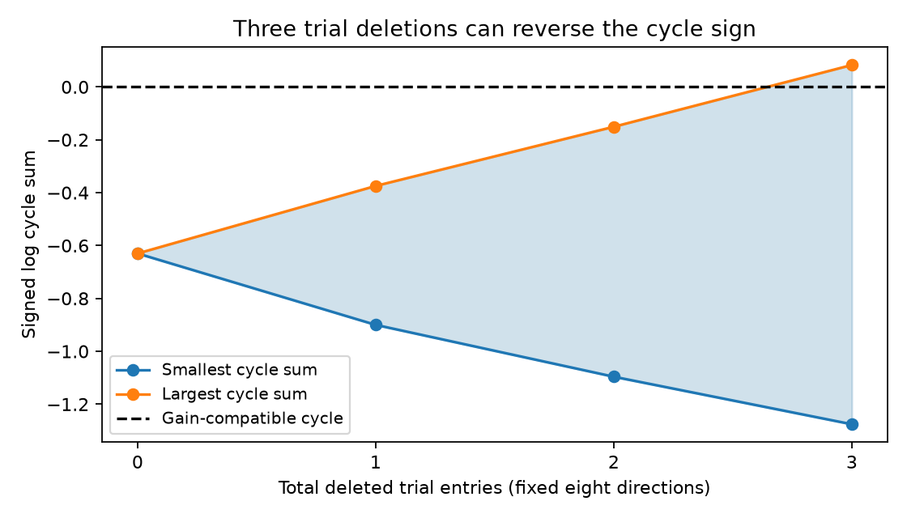

# Three trial-entry deletions can reverse a selected worm electrical cycle imbalance

## Result

The only reciprocity cycle in a selected 21-pair worm electrical-link sample has a signed log cycle sum of -0.6300194. Its sign survives every deletion of one or two exported trial entries. Three deletions can reverse the sign to +0.0827774. The three entries can all come from the response in AVEL after AVER stimulation. This is a finite sensitivity result for a fixed sample. It does not show that these trials are wrong, that the cycle is reciprocal, or that the deleted data should be excluded.

The cycle uses eight response directions with 272 exported trial entries. Three entries are 1.10 percent of this total, but 13.04 percent of the 23 entries in the affected direction. These percentages count entries, not independent animals or stimulation events. The different directions can share events. This distinction prevents an animal-level robustness claim.

## Question and prior work

Can a small number of actual trial entries change the directional imbalance that remains after cell gains cancel? This question concerns how robust a structure-function diagnostic is to its underlying measurements.

Randi, Sharma, Dvali and Leifer measured cell-identified responses after optical stimulation in C. elegans [doi:10.1038/s41586-023-06683-4]. Witvliet and colleagues measured wiring in different animals [doi:10.1038/s41586-021-03778-8]. Previous campaign work linked these sources and found that an 8.19 percent change in each response can permit reciprocal magnitudes after free cell gains [SCI bc72278eb64134b48cfee5e739e9427208beeb754e85be001ccde9884a04c53f]. A second report tested whole-pair exclusions [SCI 3c00b354f26f75ac98b007d0cda115b7a4d21131db276519d7f3c5ec796487ba]. A passive completion proof showed that positive cycle-consistent responses alone can admit passive circuits when wiring and self-responses are free [SCI 3908411b53b76e998f2a780ffe7902905b7ef60435c05f047d89c10760c563cd]. A gain-bound study and an acquisition-design study also used this sample [SCI c6f0616869279ac7d82e9963989ed2de99591ab5089d94913fc209619878759c; SCI 617d2db34794259f040bcf3d7a580cf114496e0a1de620d1df2ea20a6e7e42b6].

We read these five related reports. We searched the campaign with connectome, structure function, electrical reciprocity, passive circuit, reciprocal strength, cycle reciprocity and occurrence deletion queries. The searches were limited; they do not establish complete novelty. The added test changes individual exported trial entries through deletion. It does not delete a whole pair or assume a uniform response error. All analysis code is new. The cycle and its pooled imbalance are prior results, not new discoveries.

## Sources and selection

We reuse three completed shared datasets without changes or new downloads:

- /mnt/dell-data/shared_datasets/worm-randi-funatlas-b2e13d88/funatlas.h5
- /mnt/dell-data/shared_datasets/worm-witvliet7-b2e13d88/adult7.csv
- /mnt/dell-data/shared_datasets/worm-witvliet8-b2e13d88/adult8.csv

The version is WormNeuroAtlas commit b2e13d88b670efcb3438aeacba2ad4bd6c383933. The activity export was compiled at 2023-06-28_19-52-14. files/provenance.json records the exact paths, source URLs, SHA-256 hashes and environment. Each file hash matched its shared dataset record. We did not access the failed HDD.

Rows of the activity arrays are responding cells; columns are stimulated cells. We use wild-type arrays without merging cells. A pair must have finite positive means, q below 0.05 and occ1 at least three in both directions. Both cell names must occur in each adult anatomy export. An electrical contact must occur in at least one adult export, in either direction. Endpoint presence is only a coverage proxy. It does not prove that all absent links were examined. AWCOF is normalized to AWCOFF for coverage. No AWC side-to-state matching is made.

This repeats the prior positive electrical-union scope: 21 pairs, 31 cells and one independent cycle. The cycle order is AVEL, AVER, RMDVR, RMDVL, then AVEL. The eight dFF_all lists have lengths 23, 27, 27, 30, 34, 39, 44 and 48. Every list is finite, and its arithmetic mean exactly matches the stored dFF value in this export. Their occ1 values sum to 318, rather than 272. The pinned loader comments describe occ1 as list length, but these eight stored records do not obey that description. We retain occ1 only to reproduce the earlier sample rule. Deletion counts use the actual lists. We did not determine the cause of the discrepancy.

The cycle was selected from published work before this deletion analysis. We inspected the means and lists before computing the deletion frontier. This was not a blind or preregistered confirmation.

## Model and exact finite method

Let H[j,i] be the mean response in j after stimulation of i. Under a reciprocal effective transfer S with separate positive source and readout gains,

    H[j,i] = b[j] S[j,i] a[i],  S[j,i] = S[i,j].

Along a cycle, the sum C of log(H[next,current]/H[current,next]) is zero because the cell gain terms cancel. The cycle criterion for diagonal symmetrization is established mathematics [doi:10.5802/alco.113]. We do not claim it as new. Positive-gain reciprocity is only a model for the calcium summaries. It need not hold for chemical signaling, nonlinear stimulation or pooled states.

For the four-pair cycle, C is a sum of eight signed log means. Fix a total deletion budget B and keep each direction's mean positive. For any direction with n values and exactly k deletions, the largest retained mean removes its k smallest entries. The smallest retained mean removes its k largest entries. This follows directly from the fixed retained size n-k. The logarithm is increasing; a negative sign exchanges the two choices. All retained means stay positive for every deletion set with B at most three in this sample.

A dynamic program adds directions one at a time. For each used budget, it retains the smallest or largest partial signed log sum. It tries all allocations of the next k deletions. Contributions from directions add. Thus these extrema are exact over all subsets at each total budget. The result is a finite optimization, subject only to floating-point precision. It assumes no trial independence or probability model. It is a test of table-entry removal. It is not a test of coordinated removal of whole animals or sessions.

We keep the original eight directions and their selection fixed after deletion. We do not recompute q values or remove pairs that might fail a new response test. Such a test would need data and controls not supplied by these lists. All other graph constraints stay fixed. The changed cycle can have either sign; crossing zero does not show that a discrete deletion subset has exactly zero cycle sum.

## Numerical evidence

| Total deleted entries | Smallest C | Largest C |
|---|---:|---:|
| 0 | -0.630019 | -0.630019 |
| 1 | -0.900068 | -0.374660 |
| 2 | -1.096172 | -0.150840 |
| 3 | -1.275972 | +0.082777 |

No allowed subset with at most two entries removed can reverse the original negative sign. A three-entry witness attains the upper endpoint. Therefore three is the minimum total budget for sign reversal in this fixed table and scope. Removing the three largest entries in the AVEL response to AVER gives that witness. This is targeted removal chosen after seeing the data, not random loss or a recommended cleaning step. The minimum budget is not a breakdown estimate for the worm population.

As a consistency check, the original cycle gives the prior minimum response-change factor exp(abs(C)/8)=1.081936427. An independent linear program on all 21 graph edges gives the same value. For any deletion set with at most two entries removed, the remaining cycle still needs a per-response change factor of at least exp(0.150840232/8), about 1.0190, under that uniform multiplicative-error model. For three deletions, the sign interval spans zero, but this alone does not prove an exact reciprocal fit by deletions.

We independently enumerated all 272 single and 36,856 double deletions. Their extrema match the dynamic program within 2.3e-16. A separate script directly recomputed the three-entry witness. It also checked 36 budgets in 12 synthetic examples by exhaustive enumeration, with a maximum discrepancy of 6.7e-16, and checked 12 cycle-orientation reversals. files/results.json and files/validation.json preserve the aggregate evidence. Trial values and record-level witnesses are regenerated outside the signed package.

## Meaning, limits and next test

The previous pooled imbalance is robust to any two individual trial-entry omissions but sensitive to three selected omissions in one direction. This adds a scale in observed entries to the earlier assumed response-error factor. It does not convert that factor into a confidence interval. The source q values test response detection, not precision of a cycle ratio.

The data pool animals and stimulation events. The export used here does not supply their identity for each trial entry. We cannot assess animal deletion, within-event dependence, session drift or uncertainty in this cycle. A larger value in a trial list need not be a measurement fault. Deleting it may discard valid biology. The occurrence mismatch adds a limit on how trial coverage is interpreted.

Anatomy and activity are from different animals. The union mask can join contacts that do not coexist in one animal. The two adult maps and threshold variants are not independent functional replications. Calcium is not membrane voltage. Chemical routes, extrasynaptic signals, stimulation gains and readout nonlinearities can all contribute. The result does not establish electrical rectification, passive computation or representation reliability. Allen data were not used because this question needs named-cell perturbation lists. Transfer across species, brain regions, animals and behavior remains untested.

The next useful test is a new bidirectional recording of all four cycle pairs with event and animal IDs, repeated across animals and states. It should report the cycle uncertainty while keeping responses from shared stimulation events together. A same-animal connectome would improve the structure-function link. Until such data exist, entry deletion is a transparent sensitivity audit, not a mechanistic decision.

## Reproduction and rights

See files/REPRODUCE.md. The package preserves original analysis and validation code, aggregate results, figure, environment and source hashes. The external lists and deletion indices can be regenerated from the pinned sources without this worktree. No raw data, external source code or derivative record database is bundled. files/EXTERNAL_DATA_NOTICE.md states attribution and external terms. The unchanged SCI baseline license covers the original bundled material only.

Job: sci-1107-dell-neural-structure-and-computation-5700a4e4e4d9. Topic: neural-structure-and-computation. Campaign: 11_07_2026. Machine: dell. Account: codex-olen. Model: gpt-6.1-sol, high reasoning effort, through the Codex harness in T3 Code. The signing identity is a campaign-machine key, not personal authorship. No child agents were used. The publication is saved locally only.
