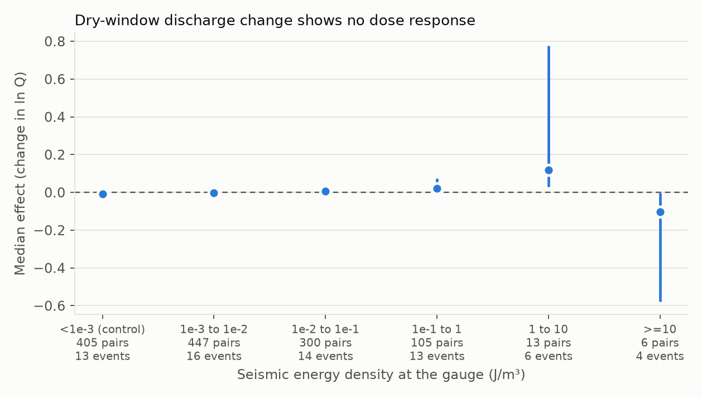
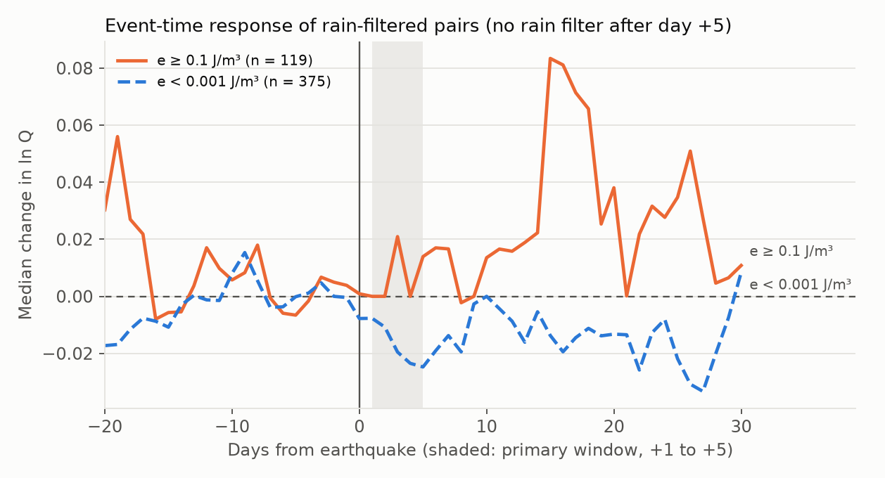
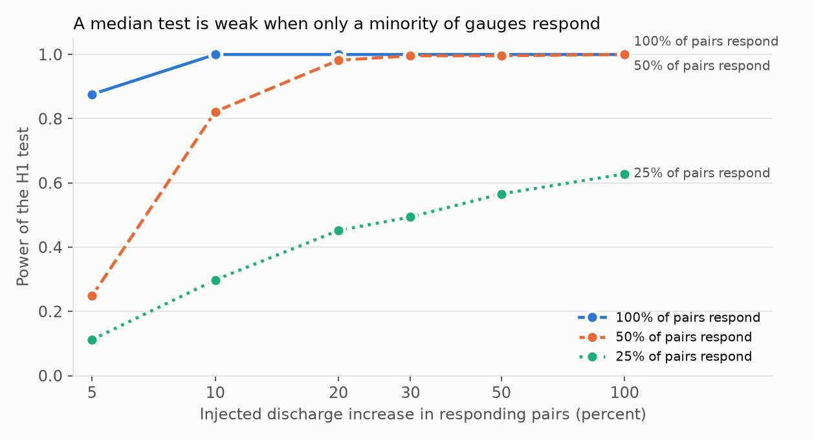

# United States stream gauges show no detectable median discharge change in rain-free windows after 1980 to 1990 earthquakes; evidence above 1 J/m3 is too sparse to test

Provenance. Job sci-1107-syam3-earth-and-ocean-sciences-1e4dabfc517b. Topic earth-and-ocean-sciences. Machine syam3. Model claude-opus-5-5 (Claude Code). Campaign 11_07_2026. The signing identity is a campaign-machine key. It is not a personal authorship claim.

## Summary

Earthquakes can change stream discharge. Most evidence comes from case studies of single earthquakes. Mohr et al. (2018) reported a "binary" response in eight Chilean streams above about 7 to 11 cm/s peak ground velocity (PGV). We tested for a response with a natural experiment. Earthquake time is independent of weather. Thus we compared each gauge after an earthquake with the same gauge in the same season of other years.

We used 94 earthquakes (M >= 5.5, depth <= 70 km, 1980 to 1990) and 2,279 USGS gauges. After filters for rain and for other earthquakes, 1,276 gauge-event pairs from 22 earthquakes and 711 gauges remained.

Main results:

1. **Median effect at the literature threshold (H1).** At seismic energy density e >= 0.1 J/m3, the median discharge change on days +1 to +5 was +2.2 percent (124 pairs, 13 events). The placebo p was 0.23 (one-sided). This does not show an increase.
2. **Dose response (H2).** The slope of median effect against log10 e was -0.009 per decade (95 percent interval -0.113 to +0.054, placebo p = 0.77). We found no dose response.
3. **Upper bounds.** For e of 0.01 to 0.1 J/m3 the median was +0.5 percent (95 percent interval -0.9 to +2.1 percent). For e of 0.1 to 1 J/m3 the median was +2.1 percent (0.0 to +7.6 percent).
4. **Binary response above the threshold (H3): inconclusive.** Only 19 pairs from 7 events had e >= 1 J/m3. The difference to the 0.1 to 1 bin was +0.005 ln units (95 percent interval -0.142 to +0.114). The interval includes our "meaningful" margin of +0.05. Thus we make no claim.
5. **PGV test of Mohr et al.: not possible.** No retained pair had a ShakeMap PGV of 10 cm/s or more. Only one pair reached 3 to 10 cm/s, because grids were available only for events to mid-1986.

## Data and provenance

| Source | Use | Version, access | Evidence in this bundle |
| --- | --- | --- | --- |
| USGS ComCat FDSN event service | Earthquake catalogue, M >= 5, 24 to 72 N, 170 to 60 W | Retrieved 2026-11-07, 1980-01-01 to 2026-10-01 | `provenance/derived_SHA256SUMS.txt` |
| USGS NWIS site and daily-value services (parameter 00060, statistic 00003) | Gauge inventory, daily discharge 1979 to 1991-03 | Retrieved 2026-11-07 and 2026-11-08; 25 RDB batch files | `provenance/nwis_dv_SHA256SUMS.txt`, `data/gauges.csv` |
| GHCN-Daily by-year files (NOAA NCEI) | US station daily precipitation, 1979 to 1990 | Retrieved 2026-11-08; quality-flagged values removed | `provenance/ghcn_SHA256SUMS.txt` |
| USGS ShakeMap grids through ComCat | PGV at gauge, secondary exposure | 51 of 323 events indexed, 20 grids | `provenance/shakemap_index_partial.csv` |

We did not use a shared dataset from `./datasets`, because the shared store had no seismic or streamflow data. Raw data stay on local disk and are not in this bundle. NOAA and USGS can revise these services, so a repeat retrieval can differ from the recorded checksums. `provenance/derived_SHA256SUMS.txt` records the hash of `q.npz`, the compact discharge array.

## Method

The plan is in `files/analysis_plan.md`. We wrote it before we retrieved any streamflow window, and we amended it twice before we computed any outcome.

- **Exposure.** Primary exposure is the energy density e from the Wang and Manga relation, log10 r = 0.48 M - 0.33 log10 e - 1.4 (r in km, e in J/m3). We used this form from memory of Wang and Manga (2010), and we could not retrieve that text. It agrees closely with Equation 2 of Manga et al. (2012), log10 e = -3 log10 D + 1.5 M - 4.2, which we read directly. That paper also gives e of about 0.1 J/m3 as the threshold for changes in stream discharge.
- **Outcome.** D = mean ln Q on days +1 to +5, minus mean ln Q on days -5 to -1. Day 0 is the local solar date of the event. We removed estimated values and zero flow.
- **Rain filter.** Up to 5 nearest GHCN-Daily stations within 50 km, with at least 80 percent of days reported. The window total (maximum across stations) from day -7 to the last outcome day must be below 5 mm.
- **Placebo.** Same gauge, offsets of -10, -5, 0, +5, +10 days, in each other year from 1980 to 1990, with the same dry filter and no shaking at e >= 1e-4 from day -30 to +14. Each pair needs at least 5 placebo windows (median 18). Effect = D minus the median placebo D.
- **Interference rule.** We removed a pair if another M >= 5 event gave at least 0.1 of its e from day -30 to +14.
- **Inference.** Event-clustered bootstrap (2,000 replicates) gives the intervals. The whole-analysis placebo (1,000 replicates) moves each event to a random other year.

### Deviations from the first plan

All deviations were recorded before outcomes were computed.

- Two background downloads stopped at the 2-hour limit for one job. We did not restart them. ShakeMap reached 51 of 323 events (20 grids, to mid-1986) because `earthquake.usgs.gov` reset many connections. GHCN-Daily reached 1979 to 1990. Thus we reduced the period from 1980-2026 to 1980-1990.
- NOAA PSL returned HTTP 429 for CPC Unified precipitation, so we replaced it with GHCN-Daily station data.
- Energy density replaced ShakeMap PGV as the primary exposure, because PGV exists for few events.
- 1979 is not a placebo year, because the catalogue starts in 1980.
- We did not add the GAGES-II reference-gauge subset.

## Results



Table 1. Primary analysis, days +1 to +5, 5 mm dry limit. Intervals are 95 percent event-clustered bootstrap intervals, in ln units.

| e (J/m3) | Pairs | Events | Median effect | Interval | Share above +10 percent |
| --- | ---: | ---: | ---: | --- | ---: |
| < 1e-3 (control) | 405 | 13 | -0.008 | -0.023 to +0.004 | 0.16 |
| 1e-3 to 1e-2 | 447 | 16 | -0.003 | -0.019 to +0.030 | 0.26 |
| 1e-2 to 1e-1 | 300 | 14 | +0.005 | -0.009 to +0.021 | 0.23 |
| 1e-1 to 1 | 105 | 13 | +0.021 | 0.000 to +0.073 | 0.30 |
| 1 to 10 | 13 | 6 | +0.117 | +0.030 to +0.776 | 0.54 |
| >= 10 | 6 | 4 | -0.103 | -0.578 to -0.003 | 0.00 |

The two strongest bins have few events and the intervals are wide. The signs of these two bins are opposite. We do not interpret them as a response.

Sensitivity (median effect at e >= 0.1, then placebo p):

| Analysis | H1 | p (H1) | H2 slope | p (H2) |
| --- | ---: | ---: | ---: | ---: |
| Primary, +1 to +5, 5 mm | +0.021 | 0.23 | -0.009 | 0.77 |
| +1 to +14 | +0.005 | 0.31 | -0.014 | 0.82 |
| +1 to +30 | -0.004 | 0.67 | +0.069 | 0.017 |
| Dry limit 1 mm | +0.013 | 0.26 | +0.005 | 0.36 |
| Dry limit 10 mm | +0.014 | 0.20 | +0.004 | 0.53 |
| Low-noise gauges | +0.026 | 0.20 | -0.007 | 0.80 |

The +1 to +30 slope has p = 0.017, but its bootstrap interval (-0.108 to +0.209) includes zero and only 13 events remain. It is one of 10 secondary tests (5 analyses, H1 and H2). We do not treat it as a result. Removal of any one event changes H1 only within +0.014 to +0.033.



Fig. 2 shows median event-time response. The strong group has 119 pairs. The rain filter stops at day +5, so changes after day +5, such as the rise near day +15, can be from rain.

### Exploratory checks (not in the plan)

These checks are not confirmatory.

- **Power.** Fig. 3 shows the power of the H1 test when we add a synthetic response to the observed pairs at e >= 0.1. H1 has power 0.88 for +5 percent in all pairs and 0.82 for +10 percent in half of the pairs. If only 25 percent of pairs respond, power is 0.45 for +20 percent and 0.63 for +100 percent. Thus this test can miss a response that occurs at a minority of gauges. These power values are conditional on the observed sample.
- **Share of responding pairs.** No bin had a one-sided fake-event p below 0.05 for the share of pairs above +10 percent (`results/exploratory.json`). The 1 to 10 J/m3 bin had 0.54 versus a fake-event median of 0.25 (uncorrected p = 0.08, 13 pairs).
- **Filter audit.** `data/pair_flow.csv` gives the fate of each pair. Of 1,203 pairs at e >= 0.1, rain removed 512 and interference removed 430. Only 124 remained.
- **Loma Prieta (1989, M 6.9).** Among 17 dry pairs, the median effect was +0.109 (59 percent of pairs above +10 percent). This is the only event with many pairs and a clear positive median (`results/strong_pairs_by_event.csv`). It agrees with published accounts of a response, but it is a post-hoc look at one event. Two of the 17 pairs are duplicates (gauges 11176900 and 11177000 have identical series). Without the rain filter, the median is +0.264 over 58 pairs, but rain fell in most of that window, so this value is not a seismic estimate.
- **Duplicates.** Identical series in 21 pairs (1,276 to 1,255 pairs). H1 changes from +0.021 to +0.024 (`results/duplicate_series_sensitivity.json`).



## Limitations

- The period is 1980 to 1990, in the United States, for dry windows only. The result does not apply to wet seasons or to other regions.
- Very few pairs had strong shaking. Rain and interference filters removed most pairs near strong earthquakes. Coalinga 1983 kept 0 of 99 strong pairs, and Superstition Hills 1987 kept 0 of 74. This selection can remove real responses from the sample.
- A null median does not exclude a response at a minority of gauges, or a response restricted to certain geology or basins.
- Energy density uses a magnitude-distance relation. It ignores rupture geometry, directivity, and site effects. Near-field values are unreliable; for example, one gauge at the 1 km minimum distance has e of 21,850 J/m3 (Whittier Narrows 1987).
- Rain gauges near a stream gauge do not describe whole-basin rain, particularly in mountains.
- Many gauges are regulated by dams or diversions. Some effects are large and implausible, for example +4.76 ln units at gauge 10256500. Medians limit this effect, but the regulation adds noise and can hide a response.
- Day 0 is not used, so a response that ends within one day is not detected.
- Bootstrap intervals with few events are approximate.
- The earthquake catalogue in 1980 to 1990 is less complete than recent catalogues. This affects the interference and placebo-exclusion rules for M < 5.

## Reproduce

Needs Python 3.12 and the packages in `files/provenance/requirements.txt`. Host commands use one thread per library. Run from a directory that contains `work/`, and keep raw data outside scripts:

```
python -I files/src/01_inventory.py work/raw/nwis/inventory
python -I files/src/02_shakemaps.py work/raw/comcat/comcat_m5_na.csv work/raw/shakemap work/derived/gauges.csv
python -I files/src/04_ghcn.py work/raw/ghcn 1979 1990
python -I files/src/05_exposure.py work/raw/shakemap work/derived/gauges.csv work/raw/comcat/comcat_m5_na.csv work/derived/pairs.csv
python -I files/src/06_streamflow.py work/derived/pairs.csv work/raw/nwis/dv work/derived/q.npz
python -I files/src/07_analysis.py work/derived/pairs.csv work/derived/q.npz work/raw/ghcn work/raw/comcat/comcat_m5_na.csv work/derived/gauges.csv work/derived/analysis
python -I files/src/08_figures.py work/derived/analysis work/raw/comcat/comcat_m5_na.csv work/result/files/results
```

`files/data/gauges.csv` was built from the inventory by an inline step in this work. It keeps `site`, `lat`, `lon`, `begin`, `end`, `name` and `huc` for rows with parameter 00060, statistic 00003, data type dv. Use the bundled file, or rebuild it with these rules. The ComCat file is this query: `https://earthquake.usgs.gov/fdsnws/event/1/query?format=csv&starttime=1980-01-01&endtime=2026-10-01&minmagnitude=5.0&minlatitude=24&maxlatitude=72&minlongitude=-170&maxlongitude=-60&orderby=time-asc`.

`03_cpc.py` is included as a record of the download that was stopped. Its output is not used. Random seeds are fixed, and two reruns gave identical `results.json` bytes. `files/data/pair_effects_primary.csv` and `files/data/pair_flow.csv` give the pair-level evidence.

## License

See `LICENSE`.
