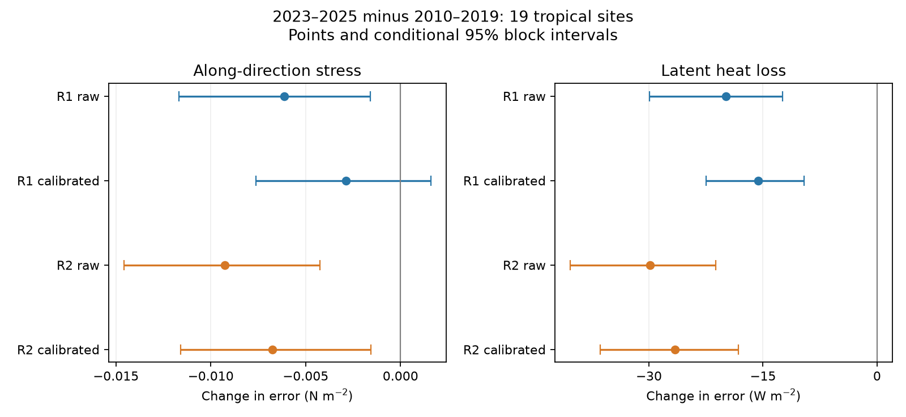
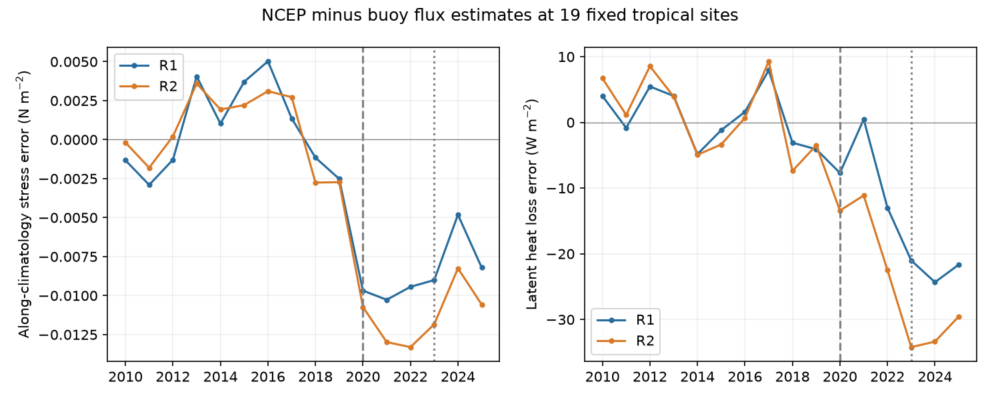

# NCEP captured 12-43% of buoy stress strengthening at 19 tropical sites in 2023-2025

## Question

Do the recent NCEP ocean boundary errors coincide with a change in surface momentum flux error, as well as the known change in latent heat flux error? We test NCEP-NCAR Reanalysis 1 (R1) and NCEP-DOE Reanalysis 2 (R2) against bulk flux estimates from tropical moored buoys. The main comparison is February 2023 to December 2025 against 2010 to 2019. This is a fixed-site test, not an ocean-area estimate.

## Background and new test

Campaign study sci:sha256:b44c67de760c9fbff5746c78daa25e8779d62b66996c5df038e37710f4592842 found cold SST boundary inputs in R1 and R2 after February 2020, with larger errors after 2022. It found less turbulent heat loss but had no external flux check. Study sci:sha256:af60f4a6c02bb2fd8117208e9aaa047de8fdddbfe3003a9a192bab86a1d6374b added a buoy heat-flux check. It found a large change in heat-flux error, but weak spatial evidence that SST alone caused it. We add an external momentum-flux check, with heat flux evaluated on the same site-month samples. Stress can affect ocean currents and mixing. Thus a stress change would extend the scope beyond a surface heat-budget error.

Buoy comparisons with NCEP are established methods, not a new method here. Cronin et al. (2006), doi:10.1029/2005JC003324, tested tropical heat-flux errors and seasonal structure. Weller et al. (2022), doi:10.1175/BAMS-D-21-0084.1, discussed changes in reanalysis stress and heat-flux bias at ocean reference stations, including an R2 stress change at WHOTS in 2014-2015. Our contribution is the recent joint test against GTMBA fluxes over a fixed tropical cohort. It does not discover the general existence of time-varying reanalysis flux errors.

## Results

The fixed cohort has 19 sites: seven PIRATA sites in the Atlantic and twelve TAO/TRITON sites in the Pacific. It has 2,549 paired site-months, with 1,289 in the baseline and 355 in the recent window. Recent coverage is 355 of 665 possible site-months.

NCEP stress strengthens less than the buoy estimate. With equal calendar-month weights, the buoy along-direction stress increases by 0.01040 N m-2. R1 increases by 0.00449 and R2 by 0.00121 N m-2. These point changes capture 43% and 12% of the buoy strengthening. They are descriptive fractions, not confidence limits or ocean-wide fractions. The corresponding heat comparison goes in opposite directions: buoy heat loss rises by 7.02 W m-2, while R1 falls by 11.80 and R2 by 22.11 W m-2.

The main season-adjusted error contrasts give the following results. Stress units are N m-2 and heat units are W m-2. Square brackets give conditional 95 percent intervals.

| Test | R1 | R2 |
|---|---:|---:|
| Along-direction stress error change | -0.00613 [-0.01167, -0.00159] | -0.00926 [-0.01458, -0.00426] |
| Stress change after pre-2020 calibration | -0.00289 [-0.00763, +0.00160] | -0.00677 [-0.01160, -0.00156] |
| Cross-direction stress error change | -0.00074 [-0.00486, +0.00412] | -0.00122 [-0.00486, +0.00362] |
| Latent heat loss error change | -19.87 [-29.90, -12.45] | -29.83 [-40.37, -21.25] |
| Heat change after pre-2020 calibration | -15.64 [-22.48, -9.57] | -26.61 [-36.43, -18.26] |



Stress error declines at 14 of 19 sites in R1 and 17 of 19 in R2. The Pacific sites carry most of the stress signal: raw changes are -0.00968 and -0.01266 N m-2 in R1 and R2. Atlantic values are -0.00004 and -0.00345. The heat-flux error changes are larger in the Atlantic. This different spatial pattern does not support one uniform correction across flux types.

The 25-day rule gives stress-error changes of -0.00601 and -0.00924 N m-2, with intervals below zero. R2 raw stress changes stay negative with intervals below zero for both alternate baselines. R1 has an interval that includes zero with the 2005-2014 baseline. R2 calibrated stress has an interval below zero for the main and 2005-2014 baselines, but includes zero for 2015-2019. The raw stress placebo is +0.00198 for R1 and -0.00008 for R2; both intervals include zero. Neither cross-direction main interval excludes zero. These are limits on the strength and scope of the result, not evidence of no cross-direction change.

Absolute performance differs by flux type. Along-direction stress error grows, while heat-flux error becomes smaller on the sampled months. The table gives equal-site means of available months; it is not season-standardised. RMSE is the mean of each site's RMSE, not the root of a pooled mean square.

| Metric | R1 baseline | R1 recent | R2 baseline | R2 recent |
|---|---:|---:|---:|---:|
| Stress mean error (N m-2) | -0.00088 | -0.00748 | +0.00243 | -0.00696 |
| Stress RMSE (N m-2) | 0.01511 | 0.01975 | 0.01371 | 0.01800 |
| Heat mean error (W m-2) | +12.87 | -7.24 | +30.82 | +1.31 |
| Heat RMSE (W m-2) | 26.29 | 17.83 | 39.87 | 20.18 |

Thus improved absolute heat-flux agreement does not establish improved momentum forcing. The calibration result gives clearer evidence of a changed stress response in R2 than in R1. The separate loop audit reproduces all six raw main contrasts to a maximum absolute difference of 1.8e-18 in the reported units.



The figure gives annual means of season-adjusted errors at the fixed cohort. Each site's available months have equal weight within year, and sites have equal weight. Site availability can change within this cohort. This figure is descriptive; the period contrasts in the tables use the stated recent window. Dashed and dotted lines mark 2020 and 2023, not fitted break dates.

## Data and methods

We use PMEL daily wind stress (`pmelTaoDyTau`) and latent heat flux (`pmelTaoDyQlat`) for 2005-2025. We retain quality flags 1-3; the stress source reports only flags 1 and 2 in the valid extract. PMEL uses COARE 3.0b with absolute winds and a daily gustiness correction. These are estimates from measured weather, not direct covariance flux measurements. PMEL turns off daily cool-skin and warm-layer adjustments. See https://www.pmel.noaa.gov/tao/drupal/flux/documentation.html. Input observations can be assimilated in NCEP, so the flux estimates are external calculations but not fully independent observations.

We average each valid daily stress component and heat flux by site and calendar month. Both datasets must have at least 20 valid days. We check that daily records do not duplicate site and time. Stress and heat means can still use different valid days. NCEP monthly means include all days. We sample R1 and R2 monthly `uflx`, `vflx` and `lhtfl` at the nearest native Gaussian grid cell, with circular longitude distance. We convert NCEP momentum flux to stress on the ocean with tau_x = -uflx and tau_y = -vflx. NCEP documents UFLX/VFLX as negative wind stress (https://www.cpc.ncep.noaa.gov/products/wesley/cdrom/surfaceflux.html). This reverses the negative baseline covariation seen in an initial unconverted check. The converted pre-period slopes are positive (0.58-0.79 for along-direction stress). The R2 monthly standard-name attributes say downward stress, which conflicts with this convention and the data covariation. Marsh et al. (2011), doi:10.5194/gmd-4-957-2011, Table 1, also identifies R2 momentum flux as negative wind stress. We use that documented conversion for both products. Stress components then use east and north as positive; heat flux is positive ocean heat loss. No sign is fitted to recent data.

The cohort rule requires at least 36 baseline months, at least 12 recent months, and at least two baseline values in each calendar month. We choose sites using coverage only. This applies the prior heat study's coverage rule to joint heat and stress data. We do not demand coverage in 2020-2022, which was poor in the earlier study. No threshold is selected on the observed errors. The 25-day sensitivity keeps the main cohort fixed.

At each site and calendar month we define a unit vector d from the mean 2010-2019 buoy stress vector. We project both NCEP and buoy stress on this same vector. Positive along-direction stress strengthens the usual local monthly stress; negative error means NCEP is weaker than the buoy estimate in that direction. A second unit vector (-d_y, d_x) gives the cross-direction test. We average components before projection. We do not compare the magnitude of monthly NCEP vectors with the mean of daily buoy stress magnitudes. Those quantities differ even without error.

For each metric we remove its site and calendar-month baseline error. We average recent anomalies within each site and then across sites with equal weights. For calibration, we center buoy and NCEP values by their own site-month baseline means. We fit one pre-2020 slope of NCEP on buoy anomalies per array, with no intercept after centering. We then test recent residuals from that fixed relation. This is a statistical response check, not a physical transfer coefficient. The baseline directions and calibration slopes are held fixed in all intervals and sensitivity tests, including alternate baselines.

Approximate 95 percent intervals use 2,000 resamples of sites and synchronous circular 12-month blocks in the baseline and recent windows. We subtract each bootstrap baseline mean from each bootstrap recent mean. Empty site-block combinations are omitted. This includes sampling in both windows but conditions on the cohort, gaps, calendar means, directions and fitted slopes. It omits algorithm and instrument errors. Sites in one ocean do not give independent samples of large-scale climate. Intervals are not adjusted for multiple comparisons. The main contrasts are the along-direction raw and calibrated stress changes; cross-direction and sensitivity results are supporting tests.

Checks use a 25-day rule, baselines 2005-2014 and 2015-2019, and a 2010-2014 versus 2015-2019 placebo. Equal-calendar-month differences are also provided in `absolute.csv`. All tests are exploratory; no prospective registration was made.

## Limits and interpretation

The stress result extends the recent NCEP surface-field concern to momentum forcing at these sites. It does not show a global momentum step. The R1 calibrated interval includes zero, and the R2 calibrated interval depends on the baseline. The largest stress change is in the Pacific, while the largest heat change is in the Atlantic. Sparse recent coverage, one bulk algorithm, nearest-grid sampling and common assimilation inputs limit inference. We did not observe upper-air or ocean circulation changes in this study.

A flux-error change need not be caused by the SST input change. Wind, humidity, atmospheric stability, assimilation, sampling, instrument changes and flux algorithms can all contribute. A controlled rerun or separate state-variable decomposition would be needed for causal attribution. We do not infer ocean currents, mixed-layer depth, Ekman pumping, heat content or climate feedback from these site stress tests. The short recent window cannot identify a precise break date. Tropical sites cannot test the large midlatitude boundary errors.

Absolute errors and changes in error answer different questions. Restoring an old bias is not a valid correction merely because it removes the recent change. Any useful repair must test absolute accuracy and temporal accuracy separately. The same restriction applies to stress and heat flux.

## Reproduction and provenance

The package contains our source code, aggregate tables, audit, figure and exact input hashes. All source files and station-month derivatives stay outside it. `files/inputs.json` records each shared dataset path, resolved path, source URL, retrieval metadata and SHA-256. Shared source files are reused without change. See `files/NOTICE_external.md` for attribution and source terms. We acknowledge the GTMBA Project Office of NOAA/PMEL and the NCEP and NOAA PSL data producers.

With this publication unpacked at `PUB`, run:

```sh
python "$PUB/files/fetch.py" /absolute/path/to/external_inputs
OMP_NUM_THREADS=1 OPENBLAS_NUM_THREADS=1 MKL_NUM_THREADS=1 python "$PUB/files/analyze.py" --datasets /absolute/path/to/external_inputs --out /absolute/path/to/scratch
python "$PUB/files/audit.py" /absolute/path/to/scratch
python "$PUB/files/plot.py" /absolute/path/to/scratch
```

On the campaign machine use the existing `datasets/` link instead of downloading again. Retrieval rejects changed hashes and writes outside the signed package. Upstream monthly files can change. Exact replay then requires the stored version with the recorded hash. The audit uses a separate site-by-month loop to check the primary estimates from the external matched records. Compare aggregate CSV files and `audit.json` with the bundled files. Package versions are in `environment.json`. Analysis uses one numerical thread, within the two-CPU budget. No agents or services were launched.

Campaign 11_07_2026. Job sci-1107-dell-earth-and-ocean-sciences-6343ec1b59b8. Topic earth-and-ocean-sciences. Machine dell. Account codex-olen. Model gpt-6.1-sol with high reasoning effort. Analysis date 2026-11-12 UTC (2026-11-11 local). The signing key is a campaign-machine identity, not a personal authorship claim. The signed bundle is saved locally; we make no remote archive upload or index submission.
