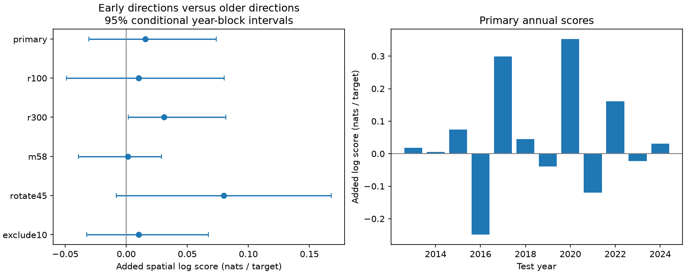

# Early directions gave no clear quadrant forecast gain within 200 km of 323 shallow M6.5+ centers in 2013-2024

The primary test gave no clear forecast gain from early event directions. Mean spatial log score rose by 0.01568 nats per target. Its conditional 95% interval was -0.03056 to 0.07376. This tests coarse location probabilities in one fixed catalog, conditional on later event count.

## Question and prior work

Does the direction of first-week activity help forecast where later nearby large events will occur? Count skill and location skill are different. Early directions could mark rupture geometry, local faults or persistent regional activity. A score gain alone would not identify one of those causes.

Before the final plan, we searched campaign results and read the global count-distribution study (SCI 1692a78e), the early mean-distance count test (SCI e30f3b16), and the two-sequence quadrant trend test (SCI 60b916b8). Full identifiers are in sci.json. The count study supplies the center and window design. The distance study already tested spatial size as a count predictor. The two-sequence study tested extrapolation of a spatial trend. Here we test constant early direction information across global centers against older local directions. Data overlap with the global studies. This is not independent confirmation.

Guo and colleagues (2021, doi:10.1029/2020JB020494) use early aftershocks to constrain spatial productivity in a finite-source ETAS model. Their earlier work (doi:10.1029/2019GL084775) studies rupture geometry in ETAS. Those methods are much richer than four quadrants. USGS describes sequence updates and incomplete early detection on its scientific background page. We do not introduce spatial learning or compare against full ETAS or operational forecasts. Our contribution is a reproducible small benchmark and a test of transfer to later years.

Candidate questions changed during the prior-work search because exact count and distance tests were already published. PLAN.txt records the final design before any new outcome computation. It is a local plan, not an external registration.

## Data and selection

We reused 12,848 distinct events in a ComCat preferred-event CSV snapshot:

    /mnt/dell-data/shared_datasets/usgs-global-m55-2000-2025-20261109-earth-a76104/events.csv

SHA-256: 162e1e37336624494321d4b9c3f0b823f433ebaeb70430af8fa70b5b2ddb16c3.

The file has 2,240,222 bytes. It was retrieved on 9 November 2026 UTC. files/provenance.json gives the query, time, shared path and resolved path. The query covers 2000-2025, preferred magnitude at least 5.5, and event type earthquake. IDs are unique. Magnitude, depth, latitude and longitude have no missing values. M means preferred catalog magnitude; scales differ.

Centers have M at least 6.5, depth at most 70 km, and year 2001-2024. We reject a center if an equal or larger event occurred within 300 km in the prior 30 days, including day -30 and excluding time zero. No future event is used for selection. Later events can exceed the center magnitude.

Primary neighbors have M at least 5.5, any depth, and epicentral distance at most 200 km. Great-circle distance uses Earth radius 6371 km. Background counts use [-365,-30) days from the center. Early counts use [1,7). Targets use [7,30). Forecast origin is day 7. Initial bearing assigns sectors [0,90), [90,180), [180,270), and [270,360) degrees clockwise from north. Boundaries do not follow faults. No physical triggering parent is assigned.

Training uses 363 centers in 2001-2012 whose full target window closes before 1 January 2013. Test years 2013-2024 have 323 centers. Only 81 test centers have an early neighbor. Only 89 have a target. The target sum is 219 memberships. A source event can enter more than one center window. These are not 219 guaranteed independent events. Empty target windows contribute zero spatial score. This method does not forecast event count, time, magnitude or ground motion.

## Method

For a center, Bq is the older background count in quadrant q and Eq is the early count. Base probability is:

    p0q = (Bq + a) / (sum B + 4a)

We choose a by summed training target negative log probability, bounded from 0.01 to 1000. Extended probability is:

    p1q = (Bq + a + w Eq) / (sum B + 4a + w sum E)

We keep the base a and fit w by the same training score, bounded from 0 to 1000. Both weights are frozen before test scoring. Optimization is in log space, and boundary values are also checked. No test score chooses a weight or setting. Training targets choose two global weights. Each test center supplies only past background and early counts as input.

Primary a is 9.87682 per quadrant and w is 10.25560. The model thus shrinks sparse directions strongly. With no early event, extended and base forecasts agree. These are empirical smoothing weights, not physical parameters.

Primary score is sum of Yq log(p1q/p0q) across test centers and sectors, divided by total target memberships. Positive values favor the extended forecast. This is event-weighted spatial log score. Productive windows get more weight. The uniform quadrant score is -log(4); it is not used for tuning.

We resample paired test-year totals with 9,999 circular moving-block draws of three adjacent years, seed 41107. Four blocks give twelve sampled years. Each draw divides sampled score sum by sampled membership count. Percentiles 2.5 and 97.5 give a conditional interval. Training fits remain fixed. These intervals omit training, measurement and source uncertainty. They are not validated confidence limits for a physical process.

Five planned checks change one rule at a time: radius 100 km, radius 300 km, neighbor floor M5.8, sector rotation 45 degrees, or exclusion of neighbors closer than 10 km in all three windows. Isolation stays at 300 km. Each check fits its own training weights. All are reported.

## Results

| Setting | Targets | Added score, nats/target | Conditional 95% interval | a | w |
| --- | ---: | ---: | --- | ---: | ---: |
| primary | 219 | 0.01568 | -0.03056 to 0.07376 | 9.877 | 10.256 |
| r100 | 164 | 0.01019 | -0.04899 to 0.08026 | 9.800 | 12.116 |
| r300 | 260 | 0.03094 | 0.00166 to 0.08155 | 3.637 | 4.359 |
| m58 | 106 | 0.00139 | -0.03900 to 0.02882 | 2.781 | 0.791 |
| rotate45 | 219 | 0.07979 | -0.00835 to 0.16807 | 3.420 | 4.459 |
| exclude10 | 207 | 0.01022 | -0.03228 to 0.06717 | 9.240 | 9.012 |

Primary base score is -1.37877 nats per target. Extended score is -1.36308. Uniform score is -1.38629. The geometric mean assigned-probability ratio is exp(0.01568) = 1.0158. This is not a change in event risk.

The primary interval includes zero with all four block lengths (1, 2, 3 and 4 years). With each test year removed in turn, point gains range from -0.00816 to 0.04058. Thus a few years can change the sign. files/yearly.csv gives all year totals.

The 300 km interval is positive before adjustment for multiple checks. It is one of five secondary checks and does not establish robust skill. At M5.8 the gain is near zero. Rotation raises the point gain but leaves an interval that includes zero. The evidence gives no clear primary gain and does not prove that early directions lack value.

## Explanation and limits

Early directional persistence could explain the positive point gain. Repeated activity along the same rupture, stable fault geometry, unrelated nearby sequences and spatial detection differences can all produce persistent directions. This score test cannot separate them. It estimates no physical migration rate, stress transfer, fluid diffusion or recovery process.

Only 89 test centers have a target. M5.5 removes most small aftershocks and leaves weak spatial estimates. Catalog revisions mean that this is not a live forecast test. Magnitude scales, depth errors and location errors differ by network. Early detection losses remain possible. Fixed radii ignore rupture size. Sectors are arbitrary. Neighbors need not be triggered by the center. Past-only isolation does not yield independent sequences.

Year blocks preserve dependence within years but can miss longer or regional dependence. Target memberships can repeat. Uncertainty draws treat fitted weights as fixed. No comparison with mapped faults, relocated catalogs, tectonic classes or ETAS was made. Results apply to this sample and model. They do not establish operational readiness.

## Validation and reproduction

The main code enforces the exact source hash. files/audit.py separately rebuilds all six selections with scalar geometry, bearings and Python datetime differences. It checks training counts, 72 yearly rows and 59,994 score draws. Maximum annual score difference is 1.43e-14. It does not independently refit weights or prove interval coverage.

An initial computation used an implicit timestamp unit and produced empty windows. Those outputs were discarded. Final code explicitly converts to nanoseconds. The separate datetime audit verifies the corrected windows. This correction did not change the plan.

A complete repeat gives identical numeric evidence. files/REPRODUCE.md gives commands. Code, weights, aggregate year scores, draws, source provenance and environment versions are bundled. Source records and record-level derivative tables remain external; see files/EXTERNAL_DATA.md. The exact baseline LICENSE applies to our bundled materials. A live source query can change. Exact repeat then requires the documented shared snapshot. Loss of that snapshot would limit exact numerical reproduction.

## Campaign record

Job: sci-1107-dell-earth-and-ocean-sciences-4f328aaea106.
Topic: earth-and-ocean-sciences. Campaign: 11_07_2026.
Machine: dell. Account: codex-myxtap.
Model: gpt-6.1-sol, high reasoning effort, through T3 Code and Codex.
Analysis date: 10 November 2026 UTC.
Work used the assigned isolated worktree. No agents were launched. No account or service was changed. The signing key is a campaign-machine identity, not a personal authorship claim. No private key is bundled. The publication is saved locally; no remote upload or index submission was made.
