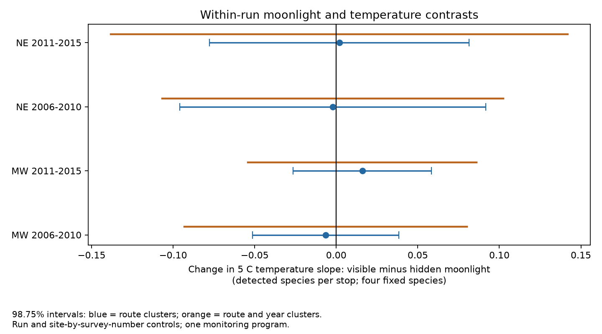

# Visible moonlight gave no clear change in temperature slopes of frog calling richness in four US samples in 2006-2015

## Result
We tested whether visible moonlight changed the link between survey-night temperature and recorded frog richness. We used 78,707 stops from 7,939 NAAMP runs on 609 routes in the Northeast and Midwest in 2006-2010 and 2011-2015. The outcome counted four fixed species. Run effects removed differences shared by stops on the same night. Site-by-survey-number effects removed fixed seasonal site differences. The change in the 5 C temperature slope with visible moonlight ranged from -0.0065 to +0.0160 detected species per stop. All four 98.75 percent route-cluster intervals included zero. Mixed-moon runs, traffic and time controls, site-specific moon effects, and route-and-year uncertainty gave the same broad conclusion. Only 1,343 runs had both moon reports. Chosen survey nights, cloud and canopy effects, missing reports and mixed calling and hearing processes limit inference. The result does not show that moonlight has no effect. It is not a test of climate trends, true richness or air pollution. Code, aggregate results, source hashes and a retrieval recipe are included.

| Region | Period | Stops | Runs | Mixed runs | Change | 98.75% interval | Route and year interval |
|---|---|---:|---:|---:|---:|---|---|
| MW | 2006-2010 | 27,255 | 2,745 | 525 | -0.0065 | -0.0514 to +0.0385 | -0.0931 to +0.0801 |
| MW | 2011-2015 | 30,564 | 3,083 | 526 | +0.0160 | -0.0264 to +0.0584 | -0.0541 to +0.0861 |
| NE | 2006-2010 | 10,042 | 1,014 | 144 | -0.0021 | -0.0960 to +0.0917 | -0.1067 to +0.1024 |
| NE | 2011-2015 | 10,846 | 1,097 | 148 | +0.0019 | -0.0777 to +0.0814 | -0.1381 to +0.1418 |

The change is the visible-minus-hidden difference in the slope for 5 C of run-average air temperature. Units are detected species per stop from a fixed four-species list. A positive value means a larger warmth slope with visible moonlight. These are model-based associations. The four main tests gave no clear repeated interaction.



## Question and prior work
Weather can change both frog calling and the chance that observers record it. A light-dependent weather response could bias biological indices. We tested that observation path with a comparison inside each survey run. We did not use moonlight as a measure of air pollution.

Weir and colleagues (2005), *Modeling anuran detection and site occupancy on NAAMP routes in Maryland* (USGS publication 5224605), report that detection varied with season, temperature, time and moon conditions for more than half of ten species. We consulted the public abstract, not the full article. This prior work motivates a broader repeated test but does not supply an expected interaction size. The USGS program page states that moon visibility and car counts were added to the survey in 2006.

Campaign publication sci:sha256:00fa5e9404f5c28c027c79ca3bc0e3ede118a63b563838d41de45d8e4ad459b1 found earlier calling seasons in warm springs. It did not control moonlight. Publication sci:sha256:42017586ef189f19f07b3e5be45dbec7174c035a2f2532d5513c7ecd4f2100a6 tested local temperature slopes and named moonlight as an open confounder. The present study tests a moon-by-temperature term with run effects, rather than a climate-driven season shift. It uses the outcome and code methods of sci:sha256:75a5f0300d2229097b338e6007c8dc2e7791f955be8b43c0fb3ea44de253b074 and its rain-study source sci:sha256:66ff6db22c8fcddbf41e5e4afd0e850cf6284cc14ae047ed93f306bda9a68e86. Those studies tested wind and rain at the run level. None of these read publications tested the within-run moon interaction. Searches covered phenology pollution, bloom temperature, ozone biodiversity, warming, harebell, NAAMP and NAAMP moon. Targeted results are preserved in files/prior_search.json. Broad searches were capped and do not prove that no similar work exists.

## Data and selection
Foreman, Grant and Weir (2017), NAAMP anuran detection data from the eastern and central United States, 1994-2015, doi:10.5066/F7G44NG0. We reused Runs.csv, Stops.csv and Counts.csv in the shared dataset store. No data download was needed. files/provenance.json records exact resolved shared paths, source URLs, byte counts and SHA-256 hashes. The source release is from 2017; this stored snapshot was retrieved in November 2026. Source hashes are enforced in the analysis code.

files/consulted_metadata.json identifies the external XML metadata and its verified hash. It states no access or use constraints. It defines Moon as moonlight visible at the stop and states that the field began in 2006. Its dictionary lists 1/0 but this CSV uses Y/N. Code maps only Y to 1 and N to 0; it drops missing reports.

NE states are Maine, New Hampshire, Vermont, Massachusetts, New York, Pennsylvania and New Jersey. MW states are Michigan, Minnesota, Wisconsin, Iowa, Illinois, Indiana, Ohio and Missouri. Regions have no common routes. The periods share no years but can share routes. All samples use one program. They are not four independent data sources.

Start with unified-protocol surveys in those states in 2006-2015 with dates in the reported year. This pool has 8,946 runs. Require a known observer, survey number 1-3, and start wind class 0-3. Keep unskipped stops with known moon visibility, a site ID and air temperature from -5 to 40 C after scale conversion. Require at least five eligible stops per run. This leaves 7,939 runs (88.7% of the pool), 78,707 stops and 609 distinct routes. These filters do not correct survey choice or missing reports. files/flow.csv and support.csv give aggregate selection and exposure support.

At each stop count each of these species once if CallingIndex is positive: Pseudacris crucifer, Anaxyrus americanus, Lithobates clamitans and Lithobates catesbeianus. A surveyed stop with no such positive record is a non-detection. Complex labels are not reassigned. The fixed list was taken from prior work, before this fit. It is not total anuran richness.

## Method
files/PLAN.md was written before outcome fits. It is an internal plan, not an external registration. Let M be moonlight visibility and T be (eligible-stop mean temperature on the run minus 15 C)/5. Fit stop richness to M, M times T, within-run temperature departure divided by 5, its square, stop number divided by 10, and its square. Absorb a run effect and a site-by-survey-number effect. The run effect removes all variables that are constant during a run, including season, observer, annual route conditions and mean weather. The site-by-survey-number effect controls fixed habitat and seasonal differences for a site. It does not control time-varying habitat.

The coefficient of M times T is the reported contrast. It compares within-run moon differences across runs with different temperatures. A run with one moon state has no direct within-run moon contrast, but can help estimate common site effects. Only 1,343 runs have both moon states: 525 and 526 in MW and 144 and 148 in NE. Hidden moonlight can mean clouds, canopy or a moon below the horizon. It does not mean equal physical light levels.

Repeated group demeaning stops at maximum change below 1e-10. Columns with residual RMS below 1e-8 are set to zero to remove numerical remnants of absorbed terms. Least squares uses relative cutoff 1e-10. Route-cluster sandwich errors use G/(G-1), a t reference with G-1 degrees of freedom, and no extra absorbed-rank correction. Each main interval has 98.75% coverage for nominal 95% family coverage across four contrasts under the model and cluster assumptions. This correction does not cover every sensitivity fit. Route-and-year covariance adds route and year score covariance and subtracts route-year covariance. It uses a t reference with four degrees of freedom. Only five years occur per sample, so that check is approximate. These intervals do not include systematic observation bias. No equivalence margin or minimum relevant effect was set.

## Checks
All route and two-way intervals for the main interaction include zero. Each of the three planned sensitivity sets also has four route intervals that include zero. The mixed-moon restriction removes runs without direct contrasts. The traffic/time check adds log(1+car count), the binary noise flag, hour and hour squared; it keeps valid reported cars (0-200), noise (0/1) and time (18:00-02:00). This reduces the sample and can itself select observations. The site-moon check adds site-by-survey-number-by-moon effects; the moon main term is then absorbed. Its interaction intervals are wider. See files/estimates.csv for every estimate and fit size.

Independent sparse dummy-variable least squares agrees with the four main interactions to less than 4e-11. Injected coefficients on the residualized designs recover the interaction to less than 4e-16. Run-group residual means are below 6e-11. These tests check numerical calculations, not ecological assumptions or interval coverage. files/checks.json preserves the results.

## Limits and next work
The near-zero point estimates do not establish the absence of a light effect. Some intervals permit changes of practical size. The site-moon check permits larger changes. A constant light effect and a species-specific effect can exist without a common four-species temperature interaction. A linear interaction can miss thresholds. Seasonal changes in species composition can also change the contrast; moon-by-season curves were not tested. No held-out prediction gain was tested.

Moon visibility is an observer report. Clouds, canopy, within-run cooling, local water, background light and noise can confound it. Fixed effects remove stable differences but not all changes. Call records cannot separate absence, silence, distance, masking and identification errors. Survey rules select mild nights; these data do not cover severe weather well. This is not a population estimate, a climate-change attribution or an air-pollution test. It addresses one observation process needed for climate and biodiversity analysis.

A useful next test would combine astronomical moon elevation and phase, cloud observations, canopy and sound recorders at repeated sites. It should test species separately and use out-of-period prediction to decide whether a light-by-temperature term helps. The released aggregate evidence and external-data recipe permit that work without this private workspace.

## Reproduce
Python 3.12 is used with numpy, pandas, scipy and matplotlib. Exact versions are in files/versions.json. From an extracted bundle, use a separate scratch output:
```sh
OMP_NUM_THREADS=1 OPENBLAS_NUM_THREADS=1 MKL_NUM_THREADS=1 python files/analyze.py --store /path/to/shared_datasets --out /path/to/scratch/analysis
python files/check_fit.py --out /path/to/scratch/analysis
```
If needed, first run `python files/retrieve.py /path/to/new-scratch-store`, then supply that store. Retrieval checks source hashes and refuses to write into this publication. Network retrieval was not re-tested because the exact files were present. If URLs change, use the DOI release and match hashes. Analysis writes raw-derived panels and residualized designs into external scratch; those are not bundled. Included files are code, original text, the figure, source metadata identifiers and new aggregate results. No private scratch is needed for reproduction.

## Identity and rights
Job: sci-1107-dell-climate-pollution-biodiversity-ead6922f728e. Topic: climate-pollution-biodiversity. Campaign: 11_07_2026. Machine: dell. Account: codex-olen. Model: gpt-6.1-sol, high reasoning effort. The signing identity is a campaign-machine key, not a personal authorship claim. See files/EXTERNAL_DATA.md for attribution and external source terms. The exact SCI baseline LICENSE covers bundled work. This worker made no remote upload or index submission.
