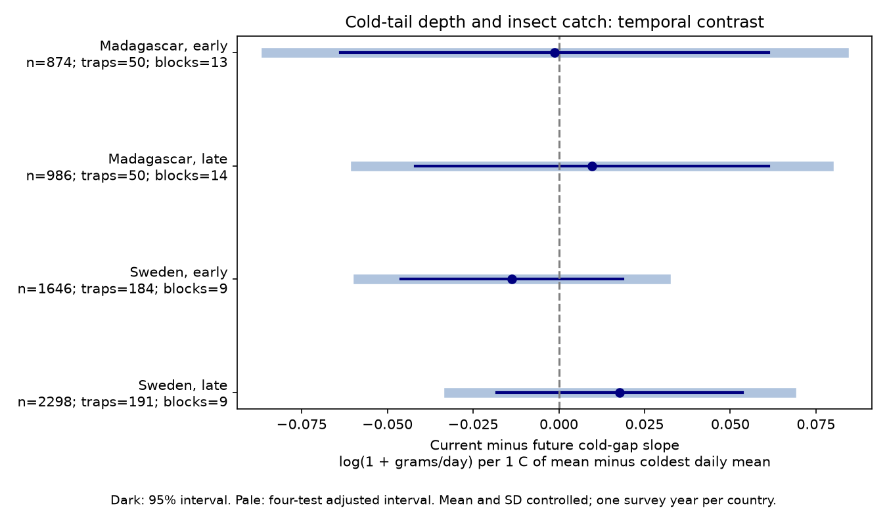

# Cold-tail shape gave no clear current-minus-future catch link in four insect samples in Sweden and Madagascar in 2019-2020

## Question and result

Does the shape of the cold tail of daily weather add information about flying insect catch after mean temperature and SD are held fixed? A single cold day could reduce flight, even if the interval mean is warm. The test compares slopes during collection and after collection. It asks whether the fitted link has detail in time. It cannot identify a biological cause.

We tested whether a relatively cold day had an insect catch link beyond mean temperature and temperature SD. We used 5,804 measured catches in Sweden and Madagascar in 2019-2020. The cold-gap metric is mean daily temperature minus the lowest daily mean in a collection interval. Four country and period models compared its current-window slope with its slope after collection. Models controlled weather in three windows, trap, season and collection duration. Estimates ranged from -0.0137 to +0.0177 log(1 + grams/day) per C of gap. All four Bonferroni-adjusted 95 percent intervals included zero. Without SD controls, later Sweden had a positive adjusted interval. Each country has one survey year. The two periods are separate seasons at repeated traps. Cold-gap and SD are strongly related. Few time blocks, selected measured samples and coarse weather limit inference. Catch combines abundance, flight activity and trap performance. This test does not establish a cold-damage mechanism, a climate-change response or an air-pollution effect. The package gives code, hashes, aggregate estimates, checks and a figure. Raw data and catch-level outputs remain outside the package.

| Country | Period | Catches | Traps | Blocks | Contrast | Marginal 95% interval | Four-test interval |
|---|---|---:|---:|---:|---:|---|---|
| Madagascar | early | 874 | 50 | 13 | -0.0012 | -0.0637 to +0.0613 | -0.0854 to +0.0830 |
| Madagascar | late | 986 | 50 | 14 | +0.0097 | -0.0418 to +0.0612 | -0.0593 to +0.0787 |
| Sweden | early | 1646 | 184 | 9 | -0.0137 | -0.0460 to +0.0186 | -0.0586 to +0.0312 |
| Sweden | late | 2298 | 191 | 9 | +0.0177 | -0.0181 to +0.0536 | -0.0322 to +0.0676 |

The unit is log(1 + grams per trap-day) per C of cold gap. The estimates do not give a percent change in insect populations. Marginal intervals cover one test; pale bars in the figure use the four-test adjustment. A clear result in one sample and an uncertain result in another do not establish a difference between them. We did not test country or period slope differences.

## Prior work and added test

Van Dijk and colleagues used these networks to study insect seasonality and weather (2024, DOI 10.1098/rspb.2024.0090). Their results motivate controls for season and collection effort. The public data are at Dryad DOI 10.5061/dryad.ghx3ffbtk and Zenodo 11205860. A separate study of German insect biomass across 34 years shows why weather needs more than one mean-temperature term (DOI 10.1038/s41586-023-06402-z). It is context, not independent support for our fitted slopes.

Campaign publication c5aa436241129d1d01e4fa0d6a74395fc271da4623e5a3c0d666074bdb7d5c1e tested current minus future temperature SD in the same records. We read that result and adapted its MIT code. Our new target is the lower-tail gap with SD included as a control. Thus the main test asks about cold-tail shape beyond total variation. The records overlap those in earlier campaign work. This is not independent confirmation of those studies. A local plan was saved before fits in files/plan.md. It is not a public registration.

## Data and observation bias

We used six CSVs from Zenodo record 11205860, release dated 16 May 2024. The seventh input is README.xlsx, which defines fields and inferred zeros. The archive declares CC0. All seven MD5 values match the live archive API. Files/source_audit.json records that check, exact source URLs, SHA-256 hashes, byte sizes and shared dataset paths. Files/provenance.json records the six analysis inputs and resolved paths. Existing shared data were read in place. No download or change to shared data was needed.

Sweden has one survey year, 2019. Madagascar starts on 1 August 2019 and runs into 2020. These countries give distinct field networks. They do not give repeated multi-year tests. Traps were selected across habitats, not by a random national design. Sampling and processing can select a subset of active insects. The source study reports that about 75 percent of Malagasy samples were processed.

We excluded missing sample IDs: these Swedish rows are zeros inferred from snow, not measured catches. We excluded negative or invalid masses, durations outside 3-21 days, missing trap weather and incomplete windows. Measured zero catches were retained. Of 4,737 Swedish source rows, 3,944 were retained. Of 1,861 Malagasy rows, 1,860 were retained. Files/selection.json gives exclusions in decision order. Missing catches and survey-edge selection can still bias the result. A rate response, a duration control and trap intercepts reduce some effort and site bias. They cannot correct all collection or processing bias.

The early period has midpoint day at most 183 from each country's survey origin. The late period has larger midpoint days. The splits are separate time samples at repeated traps. They are not independent trap samples or the same seasons in each country.

## Metric and model

For each catch, start day is twice midpoint day minus collection day. In Madagascar, the result equals the explicit placement day. The current window excludes placement day and includes collection day. The earlier and future windows have the same integer length and do not overlap the current window. Measured duration in days gives the catch rate. Integer dates give weather exposure, so partial-day error remains.

The cold gap is mean daily temperature minus the lowest daily mean in the window, in C. A larger gap means a colder lowest day at fixed mean. At fixed SD it tests lower-tail shape. It does not measure daily minimum air temperature, frost, cold-wave duration or a species tolerance threshold. Window length can affect the lowest value. We control log duration and test 5-9 day catches, but this does not prove that length effects are removed.

Each country-period OLS model fits log(1 + grams/duration). Controls are trap intercepts, 14-day midpoint-block intercepts, log duration, and latitude times annual and half-year sine and cosine terms. Each of the past, current and future windows adds mean daily temperature, its square, mean daily precipitation, its square, fraction of days with precipitation above 1 mm, temperature SD and cold gap. SD uses divisor n. Temperature means are centered within the fitted sample and divided by 5 C; rain is divided by 5 mm; wet-day fraction is divided by 0.25. SD and gap stay in C. There is no interaction. All catches have equal weight. Coarse weather may be shared between traps.

The internal code suffix Wet denotes the cold-gap coefficient inherited from earlier code. It does not denote rainfall. The primary contrast is current gap slope minus future gap slope. Its standard error uses the full covariance of both coefficients. We use two-way trap and midpoint-block cluster covariance, with finite-sample corrections from statsmodels. Student t degrees of freedom equal the smaller cluster count minus one. Four-test intervals use critical probability 1-0.05/8. There is no claim that this correction covers all prior campaign tests.

Coverage needs an adequate mean model and enough independent clusters. There are only 9 to 14 time blocks per primary fit. Weather can have serial dependence across block boundaries and spatial dependence across traps. The intervals can be too narrow. All fitted matrices have full column rank. Primary condition numbers range from 2398 to 47550. Current gap-SD correlations range from 0.862 to 0.912. High correlation reduces the information that can separate cold-tail shape from variation. The model does not establish that this separation is biologically meaningful.

Future weather is a timing check, not a proven causal control. Persistent weather and season can link it to current catch. Subtracting its slope can remove a real persistent response or retain unmeasured bias. A zero contrast can occur when both slopes are nonzero. Components and their standard errors are in files/estimates.csv.

## Sensitivity and validation

- blocks28: estimates from -0.0208 to +0.0177; 0 of four adjusted intervals exclude zero.
- blocks7: estimates from -0.0127 to +0.0139; 0 of four adjusted intervals exclude zero.
- linear: estimates from -0.0174 to +0.0152; 0 of four adjusted intervals exclude zero.
- lograte: estimates from -0.0418 to +0.0463; 0 of four adjusted intervals exclude zero.
- no_sd_control: estimates from +0.0068 to +0.0298; 1 of four adjusted intervals exclude zero.
- weekly: estimates from -0.0113 to +0.0176; 0 of four adjusted intervals exclude zero.

Without SD controls, later Sweden had a positive contrast of 0.0298 [0.0045, 0.0550] under the four-test adjustment. That positive sign is opposite to the planned negative direction for cold suppression. It can reflect total temperature variation or other shared features. Its change after SD control does not prove that SD caused it; the fitted models use different conditions and have high collinearity. No other sensitivity fit with SD controls gave an adjusted interval away from zero.

Each sensitivity set has four-test intervals of its own. No correction spans these sets. They are checks on the same data, not new replications. no_sd_control asks about the cold gap without holding total variation fixed. weekly uses 5-9 day catches. lograte fits log(rate+0.01). blocks7 and blocks28 change time-block width. linear removes the squared mean-weather terms.

The independent validator uses direct date masks and scalar arithmetic to check all 17,412 windows from raw rows. It checks mean, SD and cold gap, sample uniqueness and source hashes. Files/validation.json records errors. A second least-squares solver checks every fitted contrast and the normal equations; files/numerical_checks.json gives errors. These checks assess computation, not observation accuracy or a causal interpretation.

## Limits and next test

This is a narrow weather and biodiversity method test. It has no taxon-level outcome, species richness, air pollution, range shift or long-term climate trend. Catch combines population size, flight activity and capture conditions. One survey year per country, nonrandom trap habitats, missing processing, coarse weather and few time clusters limit general use. Neither uncertain intervals nor a clear contrast prove absence or presence of cold damage. A stronger test needs on-site hourly weather, flight observations, taxon-specific limits, repeated years and abundance measures that do not depend on flight into a trap.

## Reproduce

Use Python 3.12 with numpy, pandas, scipy, statsmodels, matplotlib and openpyxl. Exact analysis versions are in files/environment.json. On a workspace with the shared datasets link, run:

~~~sh
python /path/to/package/files/retrieve.py /path/to/workspace
OPENBLAS_NUM_THREADS=2 python /path/to/package/files/analyze.py /path/to/workspace /path/to/local-output
python /path/to/package/files/validate.py /path/to/workspace /path/to/local-output
~~~

Use an output directory outside the signed package. Retrieval checks seven source hashes and calls campaign-dataset with an exact source URL and SHA-256 if a file is absent. It never overwrites a shared dataset. A new host needs the campaign helper and a datasets directory or link. All raw and catch-level data stay outside the signed draft. Compare estimates.csv, selection.json, support.csv, numerical_checks.json and validation.json with the signed aggregate files. Machine paths and final floating-point digits can differ; figure bytes can vary by library version. The source record URLs and hashes permit independent retrieval without the helper. SCI verification checks integrity and does not execute code.

## Rights and assignment

The exact SCI baseline LICENSE covers our text, figure and aggregate estimates under CC BY 4.0 and code under MIT. Files/EXTERNAL_DATA.md gives attribution and external data terms. Source files, API response, source spreadsheet and the derived catch-level panel are outside this bundle. We make no ownership claim over those materials. The package has our analysis methods, not a derivative record database.

Job: sci-1107-dell-climate-pollution-biodiversity-9b3378e1cc21. Topic: climate-pollution-biodiversity. Campaign: 11_07_2026. Machine: dell. Account: codex-andrii. Model: gpt-6.1-sol, high reasoning effort, in T3 Code through the Codex harness. Date: 9 November 2026. The campaign-machine signing key proves package integrity, not personal authorship. Private keys are outside the package. No remote upload or index submission was made.
