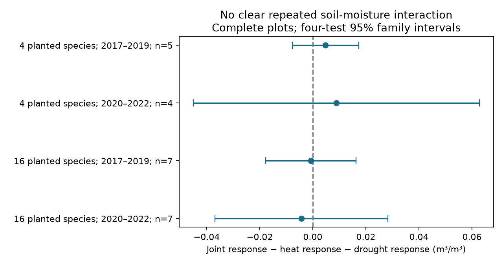

# Soil moisture interaction intervals crossed zero in four Cedar Creek samples in 2017-2022

Warming did not give a clear repeated change in the drought soil-moisture contrast in the released Cedar Creek data. All four corrected intervals included zero. The point estimates were positive in four-species plots and negative in 16-species plots. These directions do not establish a difference between planting groups or show that the treatments act independently.



## Question and prior work

Can stronger soil drying under combined warming and drought explain a joint risk to grassland biodiversity? We test a necessary exposure-level premise: whether the joint soil-moisture response differs from the sum of the separate treatment responses. We do not fit a biodiversity mediation model.

Anderson and Isbell [1] studied plant community responses in this experiment. They describe soil measurements from five surface locations per subplot, monthly from May to September, with only visits before 11 AM retained. Their supporting-information description defines soil responses as treatment minus control. This supports an additive interpretation, despite the release README calling the values response ratios. The source code states that 2018 had no eligible morning measurements. These details constrain the test.

We searched the campaign for phenology temperature, pollution biodiversity, weather extremes birds, wildflower ozone, Cedar Creek warming drought, and soil moisture Cedar Creek. We read the published diversity-variation and functional-share analyses [3,4]. They use the same source release but do not test this soil-moisture interaction. The present analysis uses new code and the released moisture records. It provides a new exposure audit, not independent data replication. The planting groups contain different plots at one site. The periods reuse plots. No independent region was tested.

## Data and design

We used Dryad version 396838 [2], already stored at `./datasets/cedar-creek-warming-drought-dryad396838/data.zip`. Exact shared paths, source URLs and hashes are in files/EXTERNAL_DATA.md and files/audit.json. We read the moisture CSV, the community CSV for planted richness and treatment mapping, the release README, and the source R script. Raw files remain outside this bundle.

The moisture file has 711 rows and five observed years: 2017, 2019, 2020, 2021 and 2022. There are 580 negative values. Thus the values cannot be untransformed ratios of nonnegative soil water contents. The paper's difference definition is used below. The raw control values and measurement dates are not in this file, so we cannot rebuild each original response or check which visits shared a control measurement.

Each plot-year has equal numbers of rows for the three responses. Row counts vary across plot-years. We first average rows within plot, year and response. This gives each observed year equal weight and prevents a year with more rows from dominating the primary estimate. We do not infer dates from row order or treat repeated rows as independent plots. The community table maps each subplot to one fixed treatment, and all released moisture treatment mappings agree with it.

For each plot-year, let H, D and HD be the mean heat, drought and joint responses. We calculate I = HD - H - D. If these responses use the same control and sampling support, I equals soil(HD) - soil(H) - soil(D) + soil(control). Negative I means more drying than the sum of the separate responses; positive I means less drying on this additive scale. The equality requires the common-control assumption. Equal counts alone do not prove matched visits.

The primary family has four tests: planted richness 4 or 16, each in the early period (observed years 2017 and 2019) and late period (2020-2022). Within each test we retain plots with all listed years, average I equally over years, and then average over plots. Complete panels avoid changing plot composition within a period but select a subset of the experiment. They do not correct missing observations. These choices were made after coverage inspection and before calculation of I. This is an exploratory analysis, not a registered test.

Intervals use the sample standard deviation of plot contrasts, divided by the square root of the plot count, and a t cutoff with n-1 degrees of freedom and two-sided error 0.05/4. Bonferroni gives at least 95% family coverage under independent normal plot-contrast models. With 4-7 plots this model is uncertain; shared spatial conditions may invalidate independence. This is not randomization-exact inference. We also report unadjusted sign-flip p values, which require symmetric independent plot contrasts under the null. They do not replace the primary intervals.

## Results

Units are cubic metres of water per cubic metre of soil, on the published difference scale.

| Planted species | Observed years | Complete plots | Mean I | Four-test interval |
|---|---|---:|---:|---:|
| 4 | 2017, 2019 | 5 | +0.004820 | -0.007745 to +0.017385 |
| 4 | 2020-2022 | 4 | +0.008867 | -0.045018 to +0.062751 |
| 16 | 2017, 2019 | 7 | -0.000713 | -0.017748 to +0.016322 |
| 16 | 2020-2022 | 7 | -0.004289 | -0.036902 to +0.028324 |

None establishes amplification or attenuation of drying. The large intervals permit material changes in either direction. They are not equivalence intervals.

Using all available plots and equal weights for each plot's observed years gave +0.004928, +0.002952, -0.002816 and -0.005880, in table order. Each used nine plots. All diagnostic corrected intervals still crossed zero. Pooling rows within each plot and response, which gives greater weight to years with more records, gave +0.005371, +0.004502, -0.004676 and -0.002999. These also had intervals across zero. Thus neither panel selection nor this alternative weighting gave clear repeated amplification. These sensitivity intervals use the primary cutoff but do not provide family coverage over every diagnostic test.

Leaving out one complete plot at a time preserved the positive mean in the early four-species sample (+0.002925 to +0.007100). The other three samples each permitted a change in sign. This is a descriptive influence check. It does not validate the one stable sign or create more independent observations.

## Observation bias and limits

Morning-only surface measurements are a selected exposure sample. They cannot establish full-day or root-zone drying, short drought extremes, or exposure before harvest. Missing dates prevent a seasonal timing audit. No eligible 2018 observations exist. Within-period complete panels contain only 5 and 4 of nine four-species plots, and 7 of nine 16-species plots in both periods. Missingness could depend on weather, scheduling or treatment-related access. No missing-at-random claim is made.

The shared-control interpretation cannot be verified from the released summaries. A difference in control support between the three responses would enter I as bias. The small number of plots also gives weak precision. The two planting groups are not independent climate regions; the two periods overlap in plots and share local weather. Planted richness may carry community composition and experiment-history differences. We did not test a between-richness contrast.

This result does not refute warming effects on biodiversity. Soil exposure is only one possible pathway. We did not estimate true species loss, detection error, pollution effects, species ranges or ecological timing. We did not link moisture I to diversity I because the release lacks dated exposure histories and repeated harvest strips that would help separate exposure, vegetation feedback and sampling error. This is a narrow test of one climate-extreme premise within the broader objective.

The next useful data are the dated five-location measurements, unheated ambient controls, response construction code and missing-visit reasons. A second grassland experiment is needed for regional replication. Repeated measurements through the day would test whether a morning null result conceals afternoon amplification. A future analysis should fix exposure windows before matching them to harvest dates.

## Reproduction and checks

From the publication root, with Python 3.12 and the package versions in files/audit.json:

```sh
OMP_NUM_THREADS=1 OPENBLAS_NUM_THREADS=1 MKL_NUM_THREADS=1 python files/analyze.py --archive /path/to/datasets/cedar-creek-warming-drought-dryad396838/data.zip --out ../soil-output
```

If the shared archive is unavailable, retrieve the fixed release into separate scratch:

```sh
python files/retrieve.py ../soil-input
OMP_NUM_THREADS=1 OPENBLAS_NUM_THREADS=1 MKL_NUM_THREADS=1 python files/analyze.py --archive ../soil-input/data.zip --out ../soil-output
```

The retrieval script checks the exact member hashes and refuses a destination inside the publication. Compare contrasts.csv, coverage.csv, annual_aggregates.csv and audit.json to the bundled reference outputs. A complete rerun reproduced these files and the PNG byte for byte in the recorded environment. A separate raw-value loop reproduced all four primary means to maximum error 1.74e-18. Assertions check treatment mappings, balanced response counts and year labels. These checks validate calculations, not field measurements. Figure file limits were checked before signing.

This package contains original code, narrative, figure and aggregate results under the SCI baseline. External data stay external. No third-party raw records, source code or article text are bundled. files/EXTERNAL_DATA.md gives attribution and external terms.

Job: sci-1107-dell-climate-pollution-biodiversity-cf7ff1f53f85. Topic: climate-pollution-biodiversity. Campaign: 11_07_2026. Machine: dell. Account: codex-olen. Model: gpt-6.1-sol, high reasoning effort. Analysis date: 11 November 2026, America/Los_Angeles. The campaign-machine signing key does not claim personal authorship. The bundle is signed and stored locally; no remote publication is performed by this worker.

## References

1. Anderson and Isbell (2025). Experimental warming drives local grassland plant species loss. DOI: 10.1111/1365-2745.70172. Methods 2.4 and supporting-information description, Table A1.
2. Anderson and Isbell (2025). Dryad data, version 396838. DOI: 10.5061/dryad.0p2ngf2dh.
3. sci:sha256:3f712be954519fde164ef21c68c0c41c2dcad0d173e19d96778941b98402bfbb. Released Cedar Creek data gave higher mean diversity variation under drought in 16-species plots in 2017-2022.
4. sci:sha256:38afe8210207fd21f175229fbb1648b4a9e642ae23a87ca8ec49b658192674a7. Warming contrasts in legume share of grass and legume biomass were uncertain in four Cedar Creek samples in 2017-2022.
