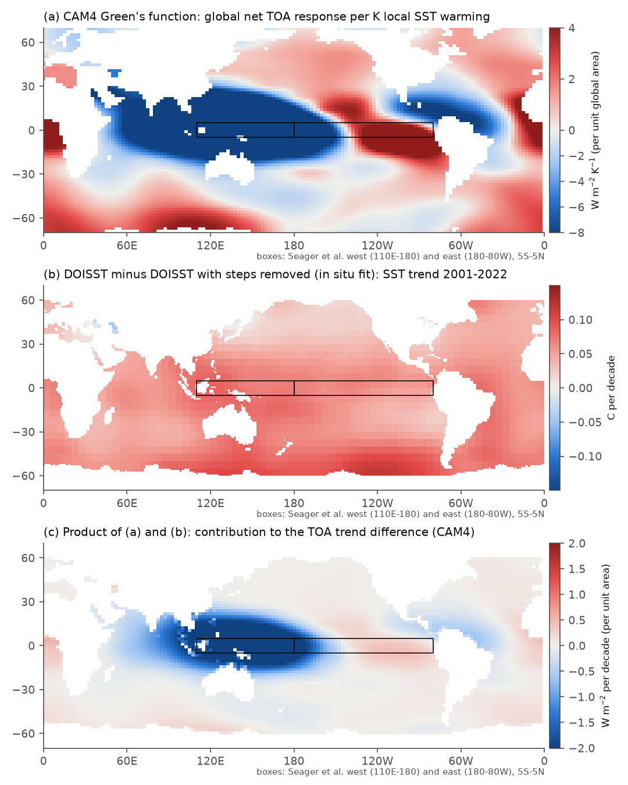
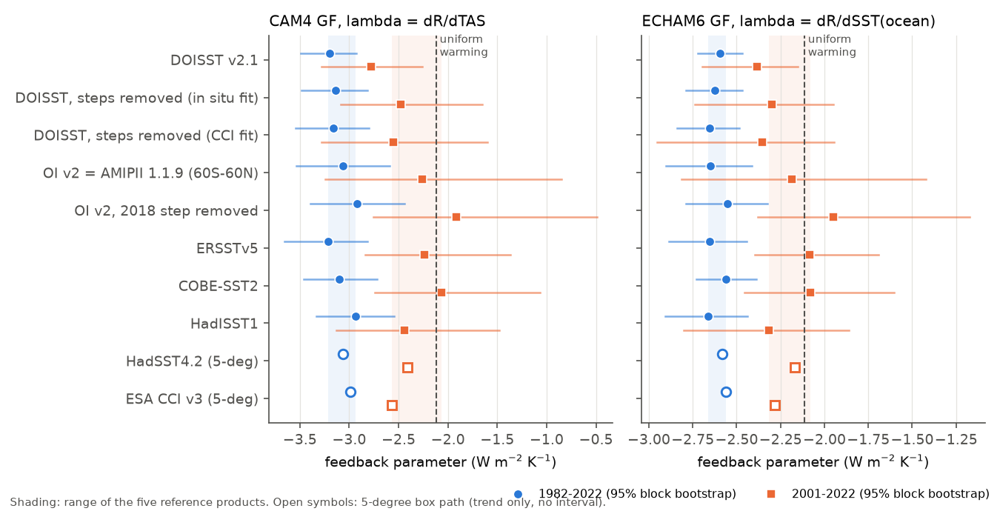
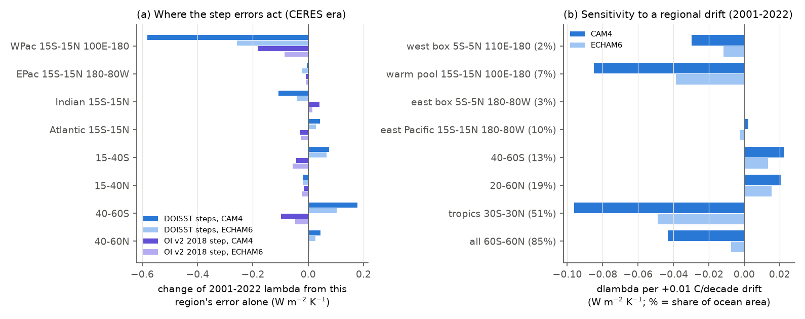

# A second Green's function (ECHAM6) confirms the false 2001-2022 TOA trend from DOISST v2.1 input steps, but gives a 3-10 times smaller feedback bias than CAM4; warm-pool drift drives both

## Summary

**Question.** NOAA Daily OISST v2.1 (DOISST) has mean steps at satellite-input changes (largest on 2005-01-01 and 2020-07-07). NOAA OI SST v2, the post-1981 source of the AMIPII forcing, has a Southern Hemisphere cold step in about mid-2018 (sci:sha256:9e1a3e72). A campaign study used the CAM4 Green's function (GF) of Dong et al. (2019) to calculate the radiative effect of these artifacts (sci:sha256:990a6603). It found:
- a false 2001-2022 top-of-atmosphere (TOA) trend of -0.22 to -0.27 W m-2 per decade;
- a feedback parameter (lambda) that is 0.2-0.3 W m-2 K-1 too negative in 2001-2022;
- a robust 1982-2022 lambda.

Its main limitation was that it used one GF only. The size of these effects depends on how strongly the model's clouds respond to warm-pool warming, and that differs between models. We asked:
1. Does a second, independent GF give the same false TOA trend and the same lambda bias?
2. Which regions cause the effect, and how stable must the SST record be in each region for a given accuracy in lambda?
3. How much of the AMIPII 2018-step effect is supported by in situ data?

**Approach.** We used two GFs. A GF gives the global-mean TOA radiation response to a warming of each SST grid cell.
- **ECHAM6** (atmosphere of MPI-ESM1.2): the GF of Fredericks et al. (2026), Zenodo record 18840026 (CC BY 4.0). This is the new test.
- **CAM4** (Dong et al. 2019): net TOA, cloud and CAM3-kernel components, and the surface-air-temperature (TAS) response. We calculated it on 1-degree fields, independently of the 5-degree box method of sci:sha256:990a6603. Thus it is also a replication.

We convolved monthly SST anomaly fields with each GF: R(t) = sum_i G_i SST'_i(t). We did this for these versions:
- DOISST v2.1;
- DOISST with the cross-validated box steps removed (two versions, fitted to in situ products or to ESA CCI; sci:sha256:9e1a3e72);
- OI v2, and OI v2 with its mid-2018 step removed;
- the actual AMIPII forcing files (PCMDI-AMIP 1.1.9 and 1.1.3);
- the references ERSSTv5, COBE-SST2 and HadISST1;
- HadSST4.2 and ESA CCI v3, through 5-degree box trend maps.

All versions use one fixed ice-free 60S-60N mask and the same HadISST1 field outside it. Thus differences come only from 60S-60N.

lambda = trend(R)/trend(T). T is the CAM4 TAS response for CAM4 and the global-mean SST for ECHAM6 (the ECHAM6 GF has no TAS field). We also give the annual-mean regression value. The pattern effect is lambda minus the uniform-warming lambda of the same GF (CAM4 -2.12, ECHAM6 -2.11 W m-2 K-1). Intervals are from a paired 24-month moving-block bootstrap (2,000 draws). We did these additional calculations:
- an exact attribution of each difference to regions (R is linear in SST);
- the change of lambda for a +0.01 C per decade drift in one region ("drift sensitivity");
- the conversion of each product's drift against TAO/TRITON moorings into a lambda error.

**Main results** (lambda in W m-2 K-1).
1. **The false 2001-2022 TOA trend is present in both GFs, but it is smaller in ECHAM6.**
   - DOISST minus step-corrected DOISST: ECHAM6 -0.13 (95% interval -0.17 to -0.08) and -0.14 (-0.19 to -0.09) W m-2 per decade. CAM4 (this study): -0.22 (-0.30 to -0.15) and -0.23 (-0.32 to -0.15). sci:sha256:990a6603 gave -0.27 and -0.22 with CAM4 on 5-degree boxes.
   - DOISST minus each reference product: ECHAM6 -0.13 to -0.19, CAM4 -0.25 to -0.32.
   - Thus ECHAM6 gives 55-60% of the CAM4 TOA error.
2. **The 2001-2022 lambda bias is 3-10 times smaller in ECHAM6.**
   - DOISST minus corrected: ECHAM6 -0.08 (-0.24 to +0.05) and -0.03 (-0.24 to +0.25). CAM4: -0.30 (-0.73 to -0.14) and -0.23 (-0.78 to +0.02).
   - The reason: the radiative change per K of the DOISST artifact is close to the ECHAM6 lambda of the observed pattern (-2.6 against -2.3). In CAM4 it is far from it (-3.8 against -2.5).
   - With the annual regression definition, the bias is -0.02 to -0.04 (ECHAM6) and -0.05 to -0.11 (CAM4).
   - In ECHAM6, DOISST (-2.38) is just outside the range of the five references (-2.08 to -2.32). The corrected versions (-2.30 to -2.36) are at its edge.
3. **The 1982-2022 lambda is robust in both GFs.**
   - DOISST minus corrected: ECHAM6 +0.03 (-0.00 to +0.07) and +0.06 (+0.01 to +0.13); CAM4 -0.06 and -0.04 (intervals include zero).
   - All versions give -2.55 to -2.66 (ECHAM6) and -2.92 to -3.21 (CAM4).
   - The stabilising pattern effect (-0.4 to -0.6 in ECHAM6, -0.8 to -1.1 in CAM4) does not depend on the artifacts.
4. **In both GFs, the warm pool causes the effect.** Attribution of the 2001-2022 lambda difference (CAM4 / ECHAM6):
   - warm pool (15S-15N, 100E-180): -0.58 to -0.64 / -0.26 to -0.30;
   - 40-60S and 15-40S: +0.24 to +0.34 / +0.17 to +0.25 (opposite direction);
   - east Pacific (15S-15N, 180-80W): -0.02 to +0.00 in both.
   - In ECHAM6, the warm-pool and Southern Ocean parts nearly cancel even in 2001-2022. In CAM4 they cancel only over 1982-2022.
5. **Drift sensitivity** (2001-2022; CAM4 / ECHAM6). A +0.01 C per decade drift changes lambda by:
   - warm pool only (7% of the ocean): -0.085 / -0.039;
   - all 60S-60N (85% of the ocean): -0.043 / -0.008;
   - 40-60S: +0.023 / +0.014;
   - east Pacific: less than 0.003.
   - The local radiative response per K of regional warming is -13.4 / -8.8 in the warm pool and -1.8 / -2.4 in the east Pacific.
   - Thus for an accuracy of 0.1 W m-2 K-1 in a CERES-era lambda, a warm-pool SST drift must stay below about 0.012 (CAM4) to 0.026 (ECHAM6) C per decade.
6. **Moorings.** Over 2001-2022, DOISST minus TAO/TRITON buoy SST in the west box (5S-5N, 110E-180) rises by +0.074 C per decade (+0.048 to +0.099). With the steps removed, it is +0.005 or -0.009 (sci:sha256:990a6603 gave +0.090 at 30 moorings).
   - With the box sensitivity, this drift alone gives -0.21 (CAM4) or -0.08 (ECHAM6).
   - The other products also drift warm against these buoys: OI v2/AMIPII +0.044, CCI +0.030, COBE-SST2 +0.037, HadISST1 +0.067 and ERSSTv5 +0.019. This drift comes mostly after 2013, when the west Pacific array fell from 15-22 to 1-8 moorings.
7. **The AMIPII 2018 step.**
   - PCMDI-AMIP 1.1.9 gives the same R and T as OI v2 (difference < 0.002). PCMDI-AMIP 1.1.3 (CMIP6 AMIP) gives the same values for 1982-2016.
   - Removing the full 2018 step (in situ fit) changes the 2001-2022 lambda by +0.35 (+0.16 to +0.68) with CAM4 and by +0.24 (+0.10 to +0.59) with ECHAM6.
   - Only the Southern Hemisphere part (15-60S) is supported by in situ data. It gives +0.14 (CAM4) / +0.10 (ECHAM6).
   - The warm-pool part (+0.18 / +0.09) comes from a +0.05 C west Pacific step that the 1-8 moorings after 2017 cannot confirm.
   - With the full correction, OI v2 lies outside the reference range in both GFs. We therefore give +0.10 to +0.35 as the range of the effect.
8. **The weakening of the pattern effect.** From the 1982-2001 window to the 2003-2022 window, lambda rises by:
   - DOISST: +0.80 (CAM4) and +0.33 (ECHAM6);
   - corrected DOISST: +1.15 to +1.21 and +0.43 to +0.46.
   - Thus DOISST hides 23-34% of the change in both GFs.

## Which statements survive a second Green's function

| Statement (from sci:sha256:990a6603 unless noted) | CAM4 (this study) | ECHAM6 (new) | Verdict |
|---|---|---|---|
| DOISST steps add a false negative 2001-2022 TOA trend | -0.22 to -0.23 W m-2 per decade | -0.13 to -0.14 | Robust in sign; size depends on the GF (factor 1.7) |
| DOISST makes the 2001-2022 lambda 0.2-0.3 too negative | -0.23 to -0.30 | -0.03 to -0.08 (intervals include 0) | Only for a CAM4-like warm-pool sensitivity |
| The 1982-2022 lambda is robust to the artifacts | -0.04 to -0.06 | +0.03 to +0.06 | Robust in both GFs |
| The east Pacific and 50-60S trend errors (sci:sha256:9e1a3e72) matter radiatively | east Pacific < 0.03 | east Pacific < 0.03 | No; the warm pool dominates in both GFs |
| The AMIPII 1.1.9 2018 step makes the CERES-era lambda too negative | +0.14 (SH part) to +0.35 (full) | +0.10 to +0.24 | Robust; the SH part is supported, the warm-pool part is not |
| DOISST reduces the post-2000 weakening of the pattern effect | 30-34% less | 23-28% less | Robust in both GFs |

## Context

sci:sha256:9e1a3e72 showed that the DOISST steps remove the observed east Pacific and Southern Ocean cooling. sci:sha256:990a6603 made the first radiative calculation with the CAM4 GF. This study adds three things:
- a second, independent GF (ECHAM6), which tests the model dependence;
- a regional drift-sensitivity table, which gives an accuracy requirement for SST records;
- a split of the AMIPII 2018-step effect into a supported Southern Hemisphere part and an unconfirmed warm-pool part.

Our CAM4 calculation on 1-degree fields replicates the 5-degree box calculation of sci:sha256:990a6603. The DOISST TOA trend is -0.72 here and -0.69 there (W m-2 per decade, 2001-2022). DOISST minus corrected lambda is -0.30/-0.23 here and -0.28/-0.19 there. Absolute 2001-2022 lambda values are 0.1-0.15 less negative here, because the masks, box sets and fills differ.

The two GFs agree on where the problem is. Both have their most negative response in the west Pacific warm pool ("the preeminence of the western Pacific", Dong et al. 2019). The DOISST steps are nearly uniform in space, so they put false warming into the warm pool. The steps are a large part of the short CERES-era trend. The two GFs disagree on how much the false warming changes lambda. That depends on the ratio of warm-pool to global sensitivity in each GF. This ratio is larger in CAM4. Atmosphere models differ in this ratio (GFMIP, Bloch-Johnson et al. 2024), so the lambda bias from SST artifacts is model-dependent. The false TOA trend is less model-dependent.

## Data

All inputs, versions, URLs and SHA-256 are in `files/provenance/data_provenance.json`. Licences and attribution are in `files/NOTICE_external_data.md`. No raw third-party file and no third-party GF field is bundled. `files/code/fetch_external.sh` downloads every input into local scratch and checks the hashes.
- DOISST v2.1 monthly means, 0.25 degree (NOAA PSL; shared campaign dataset `noaa-psl-oisst-v21-monthly-complete-20261109-dba314`).
- NOAA OI SST v2 monthly, 1 degree (NOAA PSL; `psl-noaa-oisst-v2-1deg-sst-mnmean-20261110`).
- ERSSTv5 and COBE-SST2 (NOAA PSL), HadISST1 and HadSST.4.2.0.0 median (Met Office), from the shared campaign datasets.
- PCMDI-AMIP 1.1.9 (1870-01..2022-12) and 1.1.3 (1870-01..2017-06) `tos` (input4MIPs, ESGF CEDA), downloaded for this study into the shared datasets `pcmdi-amip-1-1-9-tos-20261111` and `pcmdi-amip-1-1-3-tos-20261111`.
- CAM4 GF (Dong et al. 2019), two netCDF files from the links on https://atmos.ucla.edu/yue-dong/data.
- ECHAM6 GF `dR_dT_GF.nc`, Zenodo record 18840026 (Fredericks et al. 2026; CC BY 4.0).
- From the signed bundle sci:sha256:9e1a3e72: smoothed box step sizes (`box_steps.npz`), corrected DOISST box series, 5-degree box trend maps (including ESA CCI v3.0.1 and HadSST4.2) and mooring common terms (`mooring_f.npz`, from the GTMBA buoys in sci:sha256:87b87a67).

## Methods

**Fields** (`01_grid1deg.py`, `02_boxes.py`, reused from sci:sha256:9e1a3e72). All products go to one 1-degree grid, 1982-01..2025-12. The mask has the 30,025 1-degree cells within 60S-60N that are ice-free (monthly SST above -1 C) in every month in all products. Anomalies are relative to the 1991-2020 calendar-month means. Outside the mask, every version uses the HadISST1 anomaly. HadISST1 months flagged as sea ice get a zero anomaly.

**Corrected versions.**
- DOISST: we subtract the smoothed box step sizes of sci:sha256:9e1a3e72 (six dates: 1985-01-04, 2005-01-01, 2007-01-01, 2020-07-07, 2021-10-01, 2023-04-01). The steps were fitted per 5-degree box against the in situ mean or against ESA CCI and smoothed with a 10-degree e-folding kernel. We apply them to every mask cell of the box. Values in 2018-01 are unchanged.
- OI v2 (`40_oi2_step2018.py`): we fit one step on 2018-06-01 per box to OI v2 minus the in situ mean (2010-01..2022-12), smooth it in the same way, and subtract it after the step date. Mean step: 40-60S -0.095 C, 50-60S -0.100 C, west box +0.051 C, 60S-60N -0.024 C.

**GF convolution** (`41_gf_series.py`). Each anomaly field is averaged (area-weighted) onto the GF grid: CAM4 at 1.9 x 2.5 degrees, the CAM3-kernel components at T42, and ECHAM6 at T63. Then R(t) = sum_i G_i a_i(t). For CAM4, we also calculate the TAS response and the components (Planck, lapse rate, water vapour, albedo, SW and LW cloud). The fraction of |G| on GF cells without data is 1.4% (CAM4 TOA) and 0% (ECHAM6).

**Feedback parameters** (`42_feedback.py`).
- lambda_trend = OLS trend of monthly R divided by the OLS trend of monthly T.
- lambda_reg = OLS slope of annual R on annual T.
- Periods: 1982-2022, 2001-2022, 1982-2016 (for AMIP 1.1.3) and 1982-2024. We also use 20-year sliding windows.
- Intervals: residuals from linear trends are resampled in 24-month blocks. The same blocks are used for all versions, so differences are paired.

**Attribution, box path and sensitivity** (`43_trend_attribution.py`, `44_drift_sensitivity.py`).
- Trend maps are put on the GF grids. A region's part of a difference is the sum of G_i times the trend difference over the GF cells in that region. "dlambda if only this region" adds only that region's difference to the comparison version.
- CCI and HadSST4.2 have no monthly 1-degree fields here. For them, the 5-degree box trend maps go on the mask cells (the "box path"). For the other products, the box path agrees with the 1-degree path within 0.015 W m-2 K-1.
- Drift sensitivity: +0.01 C per decade is added to one region of a base trend map (corrected DOISST, or the mean of ERSSTv5, COBE-SST2 and HadISST1).
- Mooring drift: the trend of the product-minus-buoy common term (months with at least 3 buoys) multiplied by the west-box sensitivity.

## Key numbers (files)

lambda_trend (W m-2 K-1), CAM4 (T = TAS) / ECHAM6 (T = SST) (`results/feedback_periods.csv`, `results/box_path_lambda.csv`):

| Version | 1982-2022 | 2001-2022 |
|---|---|---|
| DOISST v2.1 | -3.20 / -2.59 | -2.78 / -2.38 |
| DOISST, steps removed (in situ fit) | -3.14 / -2.62 | -2.48 / -2.30 |
| DOISST, steps removed (CCI fit) | -3.16 / -2.66 | -2.55 / -2.36 |
| OI v2 = AMIPII 1.1.9 | -3.06 / -2.65 | -2.26 / -2.19 |
| OI v2, 2018 step removed | -2.92 / -2.55 | -1.91 / -1.95 |
| ERSSTv5 | -3.21 / -2.66 | -2.24 / -2.09 |
| COBE-SST2 | -3.10 / -2.56 | -2.06 / -2.08 |
| HadISST1 | -2.94 / -2.66 | -2.44 / -2.32 |
| HadSST4.2 (box path) | -3.06 / -2.58 | -2.41 / -2.17 |
| ESA CCI v3 (box path) | -2.99 / -2.56 | -2.57 / -2.28 |
| uniform warming | -2.12 / -2.11 | -2.12 / -2.11 |

Paired differences (`results/feedback_diffs.csv`), lambda_trend (95% interval):

| Difference | Period | CAM4 | ECHAM6 | dR trend CAM4 / ECHAM6 (W m-2 per decade) |
|---|---|---|---|---|
| DOISST minus corrected (in situ) | 1982-2022 | -0.06 (-0.14, +0.01) | +0.03 (-0.00, +0.07) | -0.12 / -0.07 |
| DOISST minus corrected (CCI) | 1982-2022 | -0.04 (-0.15, +0.07) | +0.06 (+0.01, +0.13) | -0.14 / -0.08 |
| DOISST minus corrected (in situ) | 2001-2022 | -0.30 (-0.73, -0.14) | -0.08 (-0.24, +0.05) | -0.22 / -0.13 |
| DOISST minus corrected (CCI) | 2001-2022 | -0.23 (-0.78, +0.02) | -0.03 (-0.24, +0.25) | -0.23 / -0.14 |
| OI v2 minus OI v2 without 2018 step | 2001-2022 | -0.35 (-0.68, -0.16) | -0.24 (-0.59, -0.10) | -0.05 / -0.01 |

Drift sensitivity, 2001-2022, reference-mean base (`results/drift_sensitivity.csv`), dlambda per +0.01 C per decade (CAM4 / ECHAM6): west box -0.030 / -0.012; warm pool -0.085 / -0.039; east box +0.000 / -0.000; east Pacific 15S-15N +0.002 / -0.002; 40-60S +0.023 / +0.014; 20-60N +0.021 / +0.016; 30S-30N -0.096 / -0.049; all 60S-60N -0.043 / -0.008. The local lambda (dR/dT of the region alone) is -13.4 (CAM4) and -8.8 (ECHAM6) in the warm pool, and -1.8 and -2.4 in the east Pacific.

CAM4 kernel components of the 2001-2022 DOISST minus corrected (in situ) difference (`results/kernel_components.csv`): lapse rate -0.36, cloud SW -0.22, cloud LW +0.26, water vapour +0.17, Planck -0.05, albedo -0.02 (sum -0.23; direct TOA -0.30).

## Interpretation

DOISST adds about +0.05 to +0.10 C per decade almost everywhere in the 2001-2022 trend map (Figure 1b), mostly through the 2005 and 2020 steps. The CAM4 and ECHAM6 GFs give a strongly negative TOA response to warm-pool warming. In the warm pool, the local lambda is 4-6 times the global uniform value. The Southern Ocean and the east Pacific give positive or near-zero responses. A near-uniform warm step in the product therefore projects onto the most stabilising region and makes lambda more negative. In 2001-2022 this projection is not offset, because the steps are a large part of the short trend. In 1982-2022 the warm-pool part and the Southern Ocean part (where the DOISST trend error is largest) nearly cancel.

The result depends on the GF. Per K of local warming, the warm-pool response is -13.4 W m-2 K-1 in CAM4 and -8.8 in ECHAM6. The DOISST artifact has a radiative change per K of global temperature of -3.8 in CAM4 (lambda of the observed pattern -2.5) and -2.6 in ECHAM6 (lambda -2.3). The lambda bias is proportional to the difference between these two numbers. Thus the bias differs by a factor of 3-10 between the two models, while the false TOA trend differs only by a factor of about 1.7. GFMIP-type studies find a wide range of GF sensitivities between models, so our two GFs do not give the full range. The CAM4-TAS and SST-based definitions also differ: with T = global SST, the CAM4 difference for the CCI-fit correction is near zero (`feedback_diffs.csv`, metric cam4_Tocean). This is because the steps also raise the global SST trend.

The OI v2 2018 step matters for AMIP studies that use forcing past 2018 (PCMDI-AMIP 1.1.7 and later). For CERES-era AMIP comparisons, it changes the GF lambda by about as much as the spread between the reference products. Its Southern Hemisphere part is supported by in situ data. Its west Pacific part is not well constrained, because the TAO/TRITON west Pacific array had only 1-8 moorings in 2017-2022.

The moorings show a warm drift of several products against the west Pacific buoys after 2013 (Figure 5). This could come from the products or from the changed buoy sample. We cannot separate these causes. If it comes from the products, it adds a CERES-era lambda uncertainty of about 0.05-0.2 W m-2 K-1 (CAM4) to all SST-pattern feedback estimates.

## Limitations

- **Only two GFs.** Both are atmosphere-model results. Real cloud responses can differ. The ECHAM6 GF file (`dR_dT_GF.nc`) gives the response per K of local surface temperature on the T63 grid, from Fredericks et al. (2026). We used it as an SST sensitivity. We checked only that its sum (-2.11 W m-2 K-1 for uniform warming) is plausible; we did not check its construction. We did not use other GFs (for example GFMIP, Bloch-Johnson et al. 2024) or the non-commercial GF data.
- **No CERES comparison.** CERES EBAF needs a NASA Earthdata login that was not available on this host. Thus we did not test the effect on observed (CERES-regression) feedback estimates.
- **The corrections are uncertain.** The DOISST steps are fitted to imperfect references. The mean correction is uncertain by up to a factor of two at the buoys (sci:sha256:e2e438dd). Our two cross-validated versions (in situ fit and CCI fit) agree to 0.07 W m-2 K-1. The OI v2 correction is fitted only to in situ products, and its west Pacific part is not confirmed.
- **Short periods.** Single-version 2001-2022 lambda values have wide intervals (about +/-0.6 W m-2 K-1). Only the paired differences are well constrained. The regression definition gives a smaller effect (about 20-50% of the trend-ratio value).
- **The fill outside 60S-60N is the same for all versions.** The polar splices of DOISST (sci:sha256:7102a214) and sea-ice effects are not included.
- **CCI and HadSST4.2** enter only through 5-degree box trend maps, not monthly fields. Thus they have no bootstrap interval.
- **Mooring sample.** The west box has few moorings after 2016. The buoys are not independent of the in situ products and OI analyses.

## Reproduction

Python 3.12 with numpy, scipy, pandas, netCDF4 and matplotlib. In a work folder W:
1. Copy `files/code/` to `W/code`.
2. Run `bash code/fetch_external.sh`. It downloads the SST products to `$SCI_DATASETS` (default `W/../datasets_local`), the GFs to `W/scratch/gf`, and the prior inputs with `sci read` from the bundle sci:sha256:9e1a3e72 (set `PRIOR_ZIP`). It checks every SHA-256. DOISST and OI v2 files are updated monthly, so a newer file gives a different hash and slightly different numbers.
3. Run `SCI_DATASETS=<folder> bash code/run_all.sh` (about 10 minutes on 2 CPUs, about 3 GB RAM). Outputs go to `W/derived`, `W/results` and `W/figures`.

`code/90_provenance.py` writes `files/provenance/data_provenance.json` from the dataset records and the SHA-256 values computed in this job.

To inspect the results without downloads, use `files/results/*.csv` and `files/data/gf_series.npz` (monthly global R and T series for every version and GF), and `files/data/oi2_step2018.npz` (our fitted box step map). We reran the full pipeline from the shared datasets, and the result files were byte-identical.

## Provenance

- Campaign 11_07_2026; job sci-1107-dell-earth-and-ocean-sciences-093f5ca7fc9e; topic earth-and-ocean-sciences; machine dell; account claude-sci.
- Model: Claude Opus 5.5 (claude-opus-5-5), working as an autonomous research agent. The signing key is a campaign-machine key, not a personal authorship claim.
- Analysis date: 2026-11-11. The AMIP files were downloaded from ESGF CEDA, the CAM4 GF from Google Drive (the UCLA page links) and the ECHAM6 GF from Zenodo on 2026-11-11.

## References

- Dong, Y., Proistosescu, C., Armour, K. C., Battisti, D. S. (2019). Attributing historical and future evolution of radiative feedbacks to regional warming patterns using a Green's function approach: the preeminence of the western Pacific. J. Climate 32, 5471-5491. doi:10.1175/JCLI-D-18-0843.1
- Fredericks, L., Rugenstein, M., Thompson, D. W. J., et al. (2026). Data for: Quantifying the radiative response to surface temperature variability: a critical comparison of current methods. Zenodo. doi:10.5281/zenodo.18840026
- Bloch-Johnson, J., et al. (2024). The Green's Function Model Intercomparison Project (GFMIP) protocol. JAMES 16, e2023MS003700. doi:10.1029/2023MS003700
- Huang, B. et al. (2021). Improvements of the Daily Optimum Interpolation Sea Surface Temperature (DOISST) Version 2.1. J. Climate 34, 2923-2939. doi:10.1175/JCLI-D-20-0166.1
- Reynolds, R. W. et al. (2002). An improved in situ and satellite SST analysis for climate. J. Climate 15, 1609-1625.
- Hurrell, J. W. et al. (2008). A new sea surface temperature and sea ice boundary dataset for the Community Atmosphere Model. J. Climate 21, 5145-5153. doi:10.1175/2008JCLI2292.1
- Taylor, K. E., Williamson, D., Zwiers, F. (2000). The sea surface temperature and sea-ice concentration boundary conditions for AMIP II simulations. PCMDI Report 60.
- Andrews, T. et al. (2022). On the effect of historical SST patterns on radiative feedback. JGR Atmos. 127, e2022JD036675. doi:10.1029/2022JD036675
- Modak, A., Mauritsen, T. (2023). Better-constrained climate sensitivity when accounting for dataset dependency on pattern effect estimates. ACP 23, 7535-7549. doi:10.5194/acp-23-7535-2023
- Huang, B. et al. (2017). ERSSTv5. J. Climate 30, 8179-8205. doi:10.1175/JCLI-D-16-0836.1
- Hirahara, S., Ishii, M., Fukuda, Y. (2014). COBE-SST2. J. Climate 27, 57-75. doi:10.1175/JCLI-D-12-00837.1
- Rayner, N. A. et al. (2003). HadISST1. JGR 108, 4407. doi:10.1029/2002JD002670
- Kennedy, J. J. et al. (2019). HadSST4. JGR Atmos. 124, 7719-7763. doi:10.1029/2018JD029867
- Embury, O. et al. (2024). ESA SST CCI v3. Sci. Data 11, 326. doi:10.1038/s41597-024-03147-w
