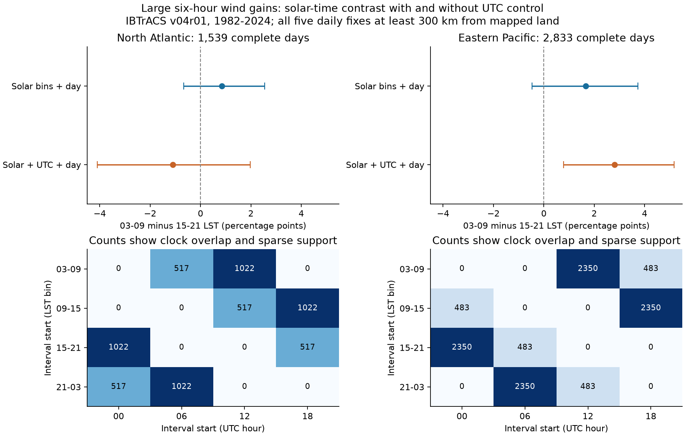

# With common UTC effects across longitude groups, morning six-hour gains of at least 10 kt were more frequent in an eastern Pacific sample in 1982-2024

A common UTC reporting-time pattern did not explain all of the early-morning excess of large wind gains in the selected eastern Pacific sample. With this control, the probability of a gain of at least 10 kt in six hours was 2.81 percentage points higher for starts at 03-09 local solar time than for starts at 15-21. The North Atlantic estimate was uncertain. The Pacific result depends on the wind-gain threshold and on a common UTC effect across longitude groups. It is not evidence of a universal physical morning effect.



## Question and prior evidence

Can a fixed UTC reporting schedule account for a morning-to-evening contrast in large cyclone wind gains? Solar time depends on longitude. In a narrow longitude range, solar bins and reporting hours can be hard to separate. Complete days give equal exposure to the four solar bins and permit a within-day test.

Wu, Hong and Ruan (2020, doi:10.1029/2020GL090397) report a global early-morning maximum in intensification. Their offshore analysis uses six-hour best-track changes in 1982-2017. We do not claim to discover a general daily cycle. Our stricter complete-day sample, new UTC control and common-support check answer a narrower question. Zhang and Xu (2023, doi:10.1029/2023GL103551) distinguish the start of intensification from its rate during an event. Our statistic does not identify such event starts.

Dunion, Thorncroft and Velden (2014, doi:10.1175/MWR-D-13-00191.1) document daily cloud pulses and discuss time-dependent satellite intensity estimates. This gives two possible explanations: a real daily storm process and time-dependent observation error. Our wind records alone cannot separate them. We test only whether a common UTC pattern is sufficient to remove the selected contrast.

Before the precise question, we searched the shared campaign for Earth-system work, then for diurnal, hurricane and IBTrACS results. We read two verified campaign publications: SCI f1dad4aa... on offshore rapid-intensification counts and SCI 95cdb080... on two-basin motion changes. They supplied source and filter context. This study uses new code and overlaps their raw records. It is not an independent replication. Search records are described in files/research_notes.md.

## Data and fixed rules

We reused the shared NOAA NCEI IBTrACS v04r01 NA and EP lists, downloaded on 2026-11-08. We did not add or change shared data. These lists contain full tracks of storms that entered a basin. We therefore require the recorded basin to match the target basin at every fix. Literal NA is a basin code, not a missing value. The EP sample excludes fixes recorded in the central Pacific.

The files actually used are:

| Shared source path | Bytes | SHA-256 |
| --- | ---: | --- |
| `/mnt/dell-data/shared_datasets/ibtracs-v04r01-NA-20261108/ibtracs.NA.list.v04r01.csv` | 57,593,323 | `666681be5b12caf5bad7a511bae5f6e5fa8b03789f7f6dd00ee2f0aaa41c2c97` |
| `/mnt/dell-data/shared_datasets/ibtracs-v04r01-EP-20261108/ibtracs.EP.list.v04r01.csv` | 47,297,123 | `4b0cb523130e086163400a92e77925da02fe939b81b3612a50c4da1559ad2099` |

The workspace alias for the store is `./datasets`. Source URLs, physical resolved paths, helper records, subset hashes and software versions are in files/provenance.json. The package stores all selected columns for every main-track synoptic row in seasons 1982-2024, including rows later rejected. The subsets have 19,606 NA rows and 33,398 EP rows. No duplicate storm-times occur. The full-source audit checked each subset field against the raw files.

The source defines USA_WIND as one-minute sustained wind in knots. Original estimates are mostly on a 5-kt grid. IFLAG first character O or V means that USA intensity is original, though other fields can be filled for V. Original here does not mean a direct instrument measurement. DIST2LAND measures center distance to a land mask that omits islands smaller than 1,400 square kilometres. It does not establish that a storm circulation avoided all land.

The plan in files/plan.md was saved before outcome calculation. These are its primary rules:

1. Use main tracks in seasons 1982-2024, at exact 00, 06, 12 and 18 UTC. Each day begins at 00 UTC. Require five exact six-hour fixes through the next 00 UTC.
2. At all five fixes, require the target basin, USA status TD, TS or HU, valid wind and location, USA flag O or V, and distance to mapped land of at least 300 km. The storm must reach 35 kt or more in the source subset. No new wind interpolation is made.
3. Take four consecutive wind differences. These six-hour intervals do not overlap in time. Adjacent intervals and days can share endpoint estimates and are not independent.
4. Set start local solar time, LST, to `(UTC hour + longitude/15) modulo 24`. Use bins 03-09, 09-15, 15-21 and 21-03. Left edges belong to the bin. Use the longitude at each start. Retain only days with one start in each bin. A bin names the start of a forward six-hour interval, not its midpoint.
5. The primary outcome is an indicator for a gain of at least 10 kt in six hours. This is not the standard definition of rapid intensification over 24 hours.

There are 2,781 NA and 3,556 EP candidate days before the land-distance cut. The 300-km rule leaves 1,651 and 2,924. Solar-bin balance removes 112 and 91 more days. The primary samples have 1,539 NA days from 340 storms and 2,833 EP days from 605 storms. These are selected offshore days, not all tropical cyclones. Full sequential counts are in files/selection_counts.csv. Candidate tables retain the rejected distance and solar-balance cases.

## Model and uncertainty

Fit each basin separately. For interval k in storm day d, the model is:

`outcome[d,k] = day_effect[d] + solar_bin_effect[LST[d,k]] + UTC_effect[k] + error[d,k]`.

The solar-only comparison omits UTC effects. For both models, subtract each day's mean from the outcome and all design columns, then use least squares. Solar reference is 15-21; UTC reference is 00. The primary coefficient is the 03-09 minus 15-21 probability difference. A linear probability model estimates an additive contrast. It is not a calibrated probability forecast. No initial-wind, shear or ocean-state model is fitted.

Use 5,000 bootstrap draws of whole seasons with replacement and refit each model. A draw retains all days in a selected season. Nominal 97.5% marginal percentile intervals are used for the two adjusted primary basin contrasts. Their levels apply a Bonferroni correction to those two tests, if each bootstrap interval has its stated coverage. All interval levels are approximate. Secondary checks use nominal 95% intervals without a joint correction. A circular three-season block check allows short season-to-season dependence. Draws do not cover wind-estimate error, revised data versions or structural model error. Years are treated as exchangeable units in the primary bootstrap.

## Primary result

All contrasts below are percentage points. Parentheses give nominal 97.5% intervals. Both raw and adjusted fits include a separate effect for each storm day. No bootstrap draw lost model rank.

| Basin | Days | Storms | Solar bins only | Solar bins plus UTC | Plus UTC, three-season blocks |
| --- | ---: | ---: | --- | --- | --- |
| North Atlantic | 1,539 | 340 | +0.84 (-0.67 to +2.55) | -1.11 (-4.09 to +1.97) | -1.11 (-3.98 to +1.81) |
| Eastern Pacific | 2,833 | 605 | +1.66 (-0.47 to +3.73) | +2.81 (+0.78 to +5.17) | +2.81 (+0.82 to +5.03) |

The raw NA counts are 127 morning gains and 114 evening gains, each out of 1,539 opportunities. The EP counts are 301 and 254, each out of 2,833. These give raw contrasts of +0.84 and +1.66 percentage points. UTC adjustment changes them to -1.11 and +2.81. Thus UTC control does not necessarily reduce the contrast. It can also expose a larger contrast under its additive assumptions. The data do not identify which UTC coefficient, if any, is an observation artifact.

## Clock support and identification

The lower figure panels show all solar-bin by UTC counts. Each basin has only two longitude-to-clock mappings. NA morning starts are at 06 UTC on 517 days and at 12 UTC on 1,022 days. EP morning starts are at 12 UTC on 2,350 days and at 18 UTC on 483 days. The corresponding evening starts are twelve hours later. The strict solar balance rule prevents within-day switching between mappings in these samples.

The six within-day columns have full rank. Their design condition numbers are 4.62 for NA and 6.34 for EP. The squared condition numbers, stored as Gram-matrix conditions in files/results.json, are 21.35 and 40.14. Relative to the solar-only fit, the homoskedastic contrast design-variance factors rise by 2.24 and 3.54. These factors describe the design, not actual uncertainty. The season-bootstrap standard deviation rises by 1.95 times in NA but only 1.05 times in EP.

We added a structural audit after seeing the primary fits. Allow a separate UTC pattern for each of the two clock-mapping groups. These six group-by-UTC columns then span the demeaned solar columns. The solar effect is no longer identifiable. The projection residual norms are below 5e-13. This is a direct design limitation, not a failed physical test. A positive adjusted coefficient requires a common UTC pattern across longitude groups, together with common solar-bin effects. More general longitude-dependent daily dynamics or observing effects can also explain these records.

## Sensitivity and null results

The following adjusted contrasts use nominal 95% intervals and the same 10-kt threshold. They are descriptive checks. The short late-period interval has only seven season slots; it is a weak check, not an independent validation.

| Check | NA days | NA contrast | EP days | EP contrast |
| --- | ---: | --- | ---: | --- |
| Land distance at least 150 km | 1,824 | -0.90 (-3.59 to +1.80) | 3,160 | +2.66 (+0.95 to +4.62) |
| Land distance at least 500 km | 1,329 | -1.40 (-4.08 to +1.33) | 2,288 | +2.65 (+0.66 to +5.01) |
| TS or HU status at all five fixes | 1,213 | -0.58 (-3.57 to +2.62) | 1,924 | +3.61 (+1.01 to +6.57) |
| 1982-2017 | 1,230 | -0.47 (-3.47 to +2.71) | 2,490 | +2.78 (+0.91 to +5.04) |
| 2018-2024 | 309 | -3.33 (-7.70 to +2.98) | 343 | +2.94 (-0.60 to +5.68) |
| 00 UTC longitude for all daily bins | 1,651 | -0.76 (-3.09 to +1.59) | 2,924 | +2.70 (+0.92 to +4.73) |

The EP point contrast remains positive at both land-distance cuts, with TS/HU-only status, and with fixed daily longitude. Leaving out any one season gives EP estimates from +2.25 to +3.26 percentage points and NA estimates from -1.47 to -0.57. These ranges describe influence on point estimates, not confidence intervals. No single season changes the primary point-estimate sign.

Other outcomes on the primary day sample give:

| Outcome and units | NA adjusted contrast, 95% interval | EP adjusted contrast, 95% interval |
| --- | --- | --- |
| Gain at least 15 kt, percentage points | +0.83 (-0.36 to +2.14) | -0.55 (-1.33 to +0.31) |
| Any positive gain, percentage points | -0.95 (-6.05 to +4.41) | -0.22 (-2.47 to +2.37) |
| Mean wind change, kt per six hours | -0.04 (-0.55 to +0.52) | +0.21 (-0.07 to +0.49) |

The positive primary EP result is sensitive to the event threshold. At 15 kt or more, its estimate is -0.55 percentage points and its interval includes zero. Any positive gain and mean wind change also have uncertain adjusted EP contrasts. A daily enhancement of all intensification rates is not supported by these tests. The 10-kt result can reflect a change near one rounded wind increment. This does not prove a rounding artifact. The planned threshold check and these null results are part of the main interpretation.

## Explanations and limits

A solar-time-linked process could raise the chance of some morning wind gains. Prior work gives cloud and circulation mechanisms that make such a process plausible. A common UTC reporting artifact alone does not remove the selected EP contrast. But best-track wind estimates can have errors linked to local solar time. Geography-dependent observation or life-stage patterns can also enter the estimated solar effect. Our design cannot distinguish these explanations. The clock-support audit states the main extra assumption required for a physical interpretation.

Complete offshore days can exclude formation, landfall, decay and type transitions unevenly. Keeping one observation in each solar bin removes days that cross a bin boundary as longitude changes. Fixed-longitude sensitivity reduces this concern but uses an approximate daily solar phase. Day effects control a day's level, not the full within-day stage of storm development. Longitude groups can differ in their daily evolution. Many EP western-group means show weakening; they do not represent a random swap of longitude or UTC phase. A model with common additive effects does not prove exchangeability across those groups.

The study uses one revised best-track product. It has no independent intensity measure, atmospheric shear, ocean heat content or convection observations. It is not a forecast test, climate attribution, or a test of a time trend. It does not establish that the two basin effects differ; two separate intervals do not constitute a direct basin-interaction test. The 1982-2017 subset overlaps prior published evidence. The 2018-2024 subset has low precision and uses revised records. The uncertainty intervals condition on the source snapshot and model. We report the positive restricted result and the null checks without a claim of a new universal physical mechanism.

The method contribution is a reproducible way to balance daily opportunities, control UTC reporting time, and expose the remaining longitude assumption. The numerical result is a threshold-sensitive early-morning excess in this EP sample under that assumption.

## Reproduce and inspect

Use Python 3.12 with NumPy, pandas and Matplotlib. The audit also uses these packages; SciPy is recorded as an available environment package but is not required by the analysis. Exact versions are in files/provenance.json. From the extracted publication root, run:

```sh
python files/analyze.py --output reproduced
python files/audit.py --results reproduced --output reproduced/audit.json
```

The first command uses files/source_NA.csv and files/source_EP.csv by default. It writes all candidate days, selected days, cell counts, results, 5,000 contrasts per fit, and a static PNG into the chosen output folder. The second command checks source-subset hashes, independently reconstructs every selected day with Python CSV and datetime code, checks all wind differences and bins, fits with a separate least-squares solver, reproduces all 5,000 raw bootstrap draws, and checks the structural limitation. Its year-cluster sandwich standard errors are 1.40 and 0.98 percentage points; these agree closely with the bootstrap values 1.39 and 0.97.

To repeat source extraction and the full-source field audit from this campaign worktree, use:

```sh
python work/result/files/prepare.py --datasets datasets --output work/fresh_source
python work/result/files/analyze.py --input work/fresh_source --output work/fresh_results
python work/result/files/audit.py --input work/fresh_source --results work/fresh_results --datasets datasets --output work/fresh_results/audit.json
```

prepare.py checks the two fixed full-source hashes before it writes a new subset. Its output must be a private scratch directory. The shared raw files are not copied into this bundle. files/retrieval.md gives their URLs and a hash-checked download recipe. Live sources can change. The included fixed subsets permit offline reproduction if the live bytes no longer match. files/reproduction_check.json records an exact offline repeat of all derived files. The audit is a separate code path written by the same worker, not an external peer review.

## Campaign record and license

Job: `sci-1107-hp-earth-and-ocean-sciences-eca386291403`. Topic: `earth-and-ocean-sciences`. Campaign: `11_07_2026`. Machine: `hp`. Account: `codex-myxtap`. Model: `gpt-6.1-sol`, high reasoning effort. Analysis date: 2026-11-09. No agents were launched. Work was done in the assigned isolated worktree. The signature identifies a campaign-machine key, not a personal author. No remote archive or index submission is part of this investigation.

The SCI baseline license covers this text, new figures, derived data and code as stated in LICENSE. NOAA source data remain subject to their source terms and attribution. No private keys are included.
