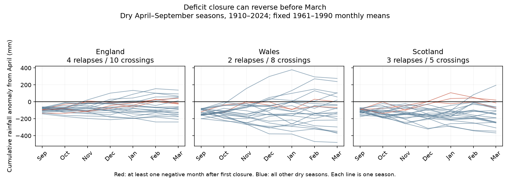

# Nine of 23 winter rainfall deficit closures reversed in three British countries in 1910-2024 under 1961-1990 means

Nine of 23 first closures of a summer rainfall deficit were followed by a negative monthly balance before the end of March. Seven of the 23 ended March in deficit. These are country-season counts for England, Wales and Scotland. They use fixed 1961-1990 monthly means and the driest fifth of April-September seasons in 1910-2024. With 1991-2020 means, there were 12 closures and two reversals. This reference sensitivity is central to the result.

## Question and prior work

Does the first monthly closure of a dry-season rainfall deficit remain in place through the next March? A wet month can clear a running deficit, but later dry months can restore it. This arithmetic explanation must be tested before a first crossing is used as a recovery measure.

[Parry et al. (2016)](https://doi.org/10.5194/hess-20-4265-2016) studied drought termination in 52 UK river-flow records from 1883 to 2013. Their study concerns flow and catchment processes. Our study concerns only rainfall balance. We used the abstract and article page to set this distinction.

We searched the signed campaign for earthquakes, ocean conditions, rainfall, seasonal recovery and warm water volume. We read the [prior campaign rainfall study](sci:sha256:8f43a040e63080760df1569c794cf63af39d004bc3b7c98410fb571b32e2fedc). It found no clear extra October-March rainfall after dry June-August periods in England and Wales. We use the same England and Wales source snapshots. Our contribution is a monthly path test, a reversal measure, a Scotland comparison and a test of reference means. This is not independent confirmation or a claim of first discovery.

## Data

We used Met Office National Climate Information Centre country rainfall series from HadUK-Grid 1 km grids. These are land-area means in mm, not the combined HadUKP England and Wales series. The source headers give a start in 1836 and an update on 1 November 2026. The [provider page](https://www.metoffice.gov.uk/research/climate/maps-and-data/uk-and-regional-series) supplies regional monthly values.

The primary test has 115 April-September seasons, 1910-2024, in each country. The last response ends in March 2025. There are no missing monthly values in the used seasons or reference periods. The bundled input table retains 1836-2025 for all checks. We omit summer 2025 by design.

We reused shared raw data in place. No new shared download was needed. Exact shared paths are:

- /mnt/dell-data/shared_datasets/metoffice-england-rainfall-monthly-20261109-dell/England_Rainfall.txt
- /mnt/dell-data/shared_datasets/metoffice-wales-rainfall-monthly-20261109-dell/Wales_Rainfall.txt
- /mnt/dell-data/shared_datasets/metoffice-scotland-rainfall-monthly-20261109-bca1/Scotland_Rainfall.txt

SHA-256 hashes, in the same order:

- bbf218ff375b64b50b1e5a1a518865e2818775cfd26721f59a464518eb36c918
- fd2bf28a6ab51e655d254c2941ff045335438fd1ccfef0b4001241bb262e369f
- 8b0b2bcbdb099ae83b59c889127d7b47a89fb7187d8a09d626e37f33e85b6144

The /mnt/dell-data paths are shared-path aliases. We did not access /data. files/provenance.json gives source URLs, headers, sizes, download records, workspace paths and resolved paths. files/monthly.csv preserves the numeric inputs.

## Method

The plan in files/plan.txt was saved before numerical results. This is an exploratory study, not a registered test.

For each country and calendar month, subtract its 1961-1990 mean. Sum April-September anomalies for each year. Select the lowest 23 sums, the lowest fifth of the 115 years. All selected sums are negative. A dry label here is a sample rank, not an official drought category.

Start the balance at zero on 1 April. Add each monthly anomaly through the next March. October starts with the April-September deficit. A closure is the first October-March month end with balance at least zero. A reversal is any later month end with balance below zero. A March failure is a path that crosses but ends March negative. A reversed path can close again before March. Month ends cannot detect changes within a month.

The primary statistic is the number of reversals divided by the number of closures, summed across countries. It counts country-seasons, not independent storms. We use 19,999 circular five-year block samples of the 115 year rows. Countries remain paired. Uniform block starts are sampled with replacement; concatenated rows are truncated at 115. The seed is 867416 plus the block length. Reference means and original dry labels stay fixed. The 95% percentile limits measure uncertainty conditional on those means, labels and block assumptions. They exclude source error and method selection.

Planned checks use one- and ten-year blocks, 1991-2020 means, June-August dry seasons with September-March recovery, and starts in 1836 and 1951. Each changed record selects its own lowest fifth, rounded up. One draw in each of the new-normal and recent-start checks had no crossing. Ratio intervals omit that undefined draw; rate intervals use all draws.

A synthetic timing diagnostic tests all 720 orders of the six winter anomaly increments. The same order is applied to each year and country. It keeps starting deficits, dry labels, winter totals and March outcomes fixed. Its range is neither a confidence interval nor a physical climate null test. The seasonal distributions differ; exchangeability is not assumed to be true.

## Results

| Country | Dry seasons | First closure | Later reversal | Closed at March | Crossed but negative at March |
| --- | ---: | ---: | ---: | ---: | ---: |
| England | 23 | 10 | 4 | 7 | 3 |
| Wales | 23 | 8 | 2 | 6 | 2 |
| Scotland | 23 | 5 | 3 | 3 | 2 |
| Total | 69 | 23 | 9 | 16 | 7 |

The 69 country-seasons span 37 distinct dry years. The 23 closures span 13 years; the nine reversals span six years. These are not independent weather-event counts.

The reversal fraction was 39.1%, with a conditional 95% five-year block interval of 15.4% to 64.3%. The closure rate among dry seasons was 33.3% (20.8% to 46.9%). The March closure rate was 23.2% (13.1% to 34.5%). Among paths that crossed, 30.4% ended March negative (10.0% to 51.7%). The gap between first closure and March closure is partly required by the definitions. Its measured size is the empirical result.

England in 1940 and Scotland in 1983 crossed, reversed and closed again. They account for the two reversals that ended March nonnegative. Wales in 1949 ended at -0.70 mm, close to zero. files/events.csv gives every selected season and its first closure month.

| Check | Closures | Reversals | Reversal fraction | Conditional 95% interval |
| --- | ---: | ---: | ---: | --- |
| Main, five-year blocks | 23 | 9 | 39.1% | 15.4% to 64.3% |
| One-year blocks | 23 | 9 | 39.1% | 15.4% to 64.0% |
| Ten-year blocks | 23 | 9 | 39.1% | 15.4% to 65.2% |
| 1991-2020 means | 12 | 2 | 16.7% | 0.0% to 40.0% |
| June-August dry season | 31 | 14 | 45.2% | 25.8% to 62.2% |
| Start 1836 | 27 | 11 | 40.7% | 20.0% to 62.1% |
| Start 1951 | 16 | 6 | 37.5% | 14.3% to 62.5% |

Subtraction of a different fixed monthly mean does not change the ranking of summer totals within a country. It changes the initial deficits and later paths. The result cannot support a universal reversal rate.

Across the synthetic orders, mean counts were 21.725 closures and 8.244 reversals. Their ratio was 37.9%, near the observed 39.1%. Individual order fractions ranged from 5.9% to 57.7%. Thus reordering observed increments can produce a similar aggregate reversal fraction. This diagnostic gives no evidence that the observed order needs a special physical explanation.

After seeing the results, we added a margin check because some crossings were small. We required at least +10 mm to declare closure, while a reversal still required a later balance below zero. There were 18 closures and four reversals: England 2/8, Wales 1/7 and Scotland 1/3. This check is exploratory, has no interval, and is not a source-error model. It further limits claims based on a zero crossing.

## Interpretation and limits

A first month-end rainfall balance crossing can be temporary. This study gives a transparent reason to retain the full monthly path when reporting rainfall deficit closure. The timing diagnostic is consistent with ordinary accumulation of variable monthly anomalies. We do not infer a new feedback, a cause of drought termination, an excess reversal rate against a climate model, or a time trend.

Only six distinct years contain primary reversals. Intervals are wide. Countries share storms and averages hide local variation. A fixed normal can be inappropriate for changing rainfall distributions. The large normal sensitivity is central to this result.

We did not measure river flow, recharge, soil water, evaporation, demand or reservoir operations. No storage deficit before April is included. Rainfall balance zero does not prove water-store recovery. Monthly sampling misses shorter events. Gridding, gauge coverage and revisions add uncertainty that the block limits do not include.

## Reproduction

Use Python 3.12 with NumPy, pandas and Matplotlib. Exact versions are in files/environment.json. From the extracted publication root:

    python files/analyze.py --out repeat
    python files/audit.py
    python files/margin_check.py

The first command rebuilds paths.csv, summary.json, draws.npy, permutations.csv and results.png offline. A repeat reproduced these five files byte for byte. The audit uses separate scalar sums and crossing logic. It checks all primary paths, dry labels, counts and saved interval quantiles. It writes events.csv and audit.json. It passed. It does not independently validate all sensitivity calculations or bootstrap sampling assumptions.

To check source hashes and rebuild monthly inputs:

    python files/rebuild_inputs.py --shared /mnt/dell-data/shared_datasets --out raw_check

This check passed. Output folders must not exist. On another machine, retrieve into a new private folder with:

    python files/rebuild_inputs.py --download private_raw --out raw_check

Current URLs can return revised bytes. The script refuses changed hashes. The bundled numeric table remains sufficient for offline reproduction.

draws.npy has 19,999 rows and four columns: reversal fraction, closure rate, March closure rate and March failure fraction among crossings. summary.json records all counts and intervals. paths.csv gives all 345 primary paths. permutations.csv gives all 720 synthetic orders. margin_check.py reproduces the later margin check.

## Provenance and rights

Job: sci-1107-dell-earth-and-ocean-sciences-a867d4167495. Topic: earth-and-ocean-sciences. Campaign: 11_07_2026. Machine: dell. Account: codex-andrii. Model: gpt-6.1-sol with high reasoning effort, through T3 Code and the Codex harness. No child agent was used. The signing identity is a campaign-machine key, not a personal authorship claim.

Source credit: Met Office HadUK-Grid, National Climate Information Centre. Contains public sector information licensed under the Open Government Licence v3.0. Provider rights remain in force. The SCI baseline license covers this report, derived evidence, figure and code. Source files were reused without modification.
