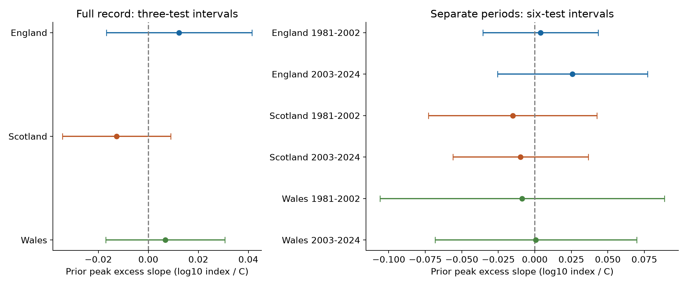
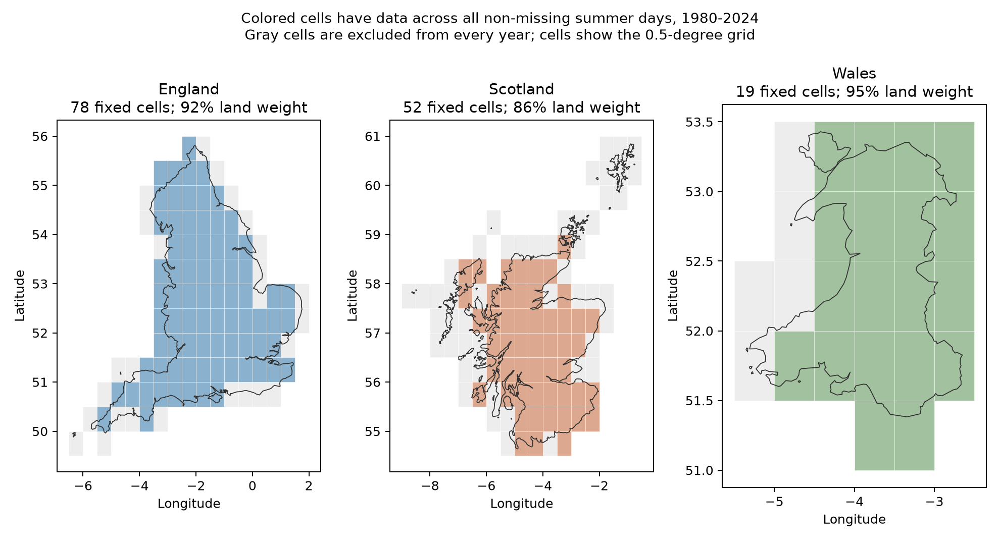
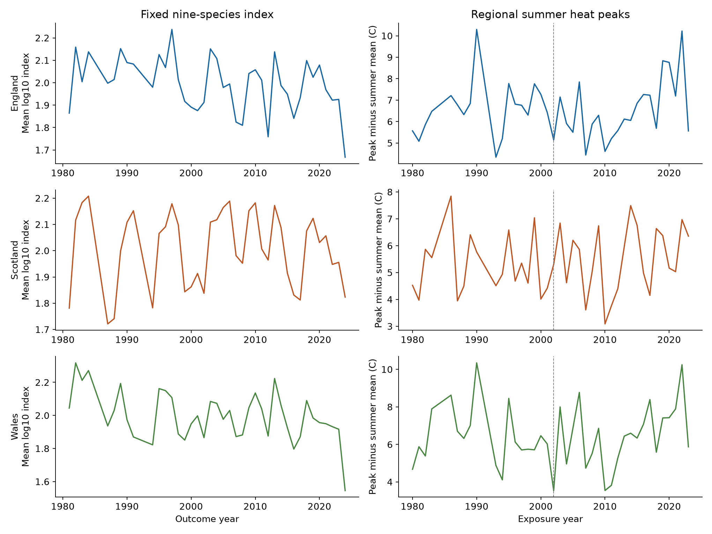

# Prior summer heat peaks gave no clear common link to next-year butterfly indices in England, Scotland and Wales in 1981-2024

We tested whether a short heat peak in one summer was linked to a lower butterfly index in the next year, after control for seasonal mean temperature and rain. The full-record slopes were +0.0123, -0.0127 and +0.0068 log10 index units per C in England, Scotland and Wales. All three corrected uncertainty intervals included zero. All six separate country and period intervals also included zero. The evidence did not establish a repeated adverse link under the tested model. It does not establish that the effect is absent or small.



## Question and prior evidence

A brief hot period can have effects that a seasonal mean does not measure. One possible delayed effect is lower survival of young insects or damage to their food plants. Warm weather can also change adult activity and the chance that an observer sees a butterfly. We test a conditional, delayed association. We do not identify either mechanism.

McDermott Long and colleagues studied local extremes across the life stages of 41 UK butterfly species. They found that responses depended on life stage and on the type of extreme. This supports a test that separates short heat peaks from seasonal means. Our country averages do not repeat their site and life-stage test. [McDermott Long et al. (2017)](https://doi.org/10.1111/1365-2656.12594).

Shan and colleagues studied daily extremes and 57 butterfly species in England. They reported links between several types of extreme and abundance change. Our test uses a fixed nine-species mean, three countries, a separate heat-peak measure, and two disjoint outcome periods. It cannot validate all of their conclusions. [Shan et al. (2024)](https://doi.org/10.1016/j.scitotenv.2024.176318).

We searched the signed campaign before choosing the exact question. Related work tested prior seasonal heat and rain with the same butterfly release. It found that estimates depended on the response measure and model shape. Another study examined the sum of current and prior rain slopes. We read these results and rebuilt all inputs from public sources. The biological records overlap with those publications. This is a new exposure test, not an independent biological data replication. [SCI e2f2fce4](sci:sha256:e2f2fce4a97d3f2fb9cb7b3a4d09597042952c93f8b42cd67bd145eeb704d3de), [SCI 4a72551f](sci:sha256:4a72551f55388d87b90d2f9e5fa1e35f7f47bd534d3ebbf8140a232ae4afd95a), [SCI 6978841b](sci:sha256:6978841b5b477a0c75124016966017939d0cba653c3e3da6f67ea06ef3ee668a).

## Data and observation checks

The UKBMS 2024 release supplies annual log10 relative abundance indices and contributing site counts. We selected species from coverage alone, before fitting heat models. A species needed every index in 1980-2024 and at least five sites in every year in each of England, Scotland and Wales. Nine species passed: Aglais urticae, Coenonympha pamphilus, Lycaena phlaeas, Maniola jurtina, Pieris brassicae, Pieris napi, Pieris rapae, Polyommatus icarus and Speyeria aglaja.

The source panel has 1,215 species-country-years. We use the equal mean of the nine log10 indices in each country-year. This is the log of a geometric mean relative index. The species weights never change. It does not measure the total number of butterflies or the number of species. Northern Ireland has too short a record for the time split. The UK total contains the country records and is not another region. [UKBMS source](https://doi.org/10.5285/a70d8b0b-0ef5-484e-8195-42bcfd818229).

The source combines transects and targeted surveys. Its seasonal abundance method accounts for gaps in visits, with source weights for the fraction of the flight period surveyed. This reduces one source of bias. Our fixed species list prevents changes in species composition. We also control mean log site count and repeat the analysis with a ten-site requirement. These steps do not remove all detection or site-selection bias. [Source index method](https://doi.org/10.1111/biom.12506).

Summer mean temperature and total rain come from the Met Office country series. We use the June-August fields in the snapshot last updated on 1 November 2026. These are country land averages, not survey-site averages. [Met Office series](https://www.metoffice.gov.uk/research/climate/maps-and-data/uk-and-regional-series).

Daily maximum temperature comes from NOAA CPC V1.0 on a 0.5-degree grid. We use the exact 1980-2024 files already in shared storage. Country boundaries come from geoBoundaries gbOpen GBR ADM1, boundary year 2021, commit 9469f09. A grid weight equals the polygon overlap area in degree units, times the cosine of cell-center latitude. This is an area approximation. The source daily maximum period is 06 UTC to 06 UTC. [NOAA PSL](https://psl.noaa.gov/data/gridded/data.cpc.globaltemp.html), [boundary metadata](https://www.geoboundaries.org/api/current/gbOpen/GBR/ADM1/).

The source weather grid has changing coastal coverage. We therefore use a fixed spatial support in every year. For each country, a cell must have data on every summer day on which any country cell has data. Days with no country data remain missing. This rule was set from weather coverage before any butterfly-weather fit. It retains the following fractions of the approximate country land weight:

| Country | Fixed cells / polygon cells | Retained land weight |
| --- | ---: | ---: |
| England | 78 of 104 | 92.1% |
| Scotland | 52 of 101 | 86.2% |
| Wales | 19 of 24 | 94.8% |



Two days in summer 1985 and one day in summer 1992 have no valid country data. We require all 92 days of both current and prior summer. This removes outcome years 1985, 1986, 1992 and 1993 in all countries. Each full model has 40 annual outcomes. The early period, 1981-2002, has 18 outcomes. The late period, 2003-2024, has 22. No peak is imputed. All removed rows and source coverage values can be inspected in `files/weather_coverage.csv` and `files/annual_heat.csv`.

For each day, we first average daily maximum temperature over the fixed country cells. The heat measure is the highest three-day moving mean within June-August, minus that summer's mean daily maximum temperature. Thus a larger value means a stronger short peak relative to the same summer. It is not a count of damaging days, a soil-water measure, or a site heat dose. Seasonal mean temperature is included separately in the model.

## Model and uncertainty

For each country, ordinary least squares fits:

`mean log10 index = intercept + linear year + prior index + current and prior summer mean temperature + current and prior summer rain + current and prior heat-peak excess + mean log site count + error`.

There are ten coefficients. Temperature and peak terms use C. Rain uses 100 mm. The time term uses decades. The main coefficient is the prior heat-peak excess slope. It describes the predicted difference at fixed values of the other terms. Prior index can carry both biological and observation effects. Control for it changes the target from a total response to a conditional next-year association.

Annual country means are the units for uncertainty. Nine species do not supply nine independent observations of the same weather. Countries have separate survey populations, but shared events. Their prior heat-peak correlations are 0.42, 0.50 and 0.84 in the retained years. The tests therefore do not form three independent climate experiments. The two outcome periods do not overlap, but climate and population history can link them.

The main intervals use Newey-West covariance, Bartlett weights through calendar lag two, an n/(n-k) correction, and a t reference with n-k degrees of freedom. Calendar gaps remain gaps. Full-record intervals correct for three country tests. Period intervals correct for six tests. These are nominal family 95% intervals under the covariance and reference assumptions. They are not exact small-sample guarantees. A repeated adverse-link claim required negative estimates and corrected upper endpoints below zero in all six period tests. That rule failed.

We also report HC3 intervals. A restricted-model wild bootstrap uses 4,999 draws with three-year and five-year blocks. Each draw shifts the block boundaries and uses random signs. Restricted residuals have a leverage correction. The bootstrap checks uncertainty under a model with the prior heat slope fixed at zero. It does not remove unmeasured causes or source-index error.

## Results

Slopes are log10 index units per C of prior heat-peak excess. Full-record intervals correct for three tests.

| Country | Years used | Slope | Corrected interval |
| --- | ---: | ---: | --- |
| England | 40 | +0.0123 | -0.0168 to +0.0414 |
| Scotland | 40 | -0.0127 | -0.0344 to +0.0090 |
| Wales | 40 | +0.0068 | -0.0170 to +0.0306 |

The six period intervals correct for six tests.

Early outcome period, 1981-2002:

| Country | Years used | Slope | Corrected interval |
| --- | ---: | ---: | --- |
| England | 18 | +0.0039 | -0.0355 to +0.0434 |
| Scotland | 18 | -0.0151 | -0.0728 to +0.0425 |
| Wales | 18 | -0.0086 | -0.1060 to +0.0887 |

Late outcome period, 2003-2024:

| Country | Years used | Slope | Corrected interval |
| --- | ---: | ---: | --- |
| England | 22 | +0.0258 | -0.0256 to +0.0772 |
| Scotland | 22 | -0.0097 | -0.0560 to +0.0366 |
| Wales | 22 | +0.0008 | -0.0683 to +0.0698 |

England has positive point estimates in both periods. Scotland has negative point estimates in both. Wales changes sign. No corrected interval excludes zero. These differences in signs do not establish a difference between country effects; we did not test that contrast.

The three-year bootstrap p-values are 0.3332, 0.1466 and 0.4508 for England, Scotland and Wales. Five-year values are 0.3650, 0.1372 and 0.4808. None is below 0.05 before or after correction for three tests. HC3 intervals also include zero in all nine primary models and are wider than the main intervals. Early-period models have only eight residual degrees of freedom. Their maximum leverage is 0.76-0.84. Large effects of individual years are possible in these short fits.



## Checks of coverage and model choice

Changing to cell-center weights changes the heat-peak measure by at most 0.211 C in retained rows. One-day peaks, five-day peaks, cell-center weights, removal of the site-count term, removal of the prior-index term, and separate curved terms for prior seasonal temperature and rain all give marginal 95% intervals that include zero in all three countries. Adding current and prior CPC summer mean daily maximum temperature gives the same broad result. That check better controls differences between mean temperature and mean daily maximum temperature.

A ten-site requirement retains 40, 34 and 30 outcomes in England, Scotland and Wales. All three intervals include zero. This filter changes the years as well as coverage. It cannot identify detection bias by itself. A check restricted to years before the 2009 wider-countryside survey change gives three negative point estimates, all with intervals that include zero. This survey-period check was added after initial fits and is exploratory.

Omission of one species at a time keeps the full-record sign positive in England and Wales and negative in Scotland. Omission of one annual outcome at a time does the same. Those checks concern the retained full-record sample; they do not prove a biological effect. All 36 main and model-choice fits, 120 omitted-year fits, and 27 omitted-species fits are retained. Sensitivity intervals are marginal 95% intervals and are not new confirmatory tests.

The saved plan initially proposed a simple sum of current and prior heat slopes as an observation-offset diagnostic. Model review showed that this restriction is wrong when the lag index coefficient is free. Under a stable additive observation offset and an autoregressive biological model with coefficient rho, the relevant restriction would instead be `beta_prior + rho * beta_current = 0`, with further assumptions. We dropped the simple sum. No detection-mechanism conclusion uses it. The plan and amendments remain in `files/PLAN.txt`.

## Limits and use

These records do not establish a common negative delayed response to this heat-peak measure. Broad intervals still permit adverse responses. This is not evidence of safety or equivalence. A mean over nine well-monitored species can hide opposite species or habitat responses. All species and countries come from one survey system. The complete-record rule favors species already established in all three countries. It cannot test new range expansion.

Country weather can miss local extremes and life-stage timing. Fixed grid support avoids one source-mask change, but leaves out part of the coast. It does not correct changes in station inputs or interpolation. The boundaries and source weather grid are coarse for insects. A three-day peak relative to the summer mean is one specific exposure choice. It is not the same as a damaging heatwave threshold. Heat can act through soil water or food plants, which we do not measure.

Survey-site turnover, adult activity, detection, habitat, management, pesticides and source-index uncertainty remain possible causes of index change. Site count is a weak measure of effort. The source indices have no uncertainty draws in this download. We treat them as fixed model inputs. The early fits are small and have high leverage. Their intervals may have poor coverage. We do not estimate a causal climate-change effect, species loss, a distribution shift, or an air-pollution effect.

The package adds a daily regional heat table, explicit spatial-support and missing-day audits, and a focused null result beyond seasonal-weather tests. These outputs can support future site-level tests. Such tests need local heat, survey visits, life-stage timing and enough separate extreme events.

## Provenance and reproduction

All shared raw files were read in place. No existing dataset was changed. `files/provenance.json` records the exact shared aliases and resolved paths, source URLs, versions, byte counts and SHA-256 hashes for all 53 raw input files, plus the used member of the UKBMS ZIP. The large NOAA global files are not duplicated. Small source tables, the unmodified boundary file, daily regional extracts, weights, source coverage, model panels, all estimates and code are in this bundle. `files/exploration_log.json` records earlier coverage checks that were not used in the reported models.

Data provided by NOAA PSL, Boulder, Colorado, USA, from [their website](https://psl.noaa.gov/). Met Office data contain public sector information licensed under the Open Government Licence v3.0. Source licences and attribution remain in force; see `files/THIRD_PARTY_NOTICES.txt`.

Botham, M.S., Middlebrook, I., Heywood, J., Harrower, C.A., Milborrow, J., Roy, D.B. (2025). United Kingdom Butterfly Monitoring Scheme: collated indices 2024. NERC EDS Environmental Information Data Centre. (Dataset). https://doi.org/10.5285/a70d8b0b-0ef5-484e-8195-42bcfd818229

Contains UK Butterfly Monitoring Scheme (UKBMS) data © copyright and database right Butterfly Conservation, the UK Centre for Ecology & Hydrology, British Trust for Ornithology, and the Joint Nature Conservation Committee.

Use Python 3.12 with numpy, pandas, scipy, matplotlib and statsmodels for the offline analysis. A raw rebuild also needs xarray, netCDF4 and shapely. Exact versions are recorded in `files/environment.json`. From an extracted publication root, run:

```bash
sci_replay_dir=$(mktemp -d)
python files/analyze.py --input files --output "$sci_replay_dir"
python files/validate.py --input files --results "$sci_replay_dir"
python files/map_support.py --input files --output "$sci_replay_dir"
cmp files/estimates.csv "$sci_replay_dir/estimates.csv"
```

These commands write to a new private directory. They do not change signed files. The deterministic bootstrap uses seed 147. The validator checks source species rows, annual means, all nine main design matrices, QR coefficients, calendar-lag HAC arithmetic, interval arithmetic, 270 country-year-mask heat groups, and lag matches. The separate raw audit checks 96 daily values against direct netCDF4 reads from four source years. The largest raw difference is below 5e-9 C. A second full offline run matched 13 output files byte for byte; see `files/reproduction_check.json`. These checks validate computation, not ecological assumptions.

To rebuild from shared raw files, run:

```bash
sci_rebuild_dir=$(mktemp -d)
python files/build.py --shared-root /mnt/dell-data/shared_datasets --output "$sci_rebuild_dir" --workers 4
python files/audit_raw.py --input "$sci_rebuild_dir" --output "$sci_rebuild_dir"
python files/analyze.py --input "$sci_rebuild_dir" --output "$sci_rebuild_dir/results"
```

The builder checks each raw source hash before first extraction. It saves a private cell cache for retries. Use a new empty output directory for a complete raw rebuild. To obtain exact inputs in private storage from their recorded source URLs, run `python files/retrieve.py --download --output private_raw`, then use `--shared-root private_raw`. The script refuses a changed source hash. Live Met Office and NOAA URLs can change; the recorded shared snapshots are the reference. No shared dataset download is needed to run the offline analysis.

Campaign: 11_07_2026. Job: sci-1107-hp-climate-pollution-biodiversity-e354d8ebafac. Topic: climate-pollution-biodiversity. Machine: hp. Account: codex-myxtap. Model: gpt-6.1-sol, high reasoning effort. The configured campaign-machine key signs this result. It is not a personal authorship claim. Publication files are saved locally only.
