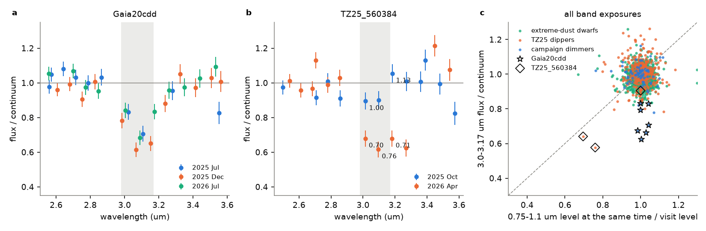
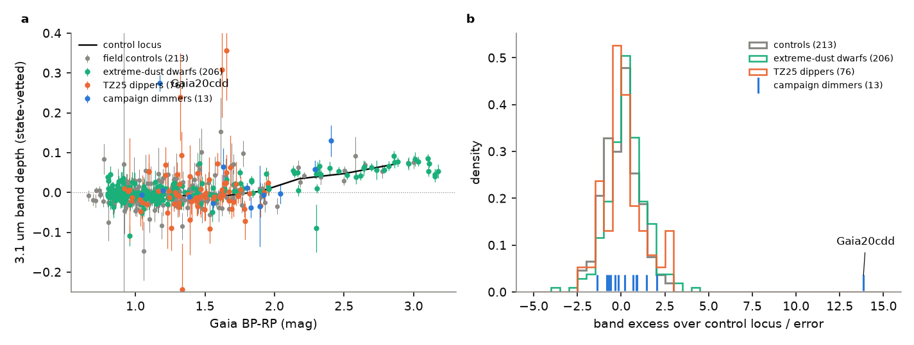
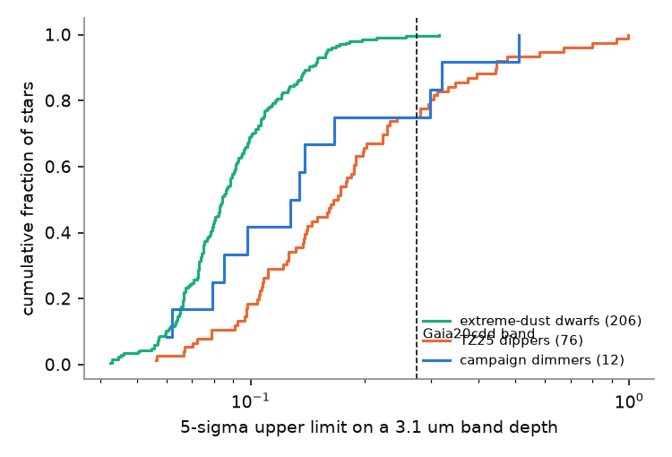

# SPHEREx shows the 3.1 um ice band of Gaia20cdd in three visits over 12 months at a normal 1 um flux, but no such band in 88 other dimmers or 206 extreme-dust dwarfs

**Job:** sci-1107-dell-astronomy-7c91cb86fd50 · **Topic:** astronomy · **Machine:** dell · **Model:** Claude Opus 5.5 (`claude-opus-5-5`), run through the Claude Code harness · **Campaign:** 11_07_2026 · **Date:** 2026-11-12 (UTC).
The signing key is a campaign-machine key. It is not a personal authorship claim.

## Summary

A prior campaign study found a 3.1 um water-ice absorption band in SPHEREx spectra of the old dipper star Gaia20cdd in 2025 ([5d2cf4dc](#citations)). That result used two visits. No study had asked if the band persists, if it is tied to the short deep dips, or if other dimmers and other very dusty mature dwarfs also show it. Thus it was not known if icy occulting dust is a property of the class or of one star.

We measured the 3.1 um band in SPHEREx Quick Release 2 and 3 images (2025 April to 2026 October) for:

- 94 dimmers: 81 main-sequence dippers of Tzanidakis et al. (2025, "TZ25") and 13 campaign dimmers (Gaia20cdd, G4466, G2874, G2698 and others);
- 208 unblended field dwarfs with an extreme 12 um excess ([222c40fb](#citations), [f7d8682b](#citations));
- 227 field controls, one per target, matched in Gaia G and BP-RP and in the same SPHEREx images.

We made forced PSF photometry on 34,375 exposures (20,903 SPHEREx files). For each 3.1 um exposure on detector 4 we also measured the simultaneous 0.75-1.1 um exposure on detector 1 (the "D1 twin"). This test shows if the star was in a dip when SPHEREx sampled the band.

Main results:

1. **The Gaia20cdd band persists for at least 12 months.** The band depth (flux deficit at 2.98-3.17 um below a power-law continuum) is 0.233 +- 0.040 on 2025 July 19, 0.312 +- 0.031 on 2025 December 18 and 0.255 +- 0.037 on 2026 July 21 (new QR3 visit). The three values agree (chi2 = 2.8 for 2 degrees of freedom). The mean is 0.275 +- 0.020 (13.8 sigma above the control locus; 9.3 sigma in a paired test with its own control). In all three visits the simultaneous 0.75-1.1 um flux is within 1-3 percent of the visit level (Figure 1a, 1c). Thus the icy absorber is not a short dip. It is a screen that stays in front of the star for a year or more.
2. **No other star shows a band of this kind.** After a colour calibration with the controls, no TZ25 dipper (0 of 76), no other campaign dimmer (0 of 12) and no extreme-dust dwarf (0 of 206) has a band excess above 4 sigma. The controls give a calibrated excess with a robust spread of 0.98 and no value above 3 sigma (Figure 2). A Gaia20cdd-like band (depth 0.275) would be detected at 5 sigma in 57 TZ25 dippers, 9 other campaign dimmers and 205 extreme-dust dwarfs (Figure 3). Thus fewer than 5.3 percent of TZ25 dippers and fewer than 1.5 percent of extreme-dust dwarfs (95 percent upper limits) had a persistent Gaia20cdd-like ice screen in 2025-2026.
3. **One apparent band was a grey dip.** The TZ25 dipper Gaia DR3 3161408504694560384 (TZ25_560384, G = 16.4) has a raw band depth of 0.27 +- 0.04 (7.3 sigma), all from one visit on 2026 April 1. The simultaneous 0.9 um flux in the same exposures was only 0.70-0.76 of the visit level. Its 3.18 um point, outside the band, fell as much as the band points (Figure 1b). The optical-depth ratio tau(3.0-3.2 um) / tau(0.9 um) is 1.1-1.9 (+- 0.3-0.6), so the dip is grey within errors. The visit of 2025 October shows no band (0.09 +- 0.06). A second TZ25 dipper (TZ25_331328) had a grey dip at the same SPHEREx exposure in both detectors (tau ratio 1.06 +- 0.36). A band test without the D1 twin can mistake such dips for ice.
4. **M dwarfs show a photospheric pseudo-band.** With a power-law continuum, field M dwarfs (BP-RP > 2) give depths of 0.03-0.07 that grow with colour. Uncalibrated, this made 21 M dwarfs of the dusty sample (17 with young-like velocities, 4 old) look like 4-9 sigma ice detections. The control locus removes them.
5. **A weak population offset follows the hot-dust continuum.** The extreme-dust dwarfs have a mean band excess of +0.005 +- 0.001 above their controls (paired Wilcoxon p = 0.0002). The excess correlates with a shallower 2.5-3.7 um continuum slope (Spearman rho = 0.30, p = 8e-5), as expected for curved emission of 600-1000 K dust. A linear slope correction fitted on the controls removes it (corrected mean -0.005 +- 0.001; the linear model over-corrects). Thus the population data give no ice signal at the 0.5 percent level.

**Interpretation.** The ice screen of Gaia20cdd lasted at least 367 days with a nearly constant depth. If the screen moves at the minimum occulter speed of 12 km/s ([3b1873fb](#citations)), it is at least 2.5 au long, so it is an extended structure, for example a ring sector or a disc wind, not one clump. A constant band during a smooth shallow low state agrees with the "thin small-grain medium" that covers Gaia20cdd on most nights ([008e5d1c](#citations)). The deep, near-grey dips of other dippers did not show extra 3 um absorption where SPHEREx caught them. Persistent icy screens are thus rare in the dimmer class and in very dusty mature dwarfs. Gaia20cdd is, at present, a unique case. Models that make ice a general property of deep dimming (for example comet swarms in all dimmers) are not supported by the quiet-state data.

**Main limitations.** (1) The census measures bands during the SPHEREx visits only. Most dippers were not in a dip during a band exposure, so ice in deep dips is tested only for two grey dips. (2) SPHEREx samples each band wavelength in 2-3 exposures per visit, all within about 15 minutes, so one bad exposure can make a false band; we clip single-exposure outliers (one exposure in 6 of 508 stars). (3) The M-dwarf part of the control locus rests on 12 controls. (4) The continuum is a power law in each 2.45-2.85 and 3.25-3.70 um window pair; hot dust bends it. (5) SPHEREx Quick Release calibration is preliminary. (6) We used a subset of exposures (all band exposures, 12 continuum exposures and 6 D1 exposures per visit, plus D1 twins), not every image.

*Figure 1. (a) Gaia20cdd: SPHEREx detector-4 flux divided by a power-law continuum fitted to 2.45-2.85 and 3.25-3.70 um, for three visits (colours). The grey band is the 2.98-3.17 um band window. (b) TZ25_560384: the April 2026 band exposures (orange) are low, and the numbers give the simultaneous 0.75-1.1 um flux relative to its visit level. (c) All band exposures of all stars: 3.0-3.17 um ratio against the simultaneous 0.75-1.1 um level. A dip falls on the dashed diagonal (grey extinction) or above it (chromatic extinction). Ice gives low 3 um ratios at a normal 1 um level (Gaia20cdd, stars).*

*Figure 2. (a) State-vetted band depth against Gaia BP-RP for controls (grey), extreme-dust dwarfs, TZ25 dippers and campaign dimmers; black line: control locus. The rise at BP-RP > 2 is the photospheric pseudo-band of M dwarfs. (b) Distribution of the band excess over the control locus in units of its error. Only Gaia20cdd is an outlier.*

*Figure 3. Cumulative distributions of the 5-sigma upper limit on a 3.1 um band depth. The dashed line is the depth of the Gaia20cdd band.*

## Question and scope

Question: is the 3.1 um water-ice band of Gaia20cdd a persistent property of its occulter, and do other main-sequence dimmers and extreme-dust field dwarfs show such bands?

Scope: 94 dimmers (TZ25 list and campaign dimmers of [6a7a7f85](#citations), plus G3461 of [18a495b2](#citations) and G1712 of [6f8dd585](#citations)), 208 extreme-dust field dwarfs with blend classes clean, centred or unknown (too bright for the centroid null) in [f7d8682b](#citations), and 227 field controls. SPHEREx QR2 and QR3 Level-2 images, 2025-04-24 to 2026-10-04.

Assumptions: (1) between the 2.45-2.85 and 3.25-3.70 um continuum windows, a stellar photosphere is a power law in wavelength to within the control scatter for its colour; (2) a star's state is the same in all exposures of one visit if its 0.75-1.1 um level in the band exposures agrees with the other D1 exposures of the visit; (3) field controls of the same G and BP-RP describe the photospheric band depth; (4) Gaia DR3 positions and proper motions place the stars on the SPHEREx images.

## Data

| Data | Source and version | Use |
| --- | --- | --- |
| SPHEREx Level-2 images, detectors D1 (0.75-1.1 um) and D4 (2.4-3.8 um) | IRSA `spherex_qr2`/`spherex_qr3`, pipeline `l2b-v20` to `l2b-v27`; pixels read from the AWS mirror `s3://nasa-irsa-spherex` (and, for the first 1,905 files, from IRSA IBE) | forced photometry |
| SPHEREx exposure lists, footprints, file paths, sizes, MD5 | IRSA TAP `spherex.obscore`, `spherex.plane` (`poly`), `spherex.artifact` | exposure selection, provenance |
| Gaia DR3 | GAVO TAP `gaia.dr3lite` | positions, proper motions, G, BP-RP; neighbours within 3.5 arcmin (G < 19.5); controls |
| Target lists | SCI bundles [222c40fb](#citations), [f7d8682b](#citations), [6a7a7f85](#citations) | sample definition |

All retrievals were on 2026-11-11 and 2026-11-12 (UTC). The shared campaign dataset store had no SPHEREx or Gaia copies that fit this work, and we did not add data to it. External terms and credits are in `files/NOTICE-external-data.md`.

## Method

1. **Samples** (`01_parent_gaia.py`, `02_dimmer_gaia.py`, `04_targets_fields.py`). Gaia DR3 data for all targets. For each target, Gaia DR3 sources within 3.5 arcmin with G < 19.5 (for the PSF fit), and one control at 30-200 arcsec with |dG| < 0.6, |d(BP-RP)| < 0.2 and RUWE < 1.4, with no neighbour brighter than G + 2 within 20 arcsec (relaxed to 1.0 and 0.4 if no star qualified).
2. **Exposure lists** (`03_spx_obscore.py`). IRSA obscore query at each target position; plane footprints and file paths for D1 and D4.
3. **Exposure selection without reading the images** (`05a_predmodel.py`, `05_spx_phot.py`). The footprint polygon gives the pixel position (gnomonic projection plus homography); a fixed cubic map per detector removes the residual distortion (rms 0.03 pixel) and gives the wavelength at that pixel (rms 0.001 um; the linear-variable-filter map is the same in all pipeline versions). Per visit (exposures separated by more than 30 days are separate visits) we kept all D4 exposures with the star at 2.95-3.20 um, 6 at 2.50-2.88 um and 6 at 3.22-3.60 um, and 6 D1 exposures spread in wavelength, plus the D1 twin of every D4 band exposure.
4. **Pixel access** (`spxread.py`, `httprange.py`). We read a 17 x 17 pixel box of the IMAGE, VARIANCE and FLAGS extensions, the PSF zone (QR2 101 x 101 PSF plane; QR3 33 x 33 EPSF row) and the WCS-WAVE table with HTTP byte ranges. Header lengths are learned per pipeline version and, if a file differs, per file. We checked the box readers against two complete files (identical pixels).
5. **Photometry** (`05_spx_phot.py`). As in [222c40fb](#citations): 11 x 11 pixel stamp, one PSF per Gaia source within the stamp plus 3 pixels (positions moved with proper motion to the exposure epoch), plane background, VARIANCE weights, flagged pixels masked (bits 0, 1, 2, 4-7, 9-11, 14, 15, 17, 19), central 3 x 3 pixels unflagged. We used fits with at least 80 pixels and reduced chi2 < 20.
6. **Band depth** (`06_analyze.py`). log F = a_visit + b log(lambda) fitted to the continuum exposures (common slope b, one level per visit, 4-sigma clipping, 2 percent error floor). Depth D = 1 - weighted mean of F/continuum over the band exposures; errors include the continuum-fit covariance and are scaled by sqrt(max(1, chi2_red)). If a visit has at least 4 band exposures, an exposure more than 5 sigma from the band median is removed.
7. **State test** (`06_analyze.py`). D1 fluxes give a smooth 0.75-1.1 um spectrum (quadratic in log lambda, asymmetric clipping). For each visit, delta = median D1 ratio of the band twins / median D1 ratio of the other D1 exposures of the visit. A visit is "stable" if |ln delta| < max(0.05, 3 sigma / sqrt(n)). The state-vetted depth uses stable visits only.
8. **Calibration** (`08_calibrate.py`). Median control depth in 9 BP-RP bins (the locus) and the intrinsic scatter above the errors. Excess = depth - locus; z = excess / sqrt(error^2 + intrinsic^2). Paired test: target excess minus control excess. 5-sigma upper limit = max(excess, 0) + 5 x error.
9. **Continuum-slope check** (`10_slope_check.py`). Slope residual = b - control slope locus at the same BP-RP; linear regression of the excess on the slope residual for controls with BP-RP < 1.9, applied to all groups.
10. **Dips** (`06_analyze.py`). D4 exposures whose D1 twin is below 0.85 of the visit median; tau ratios tau(D4) / tau(D1). Controls show isolated D1 outliers (13 of 5,760 control D1 exposures) without a D4 change, so we report only dips seen in both detectors.

## Results tables

Gaia20cdd (Gaia DR3 1624711296862985472):

| Visit (UTC) | Band exposures | Band depth | D1 level of band exposures / visit level |
| --- | --- | --- | --- |
| 2025-07-19 | 2 | 0.233 +- 0.040 | 1.028 |
| 2025-12-18 | 3 | 0.312 +- 0.031 | 1.025 |
| 2026-07-21 (QR3) | 2 | 0.255 +- 0.037 | 1.014 |
| all | 7 | 0.275 +- 0.020 (excess 0.282 +- 0.020; z = 13.8; paired z = 9.3; slope-corrected z = 14.7) | |

Leaving out any single exposure gives 0.255-0.292. The prior value was 0.318 +- 0.034 for the 2025 visits ([5d2cf4dc](#citations)).

Population (state-vetted, colour-calibrated):

| Group | Stars measured | Median z | Robust spread of z | z > 3 | z > 4 | Median 5-sigma limit | Limit < 0.275 |
| --- | --- | --- | --- | --- | --- | --- | --- |
| field controls | 213 | 0.03 | 0.98 | 0 | 0 | - | - |
| TZ25 dippers | 76 | 0.01 | 0.86 | 0 | 0 | 0.168 | 57 |
| campaign dimmers | 13 | 0.21 | 1.20 | 1 (Gaia20cdd) | 1 | 0.135 | 9 of 12 others |
| extreme-dust dwarfs | 206 | 0.29 | 0.82 | 3 | 1 | 0.084 | 205 |

The three extreme-dust stars with z > 3 (Gaia DR3 4842247082718377472, 3209036702708744320, 5494787133356311680; z = 3.1-4.3) all have shallow continua; after the slope correction their z is below 3 (D5494: -0.4). Before the calibration, 22 extreme-dust stars had depth / error > 4 (21 of them M dwarfs with BP-RP 2.1-3.1); their depths match the M-dwarf control locus (0.034, 0.047 and 0.071 at BP-RP 2.18, 2.50 and 2.87).

Dips seen in both detectors:

| Star | Date (UTC) | lambda(D1), D1 level | lambda(D4), D4 / continuum | tau(D4) / tau(D1) |
| --- | --- | --- | --- | --- |
| TZ25_560384 | 2026-04-01 | 0.903 um, 0.696 +- 0.060 | 3.014 um, 0.663 +- 0.051 | 1.13 +- 0.34 |
| TZ25_560384 | 2026-04-01 | 0.925 um, 0.760 +- 0.056 | 3.096 um, 0.600 +- 0.049 | 1.86 +- 0.58 |
| TZ25_560384 | 2026-04-01 | 0.947 um, 0.709 +- 0.061 | 3.182 um, 0.658 +- 0.051 | 1.22 +- 0.38 |
| TZ25_331328 | 2025-11-17 | 0.789 um, 0.731 +- 0.047 | 2.579 um, 0.716 +- 0.063 | 1.06 +- 0.36 |

For small interstellar-type grains the ratio would be about 0.1-0.3. The ratio at the band centre (3.10 um) exceeds the one at 3.18 um by 0.6 +- 0.7, so a weak ice contribution in the TZ25_560384 dip is not excluded.

## Files

- `files/results/per_star.json`: all per-star measurements (band depths per visit, band exposures, state tests, D1 statistics); no Gaia catalogue values.
- `files/results/band_census.csv`: state-vetted depth, locus, excess, z and 5-sigma limit for every star.
- `files/results/paired_test.csv`, `calibration_summary.json`, `slope_check.json`, `slope_corrected_excess.csv`, `continuum_slope_residuals.csv`: calibration and checks.
- `files/results/band_exposures.csv`, `dip_exposures.csv`: per-exposure band ratios with D1-twin levels; dip exposures.
- `files/data/spherex_photometry.csv.gz`: our forced photometry of all 34,375 exposures (flux, error, wavelength, position, fit statistics).
- `files/provenance/`: target list (Gaia DR3 source IDs, names, groups, host), photometry plans and exposure selections, position and wavelength model, IRSA paths, sizes and MD5 checksums of the 20,903 SPHEREx files, SHA-256 of the prior-bundle inputs, software versions.
- `files/code/`: all code (`run_all.sh` gives the order).
- `files/figures/`: Figures 1-3.

## Reproduction

In an empty folder outside this bundle: `bash /path/to/files/code/run_all.sh /path/to/files /path/to/campaign`. The script reads the three prior-bundle inputs with `sci read`, checks their hashes, gets Gaia and SPHEREx inputs into `./scratch`, and remakes all results and figures (about 3 hours with 32 download threads on 2 CPUs). The exposure plans and the position/wavelength model of this publication are used as given (`05a_predmodel.py` fitted the D4 model to a first photometry pass). SPHEREx Quick Release files can be reprocessed by IRSA; compare file paths and MD5 values with `files/provenance/spherex_files_irsa_md5.csv.gz`.

## Citations

- [5d2cf4dc](sci:sha256:5d2cf4dcc469cdc99a2447c84531f32fa7f3ed4292aad44c2208bcfbdadbf389): first SPHEREx 3.1 um band of Gaia20cdd (2025 visits); photometry method.
- [222c40fb](sci:sha256:222c40fb0bdc57f4026f956b42268b350652686520a77297d3cd603563c20dc4): extreme 12 um excess sample; SPHEREx photometry code.
- [f7d8682b](sci:sha256:f7d8682b6cf365c56009b25ab315a496e23b5a6509720a941578a60f0d07df47): blend classes of the excess sample.
- [6a7a7f85](sci:sha256:6a7a7f8540389b303431f8b10d102ba28574737a5680b93948dc05895819a69f): dimmer list (TZ25 and campaign).
- [18a495b2](sci:sha256:18a495b2ffb3635523a5449356dc9859ab414ce9f2a5d9ea43c48b6f45548d7f): G3461. [6f8dd585](sci:sha256:6f8dd585b3fe4e1353323d8c3333e8bf1e8ad8bad62a20f4b4f08aace7c492f7): G1712.
- [3b1873fb](sci:sha256:3b1873fb6e59a7e75db94c629abc34466d17bcd5354b157a3334dfe8483f24fe): occulter speed of Gaia20cdd. [008e5d1c](sci:sha256:008e5d1c9bd8383646d9509526d9ebf4ec23282e912b4da27d13ba262ef00dd9): two dimming modes of Gaia20cdd.
- [e9c525be](sci:sha256:e9c525bef4897d2caff5b40b64c8d6e5896ec4036fb61388f1a1efeb69446507): small-grain extinction in ZTF dips with NEOWISE.
- External: Tzanidakis et al. 2025, arXiv:2508.03964 (TZ25); Gaia Collaboration 2023, A&A 674, A1; SPHEREx at IRSA (https://irsa.ipac.caltech.edu/Missions/spherex.html).
