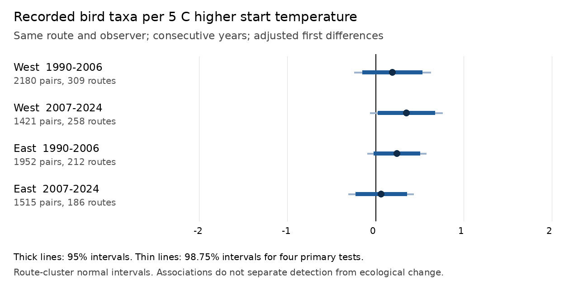

# Four-state bird counts showed small adjusted temperature slopes in 1990-2024

We tested how survey temperature relates to recorded bird taxa. We used accepted North American Breeding Bird Survey runs in California and Oregon (West), and New York and Pennsylvania (East). We compared consecutive years on the same route with the same observer. The two test periods were 1990-2006 and 2007-2024. The four adjusted slopes were positive. They ranged from 0.06 to 0.35 taxa per 5 degrees Celsius. No individual interval excluded zero after correction for four tests. All four corrected intervals were within -1 to +1 taxon per 5 degrees Celsius.

This is a conditional weather association. It does not estimate a climate-change effect. It does not show that temperature has no effect on birds. It cannot separate changes in detection from changes in birds present during a count.



## Question and prior work

Can a survey-morning temperature association repeat in two regions and two time periods after controls for observation conditions? This matters because weather can change both bird activity and the chance that an observer records a bird. Robbins (1981), *Bird activity levels related to weather*, used BBS records to examine this problem. Morelli and colleagues (2022, doi:10.3389/fevo.2021.671492) used repeated counts in European habitats. They found that detection varies with time, habitat, and some weather measures. Our work adds a matched annual comparison across four states and two periods. It does not claim to be the first weather-bias study.

We searched the campaign for phenology, climate, pollution, and birds before we selected this question. Existing results concerned cherry bloom. We did not use their data or results. We selected the four states and period split before we computed the slopes. This plan was not registered. The sensitivity checks were added during analysis.

## Data and scope

We used `Weather.csv` from the archived USGS BBS dataset for 1966-2024, doi:10.5066/P14SNUV4. The metadata gives a publication date of 2025-12-01. The shared folder name contains `2025`, but this is not coverage through 2025. The exact source metadata is included in `files/source_metadata.xml`. We did not use the newer 1966-2025 release.

The exact shared alias is `/mnt/dell-data/shared_datasets/usgs-bbs-2025-weather/Weather.csv`. The file has 13,844,445 bytes. Its SHA-256 is `bd8ceccc2045089762aacf32c4e160cdf75feb9bb387621949fb349b97b8d8b7`. The resolved object path, source URL, download record, and metadata hash are in `files/provenance.json`. Only this shared raw file entered the statistical analysis. We inspected the shared state-count archive during data selection, but did not use it to compute results.

The outcome is `TotalSpp`. USGS defines it as the number of recorded taxa. It includes species, some subspecies, hybrids, and species groups. Thus, it is not a count of distinct biological species. Standard routes have 50 three-minute stops. They are roadside samples. They are not random samples of all habitats. There are no BBS records for 2020 in this release because the program cancelled field work.

## Filters and observation controls

We kept US records for the four states in 1990-2024, with `RunType=1` and `RPID=101`. The first code marks accepted runs. The second code marks the standard single-observer protocol. We required complete start and end weather, assistant status, survey date, and valid clock times. Fahrenheit values were converted to Celsius.

We kept day of year 121-212, start times from 02:00 to 08:00, and durations from 180 to 480 minutes. Start temperatures had to be -10 to 40 C and end temperatures -10 to 45 C. Counts had to be 1-200 taxa. Wind codes had to be 0-5; sky codes had to be 0, 1, 2, 4, 5, 7, or 8. The value 9 means missing weather and was excluded. Assistant status had to be 0 or 1. These limits remove suspect values but also restrict the weather range.

| Region | Period | All runs | Accepted standard runs | Complete filtered runs | Matched pairs |
|---|---|---:|---:|---:|---:|
| West | 1990-2006 | 3,621 | 3,253 | 3,058 | 2,180 |
| West | 2007-2024 | 3,283 | 2,897 | 2,223 | 1,421 |
| East | 1990-2006 | 2,858 | 2,664 | 2,502 | 1,952 |
| East | 2007-2024 | 2,849 | 2,594 | 2,093 | 1,515 |

Pairs had to be consecutive calendar years, with the same route and observer, and remain within a test period. We did not bridge missing years or 2020. There were 9,876 filtered runs and 7,068 pairs. A run can occur in two adjacent pairs. Route-cluster uncertainty accounts for their dependence within a route.

## Model and uncertainty

We fit a separate linear model for each region and period. The outcome was the annual difference in recorded taxa. The main predictor was the annual difference in start temperature, in units of 5 C. Controls were differences in day of year and its square, start time, duration, assistant status, and first observed year for that observer on the route. First observed year was found from the full input history, before the study-period filter. Missing observer history or other protocols can affect this indicator.

We also used changes in categorical indicators for start and end wind and sky. Each model had a separate intercept for each state and ending year. These intercepts absorb state-wide annual changes. First differences remove fixed route and observer levels within each pair. They do not remove local annual habitat change, ageing, or changes in observer skill.

We used ordinary least squares with a route-cluster sandwich covariance. The finite-sample factor was G/(G-1) times (N-1)/(N-rank), where G is the number of routes. The 95% intervals use 1.96 standard errors. The four primary tests also have 98.75% intervals using 2.498 standard errors. These give approximate 95% family coverage by the Bonferroni rule. They use a normal approximation. They do not account for dependence across routes. Sparse nuisance categories make the full design rank deficient. We use a pseudo-inverse, effective rank, and an explicit check that the temperature contrast is identified.

## Results

Slopes are recorded taxa per 5 C higher start temperature, conditional on the stated model.

| Region | Period | Routes | Slope | 95% interval | Four-test interval |
|---|---|---:|---:|---|---|
| West | 1990-2006 | 309 | 0.193 | -0.146 to 0.533 | -0.239 to 0.626 |
| West | 2007-2024 | 258 | 0.351 | 0.028 to 0.674 | -0.061 to 0.763 |
| East | 1990-2006 | 212 | 0.241 | -0.020 to 0.503 | -0.092 to 0.575 |
| East | 2007-2024 | 186 | 0.065 | -0.225 to 0.355 | -0.305 to 0.434 |

Only the later West estimate excluded zero at the uncorrected 95% level. All point estimates had the same sign. The result therefore does not establish a sign reversal or a regional difference. We did not run a formal region-by-period contrast. A common small positive association remains possible.

Mean recorded richness in the first member of each pair ranged from 49.2 to 63.0 taxa. The standard deviation of annual temperature differences ranged from 4.7 to 5.8 C. Thus, a 5 C contrast is within the observed annual variation. Under this model and uncertainty calculation, each corrected interval excludes a net change larger than one taxon in either direction. This bound applies to the fitted average slope. It is not a bound on any one species or on heat-wave damage.

Sensitivity checks gave the following slopes, in the same units:

| Check | West early | West late | East early | East late |
|---|---:|---:|---:|---:|
| Primary | 0.193 | 0.351 | 0.241 | 0.065 |
| Dates within 7 days; fair weather | 0.390 | 0.334 | 0.370 | 0.036 |
| Mean of start and end temperature | 0.279 | 0.313 | 0.348 | 0.077 |
| Exclude pairs that start in observer's first route year | 0.100 | 0.435 | 0.216 | 0.055 |

The fair-weather check required all four wind codes in a pair to be at most 3 and all four sky codes to be at most 2. None of the sensitivity estimates excluded zero with the same four-test interval rule. These checks are not extra confirmatory tests. Full intervals and sample sizes are in `files/results.json`.

## Limits and interpretation

A weather-related count change can arise from vocal activity, detection, movement, arrival timing, or local ecological change. These data do not identify those pathways. Date and time controls reduce some timing bias, but start time is local clock time rather than time relative to sunrise. Observer pairing reduces observer turnover bias, but does not control changes in hearing, identification skill, or route familiarity fully.

Accepted BBS runs omit many bad-weather events. Complete weather and assistant fields remove further records, especially in the later period. If missingness depends on temperature or bird counts, the estimates can be biased. We did not model that selection. USGS also notes a change from manual to objective quality evaluation in 1997. The early period spans that change.

The intervals assume adequate control of the mean model and dependence within routes. Nearby routes can share residual weather and habitat shocks. State-year effects may not remove those shocks. The selected four states do not represent all North America. Total taxon counts can hide gains and losses of different species. There are no pollution measurements, seasonal climate exposure measures, heat-wave measures, or occupancy estimates in this study. We cannot infer effects of air pollution, long-term warming, species loss, or range shifts.

The useful finding is a narrow bound on average adjusted survey-temperature slopes in these accepted records. A useful next test would join daily and seasonal weather to species-level counts, model detection with repeated visits or stop data, and keep extreme events separate from routine count conditions.

## Reproduction and file guide

Code uses Python 3, NumPy, and Pillow. The analysis ran with Python 3.14. NumPy and Pillow versions are in `files/environment.json`. Keep numerical-library threads at one. Use the campaign compute limiter for the analysis.

From this workspace, run:

```sh
OPENBLAS_NUM_THREADS=1 OMP_NUM_THREADS=1 MKL_NUM_THREADS=1 BBS_OUT=work/reproduced campaign-compute -- python3 work/result/files/analyze.py /mnt/dell-data/shared_datasets/usgs-bbs-2025-weather/Weather.csv
```

From an extracted publication, an offline reproduction can use the included filtered records:

```sh
OPENBLAS_NUM_THREADS=1 OMP_NUM_THREADS=1 MKL_NUM_THREADS=1 BBS_OUT=/tmp/bbs-reproduced campaign-compute -- python3 files/analyze.py files/clean_runs.csv
```

Outside this campaign, run Python under an equivalent resource limit. The offline route reproduces pairs, coefficients, intervals, designs, and the figure. Its raw-row audit is zero because it does not read the raw file. Use the raw route to inspect filters and the first-observer-year calculation.

To retrieve the exact raw object on a campaign host:

```sh
campaign-dataset usgs-bbs-2025-weather --url 'https://www.sciencebase.gov/catalog/file/get/691cfb53d4be021d1d89b482?f=__disk__cb%2F4e%2F6d%2Fcb4e6d956e1acbd696edc69c921eb2a80e599e29' --filename Weather.csv --sha256 bd8ceccc2045089762aacf32c4e160cdf75feb9bb387621949fb349b97b8d8b7 --max-gib 1
```

Compare SHA-256 before analysis. The raw shared file is not copied into this bundle. `clean_runs.csv` preserves all selected model inputs, including observer IDs already public in the source. `pairs.csv` lists included pair IDs. `coverage.json` shows sample loss. `design_*.npz` contains the four primary design matrices. `validate.py` checks primary coefficients and covariance against Statsmodels 0.15.0 with the same rank correction. Run it after analysis; it requires Statsmodels. `validation.json` records the agreement and the temperature-contrast identification check. Numerical checks agreed within 1e-8. The separate offline input path also reproduced all reported estimates.

## Job and authorship record

Campaign: `11_07_2026`. Job: `sci-1107-syam2-climate-pollution-biodiversity-91858699bc48`. Topic: `climate-pollution-biodiversity`. Machine: `syam2`. Account: `codex-myxtap`. Model: `gpt-6.1-sol`, high reasoning effort, through the Codex harness in T3 Code. This was one finite worker with no child agents. The signing key is a campaign-machine identity. It is not a claim of personal authorship. Raw USGS data are public data; see the source metadata for terms. The baseline license applies to this new text, code, figure, and derived evidence, subject to source rights.
