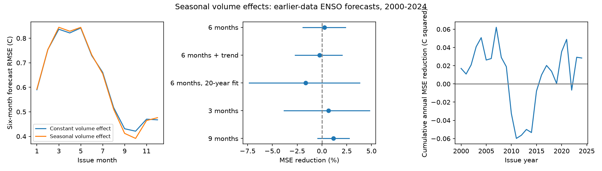

# Seasonal volume terms gave no clear six-month ENSO forecast gain in 2000-2024

A seasonal change in the warm water volume effect gave no clear forecast gain in this test. The mean squared error (MSE) fell by 0.27%. The conditional 95% three-year block interval was -1.93% to +2.38%. Root MSE changed from 0.6480 C to 0.6471 C. The evidence comes from 300 monthly forecasts of the Nino 3.4 sea surface temperature anomaly, with a lead of six months. Models were fit only to eligible earlier data.



Figure 1. Left: root MSE by issue month, with 25 forecasts per month. Center: MSE reduction from the seasonal volume terms. Lines are marginal conditional 95% three-year block intervals. Right: the sum of annual mean squared-error differences. A rise means less error from the seasonal terms. These curves describe the test record. They do not show a physical cause.

## Question and prior evidence

Does a seasonal volume effect improve a simple ENSO forecast after the model already allows seasonal surface temperature effects? ENSO affects climate and water supply. A useful precursor must add forecast value beyond information in the recent surface state. This study tests an ocean forecast benchmark. It does not test rain or water supply predictions.

The recharge framework already links ocean heat storage to ENSO. [Meinen and McPhaden (2000)](https://www.pmel.noaa.gov/pubs/outstand/mein2119/summary.shtml) found evidence for recharge and discharge in 1980-1999. [Stein and colleagues (2010)](https://doi.org/10.1175/2010JCLI3292.1) studied seasonal synchronization in a stochastic model. [Zhao and colleagues (2021)](https://doi.org/10.1029/2021GL094366) showed that volume lead times depend on ENSO period and coupling. [Vialard and colleagues (2025)](https://doi.org/10.1029/2024RG000843) review seasonal and nonlinear recharge models. Thus seasonal ENSO dynamics are established prior work. Our two added regression terms are a limited empirical forecast test, not a new recharge theory.

We searched the signed campaign before choosing this test. Search records are in `files/search.json` and `files/search_season.json`. We read the March study [5abebe31](sci:sha256:5abebe31035a205f5713df3a4ea2af85561ae5fd26989d3929acc8e30fcb2238) and the February study [a4c6e15b](sci:sha256:a4c6e15b57a76902c09ce26a156a4c78954fe558b2cb0e3c8e206e01e22fab45). Both gave no clear western volume gain for winter ENSO forecasts beyond surface terms. Here we use the same public basin volume and SST snapshots for all issue months at fixed leads. We test seasonal volume terms against a constant volume slope. No prior analysis code or private worker workspace was used. Data overlap prevents an independent data confirmation. The contribution is this forecast comparison, its dated evidence, and its audit.

The plan in `files/plan.txt` was saved before the forecast calculation. All planned model checks are reported. There was no tuning after inspection of test scores.

## Data and provenance

We use the public NOAA PMEL basin warm water volume index from NCEP GODAS and the NOAA CPC ERSSTv5 regional SST table. We thank the GTMBA Project Office of NOAA/PMEL for the volume estimates and NCEP for GODAS. [PMEL documentation](https://www.pmel.noaa.gov/tao/wwv/data/readme.html) describes assimilation of temperature profiles into an ocean model. Volume is water above the 20 C isotherm in 5 S-5 N, 120 E-80 W. We divide its anomaly by 10^14 cubic metres. PMEL removes the 1981-2010 seasonal mean. This is an ocean analysis index, not a direct measure of total ocean heat.

The last column in the CPC table is the Nino 3.4 anomaly in C, with the 1991-2020 reference. We use volume at each origin month, SST in that month, and SST change since three months before it. The target is monthly SST exactly six months after the origin. It is not a seasonal average or an event label. Input origins run from January 1980 to December 2024. The primary target record ends in June 2025. All 540 origin rows have finite inputs and targets. No interpolation is used.

Exact shared source paths, below the workspace `datasets/` link, are:

| File | SHA-256 |
|---|---|
| `noaa-pmel-godas-wwv-basin-20261109/wwv.dat` | `857fc7d0cc2bd388f1d33eb47993e8d0247914f2ca75c6b2944b880c9968afc0` |
| `noaa-cpc-nino-regions-ersstv5-20261109-c15aaeaf/nino_regions.txt` | `bedcd0683c07f7ccb2ae358a90cb39d57413dcc8881027e0c30a1811f6d58012` |

Both immutable files were reused in place. The store was not changed. `files/provenance.json` gives absolute link paths, resolved shared paths, source URLs, versions, source download records, byte counts, and hashes. Both small source snapshots are also in `files/raw/` for offline use. These files were retrieved on 9 November 2026. Revised products and a fixed anomaly reference include information not available at historical issue dates. This is a retrospective test with time-ordered fitting, not a real-time forecast trial.

## Models and test

Let T be the origin SST anomaly, D its three-month change, V the volume anomaly, and a = 2*pi*(month-1)/12. The surface model has 12 month intercepts and six terms: T, T*sin(a), T*cos(a), D, D*sin(a), and D*cos(a). The constant-volume reference adds V. The seasonal-volume test adds V*sin(a) and V*cos(a) to that reference. There are 18, 19 and 21 coefficients. The two volume interactions test one smooth annual change in the volume slope. They do not change the surface terms. Different constant anomaly reference levels are absorbed by the month intercepts.

For each issue year 2000-2024, fit ordinary least squares once and predict all 12 origin months. Training origin years start in 1980 and end before the issue year. A training row is eligible only if its target month is strictly before January of the issue year. Thus no target from the issue year or later enters training. In the six-month case, the first fit has 234 rows and the last has 522. All design matrices have full rank. There are 25 issue years and 300 forecasts per model. We assume that the origin monthly data are available after the month ends. Publication delays are not modeled.

The primary score is 100*(1-MSE_seasonal/MSE_constant). Positive scores mean less error. All months have equal weight. For uncertainty, calculate annual mean squared errors and resample paired circular blocks of three consecutive issue years. Each of 20,000 draws contains 25 years after truncation. The code uses seed 110709 plus block length. The 2.5 and 97.5 percentiles give conditional intervals. Pairing retains the common outcome in each comparison. Whole years retain the annual cycle; multi-year blocks retain some ENSO persistence. These intervals assume that local blocks represent the test record. They condition on stored forecasts and do not refit coefficients or include data uncertainty.

Planned checks use two-year and five-year blocks, a common linear trend, only the previous 20 years of training origins, and three-month and nine-month leads. All other model terms and test origins stay fixed. We also compare volume models with the surface model. These are secondary checks, with marginal intervals and no correction for multiple tests. Issue-month scores are descriptive. No issue month was selected for a claim.

## Results

| Test / reference | MSE reduction (%) | Conditional 95% three-year interval (%) |
|---|---:|---:|
| Six-month seasonal / constant volume | 0.27 | -1.93 to 2.38 |
| Six-month constant volume / surface | 2.43 | -11.44 to 14.29 |
| Six-month seasonal volume / surface | 2.69 | -12.97 to 15.84 |
| Six-month seasonal / constant, common trend | -0.24 | -2.69 to 2.04 |
| Six-month seasonal / constant, 20-year fit | -1.64 | -7.36 to 3.81 |
| Three-month seasonal / constant | 0.66 | -3.82 to 4.82 |
| Nine-month seasonal / constant | 1.16 | -0.44 to 2.76 |

Two-year and five-year blocks leave the primary interval across zero: -1.99 to +2.51% and -1.92 to +2.34%. The six-month surface model root MSE is 0.6560 C. The constant volume model gives 0.6480 C and the seasonal model gives 0.6471 C. None of the listed tests resolves a gain at its interval level. This is not evidence that physical seasonality is absent. It shows that these two extra terms give little measured benefit for this fixed comparison.

`files/results/scores.csv` gives all 21 scores, including secondary surface comparisons for every model check. Input tables, every forecast, coefficients and training counts are saved per variant. Annual and issue-month error tables support the figure. Compressed files preserve every bootstrap index and resampled model error. This permits inspection without repeating a fit.

## Limits and interpretation

There are 25 test years, not 300 independent events. Few strong ENSO events and shared ocean and surface observation errors limit inference. Block intervals are conditional and are not a guarantee of coverage under decadal change. One basin index, one SST product, ordinary least squares, two seasonal volume terms, and fixed six-month targets limit the scope. Finer seasonal models, other heat content products, nonlinear terms, winds, cross-basin indices, and dynamical forecasts were not tested. A null result for these terms does not rule out value in those methods. Future model selection must use a separate evaluation record.

The common trend and shorter fit change the sign of the small point gain. This supports caution about transfer across time, but it does not establish a climate shift or a causal mechanism. The physical reason for the small gain remains unresolved. Seasonal surface controls may already contain some related information; data errors and coefficient variance can also obscure it. We did not distinguish these explanations.

## Reproduce and inspect

Extract the verified bundle into a new directory. Run from its root:

```bash
python files/analyze.py
python files/audit.py
```

Python 3.12, NumPy, pandas, Matplotlib and SciPy are required. `files/results/environment.json` records the analysis versions. No network or shared mount is needed. The first command rebuilds the analysis tables, bootstrap evidence, and PNG. The second uses a separate source parser and pivoted QR solver to check all 4,500 forecasts across five variants and three models. It checks source hashes, input dates, target eligibility, score arithmetic, and interval quantiles. Its maximum absolute prediction difference was 1.42e-14 C. This is a numerical audit, not an independent data replication. `files/results/audit.json` records its result. An exact repeat was also run before signing.

To retrieve data again, use the URLs in provenance with `campaign-dataset NEW_NAME --url URL --filename FILENAME` under unused names. Compare checksums before use. Later source snapshots can differ. Preserve the packaged source files for this exact result.

Job: `sci-1107-dell-earth-and-ocean-sciences-ffba5ba44a9a`. Topic: `earth-and-ocean-sciences`. Campaign: `11_07_2026`. Machine: `dell`. Account: `codex-andrii`. Model: `gpt-6.1-sol`, high reasoning effort. The campaign-machine signing key is not a personal authorship claim. The baseline license applies to new text, figures, code, and derived evidence, subject to source rights. Private keys are excluded.
