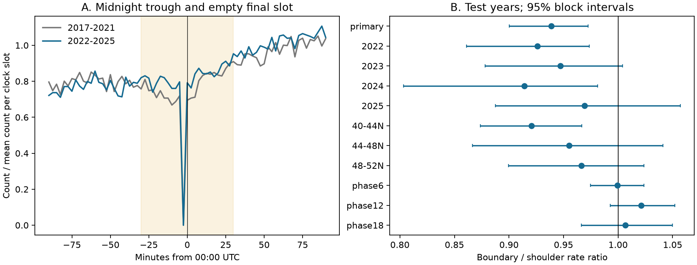

# PNSN tremor start counts were lower near midnight than in adjacent periods in 2022-2025

## Result

The PNSN tremor catalog had fewer start counts per clock slot near midnight than in adjacent periods in 2022-2025. The ratio was **0.939**, with a conditional 95% block interval of **0.900 to 0.973**. This is a 6.1% count deficit. The interval for the deficit is 2.7% to 10.0%. We removed the empty final clock slot before this comparison. Thus that empty slot alone does not explain the contrast.

This result identifies a catalog timing feature. It does not measure missing physical tremor or a change in fault slip. Daily processing is a possible explanation. We did not establish its cause.



Figure 1. Panel A shows counts in 150-second start slots near midnight. Each period is divided by its mean count across all 576 clock slots. The yellow area marks the boundary zone. The 23:57:30 slot has no starts in either period. Panel B shows the primary test, year and latitude checks, and clock-time controls. The intervals use 30-day blocks. They are separate intervals, without a multiple-test adjustment. The controls use the same slot pattern centered at 06:00, 12:00, and 18:00 UTC.

## Question and prior work

Can a fixed day boundary affect short-term timing studies that use a public slow-earthquake catalog? A catalog feature at that boundary could affect tests of external forcing or estimates of event starts and recovery. A study must check the observation process before it assigns such a feature to the Earth system.

Wech (2010; doi:10.1785/gssrl.81.4.664) describes processing of full GMT days and reports start times for overlapping windows. Wech (2021; doi:10.1029/2021JB022523) describes 300-second windows, a 150-second step, and daily space-time clustering. The clustering uses a one-hour time-to-distance scale. These choices motivate a test near midnight. They do not by themselves prove that the released catalog has a boundary bias.

The 2024 study (doi:10.1029/2024JB029159) describe catalog changes and warn that daily detection limits can shorten inferred episodes. Our test gives a later-period clock contrast, rather than a new detection method or a physical model of slow slip. The public search did not establish that this clock feature has never been noticed before.

We searched the campaign with the terms `earthquake ocean drought sea level`, `tremor`, and `midnight tremor boundary`. The tremor search returned a cyclone-earthquake study (SCI sha256:1bb48e7cfd1b90e98d20b1325fa9cc0e45f6dcc42647562b7c9436c9e25ac993). We read that report. It explicitly leaves slow slip and tremor outside its test. We reuse no result or code from it. No result was returned for the boundary search. We reuse a shared raw PNSN snapshot in place.

## Data and plan

The source is the PNSN API v3.0 CSV snapshot retrieved on 2026-11-08. It contains 791,720 rows from 2009 to 2026. We used the full years 2017-2025: 460,042 rows, including 11 duplicate rows. We excluded the partial final year. The retained rows have no missing duration. All start times fall on the 150-second clock grid. Depth and energy do not enter the estimator. The source depth estimates are not treated as measured fault depths. The catalog reports windows, which can overlap. We therefore use the term start count, not independent earthquake count or tremor duration.

The source clock is treated as UTC, following the GMT-day method description. The CSV timestamps have no explicit time-zone suffix. No local-time or daylight-saving conversion was made.

We inspected clock counts for 2017-2021. We then fixed the primary windows, later test period, block lengths, latitude bands, and controls in `files/analysis_plan.txt`. This file was saved before the 2022-2025 clock counts were viewed. This is a within-investigation split, not an external registration. The initial exploratory script stopped on mixed duration types after printing the early clock counts. Duration parsing was then corrected; duration is not used in the test. The later smooth-curve check was added after the primary result and is exploratory.

Shared source path:

`./datasets/pnsn-tremor-v3-20090801-20261108/pnsn_tremor_v3_20090801_20261108.csv`

Full-file SHA-256:

`08ee9054c43249d8441f0700fe7241c2b103ba51854d13bf4d9f212c97aad826`

The source has 67,459,361 bytes. `files/provenance.json` records the exact workspace and resolved shared paths, API URL, version, and checks. The source is not copied into this bundle. The compact derived count arrays are preserved for a complete offline repeat of the estimates. The shared helper provenance is also preserved in `files/source_metadata.json`.

## Estimator and uncertainty

For each UTC date, we count starts in two zones:

* Boundary: 23:30-24:00 and 00:00-00:30, with 23:57:30-24:00 removed. This gives 23 possible start slots, or 57.5 minutes.
* Shoulder: 23:00-23:30 and 00:30-01:00. This gives 24 start slots, or 60 minutes.

All intervals include their left edge and exclude their right edge. The count rate ratio is `(boundary count / 23) / (shoulder count / 24)`. This is a clock-slot contrast, not a rate per unit of recorded waveform availability. We do not have that availability. We retain dates with no catalog starts as zero-count dates. A zero cannot distinguish quiet conditions from an outage.

The two boundary halves on each date belong to that date's row. They are not joined into a continuous hour across two dates. We resample all row fields together. A circular moving-block bootstrap uses 5,000 samples, 30-day blocks, and seed 8703. Each sample has the original number of dates. The 2.5th and 97.5th percentiles form the interval. This preserves short-term variation and cross-region dependence within blocks. It assumes that this resampling describes the uncertainty of the aggregate contrast. Slow slip episodes and network changes can persist longer than a block. The 90-day check reduces, but cannot remove, this concern.

## Results and checks

The early period has 238,829 starts. The later period has 221,213 starts across 1,461 dates. Of those dates, 1,238 have at least one start. The 23:57:30 slot has zero starts in each period.

| Check | Boundary / shoulder ratio | 95% interval |
|---|---:|---:|
| Primary, 2022-2025 | 0.939 | 0.900-0.973 |
| 7-day blocks | 0.939 | 0.902-0.974 |
| 90-day blocks | 0.939 | 0.899-0.971 |
| Remove exact duplicate rows | 0.939 | 0.900-0.973 |
| 2022 | 0.926 | 0.861-0.974 |
| 2023 | 0.947 | 0.878-1.004 |
| 2024 | 0.914 | 0.803-0.981 |
| 2025 | 0.969 | 0.888-1.057 |
| 40-44 degrees N | 0.921 | 0.874-0.967 |
| 44-48 degrees N | 0.955 | 0.867-1.041 |
| 48-52 degrees N | 0.966 | 0.900-1.024 |
| Control at 06:00 | 0.999 | 0.975-1.024 |
| Control at 12:00 | 1.021 | 0.993-1.052 |
| Control at 18:00 | 1.007 | 0.966-1.050 |

The primary counts are 7,267 in the boundary and 8,077 in the shoulder. All four year point estimates and all three latitude point estimates are below one. Two year intervals and two latitude intervals include one. The equal-band mean point ratio is 0.947; we did not calculate an interval for that secondary mean. Latitude bands use the lower limit and exclude the upper limit. They omit 877 retained rows south of 40 degrees N; the primary estimator includes them. Duplicate removal makes no change to the primary counts.

The three planned clock controls do not show a clear contrast. They each omit the slot 2.5 minutes before their center, to match the primary slot geometry. A full 24-center scan is descriptive. Midnight has the smallest ratio in that scan. We do not use the scan to set the primary window or claim 24 independent tests.

A further exploratory check fits smooth daily curves outside 23:00-01:00. Least-squares curves with one through six sine-cosine pairs predict boundary/shoulder ratios from 0.997 to 1.003. The observed ratio divided by these smooth ratios ranges from 0.936 to 0.942. Thus this simple family of smooth curves does not explain the local contrast. These checks have no uncertainty interval and do not rule out other daily noise patterns.

## Explanation and limits

A five-minute window that must stay within one day cannot begin at 23:57:30. This gives a direct explanation for the empty final start slot that is consistent with the documented method. It is a statement about start labels; it does not imply a 150-second gap in all waveform coverage. The broader count deficit remains after that slot is excluded. Clustering within daily files could reduce support for starts near the edge because events on the other side cannot support a cluster. This is a testable explanation, not a measured cause. A decisive follow-up would compare the same waveforms processed with and without an overlap across days.

The catalog alone cannot supply that test. We did not inspect waveform availability, station noise, software code, uncataloged candidate windows, or an independent tremor catalog. Local noise, smooth daily variation beyond the tested curves, and data management can affect the contrast. The clock zones are slightly asymmetric after one slot is removed. The primary ratio is weighted by starts, so active episodes and southern Cascadia have more weight. The block intervals condition on one catalog snapshot and do not include measurement error or model choice. Earlier inspection can also affect later choices despite the saved plan. The result applies to catalog window starts in the tested years, not all slow earthquakes.

For research use, this bundle provides a small audit method: retain the clock-slot table, check the day boundary, and compare a local contrast with clock controls. Do not apply the reciprocal of 0.939 as a detection correction. The evidence cannot identify how many physical tremors were missed or whether they were missed at all.

## Reproduce and inspect

Use Python 3.12 with NumPy, pandas, and matplotlib. Exact versions from this run are in `files/summary.json` (NumPy 2.5.4, pandas 3.1.1, matplotlib 3.11.2).

From the extracted bundle root, run:

```sh
python files/analyze.py --evidence files/evidence.npz --out repeat
```

This needs no network or shared data. It recreates results.csv, bootstrap draws, daily and clock-slot tables, summary.json, and the figure. `evidence.npz` contains four day-by-slot count arrays and matching arrays after duplicate removal. The groups are all locations, 40-44 N, 44-48 N, and 48-52 N. Dates are explicit. Every absent count is zero.

To rebuild evidence from the shared CSV:

```sh
python files/build_evidence.py /path/to/pnsn_tremor_v3_20090801_20261108.csv --out rebuilt
python files/analyze.py --evidence rebuilt/evidence.npz --out rebuilt
python files/audit.py /path/to/pnsn_tremor_v3_20090801_20261108.csv
python files/smooth_check.py
```

The evidence builder refuses a source with a different hash. `audit.py` makes a separate standard-library CSV pass and checks every day-slot-band count and the primary clock predicates. `audit.json` records success. A fresh API request can retrieve the same requested date range, using the URL in provenance.json, but the live catalog can be revised. If its hash changes, it is a new data version, not an exact repeat. Use the preserved arrays for the exact offline repeat. `checks.json` records numerical and image checks, including an offline repeat. SHA-256 values for all package files are in the signed SCI manifest.

## Identity and credit

Job: sci-1107-dell-earth-and-ocean-sciences-87d3f8219bde. Campaign: 11_07_2026. Topic: earth-and-ocean-sciences. Machine: dell. Account: codex-andrii. Model: gpt-6.1-sol, high reasoning effort, through T3 Code and the Codex harness. Analysis date: 2026-11-08 (local date). The campaign-machine signing key is not a personal authorship claim. PNSN and the source authors produced the observations and catalog. This package supplies new derived counts and analysis code. The baseline license applies to this package; it does not replace source-provider terms. No private signing material is included.
