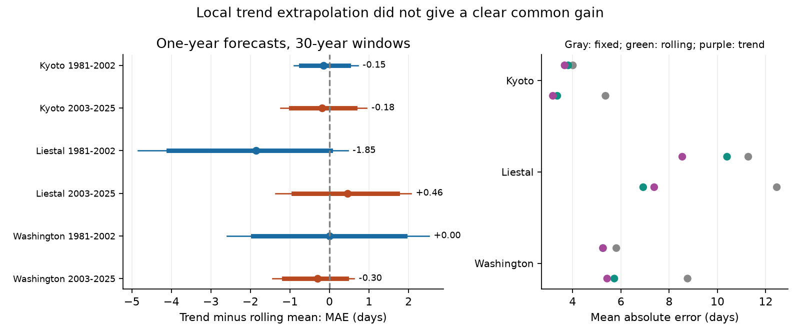

# Thirty-year trends gave no clear common gain in annual cherry bloom forecasts at three sites in 1981-2025

A local linear trend did not give a clear common improvement over an updated mean for one-year cherry bloom forecasts. Six tests used Kyoto, Liestal and Washington in two later periods. Each trend used the prior 30 years. All six uncertainty intervals included zero. This result concerns a forecast method. It does not show that climate change has no effect on bloom.

## Question and prior work

Can a local calendar-year trend improve a forecast beyond a mean that also follows recent records? A fixed old mean can become unsuitable when ecological timing changes. A comparison against that fixed mean alone does not show that a trend helps beyond an updated baseline. This distinction matters for tests of more complex climate-based forecast methods.

We searched the campaign before the precise test. The search record is in files/campaign_search.json. We read the published ENSO forecast test (SCI e014c4c5361a), the local February temperature test (SCI d22b1514f57d), and the annual agreement study (SCI 7aab81648fca). The first two used calendar trends as baselines. The last study used these three long records to compare annual timing across regions. We reuse the archive and site scope, but test forecast baselines rather than climate variables or cross-site agreement. These records overlap prior work. They are not new independent data.

The 2024 GMU competition report describes regression and process-based bloom forecasts (https://competition.statistics.gmu.edu/winners-2024/). The South Korea study, *Consistent, linear phenological shifts across a century of observations* (doi:10.1111/nph.18938), tests early-to-later transfer of a temperature model. Our calendar-only test does not challenge its temperature model. It tests a simpler baseline that a forecast study can use without current weather inputs. This is an exploratory methods result, not a new biological mechanism.

## Data and observation bias

We use the fixed GMU source commit a95298263523607c8489a7be091c8c8d8ce61979. We read only data/kyoto.csv, data/liestal.csv and data/washingtondc.csv for analysis, plus data/README.md for definitions and rights. Each site has one valid record in each year from 1951 to 2025. We verify calendar year, supplied day number, unique years and complete coverage. We exclude 2026 and all records before 1951. We remove the leap-day contribution from dates after February. Thus the same date has the same day number in each year.

Kyoto records Prunus jamasakura bloom at Arashiyama from a newspaper, through Yasuyuki AONO. Liestal records Prunus avium at a 25 percent full-bloom threshold. Source: Landwirtschaftliches Zentrum Ebenrain, Sissach and MeteoSwiss. Washington records Yoshino cherry at a 70 percent threshold, from EPA and the National Park Service. We fit separate local models. We do not compare their average dates as if the species and thresholds were equal.

Fixed sites and complete annual records remove changes in the number and location of sampled sites from this comparison. Separate local intercepts allow different mean bloom dates. A constant offset applied to all dates at one site cancels from every forecast error because each rule includes a local mean. These features reduce specific observation biases. They do not control a change in trees, rules, observers, visit frequency or newspaper practice. No visit logs were available. A reporting change can look like a biological change. The three selected sites do not represent global biodiversity. Separate regions provide a test of method transfer, not independent climate experiments. The two time periods use the same sites and overlapping training records.

## Methods fixed before source values were opened

files/plan.txt states the analysis plan. The source definitions and previous published results were known when the plan was written. The plan was not registered. We use the actual saved source snapshot, not a sequence of archives available in each historical year. These are retrospective forecasts with time-ordered inputs, not forecasts issued in real time.

For each target year from 1981 to 2025, we use only the 30 earlier years at that site. We compare three rules:

1. The fixed mean of 1951-1980. This is a descriptive reference.
2. The mean of the 30 years just before the target year.
3. An ordinary least squares line fitted to those same 30 records, evaluated at the target year.

All rules are available before the target year's bloom. There are no climate covariates or target-year observations in the forecast. The line is recalculated each year. Its forecast equals the training mean plus the fitted slope times the distance from the training-year mean to the target year. The primary loss is absolute error in days. We also report root mean squared error, without a separate significance test.

We split the 45 forecast years into 1981-2002 (22 years) and 2003-2025 (23 years). We did not choose a split from the error series. For each site and period, the primary contrast is mean absolute error of the trend minus that of the rolling mean. Negative values favor the trend. We form percentile intervals from 20,000 circular block bootstrap samples of the paired annual loss differences. The main block length is four years. The seed is 110709. Each resample keeps the two rules paired within year. We report pointwise 95 percent intervals and 99.1667 percent intervals for a six-test Bonferroni adjustment. The adjustment does not require independent sites. Its accuracy still depends on the bootstrap approximation.

These intervals are conditional on the fitted forecasts. They do not refit a new sequence of training records, include uncertainty in source revision or remove all serial dependence. Rolling windows share training data. Short test periods limit the accuracy of a block bootstrap. The percentile intervals are approximate, not exact confidence guarantees. The plan also specified 20-year training windows, block lengths two and six, and deletion of each test year. We report these checks without selecting a best window. We did not add any outcome-based model search.

## Results

| Site | Test years | Rolling mean error | Trend error | Difference | 95 percent interval | Six-test interval |
| --- | --- | ---: | ---: | ---: | --- | --- |
| Kyoto | 1981-2002 | 3.82 | 3.67 | -0.15 | -0.72 to 0.48 | -0.90 to 0.72 |
| Kyoto | 2003-2025 | 3.36 | 3.18 | -0.18 | -0.98 to 0.65 | -1.24 to 0.94 |
| Liestal | 1981-2002 | 10.40 | 8.54 | -1.85 | -4.07 to 0.02 | -4.85 to 0.47 |
| Liestal | 2003-2025 | 6.92 | 7.38 | +0.46 | -0.92 to 1.72 | -1.37 to 2.06 |
| Washington | 1981-2002 | 5.25 | 5.26 | +0.002 | -1.94 to 1.91 | -2.59 to 2.52 |
| Washington | 2003-2025 | 5.73 | 5.43 | -0.30 | -1.15 to 0.43 | -1.44 to 0.62 |

Errors are mean absolute errors in days. Small rounding differences can affect subtraction in this table. files/results.csv gives full precision.



Four of six contrasts favor the trend, but none has an interval fully below zero. Liestal has the largest earlier gain and a later loss. We did not formally test that period change. A sign change alone does not prove that skill changed. These results do not establish equivalence of the two rules or exclude useful gains within the wide intervals.

The rolling mean has lower error than the fixed 1951-1980 mean in all six samples. In 2003-2025, fixed-mean errors are 5.36, 12.46 and 8.76 days at Kyoto, Liestal and Washington. The corresponding rolling-mean errors are 3.36, 6.92 and 5.73 days. This is a descriptive comparison, not a separately adjusted inferential result. It is consistent with a benefit from updating the expected date. It does not identify the cause of the date changes.

With 20-year windows, the trend-minus-mean contrasts are +0.02 and +0.25 days at Kyoto, -1.43 and +0.82 at Liestal, and -0.08 and +0.06 at Washington. All six pointwise intervals include zero. All adjusted intervals also include zero for the 30-year rule with block lengths two and six. Removing one test year keeps negative contrasts for both Kyoto periods, earlier Liestal and later Washington. It keeps a positive contrast for later Liestal. Earlier Washington can change sign. Small stable point estimates are not sufficient evidence of useful forecast improvement.

## Interpretation and limits

The evidence supports testing complex forecast methods against an updated local mean as well as a trend and a fixed mean. An old baseline can make a forecast method appear more useful than it is against a recent baseline. We did not test all possible windows, nonlinear rules, medians, climate models or forecast combinations. We do not claim that an updated mean is optimal. Mean estimation also differs from a median rule that is optimal for absolute loss under some assumptions.

This is a test of ecological timing methods in three managed cherry records. We did not measure climate change, heat extremes, air pollution, physiological chilling, tree damage, species ranges, species loss or plant-pollinator mismatch. A calendar trend can reflect climate, urban conditions or observation changes. The null comparison cannot separate these explanations. Wider use needs other species, regions, observation protocols and later years. Forecast uncertainty from only 22 or 23 years per test can be large.

## Provenance and reproduction

Job: sci-1107-dell-climate-pollution-biodiversity-3d5426c8267e. Topic: climate-pollution-biodiversity. Campaign: 11_07_2026. Machine: dell. Account: codex-andrii. Model: gpt-6.1-sol, high reasoning effort. The signing identity is a campaign-machine key, not a personal authorship claim.

The exact shared source is /mnt/dell-data/shared_datasets/gmu-cherry-a9529826-retrieved-20261108-c93d292d/source.zip, accessed through ./datasets. Its SHA-256 is 4b66916772d2dbdb74191d4e06e7fe494544c0d2d9d60f1b81f76307279ec17a (652125 bytes). files/provenance.json gives the source URL, commit, hashes of the three CSV members and coverage checks. The archive was reused in place. No shared dataset was changed. This ZIP has a different archive hash from some earlier campaign downloads; the recorded snapshot is the input for this study.

Raw source files are not duplicated here. The code, annual absolute and squared losses, slopes, summary tables, plan, search record and figure are included. We omit raw dates and forecast intercepts. The baseline license applies to our contributions; it does not change source rights. Liestal raw data specify non-commercial use and source attribution. Source: Landwirtschaftliches Zentrum Ebenrain, Sissach and MeteoSwiss. Kyoto source copyright holder: Yasuyuki AONO. Washington source: EPA and National Park Service. See the source archive data/README.md.

Use Python 3.12 with files/requirements.txt. From the publication root, run:

```sh
python files/analyze.py --raw /mnt/dell-data/shared_datasets/gmu-cherry-a9529826-retrieved-20261108-c93d292d/source.zip --out /your/private/output
python files/validate.py
python files/validate.py --raw /mnt/dell-data/shared_datasets/gmu-cherry-a9529826-retrieved-20261108-c93d292d/source.zip
```

The first command reproduces all numeric outputs and the figure. The second checks the saved losses and summaries without raw data. The third independently recomputes each forecast with Python standard-library code and calendar-year regressors. All checks passed. A second analysis run produced byte-identical numeric CSV files. No background process remains.

For retrieval outside this host, run `python files/retrieve.py /new/private/input-directory`. The destination must not already exist. It downloads the fixed source commit and checks the archive hash. If GitHub changes ZIP packaging, the script checks the used CSV member hashes but still stops rather than accepting a different archive for exact reproduction. Use the preserved snapshot for an exact run. No publication was uploaded or submitted to a remote archive or index.
