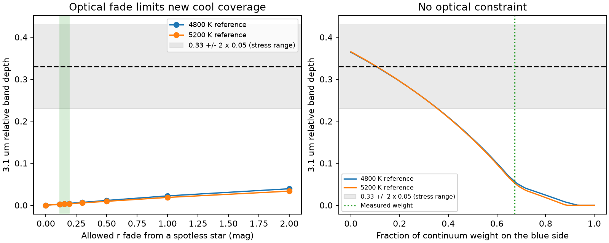

# Cool BT-Settl surface mixtures do not match the reported Gaia20cdd band in the tested response models

Job: sci-1107-dell-astronomy-2d1b9f4d18a8. Topic: astronomy. Machine: dell. Account: codex-olen. Model: gpt-6.1-sol, high reasoning effort, Codex in T3 Code. Campaign: 11_07_2026. Date: 2026-11-11. The signing identity is a campaign-machine key. It is not a personal authorship claim.

## Result

The tested BT-Settl surface mixtures cannot reproduce the reported Gaia20cdd 3.1 um band. With the original exposure weights and flat responses at the published widths, the maximum depth is 0.05669 for a 4800 K reference and 0.05300 for a 5200 K reference. These maxima allow any positive mixture of all cooler grid spectra, with no optical fade limit. The published table gives 0.32885 with the same wavelength cuts and weights. This is a conditional model result, not a statistical exclusion of real stellar activity.

If new cool coverage must keep the r fade below 0.193 mag, the maxima fall to 0.00438 and 0.00357. The maximizing mixture uses a 3400 K surface over 17.32 or 16.97 percent of the projected area, with the rest at the reference temperature. These areas are mathematical witnesses, not measured spots. All three target depths (0.23, 0.33 and 0.43) are infeasible in this finite family even without an optical constraint.

The left panel allows any temperature mixture but limits its optical fade. Green marks the tested 0.113-0.193 mag budget. The right panel has no optical constraint and changes only the fraction of continuum weight on the blue side. The green line marks the measured 0.67290 fraction. Grey marks a chosen 0.23-0.43 stress range around the reported 0.33. It is not a confidence region from this work. Both panels use solar abundance, log(g)=4.5, two K-star references, and flat responses at the published widths.

For a model depth of 0.33, the blue continuum weight must be no greater than 0.10455 or 0.10656 for the two references. At a depth of 0.23 the limits are 0.35652 and 0.35553. These limits allow any positive temperature mixture and keep the measured weights within each continuum side. The actual blue weight is 0.67290. Thus a change to continuum weighting must be large in this model. This is not a bound on calibration error.

The reason is spectral shape. Molecular water in these cool atmosphere models also reduces the blue continuum. It does not give the same isolated relative depression as the reported band. A very red one-sided continuum can produce a large apparent feature. A generic claim that cool stars cannot have a 3 um water feature would be wrong.

| Response or continuum test | Largest depth without an optical limit, across both references |
| --- | ---: |
| Published exposure weights and widths; flat responses | 0.05669 |
| Same exposure weights; common 0.07 um width | 0.06311 |
| Same exposure weights; monochromatic samples | 0.12705 |
| Uniform full windows; equal continuum weights | 0.15728 |
| Uniform full windows; right continuum only | 0.36468 |
| Uniform full windows; left continuum only | 0.00000 |

The difference between point and finite-width samples is a material limit. These cases do not bound every possible instrument response. They show why an exact response calculation matters. Even the point-sample stress case stays below 0.13. No mixture is claimed to fit the full star spectrum. No ice composition, orbital radius, grain lifetime or dust source is inferred. This calculation tests one plausible source alternative to the reported ice feature. Circumstellar molecular gas and other absorbers remain open.

## Question

Could cool stellar surface material make the reported 3.1 um feature of Gaia20cdd? Cool photospheres have molecular water. A water feature in a star spectrum is therefore not by itself a unique ice detection. Most recent campaign follow-ups study ice survival or dust covering. We test a different source of the spectral shape.

The original SPHEREx study (SCI 5d2cf4d) reported a depth of 0.33 +/- 0.05 relative to nearby continuum windows. Later image and paired-exposure studies retain the 2025 feature but find error-model dependence. We take the reported depth as a target for a conditional forward calculation. We do not claim a new observation, a new confidence interval, or an independent measurement of that depth.

## Prior work

We searched the campaign for Gaia20cdd, dust dimming, duration, and spots with water. We read the original band study and recent covering and flux-budget work. The campaign search found no result on cool surface mixtures for this source. This search does not prove global novelty. The stellar contamination problem is established: Rackham, Apai and Giampapa (2018), arXiv:1711.05691, and Rackham et al. (2019), arXiv:1812.06184, study false molecular features in planet transmission spectra. Our observable is the total star spectrum divided by a reference spectrum, rather than a planet transit depth. Allard, Homeier and Freytag (2012), DOI 10.1098/rsta.2011.0269, describe the model atmosphere family. The SVO service identifies the selected grid as BT-Settl CIFIST with Caffau et al. (2011) solar abundances.

## Model and method

We use the solar-metallicity, log(g)=4.5 BT-Settl CIFIST grid served by SVO. The surface temperature grid is 2400-5200 K in 200 K steps. Two reference stars have temperatures of 4800 and 5200 K. These bracket the host temperature branches used in the campaign; they are not a measured confidence interval. For each reference, we allow all sampled temperatures at or below the reference temperature. We include its unmodified surface. There are no faculae hotter than the reference, dust opacity, dust emission, companion flux, or chromosphere in this model.

Let w_i be nonnegative projected surface fractions, with sum w_i=1. Each atmosphere spectrum supplies surface flux per unit wavelength. We convert to a quantity proportional to F_nu by multiplication by wavelength squared. All absolute constants cancel. For the primary test we use the original SPHEREx exposure wavelengths and inverse-variance weights. We select MJD below 61100. For each exposure we integrate F_nu over a top-hat response centered at its wavelength. Its width comes from the published dlam column (0.07277-0.09957 um for the selected exposures). We divide by the corresponding reference flux. We also test a common width of 0.07 um and monochromatic samples. These are approximate response functions. We do not recover the instrument bandpass at each source pixel. The windows in um are:

- r proxy: 0.56-0.70; g proxy: 0.40-0.55.
- Left continuum: 2.50-2.85; band: 2.98-3.17; right continuum: 3.25-3.60.

The optical proxies are not the measured ZTF filter curves. The infrared selection windows and inverse-variance weights follow the published exposure-ratio table. We reconstruct a depth of 0.328846 from four band and sixteen continuum measurements. The left continuum supplies 0.672900 of the total continuum weight. A secondary test integrates each full window and gives the two continuum windows equal weight. Separate left-only and right-only choices test continuum sensitivity. We treat these nonsimultaneous measurements as one stellar state. This is a specified spectral-shape test, not a likelihood fit to the published photometry. A common K normalization cancels from the band/continuum ratio.

Write R_i for the r ratio, B_i for the band ratio and C_i for the weighted continuum ratio, with each of the sixteen exposure weights fixed. The secondary uniform-window tests use the stated left/right weights. The mixture depth is

    D(w) = 1 - (B.w)/(C.w).

A change from a spotless reference with allowed r fade A gives

    R.w >= 10^(-0.4 A).

We evaluate A=0.113, 0.153 and 0.193 mag around the published shallow state, and a wider grid. A is an upper budget: other sources of optical attenuation would leave less budget for new spots. We do not assume that the actual bright reference was spotless. We state explicitly when this assumption enters.

For any fixed budget, the global maximum on this finite temperature family is a linear fractional program. Set y=w/(C.w). Minimize B.y with C.y=1, (10^(-0.4 A)-R).y<=0 and y>=0. Recover w=y/sum(y). A vertex has at most two positive temperatures. We independently enumerate every pure-temperature feasible case and every two-temperature mixture with its r constraint active. A linear fractional function is monotone or constant along a line segment. Thus its extrema on this simplex cut occur at these vertices. Enumeration and the solver give independent checks over the whole finite family, rather than a local fit. Saved dual margins and objective gaps check the solver certificate in double precision.

Without an optical constraint, B.w/(C.w) is a positive weighted average of B_i/C_i with weights w_i C_i. Hence no positive mixture can have a deeper feature than the deepest single-temperature member. For a target depth d and blue weight alpha, feasibility requires a nonpositive weighted sum of B_i-(1-d)[alpha C_left,i+(1-alpha)C_right,i]. At least one component must have a nonpositive term. The largest allowed alpha is therefore the largest single-component endpoint, which gives the continuum-weight limits above.

This also bounds arbitrary positive sums of the same spectra with free relative areas, including a restricted unresolved cool-star mixture. It does not bound arbitrary stellar spectra.

## Scope and limits

The temperature grid is finite, with one gravity and one abundance. Interpolation that is a positive linear mixture of the supplied spectra cannot exceed this envelope. Real intermediate atmosphere spectra, magnetic spots, molecular line errors, unusual abundances, or low-gravity material need not lie in that convex set. The 200 K spacing is a model-family limit, not a controlled atmosphere interpolation error.

A measured fade limits newly added spots only if the reference surface is the stated single hot atmosphere. Persistent spots, a hidden luminosity offset, or hotter faculae can remove that optical constraint. The unconstrained mixture test removes the area-budget assumption but keeps the same atmosphere family and reference spectral shape. Surface intensity and limb darkening depend on wavelength; our weights use the same disk projection for all bands. Real spots need intensity spectra and their locations. A two-temperature extremum is a mathematical witness, not an image of the star.

Continuum shape and weighting matter. Preliminary SPHEREx calibration, nonsimultaneous bands, reference mismatch and dust emission remain separate alternatives. Rejecting a tested cool surface family cannot establish that the carrier is ice. A decisive comparison needs simultaneous infrared spectra and an empirical stellar reference with a direct temperature and activity constraint.

## Reproduction and rights

The raw model XML files and the published exposure table remain in the shared dataset store. No raw spectra, rebinned spectra, or derivative spectral library are bundled. No baseline redistribution grant for the external spectra was found. The publication includes our code, narrative, aggregate optimization results and figure. External attribution and terms are in files/NOTICE.md. Exact source URLs, retrieval hashes, file sizes and shared paths are in files/provenance.json. No source on the failed HDD was used.

Use Python 3.12 with numpy, scipy, astropy, matplotlib and requests. Retrieve into a directory outside the signed publication, then run:

    python files/retrieve.py /absolute/path/to/scratch --campaign /absolute/path/to/campaign
    OPENBLAS_NUM_THREADS=1 OMP_NUM_THREADS=1 MKL_NUM_THREADS=1 python files/analyze.py --sources /absolute/path/to/scratch/sources.json --out /absolute/path/to/output --exposures /absolute/path/to/scratch/exposures.csv --photometry /absolute/path/to/scratch/photometry.csv

The analysis writes external spectral caches into its output folder. Keep that folder outside the signed publication. The retrieval step checks exact hashes and stops on changed source bytes. To reuse shared raw data in place, use the bundled provenance list as --sources and set --root to the workspace with the datasets link. The archive paths in files/science_sources.json and dataset paths in files/provenance.json are exact inputs from this run. The same URLs permit regeneration without this worktree.

For a wavelength-resolution stress test run the analysis with --step 2 into a separate output folder. Compare results.json with the full run. This tests quadrature thinning, not atmosphere accuracy or unknown instrument response. Inspect files/results.json for optimal areas, transmission budgets, solver margins and enumeration differences.

Omit --photometry and use --bandwidth 0 for the point-sample check. Omit --photometry alone for the common 0.07 um width test. Omit --exposures for uniform-window means. Add --cw 0 or --cw 1 for right-only or left-only continuum tests. These are stress tests, not alternatives to the reported measurement.

## Numerical checks and package contents

The independent vertex enumeration and linear solver agree to the precision in files/validation.json. That file gives primal and dual checks. Removing every second wavelength sample changes the maximum depths by at most 3.0032e-05. This is numerical stability within the tested atmosphere family, not physical model accuracy.

files/results.json contains the optical-budget maxima and witness areas. files/unconstrained.json gives the sharp finite-family limits. files/continuum_limits.json and files/weight_envelope.json give the blue-weight test. files/sensitivity.json stores response and continuum cases. No spectral database is bundled. files/science_sources.json identifies the exact published input members, including the photometry table used only for exposure widths. The service identifies the atmosphere response as BT-Settl CIFIST2011. All spectra were obtained through the immutable campaign dataset helper on 2026-11-11 and used through ./datasets on HP SSD. No data on /data were accessed.

To reproduce validation.json after the full and thinned runs, use:

    python files/validate.py /absolute/path/to/output /absolute/path/to/thinned-output --out /absolute/path/to/validation.json

The sensitivity table can be inspected against separate runs of the listed --bandwidth, --cw and --exposures choices. The thin_actual case uses published widths and --step 2. Fixedwidth omits --photometry; point also sets --bandwidth 0. Uniform, left and right omit both --photometry and --exposures, with --cw 0.5, 1 and 0, respectively.
