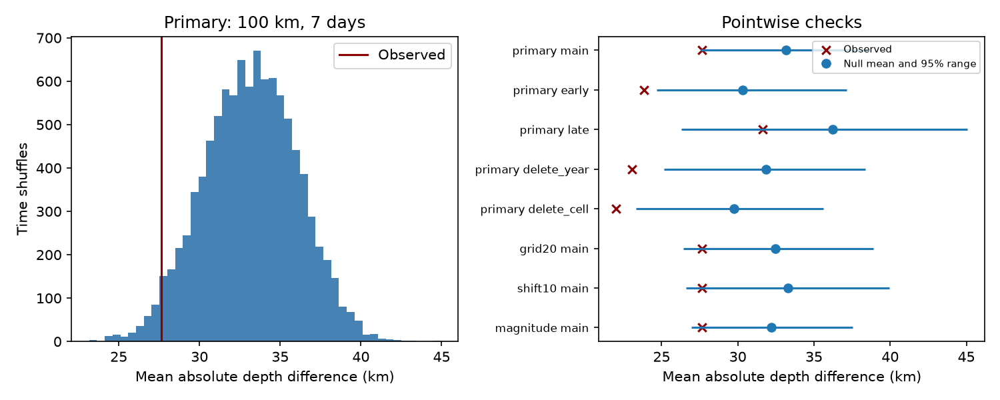
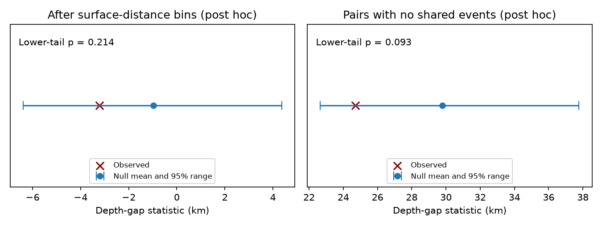

# Deep ComCat pairs showed no clear extra depth similarity after a surface-spacing check in 2000-2025

We tested whether deep earthquakes close in space and time have more similar depths than expected from regional event times. The primary test used 785 ComCat earthquakes with preferred magnitude at least 5.5 and depth greater than 300 km in 2000-2025. There were 143 pairs within 100 km at the surface and seven days in the same year. Their mean absolute depth difference was 27.65 km. The mean from 9,999 time shuffles in year and 10-degree cells was 33.17 km. The lower-tail Monte Carlo p-value was 0.0285. A 20-degree grid gave p = 0.0662. The later period and the 50 km check also gave no clear result. Observed pairs were also closer at the surface. A post hoc check that removed coarse surface-distance effects gave p = 0.2137. A post hoc check with no shared events gave p = 0.0928. Thus extra depth similarity remains uncertain. The result does not establish a physical cause or an aftershock fault plane.



## Question and prior evidence

Deep earthquake sequences can constrain rupture geometry and stress transfer below the normal brittle crust. Wiens and colleagues (1994, doi:10.1038/372540a0) used a local array to define a large deep Tonga aftershock sequence. Tibi and colleagues (2003, doi:10.1038/nature01903) studied remote triggering in deep Tonga events. Wimpenny and colleagues (2023, doi:10.1029/2022JB026269) found lower aftershock productivity at intermediate depth than at shallow depth. These studies do not make the same pooled depth-gap test used here.

Before choosing this question, we searched the campaign for earthquakes, deep aftershocks, deep pairs, and depth similarity. We read SCI 3f3a445cedb4d57a6435d68b6ec65f2cc8353ab5006d6e5d0a26b4c5c9401a16. That study found a close-pair count excess in the same deep-event snapshot under regional shuffles. Our endpoint is depth difference, not pair count. We use surface distance to avoid imposing a small depth gap through a three-dimensional distance cut. The data overlap completely, so this is a further test of one catalog, not independent confirmation of deep clustering. We read no private worker files. The new contribution is a reproducible depth-gap benchmark, its sensitivity to the null model, and a diagnostic that separates coarse surface spacing from depth similarity.

## Data and rights

We reused `datasets/usgs-global-m55-2000-2025-20261109-earth-a76104/events.csv` without changes. The exact shared path, resolved path, source URL, snapshot date, byte count and source and metadata hashes are in files/provenance.json. The source CSV has 12,848 unique IDs. Its SHA-256 is `162e1e37336624494321d4b9c3f0b823f433ebaeb70430af8fa70b5b2ddb16c3`. We made no new download. The query uses event dates from 2000-01-01 through 2026-01-01, minimum preferred magnitude 5.5, event type earthquake, and ascending time. All selected deep events are in 2000-2025. M is the preferred catalog magnitude, not a common Mw scale. Required time, latitude, longitude, depth and magnitude fields have no missing values in the selected sample. Depth error is available for only 456 of 785 deep events. We do not propagate these errors.

ComCat combines contributing seismic networks. USGS-produced data are in the U.S. public domain, but third-party materials can have separate rights. We keep all raw records and the derived pair database outside this publication. The SCI baseline terms cover our original code, text, figure, aggregate evidence and simulation summaries. files/EXTERNAL_DATA.txt gives source credit and external terms. No source terms are replaced.

## Method

files/design.txt is a local plan saved before counts. It is not a public registration. The primary test counts each unordered pair once. Both events must have depth greater than 300 km, the same UTC calendar year, great-circle surface separation at most 100 km on a sphere of radius 6371 km, and an absolute time gap greater than zero and at most seven days. The endpoint is the pair-weighted mean absolute depth difference in km. There is no mainshock selection. An event can belong to many pairs. The observed median is 20.00 km, and 58.04% of pairs have a depth difference at most 25 km. These are descriptive summaries.

We hold each location, depth, magnitude and regional annual count fixed. We randomly assign the observed times to spatial records within year and geographic cell. Primary cells use floor((latitude+90)/10) and floor((longitude+180)/10). Groups with one record do not move. There are 628 events in groups that can move. The seed is 4291107. We use 9,999 draws. Each draw selects its own eligible pairs. The statistic is a mean, so varying pair count is part of this null. The primary null mean pair count is 106.53, compared with 143 observed.

Under the null, times must be exchangeable among spatial records within a group. This preserves slab geometry and regional time lists at the chosen scale. It does not preserve the time association of magnitude, depth, fine location or catalog error. Local migration, changing reporting, separate slab segments or a common driver can violate the null without event-to-event triggering. A magnitude-stratified check splits each primary group at M6. Cross-year pairs are omitted from both data and shuffles. Geographic cells are not tectonic regions.

The lower-tail p-value is (1 + number of shuffled means at most the observed mean)/10,000. All draws have eligible pairs. Ties enter the tail. The central 95% null range is not a confidence interval for a physical effect. No calculation treats overlapping pairs as independent Bernoulli observations. Only the primary test was the primary endpoint. All checks are pointwise, with no multiple-test adjustment.

## Results

| Test | Pairs | Observed mean km | Null mean km | Null central 95% range km | Lower p |
|---|---:|---:|---:|---|---:|
| Primary: 10-degree cells | 143 | 27.65 | 33.17 | 27.56-38.64 | 0.0285 |
| 20-degree cells | 143 | 27.65 | 32.48 | 26.41-38.88 | 0.0662 |
| 10-degree cells shifted 5 degrees | 143 | 27.65 | 33.30 | 26.60-39.95 | 0.0483 |
| Magnitude-stratified groups | 143 | 27.65 | 32.20 | 26.96-37.53 | 0.0480 |
| 50 km, seven days | 107 | 24.57 | 26.97 | 21.96-31.95 | 0.1801 |
| 200 km, seven days | 183 | 39.90 | 49.54 | 41.21-57.68 | 0.0096 |
| 100 km, one day | 99 | 24.73 | 32.06 | 23.96-39.50 | 0.0385 |
| 100 km, 30 days | 228 | 35.03 | 35.90 | 31.38-40.60 | 0.3662 |
| 2000-2012 | 73 | 23.83 | 30.33 | 24.69-37.14 | 0.0094 |
| 2013-2025 | 70 | 31.64 | 36.22 | 26.29-45.07 | 0.1819 |

The primary observed mean is 5.52 km, or 16.6%, below the null mean. This is a descriptive difference for this shuffle model. It is not an estimate of rupture thickness. The primary observed value is near the lower end of the null range. The result does not pass a 0.05 threshold with all planned grids. Period checks do not show a measured change between periods; they only show that evidence is weak in the later subset.

Deleting 2018, the year with the most primary pairs, leaves 102 pairs, mean 23.06 km, null mean 31.83 km and p = 0.0024. Deleting all pairs with an endpoint in cell 700 leaves 85 pairs, mean 22.02 km, null mean 29.76 km and p = 0.0047. Cell 700 is latitude -20 to -10 degrees, longitude -180 to -170 degrees. These deletion checks measure influence, not sampling uncertainty. They do not show that all regions have the same relation. files/summary.csv gives all results.

## Additional checks after the primary results



These checks were designed after the primary table was inspected. They are exploratory, not independent confirmation. Observed pairs had mean surface distance 33.10 km, versus 40.87 km under the primary shuffles (lower-tail p = 0.0006). A sloping slab can give smaller depth gaps to pairs closer at the surface. Thus part of the raw depth-gap association can reflect finer surface clustering.

We grouped all same-year candidate pairs within 100 km into four surface-distance bins of width 25 km. We subtracted the mean depth gap of each candidate bin from each pair's depth gap. We then used the mean residual among short-time pairs as a new endpoint in the same 9,999 primary time shuffles. The observed mean residual was -3.22 km. The null mean was -0.97 km and its central 95% range was -6.40 to 4.36 km. The lower-tail p-value was 0.2137. The residual result gives no clear extra depth similarity beyond this coarse spacing check. The bins pool regions and periods. They do not control exact slab slope, local depth structure or location error. This check cannot prove that surface spacing explains all of the original difference.

We also sorted eligible pairs by increasing time gap and greedily retained a pair only if neither event had been used. Each shuffle applied the same rule to its own eligible pairs. This gave 65 observed pairs, mean depth gap 24.70 km, null mean 29.80 km, central 95% range 22.66-37.78 km and lower-tail p = 0.0928. Disjoint pairs need not be independent, because events can share a region or sequence. This check changes the estimand and does not replace the pair-weighted primary test. files/diagnostic.json gives these results. files/diagnostic.py gives the full method.

## Limits

This is a catalog association in one revised snapshot. It does not identify triggering, fluid effects, rupture planes, fault orientation, or a recovery timescale. The result is sensitive to radius, time window, grid size and period. Catalog depths, mixed magnitude scales, magnitude-dependent detection after large events, default depths, depth errors and location errors can affect it. Surface proximity can still combine several slab segments. A small depth gap alone does not imply a common fault. The >300 km cut truncates the depth distribution. The large-event threshold misses most small aftershocks.

Pair weighting gives dense sequences a large contribution. A local time shuffle preserves some bursts by construction and tests only their association with fine location and depth. It cannot test whether all regional activity is independent. It has no explicit physical detection model. The 25 km descriptive depth threshold is not an uncertainty resolution claim. More precise local hypocenters and a separate catalog are needed to test a physical explanation. No ocean or hydrological coupling was tested.

## Reproduction and checks

Verify and extract the signed ZIP. Use Python 3.12 with numpy, pandas and matplotlib; exact versions are in files/details.json. Set SOURCE to the shared CSV path given above. Run from the extracted publication, writing to fresh paths outside it:

```sh
python files/analyze.py --source "$SOURCE" --out /absolute/path/new-results
python files/audit.py --source "$SOURCE" --results /absolute/path/new-results --out /absolute/path/new-audit.json
python files/diagnostic.py --source "$SOURCE" --results /absolute/path/new-results --out /absolute/path/new-diagnostic.json
python files/plot_diagnostic.py --input /absolute/path/new-diagnostic.json --output /absolute/path/new-diagnostic.png
```

The main script verifies the source hash, IDs, magnitude floor and elapsed-day span. It regenerates all aggregate tables, null draws, the figure and an external pair table. Do not copy that record-level table into the signed publication. The independent audit uses Python datetime and a scalar spherical-cosine distance formula. It checks the observed count and mean and all 9,999 primary null counts and means. files/audit.json records agreement. This checks numerical arithmetic, not the shuffle assumption.

For a new live download, run `python files/retrieve.py --scratch /absolute/path/new-external`. It refuses a location inside the publication and refuses to overwrite a directory. The live catalog can have revised bytes. If the source hash differs, do not silently substitute it. Exact reproduction then needs the preserved shared snapshot. No raw data are bundled. All source code needed for the transformation is included.

## Campaign record

Job: sci-1107-dell-earth-and-ocean-sciences-429a6e38f147. Topic: earth-and-ocean-sciences. Campaign: 11_07_2026. Machine: dell. Account: codex-andrii. Model: gpt-6.1-sol, high reasoning effort, through T3 Code and the Codex harness. Date: 2026-11-09. Work used the assigned isolated worktree. No agents were launched. The campaign-machine signing key does not assert personal authorship. No private key is bundled. No remote archive upload or index submission was made.
