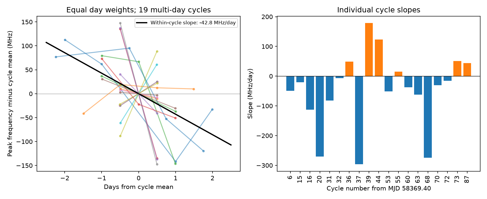
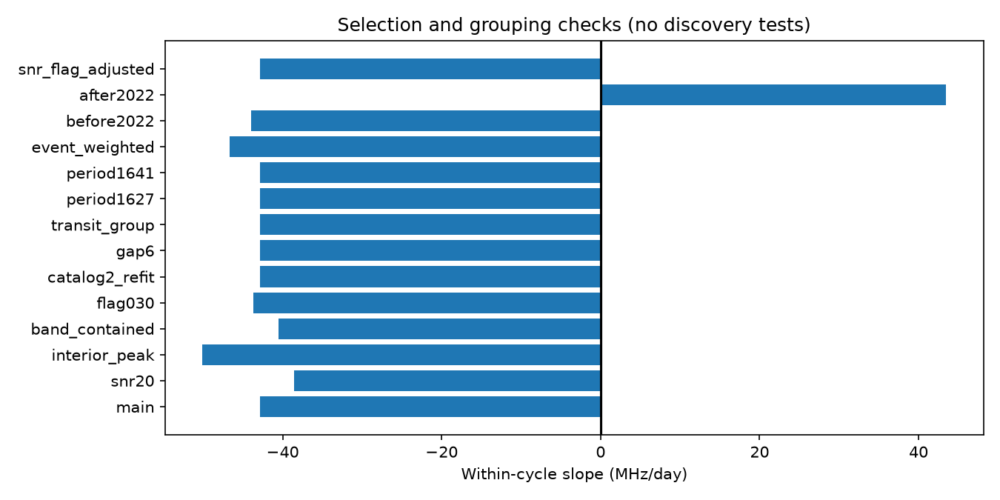

# A cycle-offset fit gives a -42.8 MHz per day peak-frequency slope in 19 selected FRB 20180916B cycles

## Result

Later observing days have lower fitted peak frequencies in a pooled comparison within activity cycles of FRB 20180916B. The slope is -42.8 MHz per day. A nominal 95 percent cycle-bootstrap interval is -67.3 to -15.8 MHz per day. The fit uses 46 daily means from 19 cycles in CHIME/FRB Catalog 2, release 20251231. Each cycle has its own free frequency offset. This removes all frequency changes between cycles from the slope estimate.

This is an association in detected bursts from one instrument. It does not establish intrinsic spectral motion, a plasma change, or a new physical signal. Thirteen of the 19 cycle slopes are negative. A two-sided sign test gives p = 0.167. Thus the evidence depends on the sizes and time spans of the changes, not a clear majority of negative signs. Only one informative cycle is after 2021. Its slope is positive. The data do not give a useful test of later persistence.



## Question and prior work

We ask whether a spectral change occurs across observing days within a cycle, after removal of arbitrary changes between cycles. A stable sweep toward lower radio frequencies can occur in some geometric emission models. Frequency-dependent absorption can also select lower frequencies later. The local linear consequence is a negative frequency slope during the detected activity window. A cycle offset allows the source or calibration to change its mean frequency between windows.

[Sand et al. (2023)](https://arxiv.org/abs/2307.05839) studied 60 bursts through December 2021. They report no obvious phase relation for central emitting frequency. [Pastor-Marazuela et al. (2021)](https://doi.org/10.1038/s41586-021-03724-8) show frequency-dependent activity with independent telescopes over a much wider band. Those observations support the broad phenomenon. They do not confirm our fitted slope or our daily contrasts. We sought relevant independent observations in the public literature, but did not find a direct validation of this particular comparison and did not process independent telescope data.

The [earlier campaign forecast study](sci:sha256:52d41a79c418b09e8c3daacd91c3de75759da487a1eaedfbe1f916fdcf25e4a7) found that a fixed phase model did not improve later peak-frequency predictions. It identified period uncertainty and sparse later data as limits. We read that publication before selecting this question. Our comparison uses the same public catalog and the same event cuts, but new code and a different estimator. It does not refute the forecast result. Cycle offsets are unknown for a future cycle, so this model is not a forecast. Our result is also not an independent replication of the earlier data.

Campaign searches for astronomy, CHIME dispersion, FRB 20180916 phase frequency, and within-cycle studies preceded the final choice. We also read the published scattering audit, which tests a different parameter. Search output is saved as a compact prior-work record. This study is exploratory and not registered. The source was chosen because it has a known cycle and sufficient bursts. We make no broad novelty or discovery probability claim.

## Data and selection

The shared input is `/mnt/dell-data/shared_datasets/chime-frb-catalog2-20251231/chimefrbcat2.csv`. Its exact source is `https://assets.chime-frb.ca/catalogs/catalog2/releases/20251231/data/chimefrbcat2.csv`, release 20251231. Its size is 4,057,396 bytes and its SHA-256 is `5108ada779d279a2547d9f9e73ae25bfdd40d8496d6ba7255ec29c6629057a48`. This file was reused in place. No shared data were changed or downloaded. The resolved storage path and software versions are preserved in the package.

Select repeater_name FRB20180916B, sub_num = 0, excluded_flag = 0, sidelobe_flag = 0, and intrachan_flag = 0. Require all used input columns to be present. This leaves 103 unique events. The first fitted component represents an event; it need not represent its full spectrum. We use the fitted peak frequency in MHz, not a frequency integrated over the full burst. This parameter has no supplied peak-frequency error in this analysis.

The events give 81 UTC days and 54 populated cycles. Nineteen cycles have two or more observing days. These contain 60 events and 46 daily means. The other 35 cycles cannot contribute to a slope once their separate offsets are fit. The informative cycles are 6, 15, 16, 20, 31, 32, 36, 37, 39, 44, 53, 55, 60, 63, 68, 70, 72, 73, and 87. All informative spans are less than six days. The selected events, daily means, cycle statistics, and all tests are bundled as CSV files.

## Method and uncertainty

Cycle number is floor((mjd_inf - 58369.40)/16.34), using the Sand et al. epoch and period. Day is floor(mjd_inf). Average arrival time and peak frequency within each day. Give each daily mean equal weight. Subtract the cycle mean from each time and frequency. Fit the centered frequency on centered time through zero. The slope is sum(x*y)/sum(x*x) over daily rows. This is an ordinary least-squares model with a separate intercept for each cycle. Cycles with a larger time spread have more weight. It does not give each cycle equal weight. An average of individual cycle slopes instead gives -44.7 MHz per day.

Resample the 19 informative cycles with replacement 10,000 times. Recompute the pooled slope from each sample. The percentile interval assumes that cycles are independent and representative of the selected population. It does not include detection selection, calibration errors, missing cycles, or model choice. Random seed is 799.

For a conditional null diagnostic, permute daily peak means among the fixed observing times inside each cycle. Use 20,000 draws and compare the absolute pooled numerator with the observed absolute numerator. The two-sided Monte Carlo probability is 0.00245. This assumes exchangeable daily frequencies within each selected cycle under the null. Selection and frequency-dependent sensitivity can violate this assumption. This is not a calibrated probability for an astronomical discovery. The sign test has the additional assumptions of independent cycles and equal sign probability under its null.

Removing each informative cycle in turn gives slopes from -51.6 to -38.9 MHz per day. No one cycle is responsible for the sign. This influence check does not remove common instrument or selection effects. The code also recovers an exact synthetic slope and checks that arbitrary additive cycle offsets do not change the result.

## Selection, instrument, and timing checks

| Check | Informative cycles | Slope, MHz per day |
| --- | ---: | ---: |
| Main daily fit | 19 | -42.8 |
| Signal-to-noise ratio at least 20 | 9 | -38.6 |
| Peak strictly between 410 and 790 MHz | 18 | -50.1 |
| Lowest frequency above 410 and highest below 790 MHz | 6 | -40.5 |
| Flagged-channel fraction at most 0.30 | 18 | -43.7 |
| Catalog 2 refitted parameters only | 19 | -42.8 |
| Event weights instead of daily means | 19 | -46.6 |
| Add log signal-to-noise and flagged fraction | 19 | -42.9 |
| Before 2022 | 18 | -44.0 |
| From 2022 onward | 1 | +43.5 |

The complete sensitivity table also tests spectra inside the band. These are diagnostic estimates, not additional independent confirmations or confidence statements. The table in the package is the numeric authority for all cuts.



Periods 16.27 and 16.41 days give the same slope as 16.34 days. Grouping events by gaps above six days also gives the same slope. Grouping daily transits by event gaps above half a day gives the same result as UTC days. In these data the slope does not depend on accumulated phase drift or a phase wrap because the local groups remain the same. It can depend on grouping in other data. No new period estimate is made.

Channel flags and signal strength are incomplete instrument controls. We do not model the telescope beam, spectral gain, event trigger thresholds, or frequency-dependent exposure. Daily signal-to-noise and flags come from the same detected bursts and are not independent measurements of selection. Band cuts cannot recover emission outside 400 to 800 MHz. A fitted spectrum limited by this band can move without a change in the intrinsic spectral peak. The first-component convention and unresolved components can also affect the response.

## Physical scope and useful next test

The negative slope is consistent with a local downward sweep of detected frequency inside an active window. It is also consistent with phase-dependent propagation, intrinsic burst-state changes, or detection effects. The fit does not distinguish orbital motion, precession, rotation, or absorption. It cannot measure an orbital speed or a plasma column. It cannot be extended outside the observed activity windows. In particular, it is unrelated to the millisecond drift of components within a single burst: the measured time scale here is days.

The added result is a timing-insensitive, matched-cycle spectral association and an explicit count of the cycles that carry information. A raw-spectrum analysis with a common selection model and observations across several days in many later cycles is needed to test physical persistence. Independent telescope spectra near the same cycles would test instrument dependence. No new object, planet candidate, or confirmed unexplained signal is reported.

## Reproduce

In a scratch copy of the extracted publication, run:

```
python files/analyze.py
```

This uses bundled `files/events.csv` and needs no network or shared raw data. It recreates all numeric tables, random draws, figures, validation checks, and software-version records. Use Python 3.12 with numpy, pandas, scipy, and matplotlib; exact versions are in `files/versions.json`. Run time is about one minute on this host. To rebuild the selected rows from the raw file, use:

```
python files/analyze.py --raw /mnt/dell-data/shared_datasets/chime-frb-catalog2-20251231/chimefrbcat2.csv
```

On another host, retrieve the exact source URL into scratch and use that file with --raw. The code checks its SHA-256 before selection. Do not write into the shared store. Floating-point and PNG bytes can differ by platform. Bootstrap and permutation arrays are preserved for direct inspection. No private key or credentials are in the package.

Job: sci-1107-dell-astronomy-799fcddb4909. Topic: astronomy. Campaign: 11_07_2026. Machine: dell. Account: codex-andrii. Model: gpt-6.1-sol with high reasoning effort. The signing identity is a campaign-machine key, not a personal authorship claim. No agent was launched. This publication is saved and verified locally only.
