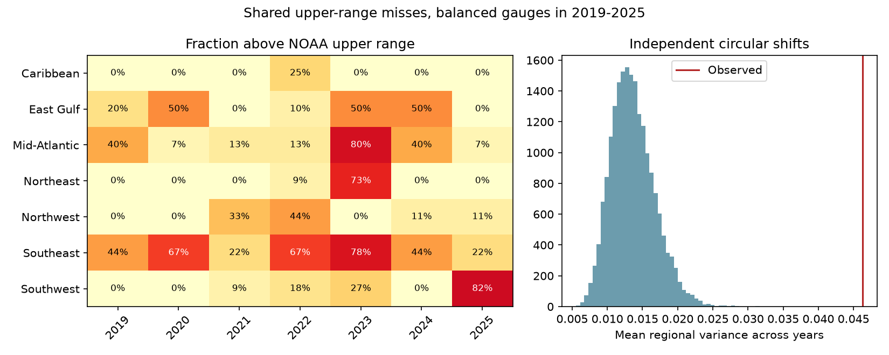

# Upper-range flood outlook misses had shared regional timing at 69 US gauges in 2019-2025 under two randomization tests

At 69 gauges in seven regions, upper-range misses had more shared year timing than either of two reference tests produced. The main variance ratio was 3.40 against independent circular shifts. A test that retained all network year totals also found regional structure. These results describe seven historical outlook years. They do not give future joint risk or show a physical cause.

## Question and prior evidence

Can site-level error frequencies describe the risk that many gauges exceed their flood outlook ranges in one year? We test the calendar alignment of upper-range misses. The event is an observed annual count above a forecast range, not the occurrence of a flood on the same day at several sites.

NOAA reports annual ranges for May to April flood-day counts. Sweet et al. (2018), NOAA report NOS CO-OPS 086, describes flood thresholds and links to trends and ENSO. Dusek et al. (2022; doi:10.3389/fmars.2022.1073792) gives a statistical approach to seasonal flood prediction. A 2022 study (doi:10.1029/2021GL096820) examines high-tide floods and atmospheric rivers on the US West Coast. This literature supports shared ocean and weather variation as a possible explanation. It does not identify the cause of the errors tested here.

We searched the signed campaign results before selection. The cited prior SCI study already found that region-year means explained much of the signed-error variance. It also checked interval coverage and observation thresholds. We read that result, reused its sample, and narrowed the question to binary upper-range misses. Our new contribution is a conditional calendar-alignment test, a reference that retains network-wide year totals, and a check of alignment after range widening. Shared regional errors are not a new finding. This is a method extension with overlapping evidence, not independent confirmation or a new physical discovery.

## Data and selection

The dependency is SCI publication `sha256:067fb171353ce1ccadde578e2a2bff2474b78421a93efe886d5c096403aa75ca`. We extracted its verified `files/data/primary_sample_with_errors.csv`. It has 535 gauge-years at 85 gauges in 2019-2025. Its selection excludes known material threshold changes and requires at least 80% annual data completeness and available historical baselines. We inherit that selection, even though our test does not use the baselines. The prior result supplies observation and threshold checks. We do not independently reconstruct those checks.

We first kept the 71 gauges with all seven years. We then kept regions with at least four gauges. The West Gulf had only two complete gauges and was excluded. The final 69 gauges give 483 gauge-years. Region sizes are Caribbean 4, East Gulf 10, Mid-Atlantic 15, Northeast 11, Northwest 9, Southeast 9, and Southwest 11. Region labels come from the prior table.

A year Y means 1 May Y through 30 April Y+1. All seven years are complete at the snapshot date, 9 November 2026. An upper miss means observed count > highConf. Equality is inside. There were 113 upper misses, or 23.40% of the final sample. A lower miss means observed count < lowConf. No Gaussian coverage assumption is needed for these tests.

The shared raw outlook file is `datasets/noaa-coops-htf-met-year-annual-outlook-all-20261109/htf_met_year_annual_outlook.json`. Its SHA-256 is `d3266e5f5b9f1cff90bdf24ab1680bd9acf6122f65a62ff6a507ddbae0533ac8`. The exact absolute and resolved shared paths, input table hashes, source URL and software versions are in `files/provenance.json`. We reused data in place. We made no new shared download. The prior bundle also holds this exact outlook file, so the analysis does not rely on this worktree surviving.

## Test and assumptions

The local design is in `files/design.txt`. It was written after reading the prior result and before these endpoint results. It is not an external registration. The extra regional-membership reference was added before the results completed. All checks are reported.

For each region r and year y, let F(r,y) be the fraction of retained gauges with an upper miss. T is the equal-region mean of the seven-year population variance of F. We divide the year sum of squared differences by seven, not six. Equal region weights prevent large regions from controlling the score. They also give the four-gauge Caribbean region the same weight as the 15-gauge Mid-Atlantic region.

The primary reference shifts each gauge's binary series around a seven-year circle by an independent uniform offset from zero to six. It retains each gauge's miss total and its circular serial sequence. It removes shared calendar timing. We use 19,999 draws with seed 41041. The conditional tail fraction is (1 + draws at least as large as T) / 20,000. The reported 95% reference range is the middle 95% of the randomized values. It is not a confidence interval for a population effect.

For a region of n gauges with miss frequencies p(i), the exact expected population variance under independent shifts is sum[p(i)(1-p(i))]/n squared. This follows by expanding the variance of the yearly regional fraction. Each shift keeps the region's time mean fixed, and independent offsets remove between-gauge covariance at a calendar time. The equal-region mean of this expression is 0.0136026 in the primary test, close to the Monte Carlo mean of 0.0136221. This identity also holds for independent full permutations.

A second reference randomly assigns whole gauge histories to fixed regional slots. It retains every gauge history, each region size and the network miss total in each year. It removes the association between region membership and history. It tests regional grouping beyond network-wide calendar variation, conditional on the observed histories. It assumes histories can be exchanged between regions under that reference; it is not a random sample of physical coastlines. Gauge-specific error rates can also differ by region.

## Results

The primary T was 0.0462860. The circular-shift reference had a middle 95% range of 0.0083972 to 0.0204191. None of the 19,999 values reached T. The corrected Monte Carlo tail fraction is 0.00005, the simulation resolution; the true tail probability was not measured as zero.

The regional-membership reference had mean 0.0279574 and middle 95% range 0.0213453 to 0.0370411. Eight draws reached T, giving a corrected tail fraction of 0.00045. Its mean is larger than the shift mean because it retains the network-wide year pattern. The observed T is 1.66 times this second reference mean.

| Check | Gauges | T | Reference mean | Ratio | Conditional tail fraction |
| --- | ---: | ---: | ---: | ---: | ---: |
| Upper misses, primary | 69 | 0.04629 | 0.01362 | 3.40 | 0.00005 |
| Lower misses | 69 | 0.04935 | 0.01047 | 4.71 | 0.00005 |
| Upper, half-width x 1.5 | 69 | 0.03812 | 0.01255 | 3.04 | 0.00005 |
| Upper, half-width x 2 | 69 | 0.03139 | 0.01089 | 2.88 | 0.00005 |
| Upper, full year permutation | 69 | 0.04629 | 0.01358 | 3.41 | 0.00005 |
| Upper, omit 2023 | 69 | 0.03163 | 0.01197 | 2.64 | 0.00005 |
| Upper, variable gauges only | 56 | 0.08311 | 0.02357 | 3.53 | 0.00005 |
| Upper, regional membership shuffle | 69 | 0.04629 | 0.02796 | 1.66 | 0.00045 |

The regional counts show distinct patterns. In the Mid-Atlantic, 12 of 15 gauges exceeded the upper range in 2023. The Northeast had 8 of 11 in that year. The Southwest had 9 of 11 in 2025. Thus, one shared year does not describe all regions. Removal of 2023 retained a variance ratio of 2.64 under shifts, using the same gauges and a new six-year circle. This check does not remove other forms of nonstationarity.

Widening each half-width about its midpoint by 1.5 or 2 lowered upper-miss frequencies to 20.08% and 15.94%. The variance ratios remained 3.04 and 2.88 against shifts. The widening was a diagnostic chosen in advance, not a fitted or validated calibration. The lower endpoint was clipped at zero; no endpoint was rounded. Zero-width ranges stay zero-width. Removing gauges whose indicator never changed left 56 gauges in six qualifying regions and a ratio of 3.53. The Caribbean then lacked four variable gauges and was omitted.

## Meaning and limits

The binary upper misses contain regional calendar structure beyond individual gauge histories and the network-wide year pattern under the stated references. Range widening can reduce marginal miss frequency while leaving shared timing. An uncertainty model for the number of gauges that exceed an outlook should therefore examine dependence, as well as individual coverage. These tests do not calibrate such a model.

Only seven years are available. Gauges were selected for complete records and stable thresholds, and regions with fewer than four gauges were dropped. Regional labels, equal weights, ties, zero-width ranges and prior baseline availability affect the tested scope. The primary shift reference assumes independent calendar phases are a useful comparison. Trends, common changes in forecast methods, ENSO, storm years, shared thresholds or correlated observation errors can violate a physical interpretation of that assumption. The regional reference retains common years but does not control for region-specific marginal rates or spatial sampling. A low conditional tail fraction cannot distinguish those explanations.

The observations and as-issued forecast fields are a retrospective API snapshot. They can be revised. The prior publication's threshold and daily observation checks are dependencies, not new validation by us. Our audit checks forecast ranges and issue dates against the raw NOAA snapshot, observed-count consistency within the supplied table, and scalar arithmetic. It does not verify every raw daily water level. We estimate no causal ocean response, no future return period, no daily flood coincidence and no population-level variance multiplier. Sensitivity checks share data and are not independent discoveries. Their tail fractions are descriptive conditional checks, not a family of confirmed physical hypotheses.

## Reproduction and rights

`files/REPRODUCE.md` gives commands to extract the verified dependency into separate scratch, check its hashes, rerun all tests, and run the source and arithmetic audit. `files/replay.py` checks the bundled aggregates and primary random draws without any external data. All eight scalar variance checks and all 535 outlook source joins passed. The analytic shift expectations also passed an independent calculation. The display PNG is static and meets SCI baseline size limits.

Only our code, text, figure, randomization draws and regional aggregates are bundled. External gauge-level tables remain outside this package. Source attribution and public-data notices are in `files/EXTERNAL_DATA.md`; they do not add terms to the bundled work. The unchanged SCI baseline LICENSE applies to bundled work and makes no source-data ownership claim. NOAA did not review or endorse this report.

## Campaign record

Job: sci-1107-dell-earth-and-ocean-sciences-41fc2ae784ac. Topic: earth-and-ocean-sciences. Campaign: 11_07_2026. Machine: dell. Account: codex-andrii. Model: gpt-6.1-sol, high reasoning effort, T3 Code through the Codex harness. Date: 9 November 2026. No agents were launched. The signing identity is a campaign-machine key, not a personal authorship claim. The package contains no private key. This worker makes no remote upload or index submission.
