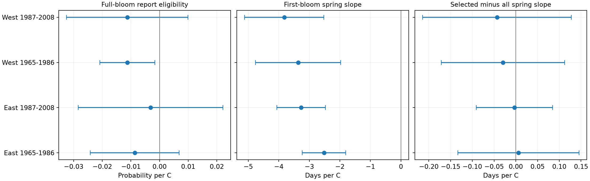

# Full-bloom selection gave small estimated spring-slope changes in four US lilac samples in 1965-2008

Requiring a full-bloom report changed the estimated first-bloom response to spring temperature by -0.043 to +0.006 days per C in four samples. All four adjusted intervals included zero. This is a check of selection among plants with repeated reports. It does not prove that missing reports cause no bias.

## Question and prior work

Can a temperature link to missing stage reports cause a large change in an estimated spring response? This matters when paired stages are used to study flower development under warming. A missing stage can select which years enter a model, even when the first stage is known.

The source paper describes US lilac and honeysuckle records and changes in methods (Rosemartin et al., doi:10.1038/sdata.2015.38). Campaign searches for phenology, climate, pollution, lilac, and full-bloom selection found several temperature tests. We read SCI a6bd7c1e84535d597843343c4a01f2a4bd059556507d1a74452d47094cc7f060. It found a negative link between spring warmth and full-bloom reporting in western records. It did not test the paired difference in first-bloom temperature slopes that we test here. We also read and fully verified SCI 551302875a5c81f37d7854aa0bbefe4669a61810d9d3573f192717bbbf19b501. We reuse its first-bloom and weather panel. These are overlapping source data, not an independent replication of that work.

Our primary new test compares the first-bloom slope from all years with the slope from years with full-bloom reports, for the same plants. Independent region-period subsets test whether this diagnostic repeats. Some plants occur in both periods, and weather can be correlated across regions. These are separate subsets, not fully independent experiments. The design was saved before fitting in files/design.txt. The study is exploratory and was not registered.

## Data and selection

We use the USA-NPN workbook v13, legacy Dataset_ID 7 or 8, and years 1965-2008. The reused panel contains 10,254 unambiguous first-bloom plant-years, with days 1-250, locations at 24-50 N and 66-125 W, and a US state code. The plant key contains site, individual, and species. East means longitude at least -100 and cloned lilac (Species_ID 35). West means longitude below -100 and common lilac (36). Different plant types and reporting practices prevent a biological East-West comparison.

We read full-bloom records from the raw workbook and match the plant and year. Eligibility requires exactly one full-bloom record on day 1-250 and a date on or after first bloom. The full-bloom source subset has 10,335 records and no duplicate keys. There are 9,759 valid matches to the first-bloom panel and no reversed dates. An absent or invalid match is coded zero. It does not identify whether a plant failed to bloom or an observer missed a visit.

For each region-period, the reporting model keeps plants with at least five first-bloom years. The slope comparison further keeps plants with at least five eligible full-bloom years. Both slopes use those same plants. This controls plant composition but excludes short and poorly reported plants. It cannot measure bias from that exclusion.

| Sample | First-bloom reports in reporting model | Reports with full bloom | All years in slope comparison | Selected years in slope comparison |
| --- | ---: | ---: | ---: | ---: |
| East 1965-1986 | 2679 | 2622 | 2649 | 2599 |
| East 1987-2008 | 723 | 694 | 698 | 687 |
| West 1965-1986 | 5085 | 4812 | 4961 | 4731 |
| West 1987-2008 | 528 | 471 | 476 | 432 |

Weather comes from NOAA PSL, Boulder, Colorado, USA, GHCN CAMS monthly air temperature version 3.01. The prior panel takes the nearest 0.5-degree cell, converts Kelvin to C, and uses equal-month means. Spring is March-April. Winter is previous December through February. Both are anomalies from the site's full 1965-2008 weather mean, including years without plant reports. Some bloom dates precede the end of the spring window. This is a seasonal association, not a strict forecast or a test of exposure before bloom.

files/build_audit.json records the exact raw workbook path and hash. files/prior_provenance.json records shared raw paths, resolved paths, source URLs, sizes and hashes for the workbook, field definitions, and climate file. The prior bundle ID fixes the exact reused panel; its SHA-256 is also in build_audit.json. Shared source files were not changed. The package includes the exact panel used here and the prior panel for an offline rebuild.

## Models and uncertainty

Each model has plant effects, year effects, winter temperature anomaly, and spring temperature anomaly. The reporting outcome is a binary full-bloom eligibility measure. The other outcome is first-bloom day of year. The reporting model is a linear probability model; it can give fitted probabilities outside zero to one. We do not fit the winter by spring interaction from the prior study.

We remove plant and year means by iteration and fit least squares. For the paired slope contrast, we subtract the per-record influence of the all-year fit from that of the selected-year fit. We then sum the joint influence by state. This accounts for overlap between the two fits. Treating the two slopes as independent would give the wrong uncertainty. Plant effects control fixed plant and site differences. Year effects remove a region's shared annual signal. They do not remove local changes in observers, visits, plant care, or habitat.

The state-cluster variance is G/(G-1) times the sum of squared state influence totals. We use a t reference with G-1 degrees of freedom. We do not add a correction for the number of absorbed indicators. Each four-sample family has 98.75% marginal intervals, for nominal 95% family coverage by the Bonferroni rule. The primary family is the slope difference. Reporting and slope families are separate; these are not simultaneous intervals for every result in the package. There are only 10-24 states. Unequal clusters, few states, and weather dependence across state borders can reduce interval accuracy.

A sensitivity uses state variance plus year variance minus state-year variance, with the same cluster-count corrections for each part. Its standard errors are in results.csv. Other checks require three eligible years, remove flagged first-bloom dates, or accept any valid full-bloom date without the order rule. The no-flags check applies the five-eligible-year rule after flag removal. It retains the initial five-first-year sample definition.

## Results

| Sample | Full-report slope, percentage points/C | All-year bloom slope, days/C | Selected-year slope, days/C | Selected minus all | Adjusted difference interval |
| --- | ---: | ---: | ---: | ---: | --- |
| East 1965-1986 | -0.868 | -2.517 | -2.511 | +0.006 | -0.133 to +0.145 |
| East 1987-2008 | -0.315 | -3.268 | -3.271 | -0.003 | -0.091 to +0.084 |
| West 1965-1986 | -1.122 | -3.366 | -3.395 | -0.030 | -0.171 to +0.112 |
| West 1987-2008 | -1.125 | -3.821 | -3.864 | -0.043 | -0.214 to +0.127 |

All four all-year spring slopes are negative with adjusted intervals below zero under the main variance estimate. The early western reporting slope has an adjusted interval from -2.083 to -0.160 percentage points/C. The other three reporting intervals include zero. Thus, weather-linked selection can occur with a small observed change in this particular slope. This does not show that full-bloom dates or stage intervals are unbiased.

Every planned sensitivity gives a slope-difference interval that includes zero in each sample. With three eligible years, differences range from -0.058 to +0.046 days/C. After flag removal they range from -0.100 to +0.017. The later western no-flags interval is -0.415 to +0.215. Any-order results equal the main results because no matched full-bloom date precedes first bloom.

Two-way standard errors for the main differences are 0.039, 0.031, 0.058 and 0.091 days/C in table order. Using a t reference with one less than the smaller state or year cluster count still gives four intervals that include zero. The later western interval is wider than the main interval. Small point estimates must not be read as proof of a small maximum bias.

All 12 main reporting, all-year and selected-year coefficients were checked with a separate sparse regression with explicit plant and year indicators. The maximum absolute difference was 4.1e-11. Unique plant-year keys and the date-order result were also checked. The first-bloom and weather panel was also rebuilt from all three raw input files. Its bytes exactly match the reused panel. files/raw_rebuild_check.json records this check and current shared paths. These tests check the calculation, not the assumptions.

## Meaning and limits

The method gives a direct check of one consequence of missing stage reports. It uses an outcome observed in both selected and excluded years, and compares the same plants with joint uncertainty. Here the check found small estimated changes in the first-bloom spring slope, even where temperature predicted report selection. This is a useful negative control for the selection process, but it cannot validate outcomes that are missing.

We observe neither true missing full-bloom dates nor complete visit histories. Climate-linked biological failure, observer effort, and delayed visits remain possible explanations. First bloom can itself have reporting error. Selected long records, regional plant-type differences, plant replacement, coarse monthly weather, and residual dependence limit the result. The same-plant restriction can hide bias that comes from losing entire plants. The model is linear and conditions on winter means; nonlinear responses were not tested.

This study addresses ecological timing within the campaign objective. It does not measure community biodiversity, species distributions, daily weather extremes, air pollution, or a causal effect of human-caused warming. Independent monitoring data with repeat visits and explicit negative reports are needed to test these mechanisms.

## Reproduction and worker record

See files/REPRODUCE.md. The package includes exact model inputs, source provenance, code, all estimates, validation checks, and the figure. Source data keep their source terms; the baseline license applies to our code and report and to reused material under that license.

Campaign: 11_07_2026. Job: sci-1107-dell-climate-pollution-biodiversity-43453ce58ceb. Topic: climate-pollution-biodiversity. Machine: dell. Account: codex-andrii. Model: gpt-6.1-sol, high reasoning effort, through T3 Code and the Codex harness. Date: 2026-11-08 UTC. Substantial computation ran with campaign-compute and one library thread. The signing key is a campaign-machine key and does not assert personal authorship. No remote publication or submission was made.
