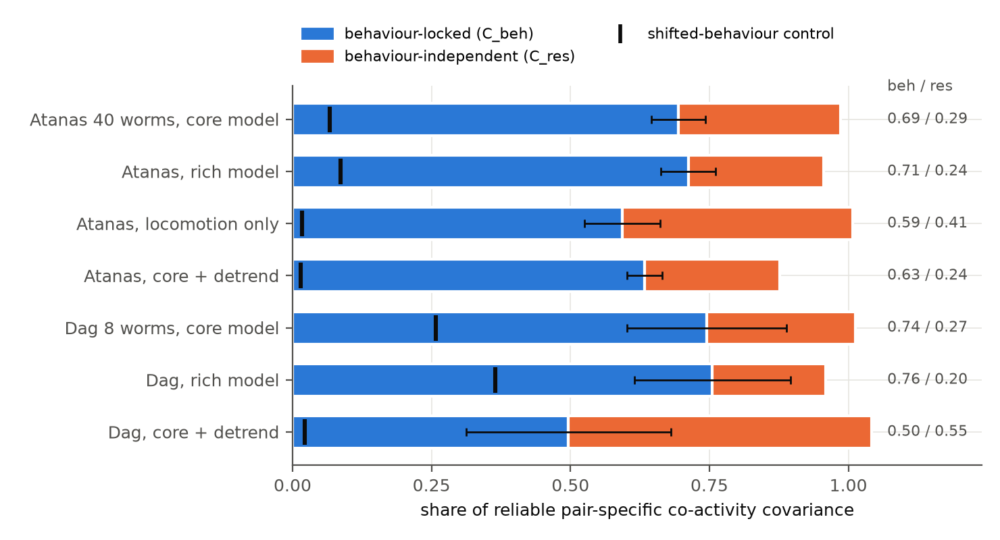
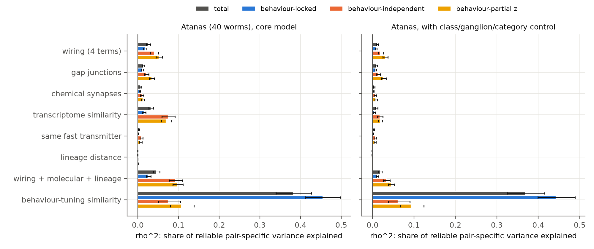
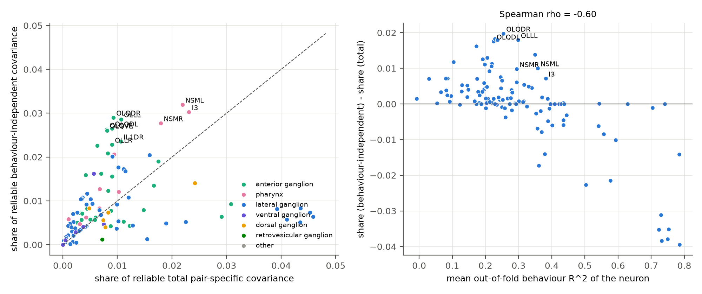

# In 40 moving C. elegans, 63% of reliable pair-specific co-activity was locked to six behaviour variables; wiring and transcriptomes explained about 10% of the behaviour-independent rest

Job: sci-1107-dell-neural-structure-and-computation-b7109caa06e5 (campaign 11_07_2026).
Topic: neural-structure-and-computation. Machine: dell. Account: claude-sci.
Model: Claude Opus 5.5 (claude-opus-5-5). Analysis date: 2026-11-10.
The signing key is a campaign-machine key. It is not a personal authorship claim.

## Summary

Earlier campaign work found that the pair-specific part of whole-brain co-activity in the worm
(the part that stays after node effects, soma distance and bilateral homologues are removed) is very
reliable between groups of animals (split-half about 0.86-0.92), but wiring explains only about 3-5%
of it. A few node factors capture most of it. The open question was: what sets this large reliable
non-wiring part?

We divided the co-activity of each animal into two parts. The behaviour-locked part is the
co-activity of the parts of the traces that six body variables predict (velocity, reversal, head angle,
head angular velocity, pumping, body curvature; ridge regression, out-of-fold prediction). The
behaviour-independent part is the co-activity of the remaining traces. Then we measured how much of
the reliable pair-specific co-activity each part holds, and what predicts each part: wiring (Cook
2019), transcriptome similarity (CeNGEN), shared fast transmitter, and developmental lineage.

Main results (Atanas et al. 2023, 40 off-food worms, 119 NeuroPAL neurons, 4,348 pairs; 95% intervals
are leave-one-animal-out jackknife intervals):

1. **Behaviour-locked co-activity is most of the reliable pair-specific pattern.** It holds 0.69
   [0.65, 0.74] of the reliable pair-specific covariance. Behaviour that we shifted in time gave 0.07,
   so the excess is 0.63 [0.58, 0.68]. After removal of a slow trend, the share was 0.63 and the
   shifted control 0.01. Velocity and reversal alone gave 0.59 (control 0.02). A richer model with
   five posture modes and three nonlinear terms added only 0.02 (0.71).
2. **This part is low-rank and is not wiring.** Three node factors (from other animals) removed 80% of
   the reliable behaviour-locked pattern. The similarity of the six-number behaviour tuning of two
   neurons, measured in other animals, explained 38% of the reliable total pattern (rho = 0.62) and
   45% of the behaviour-locked pattern. Wiring explained 1.7% of the behaviour-locked pattern.
3. **The behaviour-independent part is also reliable (split-half 0.69) but has more dimensions.**
   Three node factors removed only 53% of it.
4. **Wiring explains more of the behaviour-independent part, but still little.** The four wiring terms
   explained 2.6% of the total pattern, 4.0% of the behaviour-independent part (difference +1.5
   points [0.7, 2.2]) and 5.2% of the behaviour-partial correlation map (+2.6 points [2.0, 3.3]).
   62% [58, 66] of the covariance that gap junctions predict is in the behaviour-locked part.
5. **Transcriptome similarity predicts the behaviour-independent part beyond wiring, but mostly
   through neuron class and coarse type.** Alone it explained 7.4% of the behaviour-independent part
   (rho = 0.27). Wiring plus molecular terms explained 9.2%. A class-label permutation null gave p =
   0.004 beyond wiring. After control for same CeNGEN class, same ganglion and the
   sensory/inter/motor pair type, the molecular gain over wiring fell from 5.2 to 1.4 points [0.9,
   2.0] (permutation p = 0.005).
6. **Lineage did not predict co-activity** (rho = 0.002, permutation p = 0.99).
7. **The behaviour-independent reliable coupling is concentrated in a few neuron groups**: the nose-tip
   mechanosensory classes IL1, OLQ and OLL, and the pharyngeal neurons NSM and I3. Neurons that
   behaviour explains less carry more of it (Spearman -0.60). The strongest residual pairs are
   within-class dorsal-ventral pairs (IL1, OLQ quartets) and OLL-OLQ pairs.

Replication (Dag et al. 2023, 8 on-food worms, 800 frames each) agreed in direction for results 1, 3
and 5 with much wider intervals: behaviour-locked share 0.50 [0.31, 0.68] after detrending (control
0.02); transcriptome similarity beyond wiring and blocks p = 0.001. The wiring increase of result 4 did
not replicate (+1.1 points [-0.9, 3.1]).

**Conclusion.** In freely moving worms, most of the large, reliable, non-wiring pair-specific
co-activity is shared behavioural drive: neurons with similar tuning to locomotion, head movement and
feeding are co-active. This explains why a few node factors captured most of it in earlier work. The
remaining behaviour-independent pattern is still reliable. Known wiring, transcriptome similarity and
lineage together explain about 9-10% of it (9.2% core model, 10.5% rich model; 3.4% after coarse block
control; 12.6% in the small Dag set). It is concentrated in
nose-tip mechanosensory and pharyngeal neurons, which suggests unmeasured behaviours (for example nose
foraging movements) or class-specific shared input as the next candidates.

## Data

| Data | Use |
|---|---|
| Atanas, Kim et al. 2023 whole-brain GCaMP + behaviour, 40 off-food animals, NeuroPAL labels (Zenodo 19388374) | primary |
| Dag et al. 2023, 8 on-food animals with NeuroPAL labels (Zenodo 19414639) | replication |
| Cook et al. 2019 connectome (chemical, gap junction) and OpenWorm soma positions, as in campaign bundle sci:sha256:a250df14... | wiring, distance |
| CeNGEN threshold-2 expression table 021821 (Taylor et al. 2021), from wormneuroatlas commit b2e13d88 | transcriptome similarity, transmitter |
| Sulston lineage table and ganglion table from wormneuroatlas commit b2e13d88 | lineage, ganglion |
| OpenWorm CElegansNeuronTables.xls | sensory / motor category |

Exact sources, hashes and terms: `files/NOTICE-external-data.md`, `files/provenance/`. External raw
data are not in this bundle. `files/code/fetch_inputs.sh` downloads them into scratch.

## Methods

**Neurons.** NeuroPAL labels with confidence >= 3, no uncertain labels, duplicates removed; traces
z-scored. Recordings with a heat stimulus use frames before the stimulus. Group analyses use neurons
labelled in >= 10 animals (Dag: >= 4) that map to a CeNGEN class, and pairs seen in >= 15 animals
(Dag: >= 4): 119 neurons and 4,348 pairs (Atanas); 100 neurons and 4,273 pairs (Dag).

**Decomposition (per animal, `code/01_decompose.py`).** Each behaviour variable was z-scored and
filtered with causal exponential kernels (tau 1, 5, 15, 50 frames) and anti-causal kernels (tau 5, 15,
50 frames); 42 columns for the core model. Ridge regression without fold intercept; lambda from a grid
by 5-fold contiguous cross-validation. x_hat is the out-of-fold prediction and r = x - x_hat. Then
C_tot = x'x/T = C_beh + C_res + C_cross with C_beh = x_hat'x_hat/T and C_res = r'r/T. We also stored
the Fisher z of corr(r) (behaviour-partial map). Control: the same procedure with the behaviour design
circularly shifted (3 random shifts in [T/5, 4T/5]). Variants: rich (add 5 posture modes from the body
angles, velocity^2, |head angle|, velocity x reversal), loco (velocity and reversal only), and _dt
(cubic trend removed from traces and design). Mean out-of-fold R^2 per neuron: 0.31 (core, Atanas),
0.02 for shifted behaviour; 0.25 and 0.001 after detrending.

**Pair-specific maps and statistics (`code/03_group.py`).** P(.) is the residual of a group mean after
node dummies, a log-distance spline, linear distance and a homologous-pair flag (the design of
sci:sha256:8c65c10b...). In 100 random half splits of the animals we computed:
- reliability: corr(P_A, P_B);
- share of component k: [cov(P_k,A, P_tot,B) + cov(P_k,B, P_tot,A)] / [2 cov(P_tot,A, P_tot,B)]. The
  beh, res and cross shares sum to 1;
- rho(x) = split-half correlation of predictor x (residualised on the same design) with P, divided by
  the square root of the reliability. rho^2 is the share of the reliable pair-specific variance that
  x explains. Composites use OLS weights from one half, tested on the other half;
- tuning similarity: correlation of the six-number tuning vectors (correlation of each neuron with
  each tau=5 filtered variable), averaged over the other half of the animals.
Predictors: gap junctions, chemical synapses (log scale), shared input and shared output (cosine);
CeNGEN similarity (Pearson correlation of log(1+TPM) over the 4,000 most variable genes); same fast
transmitter (eat-4, unc-17, unc-25); lineage distance (divisions through the last common ancestor;
Pn-derived cells excluded). Controls: `--control class` adds a same-CeNGEN-class flag; `--control
block` adds that flag, a same-ganglion flag and six sensory/inter/motor pair-type dummies.
Low rank: node factors of rank r from one third of the animals, reliable covariance left in the other
two thirds. Intervals: leave-one-animal-out jackknife over 40 fixed splits. Permutation: 1,000
permutations of CeNGEN class labels (all neurons of one class move together) for transcriptome
similarity beyond wiring; node-label permutations for lineage.

**Neuron and pair views (`code/04_nodes.py`, `code/06_pairs.py`; exploratory).** Share of the
reliable pair-specific covariance of each component carried by each neuron; strongest
behaviour-independent pairs.

## Results

### 1. Behaviour-locked co-activity is most of the reliable pattern



| Run (Atanas, 40 worms) | reliability tot / res | share beh | share res | shifted control | beh minus control |
|---|---|---|---|---|---|
| core | 0.86 / 0.69 | 0.69 [0.65, 0.74] | 0.29 | 0.067 | 0.63 [0.58, 0.68] |
| rich | 0.86 / 0.69 | 0.71 [0.66, 0.76] | 0.24 | 0.086 | 0.63 |
| locomotion only | 0.86 / 0.74 | 0.59 [0.53, 0.66] | 0.41 | 0.017 | 0.58 [0.51, 0.64] |
| core + detrend | 0.88 / 0.73 | 0.63 [0.60, 0.67] | 0.24 | 0.014 | 0.62 [0.59, 0.65] |
| core, block control | 0.85 / 0.67 | 0.70 [0.65, 0.75] | 0.28 | 0.068 | 0.63 |
| Dag 8 worms, core | 0.46 / 0.26 | 0.74 [0.60, 0.89] | 0.27 | 0.26 | 0.49 [0.41, 0.57] |
| Dag, core + detrend | 0.41 / 0.30 | 0.50 [0.31, 0.68] | 0.55 | 0.021 | 0.48 [0.29, 0.66] |

The shifted control is high in Dag without detrending (0.26). The Dag recordings are short (800
frames), so slow drifts that the slow filters fit by chance are a large part of their co-activity.
Detrending removes this artefact (control 0.02). The sum of shares can differ from 1 because of the
small cross term (e.g. 0.014 [-0.02, 0.05] in Atanas core).

### 2. What predicts each component



rho^2 (share of the reliable pair-specific variance), Atanas core:

| Predictor | total | behaviour-locked | behaviour-independent | behaviour-partial z |
|---|---|---|---|---|
| wiring (gap, chem, shared in, shared out) | 0.026 | 0.017 | 0.040 | 0.052 |
| gap junctions | 0.014 | 0.011 | 0.021 | 0.035 |
| transcriptome similarity | 0.032 | 0.015 | 0.074 | 0.070 |
| wiring + molecular | 0.046 | 0.026 | 0.092 | 0.098 |
| wiring + molecular + lineage | 0.046 | 0.026 | 0.092 | 0.098 |
| behaviour-tuning similarity (other animals) | 0.382 | 0.454 | 0.075 | 0.107 |
| with block control: wiring | 0.011 | 0.008 | 0.019 | 0.031 |
| with block control: wiring + molecular | 0.019 | 0.012 | 0.034 | 0.045 |

Pre-specified tests:
- H1 (behaviour-locked share > 0.5): supported in Atanas (0.69; 0.63 above control). In Dag the
  detrended share was 0.50 [0.31, 0.68]; not clearly above 0.5.
- H2 (wiring explains more of the behaviour-independent part): supported in Atanas, small:
  +0.015 [0.007, 0.022] (residual covariance) and +0.026 [0.020, 0.033] (partial z); with block
  control +0.008 and +0.020. Not replicated in Dag (+0.011 [-0.009, 0.031]).
- H3 (transcriptome similarity predicts the behaviour-independent part beyond wiring): supported.
  Split-half r 0.189 vs class-permutation null 0.097 +/- 0.022 (p = 0.004); with block control 0.090
  vs 0.000 +/- 0.027 (p = 0.005). Dag: p = 0.001 and 0.001. The size is small after block control:
  1.4 points [0.9, 2.0] of rho^2 in Atanas, 4.9 points [2.8, 7.0] in Dag.
- H4 (lineage): not supported (rho -0.030 to 0.021 in all Atanas runs and targets; two-sided
  node-permutation p >= 0.10).

Gene families (exploratory, `fig5_gene_families.png`): without block control, all families predicted
the behaviour-independent part beyond wiring (rho 0.09-0.15; neuropeptide genes highest). With block
control only the whole transcriptome stayed clearly positive (rho 0.11); single families were
-0.03 to 0.05.

Wiring-coupled covariance: 62% [58, 66] (gap junctions), 60% (chemical), 59% (shared input) of the
covariance that each wiring term predicts lies in the behaviour-locked component. So most of the small
wiring signal in co-activity also moves with behaviour.

### 3. Low rank

Rank-r node factors fitted on one third of the animals, applied to the other two thirds (own
component; `fig3_lowrank.png`): reliable covariance left at r = 3 was 0.23 (total), 0.20
(behaviour-locked), 0.47 (behaviour-independent) and 0.41 (partial z) in Atanas; 0.58, 0.61, 0.86 and
0.77 in Dag. The node-factor structure of earlier campaign work is mostly the behaviour-locked part.

### 4. Where the behaviour-independent pattern is



Neurons with the largest share of the reliable behaviour-independent covariance (Atanas core): NSML,
I3, OLQDR, OLLL, NSMR, OLQDL, OLQVR, OLQVL (each 2.6-3.2%, about 1.3-3.3 times their share of the
total). With the rich behaviour model, NSM and I3 fell (NSML 3.2% to 2.0%) but IL1, OLQ and OLL stayed
at the top. Dag gave NSML, IL1VR, OLQDR, IL1DL, IL1DR, NSMR, MCL, OLLL. The strongest residual pairs
were within the IL1 and OLQ classes (dorsal-ventral and left-right pairs, 5-15 um apart), OLL-OLQ pairs,
AWAL-AWAR, ASGL-ASGR and M3L-M3R (`results/pairs/`). Of the 100 strongest positive residual pairs, 19%
have a gap junction (all pairs: 3.2%) and 68% are in one ganglion (all pairs: 31%).

## Interpretation

The reliable non-wiring co-activity of the worm head is mainly a behavioural field. Neurons that encode
the same body variables are co-active in all animals. Because each neuron has a fixed tuning, this
co-activity looks like stable node similarity, and a few node factors capture it. Wiring has a small
part in it. This does not mean that the connectome is irrelevant for behaviour coding: the behaviour
tuning of each neuron can itself come from multi-step wiring (see sci:sha256:85b15b2e... and
sci:sha256:b41d39ab...). It means that pairwise wiring of a pair does not set the pairwise
co-activity; shared tuning to behaviour does.

The behaviour-independent rest is reliable and has more dimensions. Wiring explains it a little better
than it explains the total, and transcriptome similarity adds information that is mostly about neuron
class and coarse type. Most of the rest is still unexplained. The concentration in nose-tip
mechanosensory classes and pharyngeal neurons, and the strong within-class coupling, point to
unmeasured behaviours (nose and head-tip movements faster or finer than the tracked head angle,
details of pharyngeal activity), to class-specific shared sensory input, or to imaging cross-talk
between near ROIs of the same class.

## Limitations

- Correlational. The behaviour-locked part is co-activity that is shared with behaviour; it can be
  caused by behaviour (proprioception, efference) or can cause behaviour.
- Linear model with fixed filters. A better behaviour model can move part of the residual into the
  behaviour-locked part; the rich model moved only 0.02, but nose movements and fine pharyngeal
  events were not measured.
- Connectome, transcriptome and activity come from different animals. CeNGEN is class-level: all
  neurons of a class get the same profile, so transcriptome similarity is confounded with class
  identity. The block control removes coarse type, ganglion and same class, but not finer groups.
- The shifted-behaviour control depends on slow drifts; we report detrended results as a check.
- Dag replication has only 8 short recordings; reliability is low (0.46 total, 0.26 residual).
- Near ROIs in the anterior ganglion can mix signals; the distance spline removes the mean distance
  effect but not class-specific cross-talk.
- One laboratory, one strain, head neurons only.
- Jackknife intervals use fixed half splits; permutation tests use 20 splits and 1,000 permutations.

## Changes after the plan (post hoc)

The plan is in `files/PLAN.md`. After the first test on Dag data, and before any group result for
Atanas, we removed the fold intercept from the ridge fits (it added a fold-mean artefact), used 3
shifts instead of 1 and added the detrended variant. After the first quick Atanas results we added: the
class and block controls (same-class pairs drove much of the transcriptome effect), the wiring
covariance split (wshare), low-rank factors of each component's own map, the gene-family analysis,
and the neuron- and pair-level analyses. These additions are exploratory.

## Relation to earlier campaign work

This work builds on the reliability-calibrated pair-specific framework of sci:sha256:8c65c10b... and
sci:sha256:2d23aeb7... (worm wiring share 3-5%; rank-3 node factors capture 62-78%), and on
sci:sha256:68f4f3d6... (node similarity absorbs the wiring gain). Our total wiring share (rho^2 0.026
covariance scale; 0.031 Fisher z) agrees with these. sci:sha256:bcd56cbb... found no positive
neuropeptide-route effect; our gene-family result also gives no specific neuropeptide signal after
block control.

## Reproduction

```
bash files/code/fetch_inputs.sh /path/to/scratch       # downloads and checks all inputs (outside the bundle)
# copy soma_positions_openworm.csv and edges_cook.csv from bundle sci:sha256:a250df14... (see script)
bash files/code/run_all.sh /path/to/scratch /path/to/out
```
Python 3.12 with numpy, pandas, h5py, scikit-learn, matplotlib and xlrd. On this machine the per-animal
decompositions took about 1 h and the group analyses about 3 h under heavy shared load.
The outputs in `files/results/` are those of this run: `results/group/*_estimates.csv` (all
statistics with jackknife SE and 95% interval; keys `rel|k`, `share|k`, `rho|target|predictor`,
`rhoW|target|predictor` (beyond wiring), `wshare|k|predictor`, `diff_rho2|...`, `gain_rho2|...`),
`*_lowrank.csv`, `*_perm.csv`, `*_meta.json`; `results/summary.csv`; `results/neurons/`;
`results/pairs/`; `results/per_animal/` (per-animal frames, neuron counts, lambda, mean R^2).
