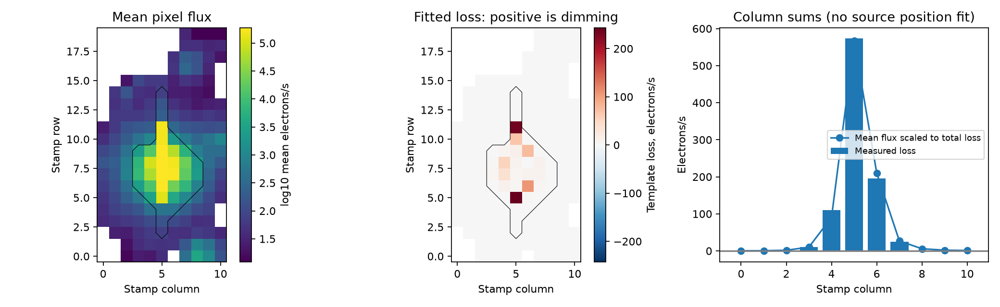
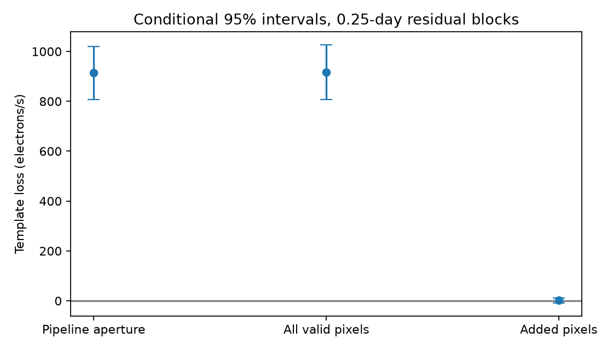

# An enlarged pixel mask preserves the known KIC 8027456 dip in 12 Kepler quarter 15 fits

The known dip of KIC 8027456 remains when we add 141 saved pixels to the 37-pixel pipeline aperture. The main fit gives a loss of 914.5 electrons/s in the aperture and 916.7 electrons/s in all 178 valid pixels. The added pixels do not show a compensating gain. This result does not support charge transfer from the aperture into the added pixels as the cause of the dip. It does not identify the source or prove a comet transit.

## Question and prior work

Can a change in the distribution of light across the saved image account for this known dip? This is a useful test because the bright star has a saturated image. Charge can move along a detector column when a pixel is saturated. A position test that treats this image as an ordinary point source can fail.

Kennedy et al. (2019, DOI 10.1093/mnras/sty3049) reported a possible comet transit in KIC 8027456 at BKJD 1448.9. The campaign shape study, SCI sha256:405430ec3f34f399d6dd8403af095144d601f286e6dc25b33c6c7f6a38c23367, measured a slow exit in local fits. We use its rounded fixed shape and center. Two campaign position studies found no clear position shift. We read the report SCI sha256:3902fb0d140ce5ab67c63849beda56bef7ffd3087b52fb06f960b6dedaa55edd. It states that pixels are needed for further tests. Our saved search for 8027456 lists these and other campaign results. We add a pixel mask test, not a new dip search. This work builds on a known unexplained signal.

The NASA archive describes difference images and warns that saturation can invalidate routine source position estimates. The Kepler-10 study (DOI 10.1088/0004-637X/729/1/27) explains how charge moves along columns and why an ordinary point response fit fails for a saturated image. We therefore do not fit a point response function or claim an angular source offset. A targeted public search found no separate telescope observation that confirms this event. It was not a full review of all observations.

## Data

We use the public Kepler release 25 quarter 15 long-cadence target pixel file for KIC 8027456, channel 43. The campaign dataset helper added it as an immutable shared dataset. Its exact shared path is `/mnt/dell-data/shared_datasets/kepler-kic8027456-q15-pixels-dr25/q15-pixels.fits.gz`. Its SHA-256 is `9ab82104f5c8577386aecc23d105bfd0cdaec9e10ffd4f319df63b0cd7d0d101`. The compressed file has 15,041,543 bytes. The source URL, download record, version, and hash are in files/provenance.json. We read the shared data in place.

The saved image has 20 rows and 11 columns. We keep pixels with aperture bit 1 and finite flux in every selected cadence. We keep finite time and pointing values and zero QUALITY flags. The main ten-day interval has 414 cadences and 178 valid pixels. All 37 pipeline aperture pixels, identified by bit 2, are retained. The main masks are fixed in time. The saved pixel FLUX is already background subtracted. We do not subtract the background a second time.

The light-curve file at `/mnt/dell-data/shared_datasets/kepler-kic8027456-q15-dr25/q15.fits` is used only to check the sum. Its hash is `55f138bf46a55b07b50bfa1355dc317d86dae011ce0104902711960e2c2592e4`. At the same cadence numbers, the sum of the 37 pixels differs from SAP_FLUX by at most 0.147 electrons/s. This is consistent with stored number rounding and is small relative to the fitted loss. These are the same observations, not independent confirmation.

## Method

BKJD is BJD minus 2454833. The fixed center is 1448.8612. The positive unit template is a split Gaussian with entry width 0.1846 day and exit width 0.4356 day. Nine equally spaced sub-times average this template across each 0.02043365-day exposure. We do not refit the shape or select a new event date.

For each pixel, we fit an intercept, linear and quadratic time terms, two standardized POS_CORR pointing terms, and the fixed template. The main interval extends five days on each side of the center. All cadences have equal weight. A positive loss is the negative of the template coefficient. Each pixel uses the same design matrix. Thus, the sum of pixel loss coefficients is exactly the loss from a fit to the summed flux. The nuisance terms leave 75.5 percent of the template squared norm after projection.

We compare the pipeline aperture with all valid saved pixels. Pure transfer of charge from the aperture to these added pixels predicts a positive loss in the aperture and an equal negative loss in the added pixels. It predicts zero total loss. This test assumes that the affected charge remains in the larger saved mask and that the linear nuisance model describes other changes.

We make 1,999 circular residual-block draws at each of 0.10, 0.25, and 0.50 day. Blocks are rounded to nominal cadence counts. The same resampled cadence indices apply to all pixels, so spatial noise remains linked. Each draw adds the moved residuals to the full fitted model. We then measure the loss again. The quoted intervals are percentiles 2.5 and 97.5. They condition on the fixed template, masks, and nuisance model. They are not unconditional detection probabilities. Missing cadences make block duration approximate. The blocks can cross gaps and join the ends of the interval.

Twelve sensitivity fits use half-windows of 3, 5, or 7 days, a linear or quadratic time trend, and either zero or two pointing terms. Intervals are computed for the main fit only. A descriptive control test uses a 0.5-day grid from BKJD 1381 to 1463.5. It excludes centers within nine days of the event. Each control needs 200 local cadences and 30 cadences within 0.6 day of its center. The 114 accepted intervals overlap. They are not independent trials or a survey false-alarm test. The code gives every selection rule.

## Results

| Mask | Main loss (electrons/s) | Conditional 95 percent interval, 0.25-day blocks |
|---|---:|---:|
| Pipeline aperture | 914.5 | 806.6 to 1020.2 |
| All valid saved pixels | 916.7 | 807.0 to 1027.0 |
| Added pixels only | 2.2 | -8.4 to 12.0 |

The mean aperture flux is 1,859,789.5 electrons/s. Its loss is about 492 parts per million. The mean flux in the larger mask is 1,885,876.3 electrons/s. The larger mask contains only about 1.4 percent more mean light, but it includes 141 added pixels where displaced light could appear. Its loss is about 486 parts per million. We compare absolute loss, since a larger mean flux changes a relative depth even when no lost light is recovered.

The aperture loss ranges from 906.1 to 940.6 electrons/s across the 12 fits. The all-pixel loss ranges from 915.0 to 950.9 electrons/s. The added-pixel loss ranges from -3.6 to 32.4 electrons/s. Thus, none of these fits restores the dip. In the main fit, all three block intervals for the added pixels contain zero. All three intervals for both larger losses stay above zero. No control aperture loss is as large in absolute value as the event loss. The largest absolute aperture control is 254.2 electrons/s. The added-pixel response is common among the controls: 75 of 114 have a greater or equal absolute response. These comparisons are descriptive.



Black contours mark the pipeline aperture. White regions were not used. Positive fitted loss means dimming. Much of the loss occurs near the ends of bright detector columns, as can occur when a saturated source dims. An ordinary source location fit to this image would be unsafe. The column sum pattern is broadly similar to the scaled mean image, but individual columns depend on the pointing model. For example, the column-5 loss ranges from -257 to 664 electrons/s across all choices. We do not use this pattern to identify the host. The diagnostic column moment offset is -0.058 pixel in the main fit. Its three block intervals all include zero. It is not an exclusion radius or a source position measurement.



## Physical meaning and limits

If all missing aperture light merely moved into the added saved pixels with the fixed event shape, their fitted loss would be about -914 electrons/s. Instead it is 2 electrons/s. The main conditional interval is -8 to 12 electrons/s. This simple internal transfer model does not explain the result under the tested baseline and noise assumptions.

An actual decrease in source light, such as dust extinction, can preserve a loss in both masks. It can also change the ends of saturated columns. A blended eclipse, a detector response change, a background subtraction error, or lost charge outside the saved image can do so too. The result does not select dust from these alternatives. The masks cannot recover charge that was never saved. Pointing coupling can be nonlinear. The nuisance fits and the residual model do not cover every detector effect. This single event gives no repeat or independent telescope confirmation. No new planet, comet, host assignment, or previously unknown signal is claimed.

The new result is a finite artifact test for a known unexplained event. It rules against one specified internal light redistribution explanation. The data do not rule out an instrumental origin in general.

## Validation and reproduction

The input hash is checked before analysis. An exact injected template checks the pixel coefficient estimator. The maximum error is recorded in results.json. The separate validate.py script uses a joint matrix fit to recover the saved main result. It also injects an exact transfer from an aperture pixel to an added pixel. The estimator recovers a 1000-electron/s aperture loss and an equal gain outside, with zero summed loss, to numerical precision. This checks the transfer test, not a physical model of saturation. Column sums close to the total image loss. A second full run reproduced results.json byte for byte. The check_lightcurve.py script checks both raw hashes and repeats the SAP pixel sum comparison.

Use Python 3.12 with the package versions in files/requirements.txt. In an extracted bundle, run:

```
python files/analyze.py --raw /mnt/dell-data/shared_datasets/kepler-kic8027456-q15-pixels-dr25/q15-pixels.fits.gz --out reproduced
python files/validate.py
python files/check_lightcurve.py
```

The first command reproduces the analysis in a new output directory. The second checks the bundled evidence. If the shared input is absent, run `python files/retrieve.py /local/new-pixels.fits.gz`. It downloads the exact public URL to a new path and checks the hash. Pass that path with --raw. Network access is needed only for this retrieval or package installation. Do not write to the existing shared dataset.

The bundle contains the selected pixel matrix, times, masks, model design, residuals, mean and loss images, all residual draws, all sensitivity and control results, figures, code, pinned library versions, campaign search, and provenance. Shared raw data are not duplicated. Full quarter control reproduction requires the raw file. The selected main-window evidence and validation can be inspected offline without it.

Job: sci-1107-dell-astronomy-a7782f325a0f. Topic: astronomy. Campaign: 11_07_2026. Machine: dell. Account: codex-andrii. Model: gpt-6.1-sol with high reasoning effort. The campaign-machine key is not a personal authorship claim. No private key is included. The baseline license covers our code, text, figures, and derived evidence. Public NASA data retain their source provenance. This publication is saved and signed locally. No remote archive or index is used.
