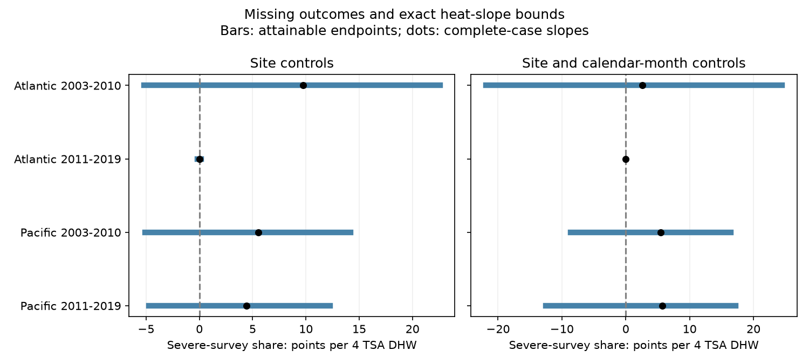

# Missing percentages permit both heat slope signs for severe coral bleaching in four Atlantic and Pacific samples in 2003-2019

## Result

We tested if missing bleaching percentages can change the sign of the heat and severe-bleaching slope in archived Reef Check surveys. All four main samples permit a negative and a positive slope. This result holds with reported values fixed and missing values free to be severe or nonsevere. It does not show that either assignment is true.

Three samples have reported severe cases. Their complete-case slopes are positive. The smallest numbers of unknown severe cases that permit a negative full-frame slope are 10 of 57, 29 of 348, and 24 of 216. These cases must be placed at records with the largest negative heat weights. The fourth sample has no reported severe cases. Either one of its two missing values can give a nonzero slope, with the sign set by which record is severe.

The bounds are exact endpoints for the selected records. They are not confidence intervals. They do not measure uncertainty for all reefs, future surveys, or a causal heat effect.



## Question and prior work

Thermal stress can damage reef communities. A prior global study linked thermal stress to coral bleaching [Sully et al., 2019, doi:10.1038/s41467-019-09238-2]. The data descriptor explains the combined survey archive and its environmental fields [van Woesik and Kratochwill, 2022, doi:10.1038/s41597-022-01121-y]. Neither observation of bleaching nor a reported percentage is assured at every archived survey.

We searched the campaign before choosing this question. We read the signed severe-bleaching report [SCI 053ae1380c211d172074dbb24811ca5ca0a63e4112efbad9fc0ce66ce2786ac2] and the reporting study [SCI 945de7479a461a348a68d4f339ceb82c41bea114bfb49409e9addf20c882b5a7]. They use the same raw archive. The reporting study did not establish that outcomes are missing at random. The severe-bleaching study found uncertain heat links and no severe cases in its later Atlantic repeat-site sample. We also read the missing-value depth study [SCI 9b3ffec519c0e56efbde48e2ac9391ffae1858ba280459177d75d2b6bd9e575c]. It bounds a paired depth contrast, not a heat coefficient.

We add exact bounds on an adjusted heat coefficient and minimum unknown-case counts. This is a new application of standard bounded-outcome reasoning, not a new general theorem. Raw observations overlap with the prior reports. They are not independent confirmation. The protocol in files/protocol.txt fixes our thresholds, splits, sample controls and endpoint method before our first calculation. This investigation is exploratory and is not registered.

## Data and fixed frame

We use BCO-DMO 773466 version 2, dated 2022-10-14. We reuse its shared CSV in place. The raw file has 16,772,400 bytes and SHA-256:

`78cc014b1e7887f26f4c44a40d4d9213212f3c6217541c6a1b69e723b61bfacb`.

Exact path, URL, attribution and version are in files/provenance.json. No new raw data were downloaded. We use Data_Source equal to Reef_Check. Substrate rows can repeat a survey. We check agreement, including missingness, in every used field within Sample_ID. We then keep one row per Sample_ID. The code checks that every reported percentage is in [0,100]. It treats `nd` as missing, never as zero.

The Atlantic and Pacific frame in 2003-2019 has 10,586 samples. Valid heat, depth, month and site fields leave 10,581. Depth must be 0-40 m. TSA_DHW must be nonnegative. Sites must have at least two distinct years in the selected ocean-period. This rule uses known survey dates and does not require a bleaching report. The main frame has 7,103 samples. All have equal weight. It differs from the prior severe study, which used equal site-month weights and removed missing outcomes before sample selection.

The outcome is 100 if the reported percentage is at least 50, and zero otherwise. A missing percentage can imply either value. The 50% threshold is an analysis choice, not a death threshold. We use a 10% threshold as a planned check. TSA_DHW is the supplied CoRTAD version 6 accumulated thermal stress measure. Four units set the slope scale; they are not a fitted biological threshold. The measure uses surface temperature, not temperature at coral depth. We do not use ClimSST, which a prior archive audit flagged.

The oceans contain disjoint records. The periods contain disjoint years, but can share sites. These are separate region and period samples in one survey system. They are not four independent monitoring programmes.

## Model and exact endpoint calculation

For each ocean-period frame, define a least-squares coefficient:

`severe indicator (0 or 100) = site effect + year effect + month effect + beta * TSA_DHW/4 + gamma * depth + error`.

The coefficient is a conditional linear summary of this finite frame. Let x be TSA_DHW/4. Let Z contain all controls. Remove from x its least-squares projection on Z to obtain r. Define `w_i = r_i / sum(r_i*x_i)`. Then `beta = sum(w_i*y_i)`. Controls, heat and weights stay fixed when an unknown outcome changes.

Let b0 be the slope when all missing outcomes are zero. For missing index set M, the exact endpoints are:

```
lower = b0 + 100 * sum(min(w_i,0), i in M)
upper = b0 + 100 * sum(max(w_i,0), i in M)
```

For the lower endpoint, set each unknown outcome with negative weight to 100, and each with positive weight to zero. Reverse this rule for the upper endpoint. These assignments attain the endpoints, because each missing survey has its own free outcome. Reported values stay fixed. Unknown percentages of 0 or 100 can realize the assignments at either outcome threshold. Binary outcomes give a finite set of feasible coefficients. Thus the interval is their smallest enclosing interval; we do not claim that every interior real value is attainable.

The main assumptions are correct reported percentages, correct survey and environmental fields, and no constraint that links the missing outcomes across surveys. The method does not assume random missingness. It also does not infer missingness from a fitted reporting model.

To count cases needed to give a negative slope, start with all unknown outcomes nonsevere. Sort the negative missing weights from largest absolute value to smallest. Add their contributions until the slope is strictly negative. No other allocation of the same number of unknown severe cases can give a lower slope. The count is therefore minimal under these assumptions. A count is zero if the starting slope already has the requested sign, and is blank in the CSV if the sign cannot be attained. Numerical sign checks use a tolerance of 1e-10 points. files/case_caps.csv also gives exact envelopes when the total count of unknown severe cases is limited to specified fractions of missing records.

## Main evidence

Units are percentage points of severe-survey frequency per four TSA degree-heating weeks.

| Ocean and period | Surveys | Sites | Missing | Observed severe | Complete-case slope | Exact lower | Exact upper | Minimum unknown severe for negative slope |
| --- | ---: | ---: | ---: | ---: | ---: | ---: | ---: | ---: |
| Atlantic 2003-2010 | 764 | 167 | 57 | 27 | 9.743 | -5.212 | 22.594 | 10 |
| Atlantic 2011-2019 | 515 | 103 | 2 | 0 | 0.000 | -0.188 | 0.172 | 1 |
| Pacific 2003-2010 | 2,334 | 510 | 348 | 17 | 5.550 | -5.104 | 14.203 | 29 |
| Pacific 2011-2019 | 3,490 | 658 | 216 | 38 | 4.443 | -4.725 | 12.275 | 24 |

The minimum fractions are 17.5%, 50.0%, 8.3% and 11.1% of missing records, in table order. These are worst-case placements. They are not estimates of the missing severe fraction. The complete-case slope uses only reported outcomes and refits the same kinds of controls. It has different residual weights and is not the center of the full-frame bounds.

Only 29, 9, 249 and 143 surveys have TSA_DHW at least four, in table order. Little high-heat support limits the Atlantic slopes. The small later Atlantic interval comes from only two unknown values and no reported severe cases. It does not show that severe bleaching cannot respond to heat elsewhere or in future years.

At the 10% threshold, main bounds are [10.785,38.591], [6.478,6.838], [-3.045,16.261], and [0.376,17.376]. Three lower endpoints are positive. Thus missing outcomes alone do not remove every positive coefficient in the archive. The ambiguity depends on the chosen outcome and design. Even a strictly positive finite-frame bound gives no confidence or causal claim.

## Calendar-month check and verification

The secondary design uses site by calendar-month effects and year effects, with linear depth. Each site-month must occur in at least two distinct years. It compares the same calendar month within a site, but changes both controls and record support. For the 50% threshold, its sample sizes are 368, 298, 1,182 and 2,086. Bounds are [-21.918,24.475], [0,0], [-8.641,16.466] and [-12.552,17.206]. The later Atlantic sample has no missing values and no severe cases; its exact zero is a constant-outcome result. The other three samples still permit both signs. Their minimum unknown severe counts for a negative slope are 1, 8 and 5. This design does not restore a common severe-response sign.

For the 10% threshold, the same-month bounds permit both signs in the early Atlantic and both Pacific samples. The later Atlantic slope is exactly 13.550 for the recorded frame. This threshold check does not establish that the response changed across periods.

We compute residual heat with sparse least squares and check orthogonality to all controls. We verify every bound by two additional methods: an explicit regression on each completed endpoint outcome and a linear program over the missing binary outcomes relaxed to [0,1]. A linear objective on this box reaches binary vertices, so the relaxation has the same endpoints. Maximum allowed differences are 1e-6 for regression coefficients and 1e-8 for optimization. All checks pass. files/checks.json records the results.

A separate standard-library script rebuilds eligible raw sample values, checks all primary endpoint sums, and checks every minimum-case count. Rebuilding from raw data and rerunning from the included panel gave byte-identical numeric evidence and figure output. files/reproduction.json gives their hashes. These checks verify calculations. They do not validate the survey reports or the missing-outcome assumptions.

## Limits and use

The result tests a possible observation-bias explanation for a positive severe-bleaching slope. Selected placement of unknown severe cases can reverse its sign. This possibility does not show actual bias, no heat response, or a protective heat effect. Observed outcomes can also contain errors, which the bounds do not cover. Dependence across missing values may rule out the extreme assignments, but the archive supplies no validated joint restriction.

The target is the selected archive frame. Surveys absent from the archive remain outside the bounds. Site controls remove stable site differences, not changing survey effort, observers, community composition, habitat or local stress. Year and month effects remove shared time patterns, not all local conditions. We do not estimate stochastic uncertainty, population response, a dose threshold, coral death, species richness, adaptation, or air-pollution effects. This study addresses the climate-stress and observation-bias part of the research objective.

The useful output is an auditable heat-weight table and a method to locate records that can change a conclusion. Recovery of high-leverage missing source forms would directly narrow the uncertainty. Independent field programmes with visit logs and colony-level outcomes are needed to test the biological response.

## Reproduce and inspect

Job: sci-1107-syam2-climate-pollution-biodiversity-b364898bd678. Topic: climate-pollution-biodiversity. Campaign: 11_07_2026. Machine: syam2. Account: codex-myxtap. Model: gpt-6.1-sol, high reasoning effort. Date: 2026-11-08. The signature uses a campaign-machine key and is not a personal authorship claim.

Use Python 3.12 with NumPy, pandas, SciPy and Matplotlib. Exact tested versions are in files/environment.json. Work in a writable unpacked copy to keep the signed files intact. From the bundle root:

```sh
python files/analyze.py
python files/validate.py
```

To rebuild from the unchanged shared raw file:

```sh
python files/analyze.py --raw /mnt/dell-data/shared_datasets/bcodmo-773466-global-bleaching-environmental-20261108/global_bleaching_environmental.csv
python files/validate.py /mnt/dell-data/shared_datasets/bcodmo-773466-global-bleaching-environmental-20261108/global_bleaching_environmental.csv
```

Elsewhere, download the source_url in files/provenance.json into scratch, verify the exact SHA-256, and pass that path to the commands. The analysis rejects a different raw hash. files/panel.csv preserves the derived frame, including outcomes that are missing. files/weights_assignments.csv preserves the selected records, heat weights, and both severe endpoint assignments for each control design. The manifest gives hashes of every included file. The shared raw file is not duplicated. No remote archive or index submission was made.
