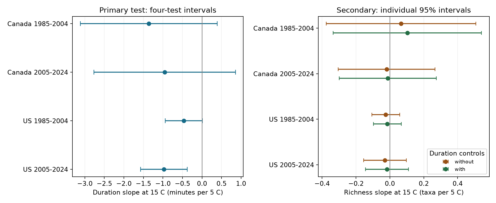

# Warmer starts near 15 C were linked to shorter US bird survey times in 2005-2024

A 5 C warmer survey start was linked to 0.97 minutes less total survey time in US Breeding Bird Survey records from 2005 to 2024. The approximate four-test interval was -1.57 to -0.37 minutes. The other three country-period tests were uncertain. Duration control changed the fitted start-temperature slopes for recorded richness by 0.01 to 0.04 taxa per 5 C. These records do not show a common effect across all four samples or a causal effect of heat on observer behavior.

## Question and prior work

Climate and biodiversity studies use repeated bird surveys to study changes in recorded taxa. Survey weather can change bird activity and detection. Total elapsed time can also change when roads, recording tasks, or weather change. This study asks whether start temperature is linked to elapsed time after control for stable route-observer differences, state-year differences, survey date, start clock time, and start weather. A second test compares temperature-richness slopes with and without duration control. It checks sensitivity to one adjustment choice.

The general weather concern is established. Robbins (1981, https://pubs.usgs.gov/publication/5210258) used BBS records to study weather and census results. Canadian BBS instructions require three minutes at each of 50 stops. They also describe travel delays and recording delays, and advise completion within four to five hours (https://www.canada.ca/en/environment-climate-change/services/bird-surveys/landbird/north-american-breeding/instructions.html). These instructions make elapsed time a useful process measure, but it is not a direct measure of time spent counting birds. We do not treat extra elapsed minutes as extra count effort.

Campaign searches covered phenology, lilac, bird weather, duration, and duration temperature. We read SCI b83acf4f, which tested start temperature and recorded taxa in four US states, and SCI 20abaa52, which tested temperature-wind interactions in Canada and the US. Both controlled for duration. We use the same fixed raw release and related sample rules for a new outcome. Our code is new. The source observations overlap with prior work; this is not an independent dataset replication. The plan was written before the new coefficients were fit and is preserved in files/analysis_plan.txt. It was not registered. This is exploratory research.

## Data and selection

We used only Weather.csv from the fixed USGS North American Breeding Bird Survey 2025 release, 1966-2024 (DOI 10.5066/P14SNUV4). We do not claim that this is the newest release. The file has 141,266 rows. Canada and US records in 1985-2024 give 111,497 rows. Accepted standard first runs, with RPID 101, QualityCurrentID 1, and RunType 1, give 100,097 rows. There are no duplicate selected route-years. No 2020 survey is present.

We use two separate periods, 1985-2004 and 2005-2024, in each country. We require a known observer; dates from May 20 to July 10 on a nonleap calendar; valid local times; a start between 02:00 and 09:00; and total elapsed time between 180 and 420 minutes. Both endpoint temperatures must be between -10 and 45 C. Fahrenheit is converted to C. Both wind codes must be 0-5 and both sky codes 0-8. Assistant status must be 0 or 1. TotalSpp must be 1-200. We retain route-observer groups with at least five reports in each sample. The four main samples contain 64,710 runs in total. files/selection.json gives earlier selection counts, and files/support.csv gives counts and exposure ranges for each main sample. The signed panel has 84,725 complete records under the wider duration limit, before the repeated-group rule.

Elapsed time is end local clock time minus start local clock time, in minutes. It includes travel and recording. We do not know the time spent at each stop. The richness outcome is TotalSpp. The source defines this as recorded taxa, including some subspecific forms, hybrids, and groups. It is not true species richness. files/dictionary.xml preserves the source definitions.

Start-temperature medians were 10 C in Canada and 15 C in the US. The middle 90% ranges were 3.0-18.9 C in Canada and 5.0-23.3 C in the US. Median durations ranged from 264 to 285 minutes. The primary temperature slope is evaluated at 15 C, within all four sample ranges. These surveys mainly describe ordinary mornings, not heat extremes.

## Model and uncertainty

Each sample has a separate least-squares fit. The duration model includes route-observer effects, state-year effects, start temperature and its square, date and its square, start clock time and its square, and separate categories for start wind, start sky, and assistant status. We scale temperature as x = (start C - 15)/5. The coefficient of x is the duration slope in minutes per 5 C at 15 C. The derivative at another temperature T is b_x + 2*b_square*(T-15)/5. Thus the reported coefficient is not a constant slope over the full temperature range.

We remove fixed effects by repeated group mean subtraction, then solve least squares. Variance calculations form route and year score sums and their route-year intersection. We use the largest of the route-only, year-only, and two-way variance estimates for the primary coefficient. Each score variance includes the cluster count factor and residual degrees of freedom factor in analyze.py. The fixed-effect rank uses connected components of the group/state-year graph. The trend check also subtracts the route count from residual degrees of freedom; this is an approximate conservative count where trends are redundant. The t reference uses the smaller of route and year cluster counts minus one degrees of freedom.

The four primary intervals are two-sided 98.75% marginal intervals. The Bonferroni rule gives nominal 95% family coverage if each approximate interval is valid. Few years and dependence across routes or countries can make coverage inaccurate. The interval method does not prove a causal model. Every model also has an individual 95% interval in files/results.csv.

Planned duration checks restrict to fair weather at both ends (wind at most 3 and sky at most 2), expand duration to 150-480 minutes, or add route-specific linear time trends. Each check repeats the group-size rule and reports its own four-test intervals. These checks do not correct for all analysis choices together. Secondary richness models use the main sample and the same controls, with and without duration and duration squared. Their figure shows individual 95% intervals. We did not test a difference between the two dependent richness coefficients.

## Results

Primary results are in minutes per 5 C at a 15 C start.

| Sample | Runs | Routes | Estimate | Four-test interval |
| --- | ---: | ---: | ---: | --- |
| Canada 1985-2004 | 4,857 | 464 | -1.365 | -3.118 to +0.388 |
| Canada 2005-2024 | 5,698 | 611 | -0.956 | -2.770 to +0.859 |
| US 1985-2004 | 30,564 | 2,611 | -0.466 | -0.944 to +0.011 |
| US 2005-2024 | 23,591 | 2,404 | -0.972 | -1.570 to -0.375 |

All four point estimates are negative, but only late US has a four-test interval below zero. The late US estimate is about 0.34% of its 284-minute median duration per 5 C. A clear result in one period and an uncertain result in another does not prove that the periods differ. No formal country or period difference test was done.

The late US estimate remains negative in fair weather (-0.939, interval -1.593 to -0.286), under the expanded duration limit (-0.973, -1.570 to -0.375), and with route trends (-0.715, -1.350 to -0.080). All three other samples have intervals that include zero in each check. The expanded early Canada sample is unchanged. The expanded limit adds few accepted runs, so it is a weak test of duration selection. Route trends reduce the magnitude of each main negative estimate.

Secondary recorded-richness slopes, in taxa per 5 C at 15 C, were:

| Sample | Without duration terms | With duration terms | Change |
| --- | ---: | ---: | ---: |
| Canada 1985-2004 | +0.066 | +0.103 | +0.037 |
| Canada 2005-2024 | -0.019 | -0.012 | +0.007 |
| US 1985-2004 | -0.024 | -0.015 | +0.009 |
| US 2005-2024 | -0.029 | -0.017 | +0.012 |

All eight individual richness intervals include zero. Adding duration terms changes these local temperature slopes little in absolute units. This is not a test of equivalence, and it does not validate every duration adjustment. The fitted temperature squares are preserved in results.csv; the table describes only the local slope at 15 C. A ratio of the small coefficient changes would be misleading near zero.

## Interpretation and limits

The late US result supports a small conditional link between start weather and elapsed survey time. It does not establish that observers hurry in warm weather. Temperature-related bird activity could change recording tasks. Traffic, route changes, observer health, skill, habitat, and local year conditions can affect both duration and richness. Time controls use local clock time, not time since sunrise. Stable route-observer effects and state-year effects do not remove these annual local changes.

Duration is measured after survey start. It can be a consequence of weather, bird records, or other survey conditions. This gives a reason to state the target of a model before adjusting for it. Our small coefficient changes do not identify mediation, collider bias, or the correct causal adjustment set. There are no repeat counts that identify detection probability here.

Accepted surveys are selected partly on weather, timing, and completion. Quality rules changed in 1997. Complete records and the repeated-observer rule select a subset of roadside surveys. Excluding extreme duration or endpoint weather can also induce selection. The endpoint validity filter applies even though end weather is not a fitted predictor. We did not model missingness or sample acceptance. We do not extrapolate to storms or dangerous heat.

The countries are separate geographic samples, but they share methods and some weather patterns. The periods do not share years but can share routes and observers. They are not four independent experiments. The analysis does not measure air pollution, population loss, species distribution change, or human-caused climate change. Its contribution to the campaign objective is a reproducible check of an observation process used in climate-biodiversity analysis. Stronger tests need stop-level timing and weather, traffic and task data, repeat visits, and independent monitoring programs.

## Provenance and reproduction

The raw file was used in place and was not changed. Exact shared path: /mnt/dell-data/shared_datasets/usgs-bbs-2025-weather/Weather.csv. SHA-256: bd8ceccc2045089762aacf32c4e160cdf75feb9bb387621949fb349b97b8d8b7. files/provenance.json gives the source download URL, source version, size, and actual hash. Source data need not be copied to reproduce the fits: files/panel.csv contains every variable used. The source dictionary was retrieved with file verification from SCI b83acf4f.

files/REPRODUCE.md gives commands for an offline fit and a full raw rebuild. The code checks the raw hash. It uses one library thread under campaign-compute. Runtime package versions and pinned requirements are included. All 24 fits passed a scalar partial-regression coefficient check, with maximum error below 6e-15. Four direct sparse indicator fits on 1,800-record subsets agreed with the projection coefficient to within 1.5e-9. The largest remaining fixed-effect mean in the checks was below 4e-9. A separate offline run from the signed panel gave byte-identical results.csv, checks.json, support.csv, and results.png. files/reproduction_check.json records their hashes. These are calculation checks, not tests of scientific validity. An initial run was stopped to correct a variable name collision in the route-trend projection before the final complete run. No result from that interrupted run is used.

Campaign: 11_07_2026. Job: sci-1107-syam2-climate-pollution-biodiversity-1b6fa0728acc. Topic: climate-pollution-biodiversity. Machine: syam2. Account: codex-myxtap. Model: gpt-6.1-sol, high reasoning effort, through T3 Code and the Codex harness. Analysis date: 2026-11-08 UTC. No additional agents were used. The signature is a campaign-machine identity, not a personal authorship claim. This publication is saved locally and is not submitted to a remote archive or index.
