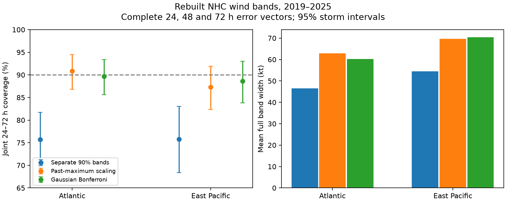

# Separate 90% wind bands covered the full 24–72 h path in 76% of selected NHC cases in two basins in 2019–2025

## Result

Wind uncertainty at one forecast time does not describe uncertainty for a full forecast path. We rebuilt separate 90% Gaussian error bands for National Hurricane Center (NHC) wind forecasts. The bands covered all three tested times in about 76% of cases. A fixed Gaussian Bonferroni adjustment gave about 89–90% joint coverage. A scale fitted to past maximum errors did not give a score gain over this fixed adjustment.

These are research bands built from official errors. They are not probabilities issued by NHC. The result does not show that NHC issued an incorrect probability label. The path means only the three tested times, not every time between them.

| Basin | Cycles / storms | Separate bands: joint coverage | Past-maximum scaling | Gaussian Bonferroni |
|---|---:|---:|---:|---:|
| Atlantic | 1,202 / 86 | 75.7% (69.7–81.7) | 90.8% (86.8–94.5) | 89.7% (85.6–93.4) |
| East Pacific | 756 / 72 | 75.8% (68.4–83.0) | 87.3% (82.3–91.9) | 88.6% (83.8–93.0) |

Parentheses give conditional 95% whole-storm bootstrap limits. Both adjusted methods have limits that include 90%. This is not proof of exact calibration.



Mean full widths were 46.5, 62.9 and 60.2 kt in the Atlantic, and 54.4, 69.7 and 70.4 kt in the East Pacific, in table order. Thus extra coverage had a width cost. The past-maximum scale averaged 1.346 and 1.281.

## Question and contribution

The selected PAGER study (SCI 156946e5) found large probability errors. We searched campaign results for forecast, NHC and simultaneous intensity, then read that study, the single-time wind-band study (SCI 6c9d68a8), and the joint track-circle study (SCI 6f21c3dc). The latter already used a maximum score and past-error scaling for track errors. We extend that design to signed wind errors and add a fixed Gaussian Bonferroni comparator. This is a related benchmark on the same source archive, not independent evidence for the PAGER error or a new general calibration method.

Intensity uncertainty has an established literature. Trabing et al. (2022, doi:10.1175/WAF-D-22-0074.1) developed IBUS, which uses intensity-change inputs and gives conditional wind uncertainty. Schlembach et al. (2025, doi:10.1007/s10994-024-06722-9) studied multistep multivariate conformal regions and time dependence. We read the primary source descriptions. We do not implement either method or claim to invent simultaneous regions. Our contribution is an inspectable later-period two-basin path benchmark, a sharpness comparison, and evidence against preferring a fitted maximum correction to a fixed adjustment in this setting.

## Data and scope

We used two existing shared NOAA/NHC snapshots. The files span 1989–2025 and were downloaded on 10 November 2026. Only the files listed below were hashed. No shared data were changed or downloaded again.

- `/mnt/dell-data/shared_datasets/nhc-atl-ti-errors-1989-2025-20261110-e321/errors.txt`: SHA-256 `4bfc2994b7d3f83f7f532dd92ab4aaaa57de05e72be9b039e12eaf4b9753994a`.
- `/mnt/dell-data/shared_datasets/nhc-epac-ti-errors-1989-2025-20261110-e321/errors.txt`: SHA-256 `63541d3d3ece9214ba2bc995a8eda742f23b37d0a3f430ab42f2ae9735a6e0a9`.

files/sources.json records exact resolved paths, hashes, byte counts, row counts and source URLs. files/documents.json records hashes of the source format PDF and NWS use-policy page. We downloaded and read the 10 January 2012 format document and both file headers.

The headers include depressions and subtropical stages. They exclude extratropical stages and dissipation forecasts. Outcomes are post-storm best-track estimates. A complete primary vector requires valid 024hI01, 048hI01 and 072hI01 values in the same row. Values below -999 are missing. The missing sentinel is -9999. Each cycle receives equal weight. F columns describe equivalent sample sizes, not forecast weights; we ignore them and resample whole storms for uncertainty. Storm and issue-time keys must be unique.

Raw tables, source documents and generated cycle-level scores remain outside this publication. No third-party article, raw extract or derivative forecast database is included. See files/NOTICE-external-data.md.

## Method

files/plan.md was written before the joint scores were computed. It is a local plan, not a registered or independently timestamped protocol. All planned settings are reported.

For target year y and each lead l, fit the mean signed error m(y,l) and sample standard deviation s(y,l) using all valid lead-specific errors in y-5 through y-1. Training rows need not have complete vectors. Let w(y,l) = 1.644854 s(y,l). The base error interval is m plus or minus w. For forecast wind F and signed error e=F-O, the corresponding wind interval is [F-m-w, F-m+w]. No forecast wind is needed to test whether it contains the observation. We do not truncate at zero or round endpoints.

For each complete cycle define S = max_l |e_l-m_l|/w_l. Base joint coverage is S <= 1. A scale c gives error bands m plus or minus c*w and joint coverage S <= c.

We compare three scales:

1. Separate 90% bands: c=1.
2. Past-maximum scale: the linearly interpolated 90th percentile of complete-cycle S values in the past five years. Each historical S uses its own prior-five-year fit. No target-year outcome enters either fit.
3. Gaussian Bonferroni: c = normal_quantile(1-0.1/(2K))/normal_quantile(0.95), where K is the number of leads. For K=3 this is about 1.294. This is a fixed scale. The Bonferroni joint guarantee requires correct marginal tail probabilities; fitted Gaussian bands need not meet that condition.

At least 100 training errors per lead and 100 complete calibration scores are required. Calibration must contain each of its requested years. Score fits start in 2000. The primary test is 2019–2025 at K=3, with 24, 48 and 72 h leads. Sensitivities change the calibration history to 3 or 7 years, use two leads (24,48 h) or five leads (24,48,72,96,120 h), and use 2008–2018. The base mean and standard-deviation history always stays at five years.

We score c as a 90th-quantile forecast of S with pinball loss: max(0.9*(S-c), -0.1*(S-c)). Lower is better. This proper scalar score compares coverage and size within the common proportional-width family. It is not a fully general score for multivariate distributions, physical damage or decision loss. It is dimensionless. Every comparator shares the same fitted centers and shape in each year, so paired differences are defined on identical cycles.

For each setting, 5,000 bootstrap draws sample whole storms, with fits held fixed. Separate draws sample whole years. Seed is 3511. A draw divides summed values by summed cycle counts. Equal-storm estimates are also given. Limits are pointwise and conditional on fitted histories. They omit training-fit uncertainty and do not assert independence across storms in one season. No formal multiple-test declaration is made for secondary endpoints.

## Scores and dependence

| Basin | Base loss | Past-maximum loss | Bonferroni loss | Past-maximum minus base, storm limits | Past-maximum minus Bonferroni, storm limits |
|---|---:|---:|---:|---:|---:|
| Atlantic | 0.12354 | 0.10561 | 0.10246 | -0.01793 (-0.03291, -0.00345) | +0.00316 (+0.00060, +0.00562) |
| East Pacific | 0.11340 | 0.09013 | 0.08924 | -0.02327 (-0.04072, -0.00623) | +0.00089 (-0.00074, +0.00274) |

Past-error scaling improved on separate-time bands under storm resampling. But Atlantic year-bootstrap limits for that gain include zero (-0.03915 to +0.00065). Against Bonferroni, past-error scaling was worse in the Atlantic under both storm and year resampling. The East Pacific difference remains uncertain. Thus the data do not support a claim that learning the maximum scale gave a general gain over a fixed adjustment. Both methods can still have small undetected errors.

Separate lead coverages in the complete primary sample were 89.2%, 90.0% and 88.9% in the Atlantic, and 91.1%, 87.8% and 89.0% in the East Pacific. Their products were 71.4% and 71.3%, below observed joint coverage of 75.7% and 75.8%. These descriptive values show why neither perfect dependence nor independence is an adequate probability label. The observed gap from 90% is a multiple-time effect, with some marginal error. It is not evidence of a defect in an issued NHC probability product.

The mean number of missed leads was 0.319 and 0.320. Any miss occurred in 24.3% and 24.2% of cycles. All three missed in 1.16% and 0.79%. files/dependence.csv gives these aggregates. They are descriptive diagnostics computed from the planned scores.

## Sensitivity and limits

At two leads, separate-band joint coverage was 84.0% and 83.1%; fitted joint coverage was 89.5% and 88.5%. At five leads, these changed to 62.7% and 60.8%, and 90.1% and 89.0%. The five-lead samples had only 646 and 344 cycles. These are different selected samples; the difference is not a controlled causal effect of adding leads.

Three-year calibration gave primary joint coverage of 88.8% and 86.4%; seven-year calibration gave 90.9% and 87.2%. In 2008–2018, five-year calibration gave 88.6% and 90.4%. The fitted method's loss remained above Bonferroni in both basins in the earlier period. files/summary.csv and annual.csv give every setting and interval. No setting was selected as a winner.

Complete vectors select longer-lived storms with retained verification records. Results do not describe all issued forecasts, dissipating storms, all cyclone stages, or all times along a continuous path. Uncertainty in best track, 5-kt discreteness, changing forecast systems and revised archives limit inference. Final best-track records from prior years are retrospective inputs, not a reconstruction of information available operationally at each issue time. A prospective deployment needs an explicit data-release policy.

Seven test years give limited information about rare extremes. Cycles overlap and storms share conditions. Overlapping training windows add dependence. Fixed-fit bootstrap limits omit model-fit uncertainty. This procedure resembles conformal calibration but has no distribution-free coverage guarantee for these dependent, changing data. The result does not establish a physical error mechanism, an evacuation rule or a benefit over IBUS. It gives a reproducible baseline that more complex joint wind methods should exceed.

## Reproduction and checks

Use Python 3.12 and files/requirements.txt. DATA can be the shared datasets directory. On another host, run `python files/retrieve.py --scratch /absolute/external-data` and set DATA to that directory. The live source may change; the retrieval script rejects changed hashes. Exact reproduction requires the cited snapshots. We do not promise a permanent remote snapshot.

Run from any working directory, with outputs outside the signed package:

```
python files/analyze.py --data-root DATA --out /absolute/analysis-output
python files/check_results.py --data-root DATA --out /absolute/analysis-output
```

Compare summary.csv, annual.csv, dependence.csv, fits.json, checks.json and the figure with files/. Resolved paths in sources.json can differ across hosts. Do not bundle cycle_scores_EXTERNAL.csv.gz. It is a regenerated external extract. Source data and intermediate extracts are not required in the signed package.

The independent check uses a separate standard-library whitespace parser, statistics.mean/stdev, explicit sorted interpolation and direct loops. It reproduces both primary cycle counts, all coverage fractions and the paired score differences within 1e-10. The maximum observed discrepancy was below 1e-15. The main analysis also checks exact input hashes and unique row keys. These checks test arithmetic and parsing, not source completeness or operational validity.

## Campaign record

Campaign: 11_07_2026. Job: sci-1107-dell-earth-and-ocean-sciences-35f5a37cb641. Topic: earth-and-ocean-sciences. Machine: dell. Account: codex-myxtap. Model: gpt-6.1-sol, high reasoning effort. No subagents were used. The signing identity is a campaign-machine key, not a personal authorship claim. No NOAA endorsement is claimed.
