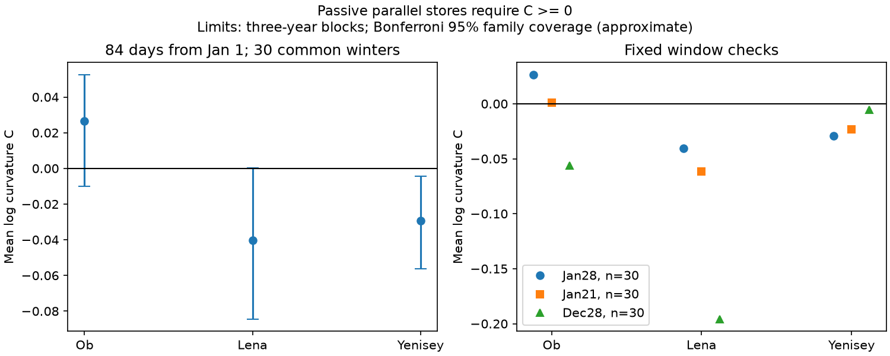

# Yenisey mean winter log curvature was negative in 30 certified winters from 1981 to 2011

Yenisey at Igarka had negative mean log curvature across three consecutive 28-day flow windows from 1 January. The mean was -0.02937. The approximate 95% simultaneous interval across three rivers was -0.05643 to -0.00429. Five-year uncertainty blocks also gave limits below zero. However, flow declined across all three windows in only 9 of 30 Yenisey winters. This is a winter flow-shape result. It is not evidence of faster groundwater drainage.



## Question and prior work

Can a positive mixture of passive stores with fixed drainage rates explain winter flow shape? A valid test can prevent a seasonal flow ratio from being read as a storage property. Winter freshwater supply affects Arctic coastal waters, but this study does not test ocean response.

We searched the campaign for earthquake, streamflow, ocean, recession, Arctic and log convex. We read SCI studies sci:sha256:0b4cedbbbad9bedddd581a7f8671328b2a102a05a4cf373a01949767f13d69d0 and sci:sha256:286340601d5a9bb5735040c0896e9d524d82675af6b5fe68431e0648a7237ec9. They tested autumn-to-March forecasts and period changes in flow ratios. They did not establish a physical recession law. We use their three gauges and late-period scope, with a different within-winter response. This is a same-source extension, not independent data confirmation.

We also read sci:sha256:5b51bdd1081948ebd20dc6b2ef6015cc2ef86b381fdb9c916a4d068a6388e5ed. It gives positive-store moment tests and shows that small errors can remove an exact exclusion in synthetic records. We apply the established three-point condition to field data and give a separate error bound. We do not claim a new convexity theorem. Search does not prove that this field test has no precedent.

Griffiths and Clausen (1997, doi:10.1016/S0022-1694(96)03060-0) derived recession models from multiple stores. Their models include routing and are broader than the parallel exponential class tested here. Ye et al. (2009, doi:10.1029/2008JD010537) studied Lena flow and permafrost. Adam et al. (2007, doi:10.1029/2007JD008525) showed that reservoirs can alter seasonal flow. These works motivate the test and limit a natural-storage interpretation. They do not supply our numerical estimates.

The initial plan is in files/PLAN.md. The question and three window choices were saved before extraction. This is exploratory research, not a registered trial. The error bound and scalar audit were added after the first results.

## Data and selection

We use ArcticGRO Discharge Dataset v20261104, fixed Zenodo record 23957361, doi:10.5281/zenodo.23957361. ArcticGRO compiled Roshydromet daily mean flow in cubic metres per second. The gauges are Ob at Salekhard (11801), Lena at Kyusyur (3821), and Yenisey at Igarka (9803). Source documentation and API metadata state CC BY 4.0. We credit both ArcticGRO and Roshydromet.

The three shared CSV files were used in place. files/provenance.json records their exact shared and resolved paths, URLs, version, byte sizes and SHA-256 hashes. We hashed only the used files. No discharge data were downloaded or changed. Small metadata responses were read from the fixed source. Their hashes and URLs are in files/source_metadata.json. Source records remain external to this publication.

For each requested winter year from 1981 to 2011, take 84 consecutive calendar days from 1 January. Divide them into three disjoint 28-day windows. Require each date, positive finite flow, and flag A at all three gauges. Reject repeated dates. Do not fill gaps. Use the arithmetic daily mean in each window. All tests retain the same 30 years: 1981-1999 and 2001-2011. Winter 2000 fails the common certification rule. The last primary date is 25 March in a non-leap year and 24 March in a leap year. A winter year refers to January, including for the December check.

Checks use three 21-day windows from 1 January and three 28-day windows from prior 1 December. These fixed choices test seasonal dependence; they are not an optimized date search. Selection and source revisions are retrospective. Certified does not mean free of ice-related discharge error. The source README lists no specific corrected values in the used gauge-period windows, but it gives no numerical uncertainty model for them.

## Model constraint and statistic

Suppose unforced outlet flow is Q(t)=sum a_i exp(-k_i t), with a_i>=0, k_i>=0, and at least one positive contribution. Rates are fixed during a winter. We allow different weights and rates between winters. This class excludes time-varying releases, new inputs, delayed routing, changing losses and nonlinear drainage. It is narrower than all passive hydrological models.

For equal-length translated daily windows, the mean is M_j=sum b_i z_i^j, j=0,1,2, where b_i>=0 and z_i=exp(-k_i n). Averaging changes positive weights only. Cauchy-Schwarz gives M_1 squared <= M_0 M_2. Thus

    C = log(M_0) - 2 log(M_1) + log(M_2) >= 0.

The same condition holds for continuous nonnegative rate mixtures. A one-rate exponential gives zero; mixing rates can give positive curvature. Negative C means that the second log-flow step is smaller than the first. If both steps are negative, this means faster proportional decline. If flow first rises, it can instead mean a turn toward lower flow. Passive draining stores also require non-increasing means. Passing curvature alone is not a sufficient test of the full store class.

We estimate each river's arithmetic mean of annual C. If all true winters follow the class, this mean cannot be negative. Use 20,000 circular moving-block draws of three retained winters, seed 751204. Keep years paired across rivers. Recompute the three means in each draw. Report quantiles 0.0083333 and 0.9916667 for each river: Bonferroni adjustment gives approximate 95% family coverage if the marginal block intervals are valid. Five-year blocks are a planned check. Within a check, the adjustment covers three rivers, not all windows or block choices together.

Intervals assume sufficiently stable dependence in the retained sequence. Blocks bridge the missing year and wrap at the sample ends. They do not include gauge error, certification selection or source revision. Trend and changes in operations can invalidate the approximation. The finite set of winters itself has no sampling error; intervals describe a conditional repeated-winter interpretation, not uncertainty in exact archived numbers.

## Results

Primary values are dimensionless natural-log curvature. Limits below use three-year blocks.

| Gauge | Mean C | Simultaneous lower limit | Simultaneous upper limit | Winters with C<0 | Winters with declining means |
|---|---:|---:|---:|---:|---:|
| Ob | 0.02643 | -0.00990 | 0.05254 | 9/30 | 28/30 |
| Lena | -0.04047 | -0.08440 | 0.00012 | 21/30 | 30/30 |
| Yenisey | -0.02937 | -0.05643 | -0.00429 | 21/30 | 9/30 |

With five-year blocks, limits are -0.00920 to 0.05147 at Ob, -0.07956 to -0.00284 at Lena, and -0.05336 to -0.00914 at Yenisey. Lena is close to the primary boundary and its exclusion depends on block length. We do not call its primary result a clear rejection.

At Yenisey the mean first log step is +0.02196 and the second is -0.00742. Thus, its main signal is a downward bend around near-level flow. Even before curvature is considered, its many non-declining winters do not fit unforced drainage. At Lena the mean steps are -0.17893 and -0.21940; this is a declining shape with a more negative late step. At Ob they are -0.13168 and -0.10525. A negative sample mean at Lena is suggestive, but the primary interval does not clearly separate it from zero.

| Fixed window check | Ob mean C | Lena mean C | Yenisey mean C |
|---|---:|---:|---:|
| Jan start, 21-day windows | 0.00081 | -0.06176 | -0.02306 |
| Prior Dec start, 28-day windows | -0.05610 | -0.19571 | -0.00553 |

With three-year blocks, the Jan21 interval is below zero only at Lena. The Dec28 intervals are below zero at Ob and Lena, but only 9 Lena winters have non-increasing December-window means. This check contains many rising shapes and is not a clean recession sample. The Yenisey primary result is not stable across all date choices. Complete check intervals are in files/results.json.

As planned, we describe the subset with declining means. Its primary mean C is +0.02728 at Ob (28 winters), -0.04047 at Lena (30), and -0.03453 at Yenisey (9). These selected-subset values have no new confidence claim. The subset does not remove unobserved inputs or ice effects.

## Error bound and limits

Let each window's true log mean differ from its recorded log mean by at most epsilon, independently in direction. The change in C is at most 4 epsilon. The same bound holds for the mean C. Removing the negative primary Yenisey mean therefore needs epsilon at least 0.0073435. This is about a 0.737% upward multiplicative change. For the mean sign alone, this bound is attained by raising both endpoint logs by epsilon and lowering the middle log by epsilon in every winter.

This small change only removes the negative aggregate curvature. It does not restore every winter's curvature, monotonicity or a positive-store fit. It is a deterministic sensitivity calculation, not an estimate of actual gauge error. Constant multiplicative gauge bias cancels in C; a bias that changes across the three windows need not cancel. Neither source documentation nor this analysis rules out such a seasonal change. Error variance that differs across windows can also bias a mean of logarithms.

The evidence constrains the exact passive parallel-store interpretation of measured winter flow. It does not identify storage, recharge, groundwater fractions, permafrost change, reservoir operation, river ice, evaporation, coastal arrival or ocean effects. Negative curvature can reflect omitted water inputs or routing as well as changing drainage. A positive or uncertain result does not confirm the store model. The small field sample, one source, a common certification filter and conditional intervals limit transfer.

The next useful test is to compare these same fixed windows with reservoir release and ice-correction records, or unregulated tributaries. Direct discharge uncertainty estimates are needed before a small curvature exclusion is treated as physical evidence. These tests were not done. Later years and other basins were not tested.

## Reproduction

Use Python 3.12, NumPy, pandas and Matplotlib. Exact versions are in files/results.json. From the extracted publication root, run:

```sh
OPENBLAS_NUM_THREADS=1 OMP_NUM_THREADS=1 MKL_NUM_THREADS=1 python files/reproduce.py --data-root /absolute/path/to/datasets --out /absolute/path/to/new_scratch
python files/audit.py /absolute/path/to/datasets /absolute/path/to/new_scratch
```

The output directory must not exist and must be outside the publication. Without --data-root, the script retrieves the three fixed CSV URLs sequentially into separate scratch and rejects a hash mismatch. To audit downloaded files, place them under the relative directory names in files/provenance.json within a scratch data root. No output or download enters the signed draft. All computations use one process and one numerical thread.

The script regenerates all window means, annual curvatures, aggregate intervals and the figure. Record-level outputs stay in scratch. The independent audit uses standard-library CSV parsing, calendar dates and scalar sums. It checks selected years and all nine aggregate means to within 4.2e-16. It also checks the sign condition on 1,000 generated positive mixtures. This supports arithmetic, not interval coverage or data accuracy. files/audit.json reports the audit and the selected-subset summaries. Two runs gave byte-identical aggregate results and figure; see files/repeat_check.json.

## Rights and job record

The unchanged SCI baseline LICENSE applies to original code, text, figures and aggregate results in this package. External flow records, source documentation, API responses and per-winter derivative tables are not bundled. files/EXTERNAL_DATA_NOTICE.md records their attribution and terms. We do not claim ownership of external data.

Campaign 11_07_2026. Job sci-1107-dell-earth-and-ocean-sciences-75a24d270481. Topic earth-and-ocean-sciences. Machine dell. Account codex-olen. Model gpt-6.1-sol, high reasoning effort, through the Codex harness in T3 Code. No child agents were used. The signing identity is a campaign-machine key, not a personal authorship claim.
