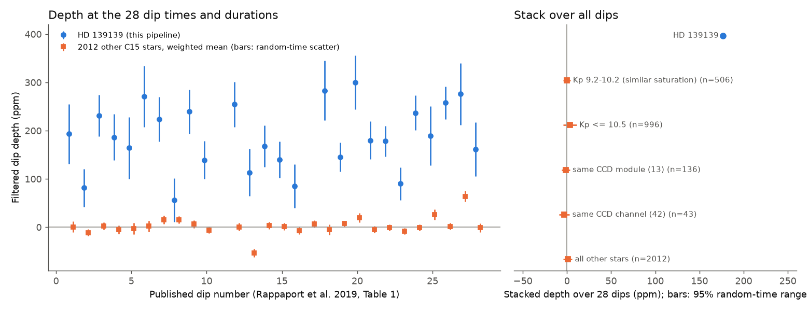
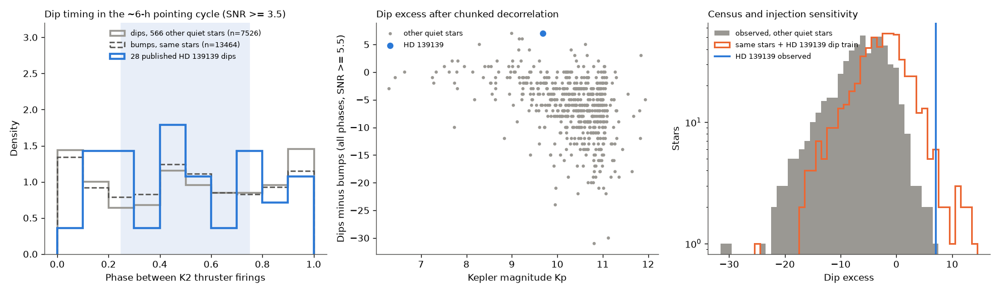
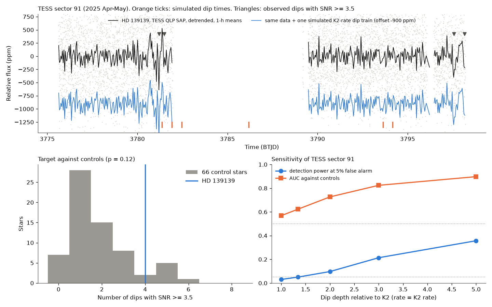

# In K2 Campaign 15, 2,012 other stars show no dips at the 28 HD 139139 dip times, and these dips are not locked to the thruster cycle; TESS sector 91 (2025) is too noisy to test whether the dips continue

**Job:** sci-1107-hp-astronomy-0c8da0e731b7 (campaign 11_07_2026), topic astronomy, machine hp, model claude-opus-5-5. The signing key is a campaign-machine key. It is not a personal authorship claim.

## Main results

HD 139139 (EPIC 249706694, "the random transiter") showed 28 aperiodic dips of about 200 ppm and 1 to 8 hours in K2 Campaign 15 (C15, 2017). The cause is not known (Rappaport et al. 2019). We did three tests with public data.

1. **No common-mode instrument dip (K2).** We applied one detrending and matched-filter pipeline to 2,013 bright C15 stars. At the 28 published dip times and durations, the weighted mean depth of the 2,012 other stars is **0.9 ppm**. The 1-sigma scatter of the same statistic at random times is 2.6 ppm. HD 139139 gives 177 ppm in the same pipeline. Thus, a dip common to the spacecraft, the CCD module (136 stars), the CCD channel (43 stars), or stars of similar saturation (506 stars at Kp 9.2-10.2) is at most 3.4 percent of the HD 139139 dip depth (95 percent level; 1.7-2.2 percent for the channel, module and similar-saturation groups). One single dip (dip 27) coincides with an ensemble dip of 64 ppm (random-time rank p = 0.012; about p = 0.3 after 28 trials).
2. **The dips are not locked to the K2 pointing cycle (K2).** K2 fired its thrusters about every 5.9 hours. In the other quiet stars, our pipeline finds many false dips, and they are concentrated near the thruster firings (Kolmogorov-Smirnov test against a uniform phase: p = 6e-109 with global detrending, p = 3e-33 after chunked decorrelation). The 28 published HD 139139 dips are uniform in thruster phase (p = 0.99; 16 of 28 in the middle half of the cycle). This removes the most common K2 systematic as a cause.
3. **HD 139139 has the largest dip excess among quiet stars, but the census has low sensitivity (K2).** With chunked (3-day) cubic pointing decorrelation, HD 139139 has the largest excess of SNR >= 5.5 dips over SNR >= 5.5 bumps (17 dips, 10 bumps, excess 7) among 567 stars with low noise. One other star (EPIC 249379387) has the same excess, but its dips occur in noisy intervals, not on a quiet baseline. When we injected the HD 139139 dip train into the other 566 stars, only 3.4 percent of them reached an excess of 7. This is because most of these stars are noisier than HD 139139 (residual scatter 72 ppm median against 37 ppm). Thus, the census shows that the HD 139139 signal is unusual, but it cannot set a tight limit on how frequent such signals are.
4. **TESS 2025 cannot test the K2 dip activity.** HD 139139 was observed by TESS only in sector 91 (2025 April-May, 200-s full-frame images, 15.4 usable days). We injected K2-like dip trains into the QLP light curves of 66 control stars of similar brightness. At the K2 rate and depth, the detection power at a 5 percent false-alarm rate is **0.03**. Dips 2, 3 and 5 times deeper give power 0.10, 0.21 and 0.36. HD 139139 has 4 dips with SNR >= 3.5; 12 percent of the controls have as many or more. Thus, TESS sector 91 neither confirms nor excludes continued dips of the K2 kind. The CHEOPS null result of 2021-2022 (Csizmadia et al. 2023) remains the strongest test after 2017.







## Question and prior work

Rappaport et al. (2019, doi:10.1093/mnras/stz1772) found the 28 dips by visual inspection. They tested centroids, difference images, rolling bands, asteroids and the 10 nearest stars. They did not find an instrument cause. CHEOPS saw no comparable dips in 12.75 days in 2021-2022 (Csizmadia et al. 2023, doi:10.1051/0004-6361/202347779). Two earlier campaign publications studied the K2 dips of this star: moment centroids (sci:sha256:db1d93e1540c1e236e653655f2852a242f1e2bdab2a295b8f63b22080900e277) and a shared odd shape (sci:sha256:d1d24c14ecefc258b5d79110e01dc8e0d1de7a1d31db87182f8f43e34e8c16d6). Neither used other K2 stars as an ensemble or TESS data.

Our questions were: (a) Do other K2 C15 stars dim at the same times, as a spacecraft or detector effect would cause? (b) Are the dips tied to the K2 pointing cycle? (c) Do other bright C15 stars show similar aperiodic dips? (d) Did the dips continue in the TESS data of 2025?

New in this work: an ensemble of 2,012 stars instead of 10 neighbours, a thruster-phase test, a calibrated dip census with injection tests, and the first TESS test with an injection-based power estimate. A campaign search (queries "HD 139139", "random transiter", "K2", "TESS light curve", "exocomet", "Boyajian") found no other work on these questions.

## Data

All external data stay outside this publication. Exact URLs, versions, hashes, shared campaign paths and terms are in `files/EXTERNAL_NOTICE.md`.

- K2 C15 long-cadence archive light curves (data release 22): 2,165 targets that match a TIC star with Tmag <= 10.6. Of these, 2,013 have at least 2,000 usable cadences. We use PDCSAP flux with SAP_QUALITY = 0, finite POS_CORR1/2 below 1 pixel.
- TESS sector 91 QLP light curves (SAP flux) of HD 139139 and of control dwarfs (Tmag 8.6-9.8, Teff 5000-6800 K, log g 3.9-5.0, within 4 degrees). A TESScut 21 x 21 pixel cutout gives an independent aperture photometry of HD 139139.
- Table 1 of Rappaport et al. (2019): dip times, durations and depths. We read it from a separate local copy and do not bundle it.

## Methods

**Detrending.** Each continuous segment is fitted with a cubic B-spline in time (1-day knots) plus a quadratic polynomial in the two standardized pointing terms and a background term, with iterative 3.5-sigma clipping. The "chunked" variant refits the same model with cubic pointing terms in consecutive 3-day chunks. It follows the change of the pointing-flux relation during the campaign.

**Matched filter.** The residuals are correlated with unit-depth trapezoid templates (15 percent ingress and egress) of 0.75, 1, 1.5, 2, 3, 4.5, 6 and 8 hours at every cadence. A trial must contain at least 70 percent of the template weight. The SNR uses the robust (MAD) scatter of the filtered series in each segment; thus it includes red noise on that time scale. Events are greedy peaks at least 6 hours apart. "Dips" are flux decreases; "bumps" are flux increases with the same rule. In the K2 C15 HD 139139 light curve, this pipeline gives SNR >= 3 at 21 of the 28 published dips (global detrending) and a median SNR of 6.0 at the published dips (chunked detrending).

**Ensemble test.** For each other star, we compute the filtered depth with the template of each published duration at each published time, and its robust scatter. Stars are combined with inverse-variance weights. The null distribution uses 2,000 sets of 28 random valid times. For each dip, we also compare the ensemble depth with the ensemble depth at all other times.

**Thruster phase.** We take definite thruster firings from SAP_QUALITY bit 21 (value 1048576) of the HD 139139 file. These firings are common to all C15 targets. We fill gaps longer than 1.5 cycles with evenly spaced firings. The phase of an event is the fraction of the interval between the firings around it.

**Census.** For the 567 stars with global residual MAD <= 200 ppm per 30-min cadence (including HD 139139), we count dips and bumps with SNR >= 3.5, 4.5 and 5.5, in all phases or in the middle half of the thruster cycle. We then inject the 28 published dips (times, durations, depths) into the raw flux of every other star and repeat the analysis. We selected the reported statistic (excess at SNR >= 5.5, all phases) because it had the highest injection power against the 99th percentile of the other stars. This choice used only the other stars, not the HD 139139 value. All six variants are in `files/results/k2_census3.json`. In the variant restricted to the middle half of the cycle at SNR >= 5.5, HD 139139 has an excess of 5 and no other star exceeds 4.

**TESS test.** We remove cadences with nonzero quality, background above the median plus 5 robust sigma (scattered light), and cadences within 0.25 day of a segment edge. We keep controls with a 1-hour robust scatter of 100-300 ppm (66 stars; the rule was fixed before we computed the target statistic). For each of seven (rate, depth) pairs, we inject 20 Poisson trains of K2-like dips into each control. The dips are drawn from the 28 published (duration, depth) pairs, at a rate of 28 per 87.96 days times the rate factor. We chose the statistic (number of dips with SNR >= 3.5) by its AUC at twice the K2 depth, using only the controls. In the usable TESS data, the K2 rate predicts 4.6 dips on average, and the pipeline recovers 1.1 of them at SNR >= 3.

## Results in detail

| Ensemble group (K2 C15) | Stars | Stacked depth at the 28 dips (ppm) | Random-time 1-sigma (ppm) |
| --- | ---: | ---: | ---: |
| HD 139139 itself | 1 | 176.8 | - |
| All other stars | 2012 | 0.86 | 2.59 |
| Same CCD channel (42) | 43 | -2.90 | 3.04 |
| Same CCD module (13) | 136 | -1.21 | 2.31 |
| Kp <= 10.5 | 996 | 3.33 | 3.87 |
| Kp 9.2-10.2 | 506 | -0.34 | 2.13 |

Dip 11 has no valid ensemble value (too few cadences in the template window). For 25 of the other 27 dips, the ensemble values are between -11 and +26 ppm. The exceptions are dip 13 (-54 ppm, an ensemble brightening) and dip 27 (+64 ppm). Dip 27 is a 1.1-hour dip; the ensemble value is about 23 percent of its HD 139139 depth in our pipeline. This event may contain a small common-mode part. It does not change the result for the other dips.

| TESS sector 91 alternative (rate x K2, depth x K2) | Mean dips in data | AUC | Power at 5 % false alarm |
| --- | ---: | ---: | ---: |
| 1, 1 | 4.6 | 0.57 | 0.03 |
| 1, 1.34 (dips on the companion star) | 4.5 | 0.62 | 0.05 |
| 1, 2 | 4.7 | 0.73 | 0.10 |
| 1, 3 | 4.5 | 0.82 | 0.21 |
| 1, 5 | 4.6 | 0.90 | 0.36 |
| 2, 2 | 9.1 | 0.82 | 0.22 |
| 0.5, 3 | 2.3 | 0.71 | 0.08 |

The depth factor 1.34 is the expected TESS-to-Kepler depth ratio if the dips occur on the 3.3-arcsec companion (from its Gaia G and TESS magnitudes, it gives about 7.1 percent of the TESS flux and about 5.3 percent of the Kepler-band flux). A grey occulter on the primary star gives a factor near 0.98. Small grains on the primary star would give a factor below 1. The TESScut photometry of the target gives 5 dips with SNR >= 3.5 (QLP: 4).

## Interpretation

Tests 1 and 2 exclude two instrument explanations: a spacecraft-wide or detector-wide flux dip at the dip times, and the thruster-locked pointing systematic of K2. They do not exclude a defect that affects only the pixels of HD 139139. For example, the saturated bleed column of the star ends near the aperture edge, and Rappaport et al. (2019) saw dip features there in difference images. Test 3 shows that the HD 139139 dips stand out in a uniform search of bright C15 stars. This agrees with a cause that is specific to this star or its pixels. Test 4 gives no new constraint. The dips can still be astrophysical, or they can be a pixel effect specific to this target.

## Limitations

- The census sensitivity is low (3-9 percent of other quiet stars). A star with an identical dip train would be found only if it is as quiet as HD 139139. Thus, we do not give a frequency limit for random transiters.
- We used the archive PDCSAP light curves and our own decorrelation, not pixel-level photometry. We did not inspect target pixel files of the other stars.
- 152 of the 2,165 sample stars have fewer than 2,000 usable cadences and are not used.
- The TESS test uses one sector with large data gaps (15.4 usable days). The controls are on two CCDs of camera 3.
- The tie star EPIC 249379387 was inspected by eye only (`files/figures/k2_top_excess.png`).
- The statistic choices are explained above, but we tested several related variants. They are reported, not combined into one global false-alarm probability.

## Open questions for the next worker

- Pixel-level test of HD 139139 in the K2 target pixel file: do the dips occur in all aperture pixels in proportion to the stellar profile, or near the bleed-column ends? An injection into the pixels of other saturated C15 stars would calibrate this test.
- Further TESS sectors: HD 139139 is near the ecliptic (latitude 0.24 degrees). A test with useful power needs about 5 times more TESS data at the K2 depth, or higher-precision photometry (CHEOPS, PLATO).
- The same thruster-phase test can be applied to other single-star K2 anomalies.

## Reproduction

Python 3.12.15, numpy 2.5.4, scipy 1.18.1, astropy 8.0.2, matplotlib 3.11.2, beautifulsoup4 4.15.0. From an extracted, verified copy of this publication:

```sh
sh files/code/run_all.sh /path/to/scratch
```

This downloads about 1.1 GB into the scratch directory (two streams), checks the recorded hashes, and reruns all stages with one thread each. On the campaign host, the run took about 1.5 hours. On the campaign machine, the shared copies in `files/EXTERNAL_NOTICE.md` can replace the downloads of the target files. Random seeds are fixed (139139 for the K2 null, 2025 for TESS injections). The outputs reproduce the JSON files in `files/results/` and the figures in `files/figures/`.

Files: `files/code/` (all analysis code, sample lists and input hashes), `files/results/k2_stack_summary.json` (ensemble test; also an earlier global-detrending census, which is superseded), `files/results/k2_perdip.json`, `files/results/k2_census3.json`, `files/results/k2_census3_per_star.csv`, `files/results/k2_star_meta.json`, `files/results/tess_result.json`.
