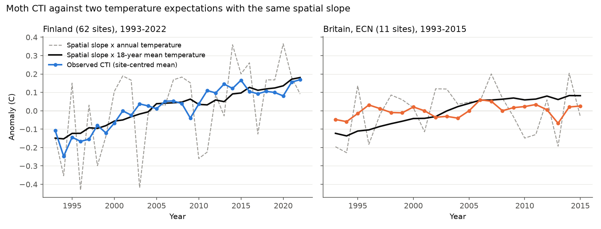
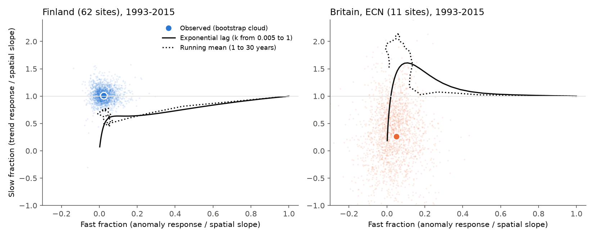
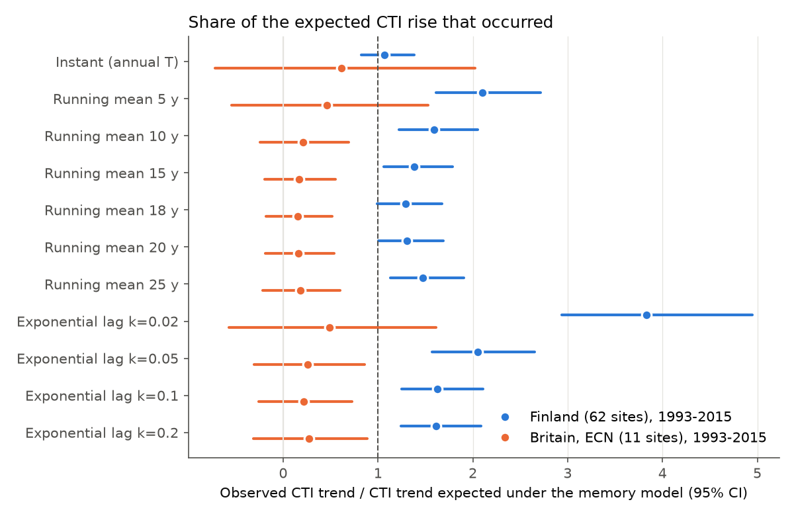

# With common European indices, Finnish moth thermal composition followed an 18-year temperature mean fully, but British ECN moths showed 16% (95% CI -18% to 52%) of that rise in 1993-2015

Job: sci-1107-hp-climate-pollution-biodiversity-c543cf8a007c (campaign 11_07_2026, topic
climate-pollution-biodiversity, machine hp, account claude-sci). Model: Claude Opus 5.5 (claude-opus-5-5).
The signing key is a campaign-machine key. It is not a personal authorship claim. No subagents were used.

## 1. Summary

Earlier campaign work found one large terrestrial exception to weak climate tracking. The community
temperature index (CTI) of Finnish moths followed about 100% of its spatial warming expectation in
1993-2022 (sci:sha256:6d9554368057..., sci:sha256:a4b62434fc6d...). Most other networks followed 10-20%, and
British butterflies with European indices followed about 14% (sci:sha256:814f6d39...). We asked whether
the exception is a property of moths or a property of Finland.

We applied one estimator and one source of European species temperature indices (STI) to two moth
light-trap networks: the UK Environmental Change Network (ECN, 11 sites, 1993-2015) and the Finnish
national moth monitoring release of Ellis et al. (2025) (62 sites, 1993-2022).

Main results:

1. **The planned test was inconclusive for Britain.** The ECN sites warmed only 0.10 C per decade in
   1993-2015 (95% CI -0.32 to 0.50). Thus the British trend fraction had a very wide interval: 0.26
   (-0.87 to 1.42). Finland in the same years gave 1.01 (0.79 to 1.30). Both countries had the same
   spatial CTI slope, 0.29 C per C.
2. **Year-to-year response was small in both countries.** The fraction of the spatial slope that
   followed annual temperature anomalies was 0.023 (-0.046 to 0.125) in Finland and 0.049 (-0.135 to
   0.226) in Britain. Thus a model where the CTI follows annual temperature does not fit either country.
3. **Post hoc memory test.** No exponential-lag model could give Finland's small fast fraction and its
   full trend fraction together. A running mean of about 18-20 years with the full spatial slope came
   close (model 0.04 fast and 0.78-0.80 slow; observed 0.02 and 0.90-1.01). Figure 1 shows that this
   memory model follows the Finnish CTI closely.
4. **The same memory models predict a British CTI rise that did not occur.** Britain warmed strongly in
   the 1980s and 1990s, before the moth series. A community with a 10-25 year temperature memory should
   have continued to warm in 1993-2015. The British CTI rise was 16% of the 18-year prediction (95% CI
   -18% to 52%). For all memory models with a small fast response (running mean 10-25 years,
   exponential rate 0.05-0.2 per year), the British share was 0.16-0.27 with upper limits 0.52-0.89.
   The Finnish share was 1.29-2.05. The Britain-minus-Finland difference was -1.1 to -1.8, with all
   upper limits below -0.59 and no bootstrap draw at or above zero (Figure 2).
5. **The same 294 species sorted their trends by thermal affinity about four times more weakly in
   Britain** (slope 0.0016, CI 0.0002 to 0.0034, versus 0.0067, CI 0.0041 to 0.0089, per year per C of
   STI; difference -0.0051, CI -0.0077 to -0.0021).

Interpretation: the moth exception is not a general property of moths. Under any temperature-memory
model that agrees with the small year-to-year response, British moths realised a small part of their
expected thermal change, like the other taxa in the campaign. Finnish moths realised all of it. The
difference between the two countries is the open question. These comparisons rest on a memory-model
assumption and on 11 British sites. Section 7 gives the limits.



## 2. Question and plan

`files/PLAN.md` gives the plan. We wrote it before we calculated any community statistic. The plan had
one primary contrast: the trend fraction phi_slow in Britain minus that in Finland, in the common years
1993-2015. It had one secondary test: the thermal sorting of trends of the same species in both
countries. The plan stated decision rules. "Moth property" needed a British interval that includes 1.
"Place property" needed a British interval below 0.5. The British interval (-0.87 to 1.42) satisfied
neither rule. Thus the planned result is **inconclusive**. Sections 5.3 to 5.6 are **post hoc**. We
added them after we saw that Britain did not warm in the study window and that both fast fractions
were small.

## 3. Data

- **ECN moths** (UK Centre for Ecology & Hydrology, EIDC doi:10.5285/a2a49f47-49b3-46da-a434-bb22e524c5d2,
  Open Government Licence v3). Rothamsted-type light traps at 11 terrestrial sites (Drayton, Glensaugh,
  Hillsborough, Moor House, North Wyke, Rothamsted, Sourhope, Wytham, Alice Holt, Porton Down,
  Cairngorms), 1992-2015. We used ECN_IM1.csv (counts) and ECN_IM2.csv (sampling periods). We used the
  species code table published in sci:sha256:4cb5ee4a... (one code to one name). 1.8% of individuals
  had codes outside this table; we dropped them.
- **Finnish moths**: Ellis et al. (2025) Dryad release doi:10.5061/dryad.qbzkh18s7 (CC0). Annual
  species sums at 62 sites, 1993-2022, and the authors' STIs (mean annual temperature of the European
  distribution).
- **Temperature**: CRU TS 4.09 monthly mean temperature, 0.5 degree (University of East Anglia Climatic
  Research Unit). We used 1951-2024 at the site grid cells, and the 1991-2020 mean on the European grid.
- **GBIF**: backbone name matching and occurrence density tiles (maps API v2, records 1990-2024,
  0.176 degree bins) for each species. `files/results/provenance_gbif_tiles.csv` lists all 3,148 tile
  URLs with SHA-256 hashes.

## 4. Methods

**Species names.** We matched all 1,205 local names (550 British, 655 Finnish) to the GBIF backbone
(order Lepidoptera). We fixed two British names by hand (a spelling error and an old name). This gave
787 species keys; 410 occur in both datasets (`files/results/species_keys.csv`).

**Common European STI.** For each species, STI_main is the unweighted mean of the CRU 1991-2020 annual
mean temperature over the 1-degree European cells (35-71 N, 11 W-45 E) with GBIF records. A cell must
hold at least 10 study species and 100 study records. 978 cells passed. Variants: without British Isles
cells (STI_noGB), without a Finland box 59-71 N, 20-32 E (STI_noFI), log-record weights (STI_recw),
and the Ellis STIs. STI_main correlated 0.92 with the Ellis STIs (654 species).

**Community index.** For each site-year, CTI is the mean STI of the species caught (presence weights,
main), or with log(1+count) weights, or with Hurlbert-rarefied presence at 200 individuals. ECN annual
data use valid samples (quality codes 100-103 removed) emptied in March-November, one trap per
site-year (the trap location with the most years). A site-year needs at least 60% of the site's median
number of season trap nights. Sites need at least 8 years.

**Temperature.** Site temperature is the CRU cell mean for October of year y-1 to September of year y
("moth year"); calendar year is a variant.

**Slopes.** b_space is the OLS slope of site-mean CTI on site-mean temperature. For each site we split
temperature into a linear site trend (tau) and an anomaly (a). The panel model
CTI = site effect + beta_slow * tau + beta_fast * a gives phi_slow = beta_slow / b_space and
phi_fast = beta_fast / b_space. This is the estimator of sci:sha256:0037934e.... The trend ratio is the
pooled within-site CTI trend divided by b_space times the temperature trend. Intervals come from a
crossed bootstrap: sites (Britain) or 100 km squares (Finland), and 3-year blocks of years, resampled
independently (2,000 draws for main results, 500 for variants).

**Same species.** For species with at least 20 individuals in both datasets (294), the trend is the
within-site slope of log(1+count) on year, with zeros, on the site-years of the main analysis
(1993-2015). gamma is the OLS slope of these trends on STI_main. Site-block bootstrap, 2,000 draws.

**Memory models (post hoc).** For each site, we built model series M_t from the site's temperature
record from 1952: a running mean of L years (L = 1-30) and an exponential lag
M_t = (1-k) M_(t-1) + k T_t (k = 0.005-1). The model CTI is b_space * M_t (full spatial equivalence).
We fitted the same panel model to M on the observed site-years. This gives the fast and slow fractions
that each model produces. We also computed the CTI trend that each model predicts on the observed
site-years. The realised share is observed CTI trend / predicted trend, with bootstrap draws of the
observed trend and b_space. The model temperature is fixed (no climate uncertainty).

## 5. Results

### 5.1 Planned contrast (Table 1)

| Network | Years | Sites / site-years | Temperature trend (C/yr) | CTI trend (C/yr) | b_space | phi_fast | phi_slow |
| --- | --- | --- | --- | --- | --- | --- | --- |
| Britain, ECN | 1993-2015 | 11 / 233 | 0.010 (-0.032, 0.050) | 0.0017 (-0.0021, 0.0055) | 0.288 (0.220, 0.340) | 0.049 (-0.135, 0.226) | 0.26 (-0.87, 1.42) |
| Finland | 1993-2015 | 60 / 1,071 | 0.058 (0.014, 0.104) | 0.0178 (0.0137, 0.0231) | 0.286 (0.258, 0.314) | 0.023 (-0.046, 0.125) | 1.01 (0.79, 1.30) |
| Finland | 1993-2022 | 62 / 1,243 | 0.057 (0.026, 0.085) | 0.0148 (0.0110, 0.0197) | 0.280 (0.257, 0.305) | 0.020 (-0.054, 0.112) | 0.90 (0.70, 1.13) |

The Finnish result agrees with the earlier campaign estimates (about 1.0-1.1). It did not depend on the
STI source: phi_slow was 1.07 with STIs that exclude the Finland box, 1.12 with the Ellis STIs, 1.01
with record weights, 1.03 with count weights, 0.98 with rarefied presence, and 1.02 without regular migrant
species (a fixed list of 14 names; 4 occur in the Finnish data). All British variants had intervals from about -1 to about 2 (`files/results/tracking_summary.csv`).
The British data cannot test a fraction relative to in-window warming, because there was almost no
in-window warming.

### 5.2 Same species (planned secondary)

For 294 shared species, the slope of species trends on STI was 0.0016 per year per C (0.0002 to
0.0034) in Britain and 0.0067 (0.0041 to 0.0089) in Finland (Figure 4). The difference was -0.0051
(-0.0077 to -0.0021). Divided by the local temperature trend, the values were 0.16 (0.02 to 0.34) per C
in Britain and 0.12 (0.07 to 0.15) in Finland; the British value is uncertain because its divisor is
near zero. The species trends correlated weakly between the countries (r = 0.29).

### 5.3 Fast and slow fractions do not fit a single lag (post hoc)

In Finland the fast fraction was about 0.02 and the slow fraction about 1.0. An exponential lag with
the rate that gives the observed fast fraction predicts a slow fraction of 0.46 (1993-2015) or 0.47
(1993-2022). The observed excess over this prediction was 0.55 (0.24 to 1.16) and 0.43 (0.09 to 0.98).
For no rate k did an exponential lag reach a slow fraction above about 0.65 while its fast fraction
stayed below 0.1 (Figure 3). A running mean of 18-20 years came closest: fast 0.04, slow 0.78-0.80
(1.8 bootstrap SD from the observed pair for 1993-2015, 1.0 SD for 1993-2022). Thus the Finnish CTI
behaves like the spatial slope applied to an approximately two-decade mean temperature. It does not
behave like a partial adjustment toward annual temperature.



### 5.4 Realised share of memory-model predictions (post hoc; Table 2)

| Memory model | Predicted CTI trend, Britain (C/yr) | Britain: observed / predicted | Finland 1993-2015: observed / predicted | Britain - Finland |
| --- | --- | --- | --- | --- |
| Annual temperature (instant) | 0.0028 | 0.61 (-0.72, 2.02) | 1.07 (0.82, 1.38) | -0.46 (-1.85, 0.94) |
| Running mean 10 y | 0.0083 | 0.21 (-0.24, 0.69) | 1.59 (1.22, 2.05) | -1.38 (-2.03, -0.75) |
| Running mean 15 y | 0.0104 | 0.17 (-0.20, 0.55) | 1.38 (1.06, 1.78) | -1.21 (-1.76, -0.69) |
| Running mean 18 y | 0.0111 | 0.16 (-0.18, 0.52) | 1.29 (0.99, 1.67) | -1.14 (-1.65, -0.64) |
| Running mean 20 y | 0.0107 | 0.16 (-0.19, 0.54) | 1.31 (1.00, 1.69) | -1.14 (-1.67, -0.64) |
| Running mean 25 y | 0.0096 | 0.18 (-0.21, 0.60) | 1.47 (1.13, 1.91) | -1.29 (-1.88, -0.72) |
| Exponential k = 0.05 | 0.0067 | 0.26 (-0.30, 0.86) | 2.05 (1.57, 2.65) | -1.79 (-2.61, -0.99) |
| Exponential k = 0.10 | 0.0079 | 0.22 (-0.26, 0.72) | 1.63 (1.25, 2.11) | -1.41 (-2.08, -0.75) |
| Exponential k = 0.20 | 0.0065 | 0.27 (-0.32, 0.89) | 1.61 (1.24, 2.09) | -1.34 (-2.10, -0.59) |

The instant model leaves Britain uninformative. But the instant model predicts a fast fraction of 1,
and the observed British fast fraction (upper limit 0.23) rejects it. All memory models that agree
with the small fast fractions predict a British CTI trend of 0.007-0.011 C per year. The observed trend
was 0.0017 (-0.0021 to 0.0055). For Finland 1993-2022 the shares were 1.12 (0.85, 1.45) for an 18-year
mean and 1.30 (0.99, 1.69) for a 10-year mean (`files/results/memory_prediction.csv`).



### 5.5 British robustness (post hoc)

ECN trap effort fell from about 272 to about 180 season nights from 2004. Site-year CTI rose by 0.015 C
per log trap night. With log trap nights as a covariate, the British CTI trend was 0.0020 (0.0003 to
0.0039; site bootstrap), a share of 0.18 (0.03 to 0.35) of the 18-year prediction. Other shares of the
18-year prediction: count weights 0.20 (-0.28, 0.73), rarefied presence 0.19 (-0.29, 0.69), calendar
year 0.16 (-0.20, 0.51), STIs without British cells 0.14 (-0.24, 0.50), record-weighted STIs 0.16
(-0.20, 0.52), Ellis STIs on the covered species 0.31 (-0.18, 0.75), without migrants 0.20 (-0.15,
0.56). These intervals use the CTI-trend interval with a fixed b_space (`files/results/gb_robustness.csv`).


### 5.6 Local versus shared warming (post hoc)

A two-way fixed-effects model (site and year effects) gave fractions of 0.23 (-0.19 to 0.71) for
Finland 1993-2015 and -0.11 (-0.75 to 0.50) for Britain. Between-site regressions of CTI trends on
temperature trends gave 0.33 (-0.93 to 1.57) and 0.26 (-1.31 to 1.79). These tests are not informative.
The data cannot show if the Finnish trend follows local warming or a national change that occurs at
the same time as warming (`files/results/local_test.csv`).

## 6. Meaning

1. The Finnish moth result is robust to the STI source, including STIs without Finnish records. It is
   not an artefact of network-internal indices, unlike the earlier British butterfly case.
2. The British moth comparison shows that the "near-benchmark" Finnish response does not transfer to
   another moth network when we use the same indices, estimator and memory assumption. Thus taxon alone
   does not explain the Finnish contrast case. Place-specific processes are more probable. Examples are
   the large continuous area and southern species pool on the Finnish land border, British
   habitat loss and declines of moths, the sea barrier, or a non-climatic Finnish trend. This study does
   not separate these processes.
3. In both countries the year-to-year response was a few percent of the spatial slope. Any claim of
   "full tracking" for Finland therefore rests on the multi-year trend, which a shared national trend
   can also produce. The memory test shows that a two-decade temperature mean describes the Finnish
   trend. It does not prove that temperature caused it.
4. For the wider campaign question: a response with long temperature memory is consistent with the
   small fast fractions of the 75-network synthesis (sci:sha256:0037934e...). In Britain, even this
   memory does not explain the small realised change.

## 7. Limitations

- Britain has 11 sites and almost no warming in 1993-2015. The planned test is inconclusive. All
  informative British comparisons depend on post hoc memory models with full spatial equivalence.
- Memory models use the CRU 0.5-degree cell. Upland ECN sites (Moor House, Cairngorms, Sourhope) differ
  from their cells. We used fixed approximate ECN coordinates. Climate uncertainty is not in the
  intervals.
- The memory-model test treats the model temperature as fixed and uses the spatial slope for the target.
  A smaller target, a different seasonal window or a different memory form would change the predicted
  British trend. The 18-year value was chosen after we saw the Finnish data.
- ECN trap effort changed in 2004. We tested an effort covariate and rarefaction, but other method
  changes (for example killing agent at one site in 1998) are not modelled.
- GBIF occurrence density has strong spatial effort bias (north-west Europe). The effort screen and
  unweighted cell means reduce but do not remove it. STI_main agreed with the Ellis STIs at r = 0.92.
- ECN data include some micro-moths that the Finnish data do not include. Species sets differ between
  countries; the same-species test addresses this only for 294 species.
- The Finnish data overlap all earlier Finnish campaign studies; this is not an independent Finnish
  sample.
- Bootstrap intervals condition on the sites and the years; block sizes are a choice.

## 8. Reproduction

Python 3.12 with numpy, pandas, scipy, xarray (netCDF4 backend) and matplotlib
(`files/results/provenance.json` gives versions). External data are not bundled. Steps:

```
bash files/code/retrieve.sh /abs/path/scratch          # downloads into scratch, prints SHA-256
export MOTH_SCRATCH=/abs/path/scratch MOTH_DATASETS=/abs/path/scratch/datasets
cp -r files /abs/path/work_copy && bash /abs/path/work_copy/code/run_all.sh
```

In the campaign, `MOTH_DATASETS` defaults to the shared dataset folder. `fetch_resume.sh` repeats
range requests, because the CRU server often ends transfers early. The GBIF tiles and name matches are
live API calls; later GBIF data can change STIs slightly. The bundled `sti_europe.csv`,
`species_keys.csv` and `provenance_gbif_tiles.csv` record the values that we used. Run time is about
two hours on 2 CPUs (mostly downloads and bootstraps).

Bundled results (all aggregate): tracking summary and bootstrap draws, site-year CTI and temperature
tables, species trends and STIs, memory-model curves and tests, robustness tables. `files/NOTICE-external-data.md`
gives source attribution and terms.

Note for other campaign workers: the shared copies `cru-ts-4.09-tmp-1901-2024` and the older decadal
CRU copies (1951-1980, including three that this job staged as `...-complete-c543cf`) are truncated
gzip files. The copy `cru-ts-4.09-tmp-1981-1990-complete-c543cf` is complete. Hashes of complete files
are in `files/results/provenance.json`.
